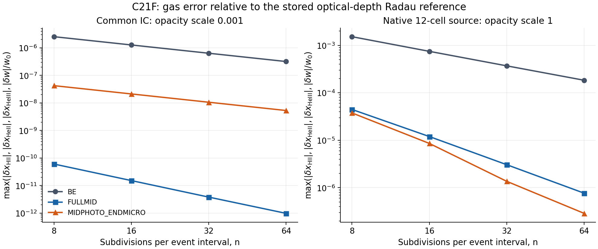
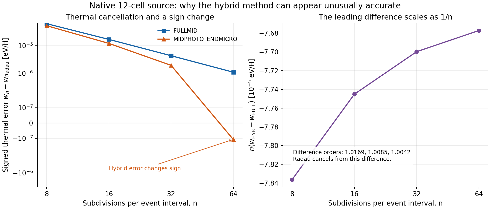

# C21F native NCP 실행 평가와 hybrid 오차 상쇄

평가일: 2026-10-19 UTC. 이 디렉터리는 이미 게시된 C21F 실행을 새로 발견하여 평가한 후속 연구다. 실행 소스는 f8359232df8d0dd4fe91fcdabeb6701eb06089ba, native owner는 rei_bianchi@6ea2b1b4b3875c9163cafc45efe720afded43fc4로 고정한다.

## 1. 현재 결론

**PR82에 native 컴파일과 두 고정 fixture의 NCP 실행이 이미 완료되어 있었다.** 그 실행의 source·fixture·원시 기록을 현재 GitHub에서 읽고, 저장된 결과를 독립적으로 재계산했다. 공개 PreparedAbsorption.evaluate 경로, 두 native 시간 정련 행렬, native point의 내부 물리 수지에 이번 범위의 실패를 발견하지 못했다.

**FULLMID는 두 fixture에서 시간 2차 수렴을 지지한다. Native-source MIDPHOTO_ENDMICRO의 2보다 큰 관측 차수는 thermal 오차 상쇄와 최대오차 성분 전환을 포함한다.** 두 방법을 직접 뺀 값에는 안정적인 1차 성분이 보이며, 아래 local-defect 유도와 일치한다. 후속 fixed-fixture 시간 정련의 기준은 FULLMID로 두고, hybrid는 대조 경로로 유지한다.

이 평가에서 새로 실행한 것은 독립 후처리 분석기, 원시 native-point 감사, 새 분석기 검사 5개와 그림 생성이다. 기존 C21F 구현·복구·게시, 56개 검사, Rust 빌드와 NCP 행렬을 반복하지 않았다. 원래 과학 소스와 역사적 중간 branch는 수정하거나 병합하지 않았다.

게시 및 새 백업의 실제 식별자는 이 디렉터리의 PUBLICATION_RECEIPT.json과 BACKUP_RECEIPT.json을 따른다. 영수증은 해당 외부 작업이 성공한 뒤 추가된다. 원시 증거를 소유한 PR82와 이번 평가를 추가한 별도 draft PR은 구별한다.

## 2. 최신 GitHub와 백업 확인

| 구분 | 현재 직접 확인한 상태 |
|---|---|
| 기존 최종 복구 게시 | [PR81](https://github.com/cosmosapjw-quantum/bass_cr/pull/81), open draft, head 249d9b29b0adc5a8cf615a9999065aff26ff6900 |
| 실행 소스 | f8359232df8d0dd4fe91fcdabeb6701eb06089ba |
| 실행 이후 PR81 변화 | 문서·영수증 5개만 변경한 1개 commit. 실행/테스트/의존성 17개 바이트 동일 |
| 새 실행 증거 | [PR82](https://github.com/cosmosapjw-quantum/bass_cr/pull/82), open draft, head c4a502e0c931a201edfa3c7046f7a91230c2278f |
| PR82 실제 Git tree | af9db874c235a4140d93d02d1cc9320586fce533 |
| PR82 계보 | 실행 f8359232에서 분기. PR81 문서 head와의 계보 비교는 ahead 2 / behind 1, merge base f8359232. GitHub three-dot 비교의 merge base→PR82 변경 목록은 169개 모두 추가 |
| 원시 증거 위치 | research/cr_c21e_event_native_20261018/evidence/C21F_NATIVE_NCP_20261018T1358Z/ |

PR81의 C21F_RELEASE.md, C21F_PUBLICATION_RECEIPT.json, C21F_EXECUTABLE_MANIFEST.json, DAG_C21F.json, CODEX_HANDOFF_KO.md, handoff/NEW_CHAT_C21F_HANDOFF_KO.md를 먼저 읽었다. 과학 ZIP의 제작 당시 NOT_PUBLISHED와 PR81의 native NOT_RUN 표시는 각각 그 당시의 기록이다. 현재 게시 상태는 PR81 영수증, native 완료 상태는 이후 PR82 원시 증거와 이번 평가로 판정한다.

위 169개는 three-dot 비교가 보여 주는 PR82 쪽의 추가분이다. PR81 문서 head와 PR82 head의 두 Git tree가 동일하거나, PR81의 후속 문서 commit이 PR82에 포함되었다는 뜻은 아니다. 두 branch와 각 authority를 원래 계보대로 보존했다.

새 native archive 이름은 C21F_NATIVE_NCP_20261018T1358Z_evidence.tar.gz, 크기는 7,902,411 bytes다. PR82의 기존 readback 영수증에 기록된 archive SHA256은 다음과 같다.

    05bd41fc998c2bda46e7606c07653cd5ab7ea36fa35556c1c480c5ca06384a90

이번에 실제 metadata로 확인한 사본은 [Google Drive](https://drive.google.com/file/d/1sQiP-1RHuCUaQnNkolLGSsmNfVA-0rjo/view)와 Dropbox /C21F_NATIVE_NCP_20261018T1358Z_evidence.tar.gz, ID id:BSpOijBcT10AAAAAAD_NlA다. Dropbox provider content_hash e3b3073f7e4edf1700a943edfab9dd2ed10b0ce262e5a49d408d2b5b93921c08은 ordinary archive SHA256과 다른 정의다.

현재 작업에서 이 압축파일을 새로 받아 전체 archive SHA를 다시 계산하지는 못했다. 이전 PR82의 readback 기록과 이번 metadata 확인을 구별한다. 현재 과학 평가에 사용한 원시 text는 GitHub에서 직접 취득하여 바이트 검증했다. 기존 과학 ZIP과 v2 handoff ZIP의 2026-10-18 총 6사본 검증 기록은 재사용한다.

### Source·fixture·raw identity

원시 디렉터리의 text 167개에 대해 현재 GitHub intake의 길이·SHA256·Git blob SHA1을 확인했다. 그중 166개는 immutable MANIFEST.sha256의 payload다. Manifest에 나열된 전체 168개 중 나머지 2개는 native binary이므로 이번에 새 바이트 검증을 하지 않았다. Manifest 파일 자체는 별도로 Git blob와 intake receipt를 확인했다.

Native binary의 기록 SHA256은 1e7265185960cd91c3c589057b3e29d191d83bce95e59d803a399f9eb234ad40이며, build input과 26개 process metadata에서 일치한다. 이는 기록의 연결 확인이다. Binary를 새로 다운로드하거나 실행한 검증으로 승격하지 않는다.

| Fixture | Canonical content SHA256 | 원래 fixture.json 바이트 SHA256 |
|---|---|---|
| common_ic | befb0c8a7a113ff0efccc450af05b1157592a8d91cc7e994cfdfd2768905cc65 | bcfb3d5a8b4d5c8153247712eb1c3d127c4410e2455f6106bf60720642d0f060 |
| native_source | c562971cf0fcab251fc96b7634f5e7aefab87377652a98be3ba4256a23a9d781 | fb33c66c9d26009ceb4d593b221481c0743320e4c657365971910b8294ef986e |

Canonical digest는 원래 코드가 정의한 JSON 정규화에 대한 값이며, 들여쓰기된 파일의 바이트 hash와 구별한다. 자세한 취득 경로와 범위는 EVIDENCE_INTAKE_KO.md 및 EVIDENCE_INTAKE_RECEIPT.json에 있다.

## 3. 실행 상태와 검증 상태

| 항목 | 근거 | 판정 |
|---|---|---|
| Native Rust bridge 컴파일 | PR82 build 로그, exit 0 | 완료된 실행 증거 채택 |
| Rust bridge tests | PR82 원시 로그 3/3 | 기존 실행 재사용 |
| Python 기존 56 tests | PR82 로그 56/56, 11.21 s | 기존 실행 재사용; inherited 44 + new 12 |
| 두 native 행렬 | 2 fixtures × 3 modes × 4 resolutions = 24 histories, 각 runner exit 0 | 완료된 고정 범위 실행 채택 |
| PreparedAbsorption parity | 각 fixture에 7개 저장 point | 고정 표본 parity 증거 |
| 새 terminal·ledger·step 분석 | 분석기 v3 exit 0, 24 histories + 2 Radau, 2,160 accepted steps | 독립 후처리 완료 |
| 새 native-point 감사 | 26 JSONL, 27,140 요청·응답, 위반 0, exit 0 | 저장 point의 내부 일관성 확인 |
| 새 analyzer 검증 | malformed input·corruption·summary mismatch·sign cancellation·create-only 보호 5개 PASS | 새 후처리 구현 검증 완료 |
| 현재 새 native/NCP launch | 현재 campaign·자원 inventory를 확인하지 못함 | 수행하지 않음 |

56개 전체를 red-first라고 기술하지 않는다. 새 5개 검사에도 사후에 red-first 이력을 붙이지 않는다. 이번 Python runtime은 3.12.14로 실제 실행 가능했고, 원래 native 실행에 쓰인 toolchain과 현재 후처리 환경은 별개다.

Native point 검증은 원래 density, EOS, CI/RR/DR stoichiometry, binding 및 energy tolerance를 그대로 사용했다. 27,140개에서 photo event 3개·photo input energy·expansion work의 5개 출력이 정확히 0이었다. Wrapper source의 소유권 분리와도 일치한다. 독립 감사의 최대 point energy residual은 1.6023737e-31 eV/H/s, 기존 허용 budget 대비 최대 비율은 1.0015320e-5였다. EOS 최대 차이는 7.2759576e-12 K였다.

Native kernel은 실제 호출되었다. 전체 standalone Grackle driver와의 독립 종단간 parity, 원자 rate fit의 외부 정확성, 실제 production EoR 정확도까지 검증한 것은 아니다.

## 4. 물리·수치 계약

두 fixture는 \(a_0=0.09\), \(\Delta\ln a=10^{-4}\), \(T_0=8500\) K,
\[
g_0=(x_{\rm HII},y_{\rm HeII},z_{\rm HeIII},w)
=(0.2,0.15,0.01,1.4229641197648433\ {\rm eV/H}),
\qquad Y=n_{\rm He}/n_{\rm H}=0.08130135170951498
\]
를 공유한다. Common-IC는 opacity scale 0.001, 3에너지 source와 총 9 cohorts다. Native-source는 opacity scale 1, MD14 원래 12-cell centroid source와 총 27 cohorts다. 양쪽 모두 birth 시각은 고정 GL2다. Spectrum과 opacity가 함께 달라 두 fixture 사이 출력 차이를 단일 source 효과로 해석하지 않는다.

\(x=\ln a\), \(q_i=aE_i\)로 두면 active photon cohort는
\[
\frac{d\tau_i}{dx}=\frac{\lambda_i}{H},\qquad
N_i=A_i e^{-\tau_i},\qquad
\lambda_i=\sum_j c\,n_{{\rm H},0}a^{-3}s_\kappa\sigma_j(E_i)\alpha_j(g)
\]
를 따른다. \(\alpha=(1-x_{\rm HII},Y(1-y_{\rm HeII}-z_{\rm HeIII}),Yy_{\rm HeII})\)다. 이는 원 population 연속식의 좌표 변환이다. 원래 population 대조 경로와 \(Y=0\) 구조적 unknown 제거는 유지된다.

Native 비광이온화 RHS가 CI/RR/DR, cooling, CMB exchange를 담당하고, 외부 event coupling이 photo와 geometry를 담당한다. Binding energy는 원래 값 (13.598434599702, 24.587389011, 54.41776) eV, cross-section fit cutoff는 (13.60, 24.59, 54.42) eV로 서로의 역할을 보존한다.

Native-source reference의 \(\tau_{\max}=81.3554849707788\), 최소 양의 survivor는 \(6.514631281313118\times10^{-38}/{\rm H}\)다. 두 reference의 underflow count는 0이다. Log-survivor와 photon stock의 대응도 재계산했다. 이 관측을 임의의 optical depth에서 underflow가 없다는 명제로 확장하지 않는다.

### 수지 재계산

다음은 새 분석기가 terminal stock과 누적 ledger에서 다시 계산한 12 histories별 최대 절대 잔차다.

| 독립 재계산량 | common_ic | native_source |
|---|---:|---:|
| Photon number defect /H | 6.63261e-17 | 1.68322e-17 |
| Energy defect eV/H | 3.70271e-13 | 9.59174e-14 |
| Species **stock** defect /total H | 1.33682e-14 | 3.11903e-15 |
| Accepted Newton normalized residual | 5.42186e-15 | 2.35924e-14 |

원래 Newton 기준 2e-13을 그대로 적용했다. 원시 로그의 species fraction residual과 이 표의 helium stock residual은 \(Y\) 변환을 구별한다. 합산 순서 차이로 원시 기록과 재계산의 마지막 몇 bit가 달라지는 것은 JSON에 그대로 남겼다.

Photon 재고, source impulse, binding 변화, photon redshift work, gas expansion work, escaped energy, CMB exchange를 함께 포함한다. 이 수지는 bookkeeping consistency의 잔차이며, 궤적의 절대 오차 상한이 아니다.

Accepted-step 파일에 개별 cohort vector와 모든 nonphoto energy ledger가 저장되어 있지는 않다. 각 step에서는 gas domain·aggregate photon stock·시간 연결·저장 Newton residual vector의 normalization·photo ledger 및 photon 수지를 확인했고, cohort positivity는 terminal vector에서 확인했다. 개별 step의 equation residual 전체와 full energy budget을 재구성했다는 주장은 하지 않는다. 전체 energy 수지는 terminal stock과 누적 ledger로 독립 계산했다. Native-point 로그에 저장된 내부 trial 호출은 별도 point 감사 범위다.

## 5. 시간 수렴과 상쇄의 관측 증거

각 event interval을 \(n=8,16,32,64\) 등분한다. 이번 두 fixture는 각각 세 event interval이므로 한 history는 각각 24, 48, 96, 192 accepted steps다. 아래 오차는 저장된 Radau와의 차이다.

\[
\epsilon_n=\max\left(|\delta x_{\rm HII}|,|\delta y_{\rm HeII}|,
|\delta z_{\rm HeIII}|,|\delta w|/w_0\right),\qquad
p=\log_2(\epsilon_n/\epsilon_{2n}).
\]

| Fixture·방법 | \(\epsilon_{64}\) | 관측 \(p\): 8→16, 16→32, 32→64 |
|---|---:|---|
| common_ic BE | 3.1801392e-7 | 0.997572, 0.998784, 0.999391 |
| common_ic FULLMID | 9.7792595e-13 | 1.995165, 1.992416, 1.961803 |
| common_ic MIDPHOTO_ENDMICRO | 5.2968656e-9 | 0.999008, 0.999510, 0.999777 |
| native_source BE | 1.8369186e-4 | 1.025830, 1.015109, 1.008191 |
| native_source FULLMID | 7.6745649e-7 | 1.896310, 1.970812, 1.992460 |
| native_source MIDPHOTO_ENDMICRO | 2.8810766e-7 | 2.136570, 2.652475, 2.241934 |

Native-source의 signed thermal error와 두 방법의 직접 차이는 다음과 같다.

| \(n\) | Hybrid−Radau [eV/H] | FULLMID−Radau [eV/H] | \(d_n=\)Hybrid−FULLMID [eV/H] | \(n d_n\) [eV/H] |
|---:|---:|---:|---:|---:|
| 8 | +5.36147472e-5 | +6.34099823e-5 | −9.79523513e-6 | −7.83618810e-5 |
| 16 | +1.21930601e-5 | +1.70337932e-5 | −4.84073318e-6 | −7.74517308e-5 |
| 32 | +1.93927004e-6 | +4.34548189e-6 | −2.40621185e-6 | −7.69987791e-5 |
| 64 | −1.07519240e-7 | +1.09206305e-6 | −1.19958229e-6 | −7.67732667e-5 |

\(d_n\)에서는 Radau가 정확히 소거된다. 그 관측 차수는 1.016855, 1.008462, 1.004232로 이번 정련에서 1에 가까워진다. \(n d_n\)의 음의 값도 해상도 사이 변화가 줄어든다. FULLMID의 양의 2차 thermal 오차와 hybrid의 음의 1차 기여가 이 구간에서 상쇄된다. \(n=64\)에서는 hybrid thermal error가 부호를 바꾸고, normalized maximum을 결정하는 성분도 thermal에서 HeII로 전환된다.

Common-IC의 같은 직접 차분 차수는 1.000034, 1.000024, 1.000029다. FULLMID의 3수준 reference-free thermal self-convergence는 common_ic에서 1.996087, 2.002840, native_source에서 1.869884, 1.963472다.

진단용 \(A/n+B/n^2\) fit 결과도 보존했지만 미래 오차나 zero crossing의 근거로 사용하지 않는다. 특히 native hybrid−Radau의 네 수준 fit은 \(n=64\) 부호를 틀리게 재현하고 관측 부호전환 32–64 밖의 crossing을 제시하므로 INADEQUATE_FOR_CROSSING_PREDICTION으로 표시했다. 미실행 128/256/512의 fit 값은 실제 실행 결과가 아니다.

## 6. 왜 hybrid에 1차 항이 생기는가

한 smooth reaction cell에서 proper time step을 \(h\), 상태를 \(z=(N,g)\), photo RHS를 \(P(z)\), 비광이온화 gas RHS를 \(M(g)\)라 하자.
\[
\dot z=F(z)=P(z)+(0,M(g)).
\]
두 방법은 photo absorber를 \(\bar g=(g_0+g_1)/2\)에서 계산하고 exponential depletion을 사용한다. Exponential의 depletion와 gas feedback을 함께 전개하면
\[
\Delta z_{\rm photo}=hP(z_0)+\frac{h^2}{2}DP(z_0)F(z_0)+O(h^3).
\]
FULLMID의 \(hM(\bar g)\)는 \(hM(g_0)+\frac{h^2}{2}D_gM(g_0)[P_g(z_0)+M(g_0)]+O(h^3)\)이고, hybrid의 \(hM(g_1)\)는 같은 \(h^2\) 항을 두 배 포함한다. 따라서
\[
\boxed{\;
g_{1,\rm HYB}-g_{1,\rm FULL}
=\frac{h^2}{2}D_gM(g_0)[P_g(z_0)+M(g_0)]+O(h^3).
\;}
\]

필요한 도함수가 유계이고 implicit stage가 smooth physical domain 안에 있으며 안정성이 유지되는 고정 구간에서, 이 일반적인 nonzero local \(h^2\) 결함은 누적 \(O(h)\) 기여를 만든다. FULLMID의 local \(O(h^3)\)와 구별된다. Photo에 되먹임되는 두 방법의 차이는 이 한 step 비교에서 \(O(h^3)\)부터다.

원 코드의 exact geometry half-step, midpoint epoch, proper time GL4는 smooth cell에서 이 hybrid local \(h^2\) 항을 제거하지 않는다. Source birth와 fit crossing은 event boundary로 분리하여 각 smooth interval에 전개를 적용한다.

계수의 퇴화나 observable별 상쇄가 가능하므로 모든 조건에서 nonzero 1차 계수가 있다는 주장은 하지 않는다. 별도 stiff limit에 균일한 차수, 새로운 no-go 정리, 방법의 신규성을 주장하지 않는다. 상세 전개, 전제, 변분 propagator 표현과 독립 검토는 INDEPENDENT_REVIEW_KO.md에 있다.

## 7. 남은 수치 의무와 다음 READY 단계

저장된 optical-depth Radau는 rtol 2e-10, atol 2e-13이다. 이 값은 physical state의 global error 상한이 아니다. Common-IC FULLMID의 약 1e-12 차이는 reference, roundoff 및 nonlinear solve 오차를 구별할 추가 근거가 필요하다. 기존 reference-free 결과는 2차 경향과 양립하지만 엄밀한 reference-error enclosure를 제공하지 않는다.

후속 실행은 같은 source·fixture를 그대로 두고 다음 새 데이터에 한정한다.

1. **Reference tolerance ladder.** 기존 기준해를 재사용하고 더 엄격한 tolerance에서 reference를 비교한다. Gas, photon/H, photon energy, log-survivor, physical ledgers, native 호출 수와 solver status를 함께 남긴다. 단순히 tolerance 숫자만으로 정확도를 인증하지 않는다.
2. **필요할 때 새 \(n=128,256\)만 실행.** Native-source FULLMID와 MIDPHOTO_ENDMICRO의 cancellation 이후를 확인한다. 8/16/32/64 원시 행렬은 다시 돌리지 않는다.
3. **실행 전 현재 NCP 자원·campaign·dirty files·watcher·checkpoint 확인.** 기존 실행기를 사용하고 원본을 보존하며 새 출력만 create-only로 만든다.

이번 현재 NCP inventory는 Desktop Commander 월간 quota 오류로 차단되었다. 기존 원시 로그의 2026-10-18 자원 값은 오늘의 가용 자원으로 해석하지 않는다. 새 작업을 띄우지 않았으며 다른 campaign 상태는 미확인으로 남긴다. 별도의 read-only Git/archive 접근은 자동 승인 검토의 model-capacity 오류로 실행되지 않았고, 가능한 GitHub connector 읽기와 로컬 후처리로 본 평가를 완료했다. 이는 과학적 실패 판정이 아니다.

Full48, source-age/spectral/angular 정련, Case B, signed Bianchi, full EoR는 각각의 독립 검증 전까지 **HOLD**다.

## 8. 산출물과 재현

| 산출물 | 역할 |
|---|---|
| INDEPENDENT_REVIEW_KO.md | 독립 유도·수렴 해석·교차 검토 |
| analyze_native_evidence.py | Solver import 없는 stdlib 원시 결과 분석 |
| audit_native_points.py | 저장 native request/response의 독립 물리 감사 |
| results/ | 최종 v3 JSON·성분별 CSV·수지·차분·SHA |
| native_point_audit/ | 27,140 point 감사 결과와 한계 |
| validation/ | 새 5개 검사와 실제 분석 argv·exit·시간·SHA |
| figures/ 및 make_figures.py | 원시 terminal 값에서 생성한 PNG/SVG·정확한 plot 데이터 |
| inputs/ | 이번 intake receipts와 PR81 실행 manifest authority 사본 |
| DAG_C21F_ASSESSMENT.json, RESEARCH_LOOP_KO.md | 연구·구현 단계와 재사용/새 결과의 연결 |
| handoff/NEW_CHAT_C21F_NATIVE_ASSESSMENT_KO.md | 현재 상태와 다음 bounded 작업 |
| ARTIFACT_MANIFEST.json | 게시용 새 산출물의 바이트 identity |

재현에는 PR82를 포함한 checkout와 이 디렉터리를 사용한다. REPRODUCE.md에 portable 명령을 제공한다. Native binary 없이 저장 결과 후처리를 재현할 수 있다. 새 native 계산에는 원래 환경과 binary/source 확인이 추가로 필요하다.

## 9. 고정된 1차 출처

- [C21F 실행 소스](https://github.com/cosmosapjw-quantum/bass_cr/tree/f8359232df8d0dd4fe91fcdabeb6701eb06089ba/research/cr_c21e_event_native_20261018)
- [PR81 현재 authority](https://github.com/cosmosapjw-quantum/bass_cr/tree/249d9b29b0adc5a8cf615a9999065aff26ff6900/research/cr_c21e_event_native_20261018)
- [새 native 원시 증거](https://github.com/cosmosapjw-quantum/bass_cr/tree/c4a502e0c931a201edfa3c7046f7a91230c2278f/research/cr_c21e_event_native_20261018/evidence/C21F_NATIVE_NCP_20261018T1358Z)
- [원시 common_ic SUMMARY](https://github.com/cosmosapjw-quantum/bass_cr/blob/c4a502e0c931a201edfa3c7046f7a91230c2278f/research/cr_c21e_event_native_20261018/evidence/C21F_NATIVE_NCP_20261018T1358Z/common_ic/SUMMARY.json)
- [원시 native_source SUMMARY](https://github.com/cosmosapjw-quantum/bass_cr/blob/c4a502e0c931a201edfa3c7046f7a91230c2278f/research/cr_c21e_event_native_20261018/evidence/C21F_NATIVE_NCP_20261018T1358Z/native_source/SUMMARY.json)
