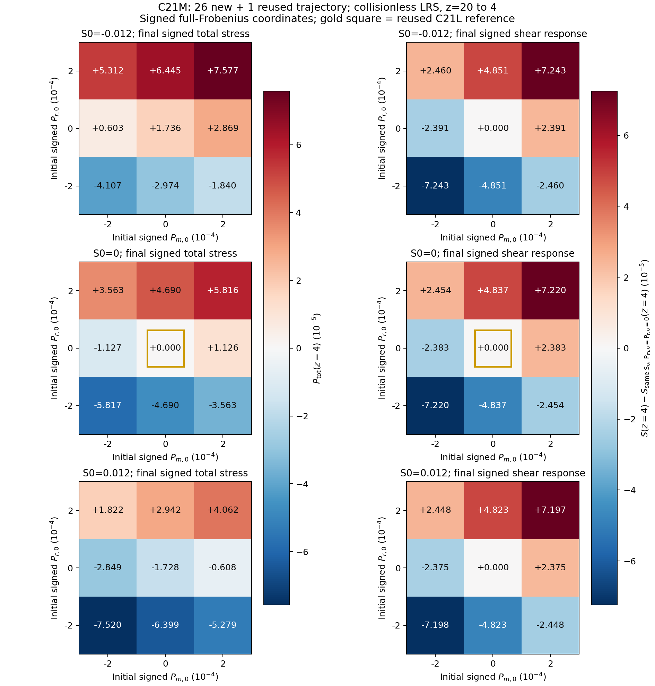
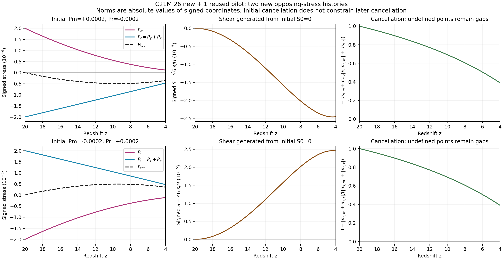

# C21L → C21M: 물질·복사 독립 초기응력 pilot

## 연구 결과와 범위

C21L의 기존 81개 물리 trajectory를 재실행하지 않고 성분별 stress를 복원·게시했다. 이어 원 REI PR147의 40성분 계산기를 유지하는 독립 초기조건 builder를 구현하고 **26개 신규 trajectory를 실제 적분**했다. 기존 C21L 기준점 하나를 provenance와 함께 재사용하여 27점의 첫 독립 3차원 pilot과 preliminary plots를 완성했다. 범위는 non-tilted, collisionless, LRS Bianchi I의 z=20→4이다. 일반 triaxial 모형, H/He/UV/stars 결합 재이온화 역사, 완성된 CMB Einstein–Boltzmann 예측은 이 결과에 포함되지 않는다.

고정 물리 source는 `rei_bianchi@3b85dedce84d37b3e165da00685a8a984950aafe`이다. C21L 원 content `60a3f1cb0d8f0875820d18c0d10c448d480334c4`의 340파일과 v1/v2 실행 provenance를 보존했다. C21L 성분 추가분의 실제 게시 content는 `17244259d25f793a25e0874443a28806e7c31d17`이며 PR90의 branch와 pull-head ref가 모두 이 SHA로 확인됐다. C21M의 실제 게시·백업 식별자는 별도 마감 영수증에 기록한다.

`global_error_bound=null`이다. 아래의 작은 잔차는 해당 초기 사상, 대수식, 저장된 수량의 일관성 검사이며 전체 해의 오차 상계가 아니다.

## 정의와 단위

직교기저에서 source의 signed shear와 stress scalar를 각각 s, pi_s,X로 표기한다.

\[
\sigma_{\hat i\hat j}=\mathrm{diag}(-s,-s,2s),\qquad
\pi^{(X)}_{\hat i\hat j}=\mathrm{diag}(-\pi_{s,X},-\pi_{s,X},2\pi_{s,X}),\qquad
\pi_{s,X}=\frac{p_{\parallel,X}-p_{\perp,X}}3.
\]

따라서 full Frobenius norm은 `sqrt(6)*abs(s)`와 `sqrt(6)*abs(pi_s,X)`이다. `Pi_matter_J_m3`, `Pi_gamma_J_m3`, `Pi_nu_J_m3`라는 source 이름의 값은 norm이 아니라 signed pi_s다. 보존하는 signed 좌표와 표시하는 norm은 다음과 같다.

\[
S=\sqrt6\,s/H_t,\quad P_X=\sqrt6\,(8\pi G/c^2)\pi_{s,X}/H_t^2,
\qquad \Sigma=|S|,\quad\Pi_X=|P_X|.
\]

여기서 H_t는 s⁻¹, stress는 J m⁻³다. 사용자의 Einstein coupling κ=8πG/c⁴는 H_g=H_t/c와 함께 쓰면 정확히 같은 무차원 값을 준다. source의 half-contraction norm은 full의 1/√2이다. 다른 repo의 half 좌표를 비교할 때 √2배하여 변환했다.

Matter는 원 source의 isotropic dust와 massive Vlasov sector의 합이다. dust stress가 0인 것은 모델의 가정이며, massive sector의 stress는 계산한다. Radiation은 실제 존재하는 photon과 massless neutrino의 tensor 합이다. UV 및 별도 baryonic anisotropic stress는 이 모델에서 absent/unmodeled로 기록하며, 존재하는 species의 0 값으로 만들어 넣지 않는다.

LRS의 공통 주축에서는 P_tot=P_m+P_r이지만 norm은 Π_tot=|P_m+P_r|이다. `Pi_m+Pi_r`를 총응력으로 쓰지 않는다. 각 성분 tensor, Δp, signed coordinate, full/half norm, shear–stress contraction, cancellation을 저장했다. Cancellation C=1−|pi_s,m+pi_s,r|/(|pi_s,m|+|pi_s,r|)는 분모가 0이면 undefined mask와 NaN을 보존한다.

## 원 분포에서 유도한 초기 사상

Massive 분포는 f_FD(q)[1+A P₂(μ)]이다. 이 절의 rho_m은 **massive Vlasov sector의 에너지밀도**이며 dust를 포함한 전체 matter 에너지밀도가 아니다. 전체 matter 중 이 sector의 초기 비율 fm=0.1은 source의 에너지밀도에 반영한다. 초기 b=0에서 radial energy가 각도와 독립이고 ⟨P₂⟩=0, ⟨P₂²⟩=1/5이므로

\[
\frac{\Delta p_m}{\rho_m}=\frac{A}{5}\frac{I_p}{I_\rho},\quad
I_\rho=\int q^2 f_{FD}(q)\sqrt{M^2+q^2}\,dq,\quad
I_p=\int \frac{q^4 f_{FD}(q)}{\sqrt{M^2+q^2}}\,dq.
\]

M=30에서 독립 radial quadrature는 I_p/I_rho=0.014042977688245462를 주었다. Radiation의 공통 초기 quadrupole k에서는 Δp_r/rho_r=k/5이다. 연속 각분포의 비음성은 −1≤A≤2이고 source가 허용하는 radiation 범위 |k|≤0.5를 그대로 유지했다. Photon과 neutrino의 k를 이번 pilot에서 공통으로 두었으며, 두 radiation species의 초기 k를 각각 독립적으로 바꾸는 확장은 별개다.

Builder는 원 constructor를 매 A마다 다시 호출하여 packet weights, cell populations, reference energy norm과 number 합을 함께 재생성한다. 기존 분포를 유지한 채 scalar A만 바꾸는 shortcut을 사용하지 않는다. Matter target은 원 discrete moment를 평가하는 bracketed inversion으로 맞추고, radiation target은 실제 source의 intercept/slope로 맞춘다. Shear는 실제 discrete 초기 H를 이용하여 Hamiltonian constraint와 함께 설정한다. 목표값을 raw field에 덮어쓰지 않는다. A=0의 약 −2.11×10⁻¹⁹ matter signed offset도 그대로 보존한다.

Wolfram은 angular moments, positivity interval, tensor contraction을 실제 평가했다. 독립 source/continuum 비교에서 Δp_m/rho_m의 최대 차이는 3.4196×10⁻¹²였으며, 이 값은 quadrature 비교의 범위만 뜻한다. 유도와 검산은 [theory/THEORY_REVIEW_KO.md](theory/THEORY_REVIEW_KO.md), [theory/initial_moments_checks.json](theory/initial_moments_checks.json), [BUILDER_CONTRACT_KO.md](BUILDER_CONTRACT_KO.md)에 있다.

## C21L: 기존 81개 성분 분리

원 A=0 초기 slice를 유지했다. Full signed 초기 S/total-P의 네 부호 branch를 각 성분으로 해석했으며, 이를 독립 matter/radiation 초기 sweep로 부르지 않는다.

| z=4에서 81개 ensemble의 최대 norm | 값 |
|---|---:|
| Sigma | 4.81987955610218e-3 |
| Pi_m | 3.828814781835141e-6 |
| Pi_gamma | 1.728772226437296e-4 |
| Pi_nu | 1.1928604521942512e-4 |
| Pi_r | 2.9216326786315474e-4 |
| Pi_tot | 2.9587955662661403e-4 |

각 행의 최대점은 같은 case일 필요가 없고 보편적 상계가 아니다. 최종 matter/radiation 부호가 반대인 case는 40/81이었다. 가장 큰 endpoint cancellation은 `s08_p05`의 C=0.9373131717409648이다. 이 case의 P_m≈−3.7142e−6, P_r≈+4.2110e−6, P_tot≈+4.9681e−7로 성분 합의 상쇄를 직접 볼 수 있다.

81×101 저장 상태의 tensor/정규화 검사를 했고, 원 source의 start/mid/end 243상태에서 13개 field가 허용오차 없이 수치적으로 동일했다(최대 차이0). 이 243상태 검사는 개별 float의 bytes 비교와 구분한다. 이전 C21L의 별도 대표3개 전체 trajectory bitwise 증거는 그대로 보존했다. 다른 입력·출력 절대 경로와 실제 복원한 원 ZIP에서 후처리를 재현하여 11개 CSV/NPZ/PNG/PDF/manifest 파일의 bytes가 일치했다. 이 단계의 새 ODE 수는 0이다.

## C21M: 독립 27점 pilot

입력은 signed full 좌표 S0∈{−0.012,0,+0.012}, Pm0∈{−0.0002,0,+0.0002}, Pr0∈{−0.0002,0,+0.0002}의 직적이다. Norm만으로 입력 부호를 제거하지 않았다. 중심은 기존 C21L `s04_p04`를 재사용했다. 해당 raw의 실제 작은 초기 offset을 `REFERENCE_REUSE.json`에 보존했고 새 builder와 bitwise 동일한 초기 상태라고 주장하지 않았다. 나머지 26점은 확인한 외부 동일-physics grids와 중복되지 않아 새로 적분했다.

실제 run identity는 `ff462f48e264b2032ec50018e9969a6eb1808c7a6fc2a60139b98efacb01c05a`이다. 모든 case는 40×101 FP64 state와 species multipoles, source diagnostics를 저장한다. `ellmax=8`, massive FV 24×12/Gauss3, fm=0.1, M=30, DOP853 rtol=3e−11/atol=3e−13를 유지했다.

| z=4에서 27점 ensemble의 최대 norm | 값 |
|---|---:|
| Sigma | 1.4449836382490454e-3 |
| Pi_m | 1.2574783729509532e-5 |
| Pi_r | 6.344480064794384e-5 |
| Pi_tot | 7.577499571350794e-5 |

이 값들을 초기 영역이 다른 C21L 최대값과 직접 성장률·개선율로 비교해서는 안 된다.

### 초기 상쇄가 이후 상쇄를 고정하지 않는다

| S0=0인 초기 입력 | 최종 signed S | 최종 signed Pm | 최종 signed Pr | 최종 signed Ptot | 최종 C |
|---|---:|---:|---:|---:|---:|
| Pm0=+2e−4, Pr0=−2e−4 | −2.4539971e−5 | +1.1384384e−5 | −4.7017047e−5 | −3.5632663e−5 | 0.3898666 |
| Pm0=−2e−4, Pr0=+2e−4 | +2.4539712e−5 | −1.1383981e−5 | +4.7015856e−5 | +3.5631875e−5 | 0.3898635 |

두 case 모두 초기 총 stress가 수치 오차 수준으로 상쇄되지만 이후 matter와 radiation의 다른 redshift/momentum response 때문에 총 stress와 shear가 생긴다. 이는 원 source의 `dot(s)=−3Hs+(8πG/c²)pi_s,total`와 일관된다. 같은 초기 Ptot를 갖더라도 성분 분해가 다르면 이후 해가 달라질 수 있으므로 독립 초기 stress 축을 유지해야 한다.

왼쪽은 최종 signed total stress다. 오른쪽은 **같은 S0에서 Pm0=Pr0=0인 기준해에 대한** 최종 signed shear 차이이며 shear norm 자체가 아니다. 색 범위는 각 column의 세 slice에서 동일하고 3×3 실제 표본만 표시한다. 금색 사각형은 재사용한 기준 trajectory다.

실선은 signed 성분, 점선은 signed total이다. Norm은 각 곡선의 절댓값이다. z는 20에서 4로 감소하는 시간 방향이다. 수치상의 약간의 ±비대칭은 raw에 보존했으며 부호를 뒤집어 한 해로 대체하지 않았다.

## 실행과 검증 범위

- Builder의 여섯 focused 검사 및 독립 비구현자 검토: 초기축, 분포 양성·정규화, Hamiltonian, FLRW limit, domain refusal, original40 RHS 동등성을 점검했다. 여기서 ODE는 0회다.
- 신규 26개 적분: sandbox에서 4개 worker가 모두 정상 종료했다. 초기 축 최대 절대차 1.734723475976807e−18, 저장 Hamiltonian 대수적 최대 상대잔차 2.220446049250313e−16, massive comoving number 최대 상대잔차 4.440892098500626e−16이었다. Radiation N0 보존 오차는 저장값 기준 0이었다.
- 실행 command, actual source/runner/resource hash, input bytes, Python/NumPy/SciPy 버전, host identity, per-case raw/receipt/COMPLETE seals를 보존했다. 분석은 원 raw/receipt를 변경하지 않는다.
- 독립 science/plot review는 신규26×101=2,626 raw 상태의 tensor/SI/half/cancellation/보존을 확인했다. 원 unoptimized source의 start/mid/end 78상태에서 field scalar4,602개와 40성분 RHS3,120개를 실제 FP64 bytes로 비교해 모두 일치했다. 원 source의 전체 trajectory를 다시 적분한 것은 아니다. 원64 Gauss angular nodes에서 L8 E/N을 재구성한 672,256개 값도 양수였다(최소 E≈0.9119877, N≈0.9172327). 이는 저장 시점·이산 angular nodes 검사이며 연속 시간·각도 전체의 positivity 증명이 아니다. NPZ27×101 및 CSV endpoints를 독립 비교했고 PNG2개를 직접 읽었다. PDF 별도 raster review는 NOT_RUN이다.
- 정확한 검토 범위는 `INDEPENDENT_PILOT_REVIEW.json`, `INDEPENDENT_OPERATIONS_REVIEW.json` 및 분석 receipt를 따른다. 외부 receipt 수용을 해당 전체 raw의 신규 독립 검산으로 확대하지 않는다.

Hamiltonian H가 source에서 constraint를 통해 재구성되므로 작은 대수적 consistency residual만으로 적분 정확도를 증명할 수 없다. 이번에는 기존 scoped trajectory 동등성 근거와 고정 tolerance를 재사용했고 새 대규모 수렴·성능 캠페인을 수행하지 않았다.

## 외부 결과 수용과 중복 제거

시작 시 일곱 관련 repo의 공개 advertised branch head 1,224개를 열거하고 최신 PR metadata 및 관련 source·manifest·실행 반환·검토를 읽었다. 모든 branch의 모든 파일을 읽었다는 뜻은 아니다. Google Drive·Dropbox·Library의 명시된 폴더/검색 범위를 조사했다. Personal Context는 이 대화에서 unavailable을 반환했으므로 접근하지 못한 다른 대화·비공개 반환은 UNAVAILABLE이다.

| 반환 | 수용 범위 | 이 연구에서의 처리 |
|---|---|---|
| REI PR198 | z20→4 collisionless; 기존625 후처리, 신규600 matter slice+6 mixed | 원4 vendor hash·solver·input·환경·runtime·검토·선택6 mixed endpoint 확인. reduced8/65샘플/half norm provenance 유지; 606 raw 전체 재검산은 하지 않음 |
| REI PR213 / BASS PR176 | 동일729 warm source-on a=.1999→.2 | mirror 중복 제거; UV/Thomson 포함 별도 physics lane 유지 |
| REC PR116 | 동일729 raw endpoint의 axis-response 후처리 | 153 support/576 withheld retrospective 결과와 방법 수용; C21M에 적용 가능한 진단을 별도 수행 |
| HH PR127 | 원 PR147의 A=0 고정63 control | 독립 matter 초기축으로 분류하지 않음; 중복 좌표 사전 제외 |
| HE PR82 | 관측한 계약 checkpoint | 후속28개 실제 실행 source·raw·receipt가 확인되기 전 새 과학 완료로 수용하지 않음 |

상세 SHA·실행 시간·toolchain·검증 범위·retrieval root는 [EXTERNAL_UPTAKE.json](EXTERNAL_UPTAKE.json)에 보존했다. 이 기록의 observation 시각 이후 새 결과의 전역 부재는 주장하지 않는다.

### 외부 axis 재사용법을 현재 collisionless 결과에 적용한 진단

REC PR116의 additive reconstruction을 이번27점에 적용했다. 각 S slice의 두 성분 축을 합친15개 support trajectory에서 Fhat(S,m,r)=F(S,m,0)+F(S,0,r)−F(S,0,0)를 만들고, 나머지12개 mixed trajectory와 비교했다. 새 ODE와 benchmark는0이며 이미 본 데이터를 이용한 retrospective 검사다.

| signed full observable | 12 mixed×101시점 최대 절대잔차 | endpoint 최대 절대잔차 |
|---|---:|---:|
| S | 1.26017e−9 | 1.25950e−9 |
| Pm | 1.16479e−9 | 6.54168e−10 |
| Pr | 1.48319e−9 | 1.30076e−9 |
| Ptot | 2.58297e−9 | 1.95493e−9 |

이는 이번 작은 영역에서 additive response가 유용한 진단일 수 있음을 보여준다. 정확한 coupled trajectory를 치환할 근거로 승격하지 않았다. Ptot가 상쇄되어 약−4.218e−20인 점에서는 raw pointwise 상대잔차가5.425까지 커진다. 이를 임의 floor로 숨기지 않고, exact zero 상대오차는 undefined mask로 보존했다. Support scale로 정규화한 잔차와 raw pointwise 상대잔차를 별도로 제공한다. Shear 전체값보다 작은 실제 응답 increment를 분모로 하면 S의 최대 잔차비는2.12062e−5다. 최종 채택 결과와 입력 hash는 `axis_response_diagnostic_results_v2/`에 있다. v1 source·결과도 보존했다. v2는 Decimal80의 값을 exact rational로 부르지 않도록 고친 표현 수정이며 NPZ/CSV bytes는 v1과 같다.

## 최적화와 후속 실행

[OPTIMIZATION_DECISIONS_KO.md](OPTIMIZATION_DECISIONS_KO.md)에 채택·보류 판단을 정리했다. 이번 결과는 원 방정식과 precision을 유지하는 immutable worker template, exact moment 공통식 재사용, 독립 case multiprocessing, 수치 library thread=1, bounded dispatch, shared CPU lease, create-only 결과, never-started-only resume를 사용한다. 성능 speedup나 64-core scaling 수치를 주장하지 않는다.

실제 sandbox quota는 8 CPU, memory limit 8 GiB였고 coordinator CPU0 및 worker CPU1–4가 사용됐다. source 실행의 wall time 3.971248287s는 재현성 metadata다. worker RSS high-water 최대 99,684,352 bytes는 이 작은 실행에서 관측한 값이며 memory 개선율 또는 NCP 보장이 아니다. 반환 시 process thread 수는 2였고 수치 library thread 설정은 1이다; multiprocessing queue 보조 thread까지 포함한 process count를 science thread 수와 혼동하지 않는다.

현재 NCP 키 경로가 없으므로 원격 접속·자원 probe·실행은 NOT_RUN이다. 선택 후속 nested125 격자에서 이미 완료된27점을 뺀 `grid_ncp_refinement98.json`은 초기조건98개만 검산했다. 이 98개는 첫 pilot의 미완료분이 아닌 다음 refinement 단위다. CPU55, coordinator, 실제 quota/affinity/load/memory와 공유 lease를 고려하는 실행기 및 명령을 제공한다. 완료된81·26·외부625/606/729를 반복 실행하지 않는다.

## 마감 상태

이 문서는 과학 content의 보고서다. 실제 content/document commit, provider ACK, ZIP SHA256, DAG와 후속 handoff는 별도 마감 문서에서 결속한다. 원 C21F/G/H/I/J/K의 통과 범위, 실패 raw, HOLD, 역사적 NOT_PUBLISHED를 수정하지 않았다.
