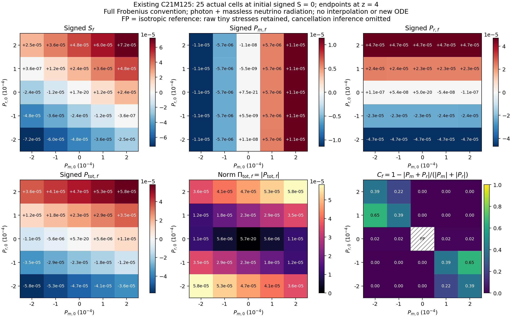

# C21N: 기존125점 수용, 초기 상쇄 응답과 준비 연산 재사용

## 결과

독립 matter/radiation 초기응력 pilot은 이미 **125개**가 완료되어 있다. 이번에는 새로운 NCP98 반환을 실제 source·입력·완료 seal과 연결해 수용했고, 그 계산을 다시 실행하지 않았다. 기존 125개 전체 40상태 이력에서 mass-shell 응력의 도함수와 초기 상쇄 해제의 signed shear 응답을 계산했다. 또한 A와 무관한 constructor 작업을 worker당 준비하는 구현과 공유 파일시스템 admission·완료 입력의 재실행 방지를 마쳤다.

**이번 C21N 신규 과학 ODE 0회, 성능 벤치마크 0회**다. 향후 실행할 off-grid opposing-stress 4개는 초기조건·양성·정규화·constraint·원 구현 대비 초기 state/RHS bytes 검증까지 준비했으며 `NOT_RUN`이다. 실제 GitHub content/document SHA, PR, 배송 ZIP와 provider ACK는 후속 `FINAL_CLOSEOUT_KO.md` 및 영수증에 확정한다. 과학 결과와 게시·백업 성공은 구분한다.

## 1. 최신 외부 결과 수용

7개 저장소의 branch heads를 기존 1,224개와 비교해 1,232개를 확인했다. 신규8·변경5·삭제0이다. 이는 광고된 refs 전수 목록과 변경된 관련 결과의 선별 독해이며, 모든 branch의 모든 source를 읽거나 접근 불가능한 대화를 조사했다는 뜻이 아니다. [intake/INTAKE_KO.md](intake/INTAKE_KO.md), [구조화 수용표](intake/C21N_EXTERNAL_INTAKE.json), [refs 변경표](intake/LIVE_REF_DELTA.json)에 scope와 source/input/solver/build/runtime/검증 범위를 보존했다.

| 대상 | 수용 판단 |
|---|---|
| BASS PR90 `e9544671…` | 기존81 및 성분별 분석 게시 완료를 유지 |
| BASS PR91 `b78a943e…` | 독립26 + 원 중심1의 완료 상태 유지 |
| BASS PR92 `645a7f1a…` | 실제 NCP98와 combined125를 source-bound scoped 수용 |
| REI214/BASS177 ACCEL01 | 불변 backing·metadata guard 원칙 재사용. C15 solver와 result cache는 다른 source family |
| HH128/129 | 완료된 shear-memory·finite-L8 표현과 회수 자료를 참고. 기존6 paired IVP 재실행 없음 |
| HH76 | 관측 head의 time-transport 계약4파일을 추적; 새 실행 근거로 승격하지 않음 |
| REC117 | z20→2 소비 계약은 확인했으나 다른 scratch의 원 raw/source는 `UNAVAILABLE` |
| HE82 | 추가 실행 보고를 추적하되 참조 source-binding2파일의404로 raw 수용 범위를 확대하지 않음 |
| VigilODE | 별도 geometry/Thomson FV oracle. 원40상태 collisionless solver에 적용하지 않음 |

Personal Context는 실제 unavailable 응답이었다. Drive 검색 API가 알려진 파일도 찾지 못해 known-ID metadata와 직접 folder listing을 사용했다. Dropbox parent3274항목/6pages, scoped bass_cr41항목, Library bass_cr94항목, Drive folder71항목을 조사한 범위는 [백업 intake 영수증](intake/backups/SCOPED_BACKUP_INTAKE_RECEIPT.json)에 있다. 접근 불가능한 저장처·대화까지 포함해 새 결과가 없다고 단정하지 않는다.

### NCP98의 세 정정

NCP98 원 source는 C21M content `659c94312eb9c12ebb987de934459c12a63d67b0`, 물리 source는 REI `3b85dedce84d37b3e165da00685a8a984950aafe`다. canonical run identity는

```text
7f89b12adbeee64a70832e633ae563584bc2a68f6ac433dc56f759a1946eb718
```

이다. 실제 manifest/RETURN/98개 COMPLETE·RESULT·RESERVATION·STARTED가 일치한다. source/manifest/vendor hash 대조15건은 중복 builder를 포함한14개 서로 다른 파일이다. 원 문서4개의 잘못된 identity suffix는 추가 정정 기록으로 분리했다.

원 analysis output manifest의 byte 일치는 **6/7**이다. CSV 실제 LF100,645B와 manifest의 CRLF100,771B 표현 차이가 원인이며, 메모리의 줄바꿈 변환 후 expected SHA가 일치했다. 125행×39열 field 문자열은 같다. 원 CSV와 원 manifest는 고치지 않았다. Archive의 실제 regular files는 **509=508payload+SHA256SUMS**이며 원 `614` 표기와 구분한다. [추가 정정](intake/NCP98_CORRECTION_RECORD.json).

NCP98 archive는 Dropbox에서 실제 다운로드한17,911,591B이며 SHA256은 `e9baa6bab57790d29a0dfb06747a3304f0449a48e7dfc2d14c6630849f9c1d0a`다. 내부508/508 checksum과98개 raw/result seals를 확인했다. 이번 세션의 Drive 확인은 metadata 수준이며 producer가 기록한 과거 다운로드 검증과 구분한다.

원 실행은 hostname `s1a0e5abed09`, Python3.12.3, NumPy2.3.5, SciPy1.17.0, 61workers+CPU0 coordinator, 보호 CPU55 제외로 보고됐다. Wrapper wall13.18초, RETURN 내부 wall10.298729851초는 서로 다른 측정 범위의 단일 실행 기록이다. 속도 향상이나61/64-core scaling 자료가 아니다.

## 2. 정의와 source 대응

\[
\sigma_{\hat i\hat j}=\mathrm{diag}(-s,-s,2s),\qquad
\pi^{(X)}_{\hat i\hat j}=\mathrm{diag}(-p_X,-p_X,2p_X),\qquad
p_X=\frac{p_{\parallel,X}-p_{\perp,X}}3.
\]

Signed 좌표를 $S=\sqrt6s/H_t$, $P_X=\sqrt6(8\pi G/c^2)p_X/H_t^2$로 쓴다. 사용자가 요청한 full Frobenius norms는 $\Sigma=|S|$, $\Pi_X=|P_X|$다. 원 `Pi_*_J_m3` 변수는 signed $p_X$이며 norm이 아니다. Half-contraction과는 $\sqrt2$배 차이가 난다.

에너지 단위의 $\kappa=8\pi G/c^4$는 $H_{\rm geom}=H_t/c$로 대응한다. $H_t$는 s⁻¹, pressure는 J/m³이다. Photon과 존재하는 massless neutrino를 먼저 tensor 합으로 radiation에 포함하고 matter와 합친 뒤 total norm을 취한다. 따라서 일반적으로 $\Pi_{\rm tot}\ne\Pi_m+\Pi_r$다. Dust는 source가 등방적으로 모델링한 성분이고 UV·baryonic anisotropic stress는 absent/unmodeled 상태다.

## 3. 원 분포에서 유도한 초기 응답

원전 Heinzle–Uggla, *Class. Quantum Grav.*23(2006)3463–3490의 [식(2d–f),(3)](https://arxiv.org/html/gr-qc/0512031v1)은 conserved covariant momenta와 mass-shell 응력을 준다. Exa로 원 식을 확인하고 SciSpace로 서지를 교차 확인했다. SciSpace가 반환한 중복 arXiv의2022 metadata는 원 발표일로 사용하지 않았다. Wolfram LanguageEvaluator의 성공2건으로 chain rule·에너지 항등식·SI 대응·초기 jet 대수를 확인했다. 최초 context 호출의 server error도 보존했다. 이번 유도는 원 논문의 전역 isotropization 정리를 이 FD/Λ source에 적용한 것이 아니다.

$\eta=\ln(a/a_0)$, $v=b'=s/H_t$에서 packet의 $u=q_\perp^2$, $w=q_\parallel^2$, $E=\sqrt{M^2+u+w}$를 쓰면

\[
u'=(-2+2v)u,\qquad w'=(-2-4v)w,\qquad
E'=\frac{u'+w'}{2E}.
\]

이를 원 conserved-packet 합에 직접 적용하여 $\rho_m'$, 두 pressure의 도함수와 signed anisotropic stress 도함수를 구현했다. 에너지 항등식은

\[
\rho_m'+3(\rho_m+\bar p_m)+6vp_m=0
\]

이다. 초기 $b_0=v_0=0$에서는

\[
p_{m,0}'+4p_{m,0}
=-\sum_j\frac{e^{-3\eta}n_j}{N_E}
\frac{M^2(w_j-u_j/2)}{3E_j^3}\bigg|_0
\]

를 직접 계산한다. 작은 $p_m$으로 나누지 않으므로 isotropic center의 FP 잔차를 잘못 증폭하지 않는다.

비영 $A$의 separable continuum 분포 $f_{\rm FD}(q)[1+A P_2(\mu)]$를 설명할 때는

\[
p'_{m,0}=(-5+\beta_m)p_{m,0},\qquad
\beta_m=\frac{\int q^6 f_{\rm FD}(q)E^{-3}\,dq}
{\int q^4 f_{\rm FD}(q)E^{-1}\,dq},\quad 0<\beta_m<1
\]

로 쓸 수 있다. Radiation은 정확한 zero-shear initial slice에서 $p'_{r,0}=-4p_{r,0}$다. $h=H_t'/H_t$와 원 shear 식

\[
S'=P_{\rm tot}-(3+h)S
\]

를 결합하면 이상적인 초기 상쇄 $S_0=P_{{\rm tot},0}=0$에서

\[
S''_0=-(1-\beta_m)P_{m,0},\qquad
S(\eta)=-\tfrac12(1-\beta_m)P_{m,0}\eta^2+O(\eta^3)
\]

를 얻는다. 실제 초기 offset $\epsilon=P_{{\rm tot},0}$는 버리지 않는다. 직접 mass-shell forcing을 $\mathcal R_m$이라 하면 실제 수학적 식은 $P'_{{\rm tot},0}=\mathcal R_m-(4+2h_0)\epsilon$, $S''_0=\mathcal R_m-(7+3h_0)\epsilon$이다. 원 normalized forcing과 SI 성분합의 FP grouping residual도 별도 보존한다. [전체 유도](theory/MASS_SHELL_DERIVATION_KO.md).

## 4. 수치 결과와 preliminary 그림

### 기존 125개 endpoint

초기축은 $S_0\in\{-0.012,-0.006,0,0.006,0.012\}$와 $P_{m,0},P_{r,0}\in\{-2,-1,0,1,2\}\times10^{-4}$다. z20→4에서 이미 계산된 이 ensemble의 종단 최대값은 다음과 같다. 보편적 상계가 아니다.

| Full Frobenius norm | z4의 ensemble 최대값 |
|---|---:|
| $\Sigma$ | $1.4449836382490454\times10^{-3}$ |
| $\Pi_m$ | $1.2574783729509532\times10^{-5}$ |
| $\Pi_r$ | $6.344480064794384\times10^{-5}$ |
| $\Pi_{\rm tot}$ | $7.577499571350794\times10^{-5}$ |

원 전125점 그림과 raw는 PR92에 남아 있다. 이번 성분별 그림은 $S_0=0$인25개 실제 cell에서 signed shear·matter·radiation·total, total norm, cancellation을 함께 보여 준다. 원 NPZ의 값만 사용했고 보간하지 않았다. Isotropic center의 미세한 stresses는 CSV에 남기되, 그 잔차로 물리적 cancellation을 추론하지 않도록 해당 그림 cell은 `FP`로 표시했다.



동일한 초기 stress norm이라도 부호와 상대 상쇄에 따라 total과 shear가 달라진다. 이 slice에서는 radiation의 종단 signed 값이 주로 초기 radiation축을 따르고 matter는 주로 초기 matter축을 따른다. 교차 효과는 원 coupled evolution을 통해 남으며, 한 성분을 제거한 인과 실험을 수행한 것은 아니다.

### 초기 상쇄 해제

비영 상쇄4case에서 $\mathcal R_m/P_{m,0}\simeq-0.968299235609$다. 해당 입력의 $\beta_m\simeq0.031700764391$에 대응한다. 코드가 이 비를 derivative 계산에 사용하는 것은 아니다.

| $P_{m,0}$ | $P_{r,0}$ | 이상적 $S''_0/2$ |
|---:|---:|---:|
| $-2\times10^{-4}$ | $+2\times10^{-4}$ | $+9.6829923561\times10^{-5}$ |
| $-1\times10^{-4}$ | $+1\times10^{-4}$ | $+4.8414961780\times10^{-5}$ |
| $+1\times10^{-4}$ | $-1\times10^{-4}$ | $-4.8414961780\times10^{-5}$ |
| $+2\times10^{-4}$ | $-2\times10^{-4}$ | $-9.6829923561\times10^{-5}$ |


국소 이차 전개의 저장 trajectory 대비 상대차 $|S_{\rm saved}-S_{\rm jet}|/|S_{\rm saved}|$는 첫 양의 저장점 $\eta=0.0143508453$에서 최대2.1223%, 표시된 마지막 $\eta=0.1004559168$에서15.8374%다. 마지막의 최대 절대차는 $1.33597\times10^{-7}$이다. 국소 부호·계수 해석은 지지하지만 전 구간 근사나1% 모델을 지지하지 않는다. 연속 시간의 remainder bound,3차 계수, global error bound는 모두 미확립/null이다.

## 5. 코드 변경과 검증

### 준비 계층

`prepared_momentum.py`는 immutable radial/angular 자료를 worker당 준비하고 `builder.py`는 이를 호출한다. 매 A trial마다 분포 weight·packet/cell population·energy normalization을 원 평가 순서로 다시 만든다. P2를 미리 나누는 FP reassociation도 피했다. 원 moment/RHS/DOP853와 tolerance는 바꾸지 않았다. 외부 ACCEL01의 불변 backing/metadata guard 원칙은 [EXTERNAL_REUSE.json](EXTERNAL_REUSE.json)에 출처를 고정했다.

| 확인 | 범위와 결과 |
|---|---|
| Constructor | 15구성, grid/distribution/normalization bytes 동일 |
| Moments | 45상태 FP64 bytes 동일 |
| 초기 사상 |125개 mapping receipt 값 동일, 초기 state bytes 동일 |
| 원 fields/RHS |375개 저장 상태;22,125 field 값과15,000 RHS 값 bytes 동일 |
| 준비 연산 |추가 quadrature 호출을 금지한5개 A trial 통과 |
| 독립 검토 |원vendor9파일 hash/size, functions/build AST 차이 및 FP 순서·alias/guard 검토 |

Mapping receipt는 dictionary equality다. 모든 receipt field의 signed zero까지 byte equality를 확인했다고 표현하지 않는다. C21N source로 full trajectory를 재적분한 비교도 아니다. 첫 v1 test의 manifest nesting `KeyError`는 하네스 오류이며 당시 source와 실패 영수증을 보존했다.

### 도함수

12개 packet 상태의 미분 전 moment bytes가 원과 같고 complex-step 최대차는 $4.44\times10^{-16}$이다. 3초기 상태에서4차 방향 차분과 full source derivative의 최대차는 $8.74\times10^{-14}$,7개 zero-shear 입력의 second derivative 방향 검산은 $5.72\times10^{-15}$다.

125개 recorded parameters로 복원한 초기 Y와 combined/raw의 eta·40-state Y가 모두 bytes 일치했다. Massive energy identity12,625상태의 최대 residual은 $1.025\times10^{-15}$, radiation375상태는 $1.7005\times10^{-14}$다. 서로 source normalization이 다른 residual이다. Signed fields2,250값의 numeric 차이는0, shear identity residual은 $3.47\times10^{-18}$이다. 이러한 항등식 검산은 시간·angular·radial discretization의 전역 오차 상계가 아니다.

최초 그림의 `\tfrac` mathtext 실패는 label만 고쳐 해결했다. v1/v2 scientific CSV4개+NPZ1개는 byte-identical이며 실패 source/receipt를 보존했다. PNG를 실제 읽어 부호·norm·축·legend를 확인했다. PDF export는 제공하지만 별도 PDF raster/print audit은 수행하지 않았다.

### 공유 실행

최종 runner는 source에 결속한 completed125 registry와 새 C21N schema를 요구한다. 완료한 물리좌표는 이름을 바꿔도 각 축 `2e-13` 범위에서 거절한다. Disk/inode는 run/lease 생성 전, 자원 대기 중, 새 dispatch 전에 검사한다. CPU55·coordinator·numeric thread1·가용 affinity/quota/RAM/load/lease는 원 공유 운영을 유지한다.

Focused3그룹에서 실제 cached builder import/READY와 fake case3개만 실행했다. 첫 완료 후 synthetic disk 감소로 새 dispatch를 멈추고 같은 identity의 미시작2개만 resume했다. 첫 결과 bytes는 보존했다. 그 뒤 추가한3줄 resource-wait storage guard는 바뀐 분기만 별도 검사했으며 처음3그룹이 최종 hash에서 재실행됐다고 주장하지 않는다. [정확한 운영 검증 범위](checks/ops_final_scope.json).

이 변경은 준비 연산 제거와 운영 정확성에 대한 결과다. **Speedup·RSS 절감·64-core scaling은 UNMEASURED**다. 단일 NCP98 elapsed를 새 구현의 속도 자료로 사용하지 않는다.

## 6. 남은 실행과 DAG

명시적 새4case는 `prepared_offgrid4/grid_offgrid4.json`에 준비했다. $S_0=0$, $P_{m,0}=\pm7.5\times10^{-5},\pm1.75\times10^{-4}$, $P_{r,0}=-P_{m,0}$다. 기존125와 겹치지 않으며 원 builder 대비 mapping 값·초기 state/RHS bytes와 physical feasibility를 검증했다. 실행 시점 최신 외부 반환을 먼저 재확인해야 한다. 현재 **science execution NOT_RUN**이다.

NCP에서4개만 실행하면 유용한 science worker는 최대4개다. Larger explicitly new grid에 대해서도 절대 상한62에서 실제 가용 자원·미시작 case 수로 더 줄인다. 이미 NCP98이 실행되었다는 사실은 지금의 NCP 자원을 확보했다는 뜻이 아니다. 현재 샌드박스에는 알려진 NCP SSH key가 없으며 새 NCP 접속은 하지 않았다.

| DAG node | 현재 과학/구현 상태 |
|---|---|
| C21K, C21L81 및 성분별 게시 |기존 scoped 완료 유지 |
| C21M independent builder, sandbox26+center |기존 scoped 완료 유지 |
| NCP98, combined125 |실제 외부 반환 수용 `COMPLETE_SCOPED` |
| C21N mass-shell 유도·focused 검산·125 후처리 |`COMPLETE_SCOPED` |
| C21N immutable constructor preparation |`IMPLEMENTED_PASS_SCOPED` |
| Disk/inode·completed125 guard |`IMPLEMENTED_PASS_SCOPED` |
| Off-grid4 초기조건 |`PREPARED_VALIDATED` |
| Off-grid4 실제 ODE/NCP 실행 |`NOT_RUN` |
| Large performance benchmark, speedup/scaling |`NOT_RUN / UNMEASURED` |
| General triaxial/full reionization/CMB |`HOLD` |
| Global error bound |`null` |

정확한 게시·백업 상태는 동결한 과학 산출물과 분리하여 마감 영수증에 기록한다. 후속 작업은 코드의 재구현이나 원81/125 재실행부터 시작하지 않는다.
