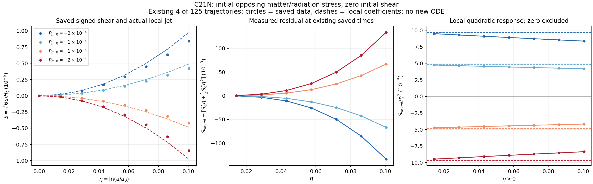

# C21N mass-shell derivative: 기존 125-case의 정적 분석 결과

## 1. 수용한 입력과 새로 한 일

채택 분석 디렉터리는 [analysis_mass_shell125_v2](../analysis_mass_shell125_v2/)이다.
그림은 [PNG](../analysis_mass_shell125_v2/initial_cancellation_release.png)와
[PDF](../analysis_mass_shell125_v2/initial_cancellation_release.pdf), 수치 요약은
[SUMMARY.json](../analysis_mass_shell125_v2/SUMMARY.json)에 있다.

| 입력 | case 수 | 실제 identity |
|---|---:|---|
| C21M 기존 sandbox pilot | 26 | `ff462f48e264b2032ec50018e9969a6eb1808c7a6fc2a60139b98efacb01c05a` |
| PR92에서 반환된 NCP refinement | 98 | `7f89b12adbeee64a70832e633ae563584bc2a68f6ac433dc56f759a1946eb718` |
| 원 C21L `s04_p04` center 재사용 | 1 | `0090e1549b21b07e46001de2bf9cb2eab9bf0cba87ffe3d4d824ba117fecb44a` |

기존 raw가 source의 원 `A`, `k_gamma`, `k_nu`, `Sigma_ref`, orientation으로
만들어졌는지 receipt와 seal을 읽고 확인했다. target 좌표를 다시 invert하지 않았다.
기존의 combined125 NPZ의 `eta`와 전체 40-state `Y`는 125개 원 raw와 각각 FP64
bytes가 같았다. 이 recorded parameters로 원 constructor를 복원한 125개 `Y0`도
저장된 `Y0`와 FP64 bytes가 같았다. 입력 경로·원 manifest·raw·receipt의 SHA256은
[INPUT_BINDINGS.json](../analysis_mass_shell125_v2/INPUT_BINDINGS.json)에 기록되어 있다.

새 ODE 적분은 **0회**다. 기존 81, 26, 98-case를 재적분하지 않았고, 새 성능
벤치마크도 하지 않았다. 이번 분석의 원 source는 계속 REI PR147의
`3b85dedce84d37b3e165da00685a8a984950aafe`다. 외부의 최신 branch를 발견했다는
이유로 이 provenance를 바꾸지 않는다.

## 2. 수행한 검산의 정확한 범위

### 새 derivative 구현에 대한 focused 검사

[test receipt](../checks/mass_shell_derivatives_v1.json)의 세 그룹은 다음과 같다.

| 검사 | 실제 범위 | 결과 |
|---|---|---|
| 원 moment와 미분 전 값 | `A=-1,0,0.4,2` × 세 `(eta,b,b')` 상태 = 12 | rho, 두 pressure FP64 bytes 동일 |
| packet chain rule | 위 12상태, 독립 complex-step 평가 | 최대 절대차 $4.44\times10^{-16}$ |
| massive energy identity | 위 12상태 | 최대 절대 residual $8.88\times10^{-16}$ |
| full source field의 방향도함수 | 세 실제 초기상태, 4차 forward stencil, step $2\times10^{-4}$ | 최대 절대차 $8.74\times10^{-14}$ |
| 실제 offset 및 ideal cancellation jet | 7개 정확한 `S0=b0=0` 입력 | 공식 residual 통과 |
| 원 RHS를 따른 $S_0''$ 방향 검산 | 위 jet 그룹 | 최대 절대차 $5.72\times10^{-15}$ |

complex-step은 미분 전 mass-shell 합을 독립적인 complex arithmetic으로 평가한
검사다. source의 생산 RHS를 복소수 입력용으로 수정한 것이 아니다. forward
difference는 국소 도함수 검사이며 trajectory 재적분이 아니다. array bytes와 source
`_nfev` counter의 보존도 확인했다.

### 이미 저장된 125개 trajectory에 대한 적용

| 항목 | 범위 | 관측 최대값/결과 |
|---|---:|---|
| 초기 도함수 | 125개 | signed `S`, `Pm`, `Pr`, `Ptot`, H derivative 별도 저장 |
| massive packet energy identity | 125 × 101 = 12,625상태 | $1.02497\times10^{-15}$ |
| 원 source fields/RHS의 정적 평가 | 시작·중간·끝, 125 × 3 = 375상태 | 신규 ODE 없음 |
| 재구성 signed S 및 다섯 component 값 대조 | 375 × 6 = 2,250값 | 최대 수치차 0 |
| radiation energy identity | 위 375상태 | $1.70048\times10^{-14}$ |
| source signed shear identity | 위 375상태 | $3.46945\times10^{-18}$ |
| source-normalized forcing과 SI 합의 grouping 차이 | 위 375상태 | $1.08420\times10^{-19}$ |
| 실제 offset을 포함한 초기 total-stress derivative 식 | `S0=b0=0`인 25개 | $2.38524\times10^{-18}$ |
| 실제 offset을 포함한 초기 second-shear derivative 식 | 위 25개 | $2.16840\times10^{-18}$ |

massive conservation residual의 density/pressure는 massive source의 reference
normalization, radiation residual은 source의 critical-density normalization이다.
서로 단위가 다른 residual의 크기를 성능·정확도 순위로 비교하지 않는다. `2,250값
수치차 0`은 numeric equality 검사이며 byte equality라는 표현으로 바꾸지 않는다.
새 full trajectory의 원 source-vs-optimized solver 비교도 이 검사에 포함하지 않는다.

## 3. 물리 결과: 상쇄 후 첫 response

원 \(S=\sqrt6s/H_t\)는 signed shear이고 \(\Sigma=|S|\)다. 그림과 표의
\(P_m,P_r\)는 signed full-Frobenius coordinates이며 scalar norms는 각 절댓값이다.
초기 massive와 radiation stress가 반대이고 requested total stress가 0인 비영
네 입력에서 얻은 local coefficient는 다음과 같다.

| requested $P_{m,0}$ | requested $P_{r,0}$ | 직접 mass-shell $\mathcal R_m=S''_{0,\mathrm{ideal}}$ | $S_{\mathrm{ideal}}$의 $\eta^2$ coefficient |
|---:|---:|---:|---:|
| $-2\times10^{-4}$ | $+2\times10^{-4}$ | $+1.9365984712\times10^{-4}$ | $+9.6829923561\times10^{-5}$ |
| $-1\times10^{-4}$ | $+1\times10^{-4}$ | $+9.6829923561\times10^{-5}$ | $+4.8414961780\times10^{-5}$ |
| $+1\times10^{-4}$ | $-1\times10^{-4}$ | $-9.6829923561\times10^{-5}$ | $-4.8414961780\times10^{-5}$ |
| $+2\times10^{-4}$ | $-2\times10^{-4}$ | $-1.9365984712\times10^{-4}$ | $-9.6829923561\times10^{-5}$ |

이 지정된 비영 입력에서는 \(\mathcal R_m/P_{m,0}\simeq-0.968299235609\)이다.
\(-(1-\beta_m)\)에 대응하며 그 절댓값이 \(1-\beta_m\)이다. 이 입력에서는
\(\beta_m\simeq0.031700764391\)에 해당하지만 모든 mass, 분포, 격자, 초기조건에
대한 상계가 아니다. 코드가 이 비를 사용하여 derivative를 계산하는 것도 아니다.
원 소스의 fixed quadrature를 직접 미분하여 나온 값이다. 양의 massive stress는
초기 radiation stress와 상쇄된 뒤 음의 signed shear response를 남기고, 반대 부호의
입력은 양의 response를 남긴다.

실제 total-stress offset은 각 네 case에서 약 $10^{-20}$–$10^{-19}$ 수준이며
`Sprime0`, 실제 second derivative와 함께 CSV/JSON에 보존한다. 실제 local curve는
\(S'_0\eta+S''_0\eta^2/2\)를 사용한다. 이상 상쇄의 coefficient만을 강제로 대입하지
않는다. 이로써 초기 normalization·reduction offset과 물리적인 상쇄 해제의 차이를
추적할 수 있다.

원 center는 \(P_{m,0}=-2.11115\times10^{-19}\),
\(P_{r,0}=+2.11115\times10^{-19}\),
\(P_{\mathrm{tot},0}=7.49353\times10^{-35}\)를 가진다. 그 실제 source derivative에도
roundoff-scale residual이 남는다. 정확한 continuum FLRW에서는 이 anisotropic
response가 0이다. center의 tiny stress를 분모로 써서 effective \(\beta_m\)나
물리적 불안정성을 주장하지 않는다.

## 4. 그림이 보여 주는 것과 국소식의 한계



왼쪽은 네 기존 trajectory의 저장된 signed shear와 실제-offset second-order jet이다.
가운데는 동일한 저장 시각에서 두 값의 차이다. 오른쪽은 \(\eta>0\)에서 저장된
\(S/\eta^2\)와 ideal initial coefficient를 비교한다. \(\eta=0\)은 이 비가 정의되지
않으므로 제외했고 floor나 임의의 작은 분모를 넣지 않았다. 색은 세 패널에서 같은
초기 massive stress를 뜻한다. 왼쪽 dashed curve는 actual jet, 오른쪽 dashed
horizontal line은 ideal coefficient다.

새 보간 해나 새 적분을 만들지 않고 \(\eta=0\)와 첫 일곱 양의 저장점만 비교했다.
첫 양의 점 \(\eta=0.0143508453\)에서 이미 relative residual
\(|S_{\rm saved}-S_{\rm jet}|/|S_{\rm saved}|\)의 네 case 최대값은 **2.1223%**다.
마지막 표시 점 \(\eta=0.1004559168\)에서는 **15.8374%**, 최대 absolute residual은
\(1.33597\times10^{-7}\)이다. 이 네 case 각각의 선택한 여덟 저장점(초기점 + 일곱 양의 시각)에서 측정한 차이를
연속 시간창의 상계로 해석하지 않는다.

따라서 2차 jet은 initial response의 부호와 크기 차수를 설명한다. 원 trajectory의
대체 solver, 전 구간 응답 근사 또는 1% 정확도 모델이라는 주장은 하지 않는다.
3차 coefficient, finite-window remainder bound, global error bound는 모두 `null`이다.
초기 입력의 non-tilted LRS symmetry와 source positivity가 continuum Einstein–Vlasov
해의 전역 정확도까지 보증하는 것도 아니다.

PNG는 작성자가 직접 시각적으로 확인했다. 독립 reviewer의 direct PNG/PDF 검토가
완료되면 별도 receipt가 이 작성 시점의 `PENDING_INDEPENDENT_REVIEW`를 보완한다.
PDF export는 완료되었으나 이 작성자가 수행한 별도 PDF raster audit은 `NOT_RUN`이다.

## 5. 실패 보존과 재현 명령

최초 시도는 Matplotlib mathtext가 `\tfrac`를 지원하지 않아 그림 저장에서 종료되었다.
정적 데이터 계산은 그전에 끝났다. [`plot_v1_failure.json`](../checks/plot_v1_failure.json)에
`ONLY_PLOTTING_FAILURE`, 단일 label 수정, 최초 script bytes의 재구성 hash와 unchanged
production diagnostic hash를 남겼다. 미완료 `analysis_mass_shell125/`는 채택/게시 대상에서
제외한다. label을 `\frac{1}{2}`로 고친 뒤 만든 v2의 네 CSV와 NPZ는 후보 v1의 다섯
scientific data files와 **byte-identical**이다. [차이 확인 영수증](../checks/plot_label_delta_science_bytes.json)을
보존한다. 이 수정에도 ODE 재실행은 없다.

새 create-only 경로에 이 정적 후처리만 복원하려면 repository root에서 실행한다.

```bash
python -B research/cr_c21n_mass_shell_cache_20261021/analyze_mass_shell_jets.py \
  --output /absolute/new/path/c21n_mass_shell_static_reproduction
```

입력은 고정 C21M local run 경로와 accepted combined125 campaign을 읽는다. 이미
존재하는 output directory를 지정하면 중단한다. `--campaign`은 같은 repository
내 accepted campaign 경로를 명시적으로 바꾸는 옵션이며, 임의의 새 source/run을
자동 수용하는 옵션이 아니다. 재현자는 이 스크립트를 run98/26 또는 pilot81 실행
명령으로 바꾸지 않는다.

## 6. 연구 DAG에 넣을 상태

| Node | 상태 |
|---|---|
| 원 PR147 mass-shell 표현·SI·norm 대응 유도 | `COMPLETE_SCOPED` |
| SciSpace/Exa 원전 확인 + Wolfram 직접 algebra 검산 | `COMPLETE_SCOPED`; context 오류 별도 보존 |
| direct packet derivative 모듈 및 focused tests | `PASS_SCOPED` |
| accepted125 raw의 초기 derivative 및 저장상태 residual 후처리 | `COMPLETE_SCOPED` |
| 4 opposing case의 local-jet preliminary plot | `COMPLETE_SCOPED` |
| 신규 ODE 또는 새 large benchmark | `NOT_RUN` |
| 3차 coefficient·finite-window/global error bound | `NOT_ESTABLISHED` |
| triaxial/full reionization/CMB 확장 | `HOLD` |

이 문서는 과학 분석의 execution 상태를 기록한다. 실제 GitHub publication과 provider
backup ACK는 상위 C21N closeout receipt에 별도로 기록하며 아직 수행하지 않은 단계의
성공을 여기서 선기록하지 않는다.
