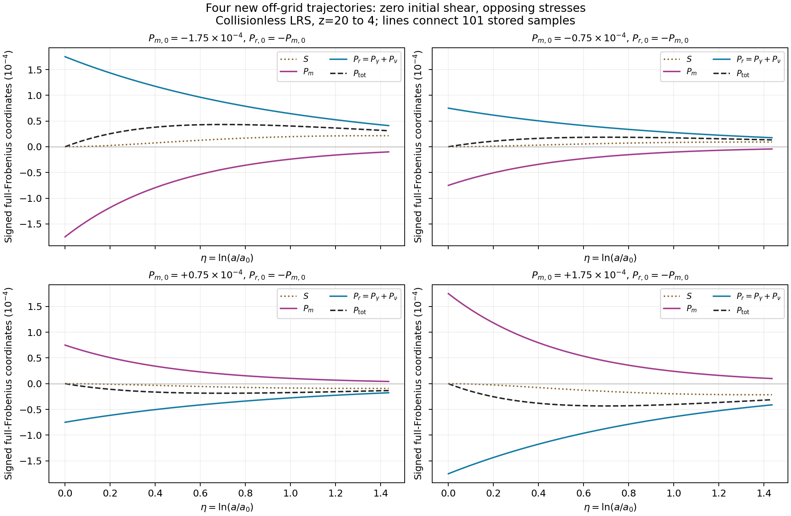
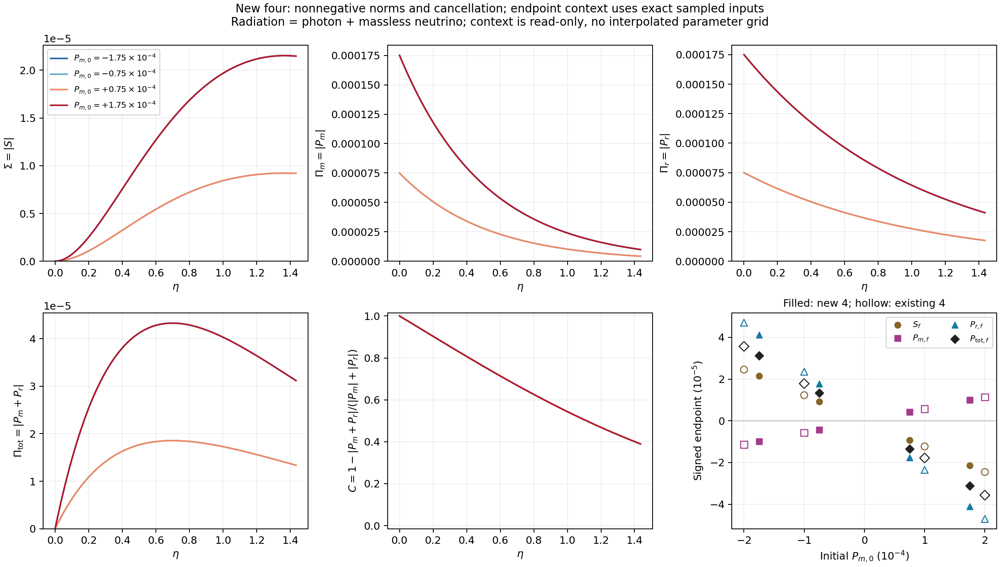
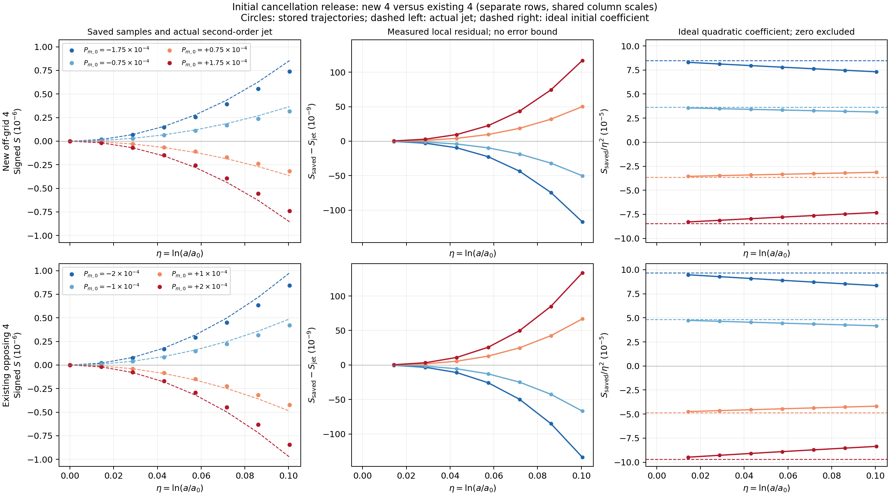

# C21N offgrid4: 초기 응력 상쇄의 실제 후속 실행

## 결과

준비된 opposing-stress 초기조건 네 개를 샌드박스에서 실제로 적분해 **4/4 완료**했다. 기존 C21L81·독립125는 재적분하지 않았다. 새 네 경우의 전체40상태·101저장점, matter/photon/neutrino/radiation/total tensor·signed amplitude·norm·상쇄, 그림과 검산을 보존했다. 새 4개를 더한129개는 불규칙한 확장 ensemble이며 새로운 정규3차원 격자가 아니다.

초기 matter와 radiation 응력을 서로 상쇄해도, 질량껍질에 따른 서로 다른 진화 때문에 total stress와 shear가 발생한다. 양의 초기 matter 응력에서는 이후 signed shear가 음수가 되고, 음의 matter 응력에서는 양수가 된다. 이 결론은 아래 지정된 source와 네 초기조건에 한정한다. General triaxial·full reionization·CMB는 HOLD이며 `global_error_bound=null`이다.

근거: [실행 영수증](execution_checks/EXECUTION_RECEIPT.json), [분석 요약](analysis/SUMMARY.json), [원 raw](raw_offgrid4/MANIFEST.json).

## 1. 최신 외부 결과와 source 보존

13:06:07 UTC에7개 저장소의1,240개 advertised head를 확인했다. 이전 통합 기준1,233개 대비 추가7·변경3·삭제0이었다. BASS_CR의170개 head와PR90–93은 기존 권위값과 일치했다. 다른 대화 검색은 실제 `UNAVAILABLE`였고, 검색 index의 누락을 결과 부재의 근거로 쓰지 않았다.

REI215/BASS178의ACCEL02는 C15의 짧은 warm 구간 a=.1999→.2와 half-norm 입력을 쓰며, 현재 PR147의 z20→4 네 입력과 source·구간·좌표가 다르다. 실제 pinned contract·case·build·runtime를 읽고 분류했다. C++ 반사쌍·Neumaier 합산은 원 FP 연산 순서를 변경하므로 현재의 동일 연산식 재사용 경로에 자동 도입하지 않았다. 외부 성능 수치를 옮겨 쓰지 않았다.

HH130의1,231개 tail, REI199/HE83/REC117의 다른 source 결과와237개 tail, REI216/HH131의 저장점 shear reversal bracket은 별도 lineage의 완료 metadata로 기록했다. 전체 raw/build를 독립 수용하지 않은 항목은 원 보고서의 주장으로 귀속했다. VigilODE의 새NCP 반환은 heat/FVM solver 연구이며 Bianchi IVP가 아니다. HH132는 실행0인 계약 checkpoint다. 새로 관측한 결과를 전역 부재로 오인하거나 현재 원 source로 소급 대체하지 않았다.

상세 source·fixture·검증 범위와 미확인 필드: [외부 intake](intake/github/RESUME_INTAKE.json), [전체 ref delta](intake/github/LIVE_REF_DELTA.json). 알려진 백업 폴더의 조사 범위: [저장처 intake](intake/SCOPED_RESUME_RECEIPT.json).

## 2. 실제 실행 문제

| 항목 | 값 |
|---|---|
| 물리 source | REI `3b85dedce84d37b3e165da00685a8a984950aafe` |
| 실행 code content | BASS_CR `5ecb8a6c4961302b7066b06278e72ecd2d77f8c9` |
| 기준 document HEAD | `0f45d0a422d79ccead565a8abaab860fcc230687` |
| Run ID | `c21n_offgrid4_opposing_z20_z4_20261021` |
| Run identity | `f42cb88bea0ebc3ed6114f092751ea9343dee9c46fbf474215fef2c9375c9023` |
| Grid SHA256 | `2a74af40c5508fc332dd3671955ad2dda6fc3e8de51bc61dcc3730a6798913b5` |
| 조건 | non-tilted, collisionless LRS Bianchi I; z20→4 |
| 분포·격자 | mass/Tref30, massive fraction.1, radial24/angular12/Gauss3, L8 |
| Solver | 원 DOP853, FP64, rtol3e-11/atol3e-13, 40상태×101저장점 |
| 초기 signed 좌표 | S0=0; Pm0=±7.5e-5, ±1.75e-4; Pr0=−Pm0 |
| 실제 환경 | sandbox host af4832b34a81; Python3.12.14/NumPy2.3.5/SciPy1.17.0 |
| 실행 자원 | quota8CPU/8GiB, workerCPU1–4, coordinatorCPU0 |
| 새 ODE / 기존 ODE 재실행 | 4 / 0 |

새 source 수정 없이 기존 준비 연산 재사용 계층을 실제 적분에 사용했다. Worker마다 A와 무관한 immutable momentum/angular geometry를 재사용하고, 각 A의 distribution weights·packet populations·reference normalization은 다시 만들었다. Moment/RHS/FP64/허용오차/방정식은 변경하지 않았다. 자세한 provenance와 자원 관측은 [운영 기록](OPERATIONS_KO.md)을 따른다.

## 3. signed 좌표와 norm

원 source의 `Pi_*_J_m3`는 tensor norm이 아니라 signed LRS amplitude $p_X=\Delta p_X/3$이다.

\[
\sigma_{\hat i\hat j}=\operatorname{diag}(-s,-s,2s),\qquad
\pi^{(X)}_{\hat i\hat j}=\operatorname{diag}(-p_X,-p_X,2p_X).
\]

따라서 $|\sigma|=\sqrt6|s|$, $|\pi_X|=\sqrt6|p_X|=\sqrt{2/3}|\Delta p_X|$이고,

\[
S=\frac{\sqrt6s}{H_t},\qquad
P_X=\frac{\sqrt6(8\pi G/c^2)p_X}{H_t^2},\qquad
\Sigma=|S|,\quad\Pi_X=|P_X|.
\]

$H_t$는 초의 역수이며 에너지 coupling $\kappa_E=8\pi G/c^4$와는 $H_{\rm geom}=H_t/c$로 대응한다. 모든 그림/CSV는 full Frobenius이며 원 half-contraction과 $\sqrt2$ 차이를 유지한다.

$P_r=P_\gamma+P_\nu$, $P_{\rm tot}=P_m+P_r$로 tensor를 먼저 합한다. 따라서 일반적으로 $\Pi_{\rm tot}\ne\Pi_m+\Pi_r$이다. Photon과 실제 존재하는 massless neutrino는 별도 배열로 남겼다. Isotropic dust의 응력0은 모델의 정의이며, 없는 UV와 모델링하지 않은 baryonic anisotropic stress를0으로 대체하지 않았다. [분석 방법](ANALYSIS_METHOD_KO.md), [NPZ](analysis/components_offgrid4.npz)에 정의·species·tensor 정보가 있다.

## 4. z=4 endpoint

다음 표의 모든 열은 signed full Frobenius 좌표이며 norm은 해당 값의 절댓값이다.

| Pm0 | S_f | Pm_f | Pr_f | Ptot_f | C_f |
|---:|---:|---:|---:|---:|---:|
| −1.75e-4 | +2.14722623e-5 | −9.96100539e-6 | +4.11389388e-5 | +3.11779335e-5 | .3898636502 |
| −7.5e-5 | +9.20242234e-6 | −4.26904013e-6 | +1.76310855e-5 | +1.33620453e-5 | .3898644425 |
| +7.5e-5 | −9.20245870e-6 | +4.26909686e-6 | −1.76312530e-5 | −1.33621561e-5 | .3898656311 |
| +1.75e-4 | −2.14724603e-5 | +9.96131424e-6 | −4.11398509e-5 | −3.11785366e-5 | .3898664236 |

\[
C=1-\frac{|P_m+P_r|}{|P_m|+|P_r|}
\]

는 전체 성분 norm 합에 비해 상쇄된 비율이다. 처음에는 거의1이던 값이 끝점에서 약.38986으로 감소한다. 부호를 버리고 norm을 더하면 이 상쇄를 재현할 수 없다. 양·음 입력의 norm 곡선은 매우 가깝지만 정확한 antisymmetry를 가정하지 않았다. 원 FP 초기 잔여응력도 그대로 보존했다. 근거: [endpoint CSV](analysis/endpoints_offgrid4.csv).

새4개 끝점의 norm 최대값은 $\Sigma=2.1472460270\times10^{-5}$, $\Pi_m=9.9613142422\times10^{-6}$, $\Pi_r=4.1139850874\times10^{-5}$, $\Pi_{\rm tot}=3.1178536631\times10^{-5}$다. Radiation의 별도 끝점 최대값은 photon $2.4343043570\times10^{-5}$, massless neutrino $1.6796807304\times10^{-5}$다.

저장점 전체에서는 shear 최대 $2.1526045930\times10^{-5}$가 z≈4.37196의 저장점에서, total stress 최대 $4.3273230896\times10^{-5}$가 z≈9.39506의 저장점에서 나타난다. 이들은101개 저장점 중 최대이며 연속 시각의 정확한 최대값이라는 주장은 하지 않는다.

기존125에 새4를 더해도 ensemble 끝점 최대값은 기존과 같다: $\Sigma=1.4449836382\times10^{-3}$, $\Pi_m=1.2574783730\times10^{-5}$, $\Pi_r=6.3444800648\times10^{-5}$, $\Pi_{\rm tot}=7.5774995714\times10^{-5}$. 이 값들은 지정된 입력 집합의 결과이며 보편적 상계가 아니다. [끝점·저장점 해석 영수증](checks/ENDPOINT_INTERPRETATION.json).

## 5. mass-shell 초기 응답 검증

이전 C21N에서 유도하고 SciSpace·Exa의 원전 확인 및 Wolfram 대수 검산으로 뒷받침한 식을 이번 새 네 입력에서 재사용했다. 문헌 검색·CAS·기존125 이론 검증을 반복하지 않았다. 원 유도와 CAS의 범위는 [C21N 유도](../cr_c21n_mass_shell_cache_20261021/theory/MASS_SHELL_DERIVATION_KO.md)에 남아 있다.

$\eta=\ln(a/a_0)$이고 정확한 이상적 $S_0=P_{{\rm tot},0}=0$에서는

\[
S''_0=-(1-\beta_m)P_{m,0},\qquad
S(\eta)=-\tfrac12(1-\beta_m)P_{m,0}\eta^2+O(\eta^3).
\]

현재 source의 mass-shell packet 합에서 얻은 새4의 $\beta_m$ 범위는 .03170076439059277–.031700764390593994다. 질량을 가진 성분의 초기 응력 감쇠율이 radiation의 −4와 달라 상쇄가 풀리는 방향을 설명한다. 이 계수는 현재 질량·분포·격자에 결속돼 있다.

실제 비교는 FP offset을 포함한 $S_{\rm jet}=S_0+S'_0\eta+\frac12S''_0\eta^2$를 사용한다. 새4의 첫 양의 저장점 $\eta=.014350845252893228$에서 상대 잔차 최대값은2.1223366%, $\eta=.10045591677025259$에서는15.8374303%다. 마지막 비교점의 절대 잔차 최대는 $1.1689730151\times10^{-7}$이다. 이는 저장된 수치 궤적과 국소2차식 사이의 관측 차이이며,1% 근사나 전 구간 대체 모델의 근거가 아니다. 3차 계수·유한구간 remainder·전역 오차 상계는 모두 `null`이다. [초기 jet CSV](analysis/initial_jets_offgrid4.csv), [관측 잔차 CSV](analysis/early_jet_residuals.csv).

## 6. 실제 검산과 제한

| 검사 | 범위·결과 |
|---|---|
| 초기 mapping/Y0 | mapping dictionary equality; 원 기록 parameter·prepared builder·raw의40성분 bytes 동일 |
| Cached/uncached fields | 새404저장점,23,836 FP64값 bytes 동일 |
| Cached/uncached RHS | 새404저장점,16,160 FP64값 bytes 동일 |
| 원 fields/저장 raw fields |23,836값 수치차0이며 bytes도 동일 |
| Hamiltonian 최대 상대 잔차 |2.2204460493e-16 |
| Massive comoving number 최대 상대 잔차 |4.4408920985e-16 |
| Radiation number 최대 절대 잔차 |0 |
| 최소 massive cell population |1.1994543757e-30, 양수 |
| L8 radiation 각도 복원 |64Gauss노드×404상태×4배열=103,424값, 최솟값.941509322965 |
| Massive energy 항등식 최대 절대 잔차 |8.8948670505e-16 |
| Radiation energy 항등식 최대 절대 잔차 |1.0525050973e-14 |
| Signed shear 항등식 최대 절대 잔차 |4.3622196784e-20 |
| SI sum/source forcing grouping 차이 |최대4.4045713257e-20; 원값 보존 |
| 입력 불변 |분석 전후 source·raw·receipt·context SHA/크기 일치 |

위 항등식 잔차는 코드에 명시된 정규화의 진단값이다. Hamiltonian이 작다는 사실이나64개 각도 노드의 양성만으로 연속 각도 양성·모든 adaptive stage 동등성·수치 수렴률·전역 오차 상계를 보증하지 않는다. 원 uncached solver의 독립 전체 trajectory 재실행은 `NOT_RUN`이다. [물리 검산](analysis/PHYSICS_CHECKS.json), [입력 binding](analysis/INPUT_BINDINGS.json), [산출 manifest](analysis/OUTPUT_MANIFEST.json).

작성자·root와 독립 검토자가PNG3개를 직접 읽고 `PASS_SCOPED`로 마감했다. 최종 독립 검토는 별도 `checks/INDEPENDENT_REVIEW.json`에 결속하며 producer SUMMARY의 과거 pending 표지는 덮어쓰지 않는다. 별도 PDF raster 검토는 `NOT_RUN`이다.

## 7. 이번 코드 기여와 남은 범위

새 분석기는 원 C21L tensor 분해, C21M saved-state 물리 검사, C21N mass-shell derivative를 그대로 재사용한다. 다른 source인 기존M loader의 경로 검증을 느슨하게 바꾸지 않고, N 실행 manifest와 code 경로를 새 loader에서 명시적으로 검사했다. 외부 input/output 경로와 create-only 결과를 지원한다.

새 `completed_input_guard.py`와129개 registry는 이번에 소모한 네 입력까지 재실행을 차단한다. 이름이 바뀐129개 입력·근접 좌표·invalid/중복 입력·변조된 source binding을 대상으로 새 focused 검사를 수행했다. 원125 registry와 source는 보존했다. 이 guard는 역사적 launcher에 자동 적용되지 않으므로 향후 승인된 새 grid의 실행 명령에서 명시적으로 먼저 호출한다. [Guard 검사](execution_checks/INPUT_GUARD_FOCUSED.json).

이번 offgrid4 실제NCP 실행은 `NOT_RUN`이지만, 같은 네 경우를 NCP에서 반복할 필수 작업은 없다. 이전 NCP98의 완료는 별도로 유지한다. 새 물리 입력이 승인되기 전까지 새 sweep·benchmark·C21O 연구 사이클을 자동으로 시작하지 않는다. 속도 향상·메모리 개선·64-core scaling은 측정하지 않았다.

Content/document 게시와 provider ACK의 최종값은 후속 `FINAL_CLOSEOUT_KO.md`, `PUBLICATION_RECEIPT.json`, `BACKUP_RECEIPT.json`, 최종 authority receipt를 따른다. 이전 C21F–K의 source/HOLD/실패/raw/역사적 게시 상태는 변경하지 않았다.
