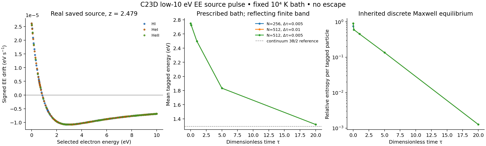

# C23D: 실제 C23B 광전자 공급과 기존 유한 온도 EE 연산자의 연결

## 결과와 연구 범위

이번 단위 `CR_N4_STOPPING_C23B_EE_BRIDGE`는 C23B의 저장 광전자 atoms를 기존 PR59 Maxwell-bath Coulomb 연산자에 연결했다. 표준 EE 계수, 가역 격자 연산자, moving-cutoff 원장과 first-passage 식은 기존 완료 근거를 재사용했다. 새 기여는 **실제 공급자의 단위·밀도·열전자 소유권·저에너지 창·작은 pulse 적용성·시간척도·수치 진화**의 결속이다. 소비자 이름은 `C23D_FROZEN_MAXWELL_EE_LOW10_V1`이다.

고정한 세 redshift의 새 입력에서 희박성 기준, source의 수/에너지 투영, 양수성, 같은 경계의 수/에너지 원장, 공간/시간 민감도와 first-passage 상단 경계 민감도가 통과했다. 독립 고정밀 비교와 실제 배송 경로 검토 결과는 `theory/independent/C23D_C9_REVIEW_KO.md` 및 동반 machine record에서 최종 확인한다. 이 보고서의 숫자는 아래 create-only run에서 읽었다.

선택한 bath는 이전 five-label 예제를 명시적으로 재사용한 합성 입력이다. 실제 우주 평균 IGM 조건의 추정값으로 제시하지 않는다. 전체 `CR_N4_STOPPING_KERNEL`은 EE 외 충돌 채널과 finite-bath/escape 조건이 남아 있어 **PARTIAL/OPEN**이다. `global_error_bound`, 전체 물리 stopping/heating 및 전체 목표 완성률은 null이다.

## 1. 먼저 확인한 최신 상태

2026-10-23 21:57:23–21:57:27 UTC에 지정7개 repo의 REST visible branch refs와 열린 PR metadata를 끝까지 페이지 처리했다. 15개 branch 페이지와11개 PR 페이지의 terminal 결과 및 중복 검사를 보존했다. Git wire 요청은 proxy 연결 실패여서 REST로 대체했다.

| Repo | Visible branches | Open PRs |
|---|---:|---:|
| bass_cr |176|97|
| bass |269|154|
| rei_bianchi |263|207|
| BASS_HE |97|92|
| WU088_HH |150|141|
| rec_bianchi |148|96|
| vigilode |198|51|
| 합계 |1301|838|

보존된 완전한 이전 inventory1294개와 비교하면 +7/4changed/0removed다. 더 오래된1255개 관측을 이번 delta의 분모로 사용하지 않았다. 관련 원문24개277398bytes는 현재 Git blob/size와 일치했다. 변경 관련 PR11개와 Coulomb PR58–64 본문을 읽었고, 모든 branch의 전체 history/body를 읽었다고 주장하지 않는다. 상세 결과는 `intake/CURRENT_INTAKE_KO.md`에 있다.

현재 bass_cr 기반은 F=`ec0c2cb8cc9feae64fe028ca2a4ea0eb7d79c8f8`, 중앙 기반은 M=`68420637a9ab54ada92afd786c5733bc0764b8c9`였다. root AGENTS 및 실행/보존 정책은 기존 검증본과 같았다. 고정 사용자 인계0f9d9df의 원 계약과 이후 N4 수신 완료 overlay를 구별했다.

병렬 결과 중 WU088_HH PR140은 PHYS83 완료, PR141은 source adapter 소유자의 진행을 나타낸다. BASS_HE PR92는 계약/controls 완료와 empirical source pending을 구별한다. REC130의 history/boundary, BASS184의 collisionless smooth-source, REI221의 prescribed-background angular thermochemistry, VigilODE80/81의 readiness/norm 결과는 각각의 모델/소유권으로 유지했다. 이들의 rate·오차·ensemble을 본 EE 입력에 합치지 않았다.

다른 대화에 대해서는 실제 Personal Context 응답이 unavailable이었다. 전체 대화는 **UNAVAILABLE**, 외부/NCP runtime·lease는 **UNOBSERVED**다. 알려진 N4 복구 ZIP은4927084bytes/SHA8132e52d…와 일치했고, Library/Dropbox의 이전43-payload R3를 재사용했다. Drive exact lookup0은 기존 UNKNOWN_NO_ACK를 실패로 확정하지 않는다. 이 조사에서 재다운로드나 과거 과학 실행은 없었다.

## 2. 재사용한 물리·코드와 새 입력

PR59 `coulomb_partition.py`는 현재 기반F에도 동일하게 존재한다. SHA256은 `0fae93ddfd555e1d135606eab51cfe010911c7624f661d27317024cf3f54ba86`, Git blob은 `27923abcaef06527011eb916acf7a414dd43c128`이다. PR59의 실제 tested-code 게시commit7900d17과 최종head029b212, 현재 containing commitF의 역할은 서로 다르다. PR60–64의 reciprocal/비선형 Landau와 저장2048-cell 후속 결과도 조사해 중복 구현을 피했다. [G1]

C23B CSV는32592행,1681578bytes, SHA256 `f5bcfe477b8a073341a7496c079e6eb2737f6ca578b884376887b04989e57fc3`이다. 각 epoch10864 atoms 중 `0<W<10eV`에384개가 있다. source quadrature와 기존18개 cutoff 요청은 다시 실행하지 않았다. [G2]

명시 입력은 다음과 같다.

| 항목 | 값 |
|---|---|
| redshift |2.316,2.479,2.649; 보간 없음|
| 온도 |10000K|
| HI,HII,HeI,HeII,HeIII |0.9,0.1,0.07,0.02,0.01 cm^-3|
| 초기 자유전자/열전자 |별도 필드로 각각0.14cm^-3; 초기 resolved nonthermal0 선언|
| Coulomb log |일정20, prescribed leading-log 모델|
| pulse 크기를 정의하는 exposure |10000proper s|
| cutoff |chi=1.5,3; q=chi*kBT|
| first-passage 상단 |40theta reflecting,80theta 비교|
| 시간비 분모 |선언한 evolution time1e10s|
| escape |homogeneous closed box, no escape|

Saved `q_aj`는 absorbing target 하나당 proper second의 number weight다. 새 초기 tagged population은

\[
F_z(W,0)=\Delta t\sum_{a\in\{HI,HeI,HeII\}} n_a\sum_{j:\,0<W_{aj}<10}q_{azj}\delta(W-W_{aj}).
\]

이는 연속 광이온화/화학을10000초 적분한 결과가 아니라, 저장률에 exposure를 곱해 정의한 **impulsive 초기 입력**이다. 제외한 atoms의 수·에너지는 별도 원장에 보존했다. 부재 종이나 rate를0으로 채우지 않았다.

## 3. 물리식에서 기존 함수까지의 대응

SI에서 열전자 밀도는 `n_e,thermal`을 사용하고

\[
\Gamma=\frac{4\pi n_{e,\mathrm{th}}}{m_e^2}
\left(\frac{e^2}{4\pi\epsilon_0}\right)^2\ln\Lambda,
\quad \theta=\frac{k_BT}{\epsilon_{\rm eV}},\quad
v(W)=\sqrt{\frac{2\epsilon_{\rm eV}W}{m_e}}.
\]

기존 anchor 입력을 `W*=theta`, `b*=m_e Gamma/[epsilon_eV v(theta)]`로 결속한다. 이번 입력에서는 theta=0.8617333262145178eV, b*=2.3306698113646996e-5eV/s다. 기존 provider의 variance convention은 Var(dW)=2Ddt이며, state는 count/eV다. Flux spectrum의 평형 W exp(-W/theta)와 count spectrum의 평형 sqrt(W)exp(-W/theta)를 구별한다. 이 계수 대응은 Jeffrey et al.의 velocity-space 계수와 공식 PlasmaPy의 독립 energy-loss 표현으로 대조했다. [P1,P2]

재사용하는 식은

\[
j=-D p_\theta\partial_W(F/p_\theta),\qquad
\partial_tF=-\partial_Wj,\qquad
p_\theta\propto\sqrt W e^{-W/\theta},
\]
\[
D=\theta b_0\Phi(W/\theta),\quad
a=D'+D\left(\frac1{2W}-\frac1\theta\right),\quad
\Phi(y)=\operatorname{erf}\sqrt y-\frac{2\sqrt y}{\sqrt\pi}e^{-y}.
\]

일정 로그에서 y=W/theta, tau=(Gamma/v(theta)^3)t로 바꾸면 bath의 밀도·온도는 시간 scale과 energy scale에 모인다. 같은 bath에서 세 redshift는 source weight만 달라지므로 unique atom energy의 first-passage 적분을 공유한다. 이 구조적 계산 절약을 측정 speedup으로 부르지 않는다.

같은 moving-cutoff current를 사용한 수/에너지 원장도 PR59에서 재사용했다. 확산을 포함할 때 tail current 적분은 `int_tail aF + D(q)F(q)`이므로 drift의 에너지 moment만 사용하면 경계 확산 항이 빠진다. 구현은 기존 `moving_interface`와 `bath_energy_rate`를 호출한다. background-only heat는 `-E dot rhs`, cutoff의 보완 reservoir는 background bath+저에너지 tagged core로 분리해 표기했다. 이전 stopping heat를 다시 더하지 않는다.

## 4. 새 결과와 해석

### 적용성 및 공급 범위

| z | 저에너지 수 fraction | 저에너지 energy fraction | Ntest/ne,th | Utest/Ue,bath |
|---|---:|---:|---:|---:|
|2.316|0.91314593|0.64456301|7.34894e-8|1.56361e-7|
|2.479|0.91465580|0.65086334|7.25167e-8|1.54242e-7|
|2.649|0.91654139|0.65896264|7.07165e-8|1.50453e-7|

희박성 기준은 두 비 모두1e-3 이하이며, 세 입력이 통과했다. 전체 source를 사용해 계산한 parent depletion의 최댓값은1.20403e-8이었다. 이 값들은 perturbation-size screen이며 approximation의 전역 오차 보증이 아니다. 해당 bath의 Debye electron sphere occupancy3.67910e9, classical coupling1.39868e-7, degeneracy5.79786e-23을 함께 기록했다. 선택한 atoms의 최대 W/(m_ec²)는1.95626e-5다. 전체50keV 가까운 source의 같은 비는0.097813으로 별도 유효영역 처리가 필요하다.

10eV 미만은 전자 수의 약91.3–91.7%를 담지만 에너지는64.5–65.9%를 담는다. 제외된 energy를 이번 EE heat에 포함시키지 않았으며, 남은 약34.1–35.5%는 다음 energy-domain 연결에서 처리할 실질적인 공급 의무다.

### Signed energy exchange

각 epoch의 선택 전자 수 중 약24.84–24.85%는 초기 `a(W)>0`, 즉 배경에서 test electron으로 에너지가 이동하는 영역에 놓인다. 전체 weighted pulse의 초기 energy moment는 음수이므로 순 background EE heat는 양수다.

| z | 초기 background EE heat [eV cm^-3 s^-1] |
|---|---:|
|2.316|3.4061861293e-14|
|2.479|3.3616677703e-14|
|2.649|3.2803697848e-14|

이는 새 선언 입력의 EE 성분이다. 중성 원자 elastic/비탄성 충돌, electron-ion energy exchange, radiative/chemical energy는 별도 공급자가 필요하다. 작은 pulse라는 사실이 그 경쟁 채널의 우열을 정하지 않는다.

### 첫 진입 시간

PR59의 backward-generator 공식을 새 source weights에 평가했다. 초기 W<=q는 이 관측량의 first-entry time0이며, 아래 표는 처음에 active인 atoms끼리 정규화한 평균이다.

| z | chi=1.5 평균 [s] | chi=3 평균 [s] |
|---|---:|---:|
|2.316|282051.683|271510.074|
|2.479|281690.158|270615.538|
|2.649|281491.197|269776.031|

선언한1e10s에 대한 비는2.70–2.82e-5다. chi마다 active subset이 달라지므로 두 열의 평균 차이를 같은 초기 집단의 paired 차이로 해석하지 않는다. 각 atom의 first-entry 문제는 흡수 하단을 사용하는 진단이고, 다음 full-band 진화는 재통과를 허용한다. 영구 assimilation 또는 완전 Maxwell화 시간으로 대체하지 않는다. 40theta→80theta 상단 변경의 weighted mean 상대차 최댓값은1.86515e-14였다.

### 새로운 population 진화

z=2.479에서 기존 positive reversible generator에 실제 pulse를 수/에너지 보존 투영했다. 주 검증은256cells/delta_tau.005,512/.01,512/.005의3개 새 경로다. 별도256/.01 보조 경로가 root의 불필요성 메시지 도착 전에 완료되어 원 결과와 비용을 보존했다. 이는 admission 근거에 추가하지 않았다. 과거 Landau2048 경로나 C21O/NCP51 재실행은0이다.

기준512/.005에서 평균 energy는 tau0의2.749337509eV에서 tau20의1.319495553eV로 감소했다. tau20은1.478945361e6s이며, 이때 누적 background heat는1.451623223e-8eV cm^-3이다. 연속 Maxwell 평균3theta/2=1.292599989eV와 구별해 표시했다. 저장된 per-particle discrete relative entropy는0.902211에서0.00126157로 감소했다. 형상 차이가 남아 있으므로 이 끝점을 exact Maxwellization으로 승격하지 않았다.

그림: 왼쪽은 저장된 source atom energy에서의 signed EE drift, 가운데는 새 source의 평균 에너지와 해상도 비교, 오른쪽은 기존 discrete equilibrium에 대한 per-particle entropy다. 선은 저장 시각 사이의 표시이며 별도 continuous error certificate가 아니다.

## 5. 검증, 실제 비용과 복구 가능한 코드

공간 평균 energy 상대차1.8700194e-4는 원 기준5e-3 이내, 시간 차1.4715806e-4는 원 기준3e-3 이내다. projection, 양수성, count, opposite energy/common-face current, entropy,9개 adapter guard가 통과했다. 기준 경로 count 상대 drift는1.009e-13, common-face energy residual1.811e-16이다. 범위는 고정한 새 입력과 유한 격자이며 global_error_bound는 null이다.

독립 검토자는 production provider를 import하지 않고 raw CSV와 별도 erf/Decimal 표현으로 새로운 anchor와 source 합계를 비교했다. Decimal110 내부 정밀도/80자리 보고의56개 비교가2e-12 기준에서 통과했고, 최대 상대 차이는1.7389330e-15였다. 초기 mpmath 부재는 환경 실패로 보존하고 표준 라이브러리 독립 산술로 교정했다. 같은 이전 물리 suite를 재실행하지 않았다.

주 worker는CPU0/native threads1, coordinatorCPU8이었다. 실제 sandbox는 affinity0–8, CPU quota8, RAM8GiB이며 CPU55는 이 호스트에 없고 건드리지 않았다. 독립 검토는 별도CPU1과 lease를 사용했다. 주+보조 worker CPU1.343299031s, wall1.351787650s, dispatch wall3.212099791s이며 서로 더해 비용을 이중계상하지 않는다. 독립 검토 및 기계적 배송 수정의 실측은 별도 receipt에 남긴다. 기존 누적 비용은 이전 N4 BUDGET_CONTINUITY에서 이월하고, 알 수 없는 global spend/remaining/currency는 null이다.

현재 배송 코드의 경로 수정과 실행 시점의 과학 source는 구분했다. 실행된3개 source의 snapshot은 `implementation/history/primary_20261023T220714Z/`에 hash 일치로 보존한다. 원 `RESULT.json`의 모호한 new_ODE0 필드는 그대로 남기고 `RESULT_CLARIFICATION.json`이 새 linear EE ODE trajectories3+보조1, coupled/cosmologicalODE0으로 교정한다. 배송 producer에는 명료한 새 필드를 적용하고, 경로 변경에는 relocation smoke만 수행했다.

## 6. 다음 DAG와 claim gate

| 노드 | 이번 상태 | 실제 남은 행동 |
|---|---|---|
|CR_N4_C23B_CUTOFF_BINDING|기존 COMPLETE_SCOPED/CONSUMER_ADMITTED 재사용|기존18 요청·KC 근거 유지|
|CR_N4_STOPPING_C23B_EE_BRIDGE|고정 입력 검증 및 독립 검토의 scoped 결과|게시/백업 receipt를 최종 authority에 결속|
|CR_N4_STOPPING_KERNEL|PARTIAL/OPEN|neutral/ion/inelastic 경쟁 채널과 finite-bath/escape 연결;10eV 이상 source 유효영역|
|CR_N5_ATOMIC_ISOTOPE_COVERAGE|구조 계약 재사용, empirical coverage OPEN|PHYS83/84 owner 결과 수신과 실제 종·전하·energy-domain matrix|
|CR_N6_CONSERVATIVE_COUPLING|선행 gate 대기|같은 source/event count의 thermal/nonthermal/binding/photon/escape RHS|
|CR_N7_NEW_PARCEL|선행 gate 대기|닫힌 source 계약 뒤 새 입력의 결합 궤적|

다음 단위는 N5의 source-owner 실제 공급자 수신 및 EE와의 경쟁률 비교다. PHYS84/HE-ANG owner가 활성인 상태에서 같은 공급자를 재구현하지 않는다. 필요한 rate가 없는 항목은 null로 남긴다. PR60–64의 finite-bath 대안을 새 source에 채택할 때는 해당 원본 구현/입력과 유효 범위를 받아 바뀐 의존성만 검증한다.

Inherited: non-tilted LRS/full Frobenius, signed amplitudes와 scalar norm/cancellation 구별, isotropic atomic gas와 nonbaryonic Vlasov stress 분리. Full high-energy nuclear 및 general triaxial/tilted/polarized CMB HOLD. Original nuclear-network PNG는 NOT_RECOVERED_NOT_READ. REI220/BASS180 mirror의 대표4raw PASS_SCOPED와 최초JSON실패/재적분 이력, VigilODE P02 C6FAIL, HE85/REI219 미완료 campaign을 그대로 보존한다.

새 strong no-go를 주장하지 않으므로 NG1–NG7 신규 성과 gate는 NOT_APPLICABLE이다. 이번 개선은 완료한 provider와 새 consumer를 실제로 연결한 것이다. API/구조 검사, 수치 결과, 물리 채택, 게시, 원격 보존은 서로 다른 상태로 최종 authority에 기록한다.

## 근거

- [G1] https://github.com/cosmosapjw-quantum/bass_cr/tree/029b2122db4f76f5a639e8ae4d58cf552e71b91d/research/cr_coulomb_partition_20261014 ; 현재F 동일 blob 확인. PR60–64 비교는 intake 원문 참조.
- [G2] https://github.com/cosmosapjw-quantum/bass_cr/tree/54c2ff11e8308d45c545679301059bc1fcf268eb/research/cr_c23c_stopping_coverage_20261023 ; 공급 CSV identity 재사용.
- [P1] Jeffrey et al.2014, DOI10.1088/0004-637X/787/1/86, https://arxiv.org/pdf/1404.1962 ; Appendix 및 계수식 직접 읽기.
- [P2] PlasmaPy 공식 소스 https://docs.plasmapy.org/en/stable/_modules/plasmapy/formulary/collisions/frequencies.html ; independent normalization reference, code 설치/복사 없음.
- SciSpace discovery와 실제 Wolfram scalar result/warnings: `theory/EXTERNAL_RESEARCH_RECEIPT.json`. PR59 재사용을 발견한 뒤 같은 계수 검산 반복을 중단했다.
- 실제 주 run: `runs/c23d_source_ee_20261023T220714Z_v1/`; 보조 run: `runs/c23d_source_ee_supplement_20261023T220810Z_v1/`.

**EXECUTION:** 새 source 연결·MFPT·population evolution 및 targeted 검증 완료; prior replay0. **PUBLICATION:** 실제 commit은 delivery/PUBLICATION_RECEIPTS.json으로 결속. **BACKUP:** artifact별 최종 provider receipt를 참조; 과거 Drive UNKNOWN_NO_ACK 유지. **DAG:** scoped EE 결과와 full stopping PARTIAL/OPEN을 구별.
