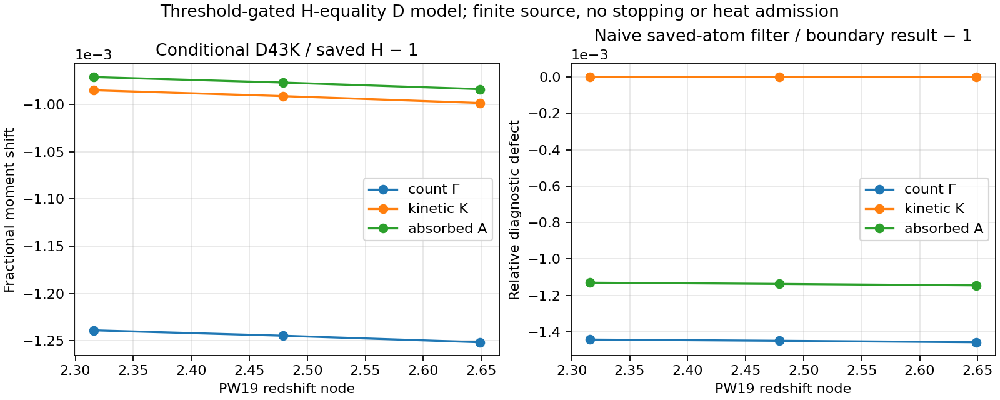

# C23E 연구·구현 결과

2026-10-24 KST. Root 판정: **COMPLETE_SCOPED / NUMERICALLY_CHECKED_SCOPED**. Fresh Astra 독립 검토 PASS_SCOPED, 한 번의 배송 경로 교정 R1 CLOSED. 부모 CR_N5_ATOMIC_ISOTOPE_COVERAGE는 PARTIAL, empirical D PI/RR·Milne 및 full21 rate coverage는 OPEN이다.

## 새로 얻은 결과

저장된 C23B H 광원 모멘트에서13.6eV부터13.6+43kB eV까지의 작은 구간만 계산하여 조건부 D 모멘트를 구성했다. 전체 H 광원이나 H/D 열적 진행량 ODE를 다시 계산하지 않았다. 새 boundary-transfer 식의 최대 독립 D 적분 상대차는1.7485509595587793e-15다. 이 값은 선택한 유한 광원/단면적 모형의 수치 일치이며 실제 천체모형 불확실성이나 전역 오차 상한이 아니다.

| PW19 z | D 사건률 s^-1 | D primary kinetic eV/target/s | D absorbed eV/target/s | GammaD/GammaH-1 |
|---|---:|---:|---:|---:|
|2.316|1.2025373321214547e-12|4.5233691002664966e-12|2.0882332763047237e-11|-0.001239056411174|
|2.479|1.1856266948265418e-12|4.431826519177986e-12|2.0560742853171096e-11|-0.001244776175945|
|2.649|1.1549471328392815e-12|4.285607149373468e-12|1.9997167758655547e-11|-0.001251676479172|

원 H atom을 문턱에서 단순 필터하는 방법은 연속 D-source 기준 사건률에 각각-0.001443462759768,-0.001450100318453,-0.001458104725752의 상대 차이를 보였다. 약0.144–0.146%의 감소다. 같은 비교의 primary kinetic 차이는약-2.01e-7..-2.06e-7이다. 두 모멘트에 대한 오차 양상이 다르므로 count와 energy를 별도 검증해야 한다. 이는 원 C23B finite-measure 계산의 실패가 아니라 새 동위원소 문턱에 맞춘 경계 정렬의 필요성을 보여준다.

## 실행과 검증

Run: `C23E_D43_SOURCE_BINDING_20261024T021612Z_v1`.

| 검증 | 실제 결과 | 동결 기준 |
|---|---:|---:|
|GL8/16/32 band 최대 상대차|5.626252649309911e-16|2e-10|
|새 D-target 독립 quad와 최대 상대차|1.7485509595587793e-15|2e-11|
|광원 energy ledger 최대 상대잔차|8.07907976464989e-17|5e-14|
|8핵종·전하 integer incidence|정확히0|정확히0|
|순간 상태 핵종 잔차|0|정규2e-13|
|thermal/fast/all 전자 pool 잔차|1.1401679038436815e-16|정규2e-13|
|전체 사건 에너지 잔차|6.824722606685112e-17|정규2e-13|
|상태 퍼텐셜 contraction 진단|1.25791865881435e-16|구성항 규모2e-13|

Primary104checks PASS,18개의 제조된 순간 상태(3z×3T×2fast fractions), 새D domain 적분3개, band9개를 수행했다. ODE0, 완료 계산 재실행0, NCP0, benchmark0이다. 원자 목록은21개 모두 입력하며 나머지 핵종은 선택 반응의 spectator다. 누락species, 다른potential, electronpool 불일치와 범위 밖 온도는 명시적으로 거부했다.

실행 당시 affinity는CPU0..8, cgroup quota8CPU/8GiB였다. CPU55는 해당 affinity에 존재하지 않았으며 coordinator0/worker8을 사용했다. 모든 수치 라이브러리는1thread, cooperative lease와 create-only 출력을 사용했다. 실제 childCPU2.161932s, wall2.171415343s, maxRSS122500KiB였다. 60CPU초/180wall초/1GiB address-space cap 안에서 끝났다. 이것은8CPU/64CPU 병렬 성능 측정이 아니다.

추적 가능한 선행 CPU13.331329114s와 합쳐 known subtotal15.493261114s다. CAS와 모든 이전 프로젝트 비용은 측정되지 않았으며 금전/잔여 예산은null이다. 구체적 계보는 BUDGET_CONTINUITY.json에 있다.

## 독립 검토와 단일 교정

Fresh Astra reviewer는 동결 계약·유도·세 실행script·재사용 source와 입력 hash·저장 raw를 직접 읽었다. 추가 과학 suite는 실행하지 않았다. 수학식과 unit/에너지 부호/두 전자 pool에서 material defect는 없었다. 배송본 validator의 외부 절대경로, 이미 있는 exact입력을xb로 다시 쓰는 동작, dispatcher import의 실행 부작용을 하나의 재현성 finding R1로 모았다.

Lower-tier coder가 같은 식·계수·허용오차를 보존한 채 상대경로/입력 읽기/main guard만 고쳤다. 원래 실행script3개는 source_snapshot에 bytes/hash 그대로 보존했다. 배송용 source identity는 별도 manifest다. import 무쓰기·무spawn, exact입력, create-only 충돌, 원 raw 보존 등29개 targeted checks가 통과했다. 과학 적분·point state 호출0이었다. 같은 독립 reviewer가 수정 diff와 실제 receipt만 확인하여R1을 닫고 PASS_SCOPED를 발급했다.

## 과학적 범위

이번 모형은 chiD=13.6eV+43kB, threshold-gated H cross section, VF H-equality RR/capture moment, WU PHYS79의 kr-preserving D43K CX를 결합한다. PI primary energy는 fast pool로 들어가며 thermal heat와 중복되지 않는다. RR은 thermal pool만 소비한다. 같은 potential을 쓰는 PI/RR/CX 경로에서 energy balance가 닫힌다.

이 조건부 결속으로 실제 D 단면적의 finite-mass/level-resolved 보정이나 microscopic Milne 관계를 인증하지 않았다. N5 모든종 CI/RR/DR/CX, fullthermal/UV/stars/nuclear network, neutral/ion/inelastic stopping, finitebath/escape, 새 cosmological trajectory는 OPEN이다. global_error_bound 및 global_completion_fraction은null이다. 동일-rate isotope quotient를 이번 문턱 차이 모형에 자동 적용할 수 없으며 D상태와delta*nD+ 장부를 유지한다.

## 게시·보존

과학 판정은 위 raw와 독립 검토에 결속된다. Git 실제 commit/PR 및 provider별 최종 ACK·byte 검증은 PUBLICATION.json, BACKUP_RECEIPTS.json과 최종 authority receipt에 기록한다. 문서의 과학 완료와 Drive 보존 상태는 독립이다. 기존 C23D/oldN4 Drive UNKNOWN_NO_ACK는 소급 승격하지 않는다.
