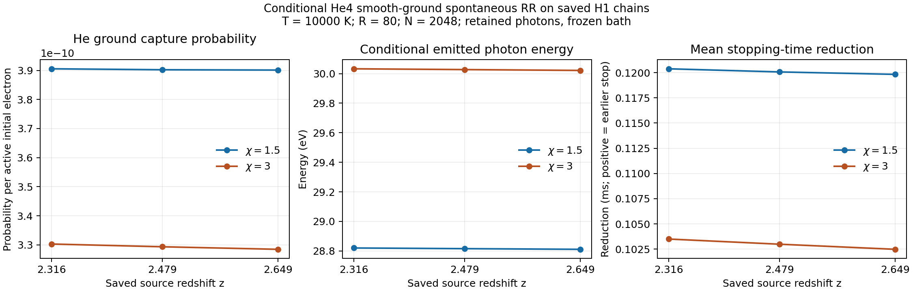

# He4 ground RR 소비자와 외부 분포·주입 인터페이스

작업일: 2026-10-25. 기준 `bass_cr` expansion commit은 `8d0a5c375589fbddadc2bb90c8117311c80bad09`다. PR105 H1 RR 계보와 별도 PR100 C23E 계보를 구분해 재사용했다. 현재 요청에 따른 두 단위의 과학·구현 결과를 이 문서에 합친다. 실제 Git commit과 백업 ACK는 같은 디렉터리의 delivery receipts 및 최종 authority에 별도로 결속한다.

## 1. 확보한 결과

**He4⁺(ground 1s)+e → He4(ground singlet)+spontaneous photon**을 기존 H1 RR가 포함된 저장 체인에 추가했다. 새 8개 변경 연산자에서 192개 RHS, 24개 source-weighted 행을 계산했고 216개 grid/domain 비교를 통과했다. 별도 검토자는 production module을 import하지 않고 Decimal70으로 48개 RHS와 72개 원자료 계수를 검산했다. 최대 열별 상대차는 `4.243216244181207e-11`, 원 기준은 `5e-10`이다.

외부 photon/electron/baryon source에는 측도·frame·clock·volume·isotope·에너지 소유권을 명시하는 타입과 검사, 공통 사건 장부, EOS 미분 및 cutoff flux 인터페이스를 구현했다. 실제 소비 경로는 고정 C23B 32,592개 atom/9개 channel-epoch 사례와 C23E 18개 point/90개 signed event다. 26개 집중 control과 실제 저장 자료의 SI 변환·장부 검사가 통과했다. 임의의 β spectrum, 비등방 분포, 유한질량·cascade·stopping 공급자의 물리적 승인은 각 공급 계약에 남아 있다.

근거 상태는 He4에 `literature-supported / derived / implementation-verified / numerically checked`, 외부 인터페이스에 `derived / implementation-verified`다. N4/N5는 `PARTIAL_OPEN`, N6/N7은 `PREDECESSOR_GATED`, 전체 물리 완료율과 전역 오차 경계는 `null`이다.

## 2. He4의 원자료와 계산식

REI151 `8a4f5df46f6e3058f5e685b85cc1cf3c20926368`의 Milne convention과 C23B의 고정 Verner96 HeI 공급자를 사용한다. 원 table SHA256은 `a53e73b0af4cc6b801aef67b84bd964e3ed8c9c4992f214e4a69dc7e4443f389`, provider module SHA256은 `71b7e3a6b6f1c68ec15bcb19b98014bc025ef595f53df29703f11e25f36f4a8d`다. 원 threshold 24.59 eV와 통계인자 `d=2 g_ion/g_bound=4`를 보존한다. 포획 이온 밀도는 ground HeII에 배정한 `0.02 cm^-3`이며 thermal electron density `0.14 cm^-3`와 구분한다.

전자 운동에너지 E와 photon energy ε=E+I에 대해

\[
\sigma_{\rm RR}(E)=\sigma_{\rm PI}(E+I)
\frac{(E+I)^2}{d(m_ec^2)_{\rm eV}E},\qquad
\lambda_{\rm He}=n_{\rm HeII}\,v(E)\,\sigma_{\rm RR}(E).
\]

cm 단위의 hazard에서는 `v_cm_s=100 sqrt(2 E eV_J/m_e)`를 쓴다. `m_e=9.1093837015e-31 kg`, `c=299792458 m/s`, `eV_J=1.602176634e-19 J/eV`다. E>0이고 E+I가 원 PI support [24.59,50000] eV 안에 있어야 한다. 이 공급자는 stationary heavy target, zero recoil, 비상대론적 spontaneous component의 smooth ground-channel 모형이다. He4 isotope assignment와 residual-ion state resolution은 명시된 조건부 모형 가정이다.

Verner–Ferland는 해당 계열 PI fit을 ground recombination에 적용한다. Verner et al.의 HeI 입력은 Samson 계열 절대 PI 측정에 근거한 smooth fit이다. 이 자료와 완전한 잔류 이온 상태별 실험 분해의 근거는 구분해 보존한다. [Verner–Ferland §2](https://arxiv.org/pdf/astro-ph/9509083), [Verner et al. §§2–3](https://arxiv.org/pdf/astro-ph/9601009), [독립 source 검토](../cr_he4_ground_rr_20261025/review/SOURCE_REVIEW.md)에 원자료 대응과 유효범위를 기록했다.

기존 H1 체인의 저장 binary64 행렬을 정확한 새 numerical baseline K_H로 정의한다. 새 연산자는

\[
K=K_H+\operatorname{diag}(\lambda_{\rm He}),\quad
p_{\rm He}=K^{-1}\lambda_{\rm He},\quad
r_{\rm He}=K^{-1}(E\lambda_{\rm He}).
\]

H1·He4·CE·first-entry는 같은 K를 공유한다. H1과 He4에 별도의 killed chain을 풀어 확률을 합산하지 않는다. `w=K_H^-1 lambda_He`, `η=max(w)`이면 양의 resolvent로부터

\[
w-p_{\rm He}=K^{-1}\operatorname{diag}(\lambda_{\rm He})w,
\qquad \frac{w}{1+\eta}\le p_{\rm He}\le w
\]

를 얻는다. 안정적인 기존 관측량 변화는 `delta h=-K^-1 diag(lambda_He) h_old`로 계산한다. 서로 거의 같은 수를 빼는 방식은 진단용으로만 남긴다. 향후 여러 새 채널을 동시에 추가하면 이 multiplicative bound의 채널별 일반화를 별도로 확인해야 한다. 현재 유도는 추가 He hazard 하나에 적용된다.

## 3. 수치 결과와 해석

고정 bath는 T=10000 K, θ=k_B T=0.8617333262145178 eV, lnΛ=20이며 기존 HI/HII/HeI/HeII/HeIII 밀도와 closed-box 경계를 유지했다. `q=χθ`, `χ=1.5,3`; reflecting upper boundary `U=Rθ`, `R=40,80`; nominal N=1024,2048이다. 신규 source/thermal quadrature, 기존 generator/primary/projection 재실행, ODE는 모두 0이다.

| χ | 저장 source z | He 포획 확률 / 활성 초기 전자 | 조건부 방출 photon energy [eV] | 평균 stopping-time 감소 [ms] |
|---:|---:|---:|---:|---:|
| 1.5 | 2.316 | 3.9054103843e-10 | 28.8199249616 | 0.1203772773 |
| 1.5 | 2.479 | 3.9021688268e-10 | 28.8153663824 | 0.1200664205 |
| 1.5 | 2.649 | 3.9010724778e-10 | 28.8109668916 | 0.1198261883 |
| 3 | 2.316 | 3.3028700759e-10 | 30.0327993844 | 0.1034999073 |
| 3 | 2.479 | 3.2933900795e-10 | 30.0275037557 | 0.1029876638 |
| 3 | 2.649 | 3.2846639797e-10 | 30.0218032449 | 0.1024820449 |

표는 R80/N2048의 6행이다. z는 세 저장 source의 label이며 그 사이의 source 보간은 수행하지 않았다. 이 값은 고정된 bath와 first-event 규칙에서 작은 추가 He capture 효과를 정량화한다. 조건부 capture photon의 에너지와 그 사건의 매우 작은 발생확률을 함께 읽어야 한다. 전체 plasma heating이나 cosmological recombination history는 이 계산의 관측량에 포함되지 않는다.

| 검증 | 관측 최대 | 고정 기준 |
|---|---:|---:|
| Primary scaled backward residual | 7.77807e-13 | 2e-12 |
| Probability partition maxabs | 9.55054e-11 | 2e-8 |
| Total signed-energy scaled residual | 4.32832e-11 | 2e-8 |
| He RR 자체 energy-scale residual | 6.67064e-17 | 5e-13 |
| Grid 상대 비교 | 1.14389e-4 | 일반 0.005, paired 0.01 |
| Upper-domain 상대 비교 | 7.38237e-11 | 1e-5 |
| 독립 Decimal70 열별 상대차 | 4.2432162442e-11 | 5e-10 |
| 독립 coefficient 상대차 | 1.1871984093e-15 | 5e-13 |

일부 node에서는 새 He hazard가 큰 기존 diagonal에 더해질 때 binary64 반올림으로 전부 사라진다. 독립 검토는 `Decimal(stored H1 diagonal)+Decimal(He hazard)`를 직접 구성했다. 위 own-column 및 observable 비교는 이 의도된 합에 대한 결과이며, 국소 반올림 진단을 삭제하지 않았다. [Primary 결과](../cr_he4_ground_rr_20261025/runs/cr_he4_rr_primary_20261025_v1/RESULT.json), [독립 C9](../cr_he4_ground_rr_20261025/review/C9_FINAL_REVIEW.json)를 참조한다.

연결선은 세 admitted epoch 사이의 시각적 안내다. 실제 PNG를 직접 읽어 축·단위·수치·범례와 가독성을 확인했다.

## 4. 외부 source와 에너지 소유권

이산 source는 `Q_s(dK)=Σ_j q_sj δ_Ksj(dK)`로 전달한다. atom weight에는 이미 에너지 quadrature가 포함돼 있으므로 dK나 4π를 다시 곱하지 않는다. proper volume과 proper clock으로 변환할 때 `dV_p=J_V dV_c`, `dτ=J_t dη`이면 `Q_p=Q_c/(J_V J_t)`다. per-target source는 target density를 한 번 적용하고, 이미 volumetric인 source는 밀도를 다시 적용하면 거절한다. constant exposure도 한 번 적용한다.

사건 extent ξ를 number와 energy에 공통으로 사용한다. PI의 signed energy는 `photon=-(I+K)`, `binding=+I`, `fast=+K`다. 같은 흡수를 full fast source와 full photoheat로 중복 등록하지 않는다. RR는 `fast=-E`, `binding=-I`, `retained photon=E+I`다. C23E의 Case-A photon escape와 새 He4의 retained photon은 서로 다른 소유 계약으로 유지한다. massive particle의 rest-energy moment는 진단용이며 kinetic/heating 장부에 중복 가산하지 않는다.

열용량 공급자는 일반 상태식의

\[
\dot T=\frac{\dot U_{\rm th}-\sum_s
(\partial U_{\rm th}/\partial n_s)_T\dot n_s}{C_V},
\qquad C_V=(\partial U_{\rm th}/\partial T)_{n_s}
\]

를 사용한다. 고전적인 monatomic translational 성분에서만 `U_th=3 n_tr k_B T/2`로 환원한다. 핵종 수·thermal particle 수·분자 내부 자유도는 구분한다. cutoff의 count/energy partition은 heating과 assimilation을 `null/false`로 유지한다. 실제 signed boundary flux를 공급받으면 같은 flux로 thermal/fast의 수와 에너지를 반대 부호로 갱신한다.

외부 인터페이스의 C23B 상대 변환오차 최대는 `1.9656643557534057e-16 < 2e-14`, C23E는 `2.1471732382525837e-16 < 2e-13`이다. 현재의 실제 source 경로는 isotropic scalar ensemble이다. 임의의 angle law, 개별 사건의 momentum transfer, moving target 및 finite recoil에는 해당 공급자가 필요하다. [외부 이론·구현](../cr_external_interfaces_20261025/THEORY_KO.md), [공급자 registry](../cr_external_interfaces_20261025/PROVIDER_REGISTRY.json), [독립 검토](../cr_external_interfaces_20261025/review/C9_EXTERNAL_INTERFACE.json)에 세부 계약을 둔다.

## 5. 전체 DAG와 다음 과업

| 전체 목표에서의 위치 | 이번 결과 | 유지 상태와 다음 입력 |
|---|---|---|
| WU/REC/HE 미시 공급자 | source·범위·isotope mapping을 고정해 소비 | HE101 C8 OPEN/reserve0 등 원 상태 보존 |
| CR N4 source/cutoff/stopping | C23B/C23E를 새 외부 source 인터페이스에 결속 | 전체 stopping PARTIAL_OPEN |
| CR N5 원자·동위원소 coverage | He4 ground spontaneous RR 소비자 추가 | N5 PARTIAL_OPEN; HeIII capture 등 별도 채널 |
| 외부 photon/electron/baryon 인터페이스 | 타입·측도·정규화·공통 사건·열용량 경계 구현 | 실제 β/cascade/angle/finite-mass 공급은 cell별 입력 필요 |
| CR N6 보존적 결합 | 기존 gate 보존 | 동일 event extent의 thermal/fast·composition·radiation·T 피드백 |
| CR N7 새 parcel | 기존 gate 보존 | N6와 새 시나리오·입력·예산 admission 후 진행 |

HeIII→HeII ground capture는 다음에 공급자·source/state·밀도·소비 범위를 다시 결속할 수 있는 후보로 남겼다. β와 일반 cascade는 WU의 evaluated spectrum/Q/branch와 REC·HE의 필요한 spectral/differential export를 받아 현재 인터페이스에 연결한다. 전 범주의 완료를 각 bounded 소비자의 선행조건으로 요구하지 않는다.

## 6. 실패와 비용의 보존

He4 첫 controls_v1은 메모리 admission에서 worker 시작 전에 거절됐다. 당시 source와 receipt를 보존했고, clean active file cache의 50%를 고려하는 보수적 가용량 추정만 교정했다. dirty/writeback/shmem/unevictable을 제외하고 1 GiB reserve와 512 MiB cap을 유지했다. 별도 controls_v2가 통과했으며 물리 계약과 tolerance는 변하지 않았다.

He4 새 worker CPU는 4.189415 s, coordinator는 0.018524602 s, 합계 4.207939602 s로 새 30 s 상한 안에 있다. 입력 복구의 기계적 CPU 0.039411097 s는 별도다. 외부 source 첫 검증 CPU는 0.145485309 s이고 budget-history guard의 기계적 검증은 0.001943521 s다. 새 단위 측정 합은 0.147428830 s / 30 s 상한이며 원 실행 및 별도 기계적 검사를 구분해 기록했다. 과거 H1 계보 39.097868524 s와 별도 C23E 15.493261114 s는 그대로 보존하고, 중복 여부가 입증되지 않은 합산을 하지 않는다. global remaining과 currency는 `null`이다.

H1 canonical의 과거 Drive `UNKNOWN_NO_ACK`, terminal `NOT_ATTEMPTED`, 소실·차단된 PR104 terminal 상태는 변경하지 않았다. 이번 source ZIP의 새 성공 응답은 새 파일에만 적용한다. 원 H1 canonical을 복구하면서 18,232,953 bytes, 원 SHA256, ZIP CRC와 164개 manifest payload의 size/SHA256을 실제로 확인했고 과거 과학 계산을 복구 목적으로 재실행하지 않았다.

## 7. 게시와 복원

Source S `4caf4273eefd51f2c605a8667c3533d8489dd0f5`를 expected-parent/non-force로 게시하고 실제 원격 ref를 확인했다. 새 canonical 소스 ZIP은 29,763,489 bytes, SHA256 `7e39930b862a0af5f87e5d3e4dd9d9fa4b37694dda496221e6e311957a087aaa`이며 198 manifest payload를 포함한다. Library·Dropbox·Drive 각각 성공 ACK 후 실제 원시 파일의 size/SHA256/CRC/전체 payload 검증이 R3 PASS다. 이 성공은 새 artifact에만 적용한다. [고정 인계](HANDOFF_KO.md)와 [실제 백업 receipt](publication/CANONICAL_BACKUP_RECEIPTS.json)를 참조한다. 중앙 두 node의 실제 M와 이후 D/M closeout은 별도 최종 artifact 및 PR106의 기록으로 결속한다.
