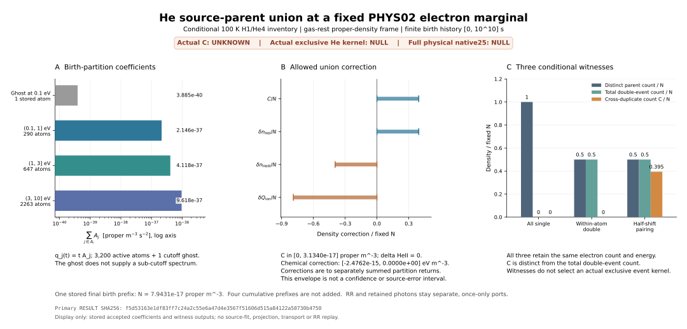

# 고정 PHYS02 He 전자원에서의 사건 합집합 보정과 정확한 조건부 상한

**연구 단위:** CR_PHYS02_HE_EVENT_UNION_V1  
**근거 시점:** 실제 primary_v1·controls_v1·independent_v1·plot_v1 결과와 C08 owner 관찰까지. 최종 C9 판정, 전체 workflow 종료 및 새 S/D/M·archive delivery는 후속 실제 closeout에서 결속한다.

## 1. 과학적 결과

Birth-energy 분할의 전자가 같은 이중 이온화 사건에서 나왔다면 부모 이온의 단순 합은 중복된다. 이 보정 규칙을 유도하고 실제 He attribution의 3,201개 원자 항에 적용했다. 원자 항은 유한 측도의 atom을 뜻한다.

분할별 선택 전자 수 밀도를 \(n_i\), 그 합을 \(N\), 최대 분할을 \(M=\max_i n_i\)라 하면, 분할을 가로지르는 이중 사건 밀도 \(C\)의 정확한 수학적 허용 범위는

$$
\boxed{0\le C\le C_{\max}=\min\!\left(\frac N2,N-M\right)}
$$

이다. 상한과 하한을 달성하는 구성을 같은 electron marginal에서 직접 만들었으며, 구현과 독립 reference가 이를 확인했다. 이 범위는 명시한 유한 원자 비음성 사건 측도의 허용 집합에 대한 결과다. 실제 He exclusive cross section의 측정 범위나 source uncertainty의 신뢰구간을 뜻하지 않는다.

Proper history \([0,10^{10}]\,\mathrm{s}\) 전체에서 저장 결과는 다음과 같다. 아래 \(N_{\mathrm e,\mathrm{He}}\)는 He에 귀속된 **출생 전자 수 밀도**이며, 배경 He 핵 밀도 \(1085/94\,\mathrm{m^{-3}}\)와 구분한다.

| 관측량 | 실제 결과의 소수 표시 | 의미 |
|---|---:|---|
| \(N_{\mathrm e,\mathrm{He}}\) | \(7.943146027889112\times10^{-17}\,\mathrm{m^{-3}}\) | 선택 support의 저장 He 전자 marginal |
| 선택 kinetic energy 밀도 | \(3.419024347163867\times10^{-16}\,\mathrm{eV\,m^{-3}}\) | 세 구성에서 동일 |
| \(C_{\max}\) | \(3.13404624094786\times10^{-17}\,\mathrm{m^{-3}}\) | 가능한 cross-event 중복의 수학적 최대 |
| \(C_{\max}/N\) | \(0.3945598167204703\) | 전자 수 기준 비율; 실제 double-ionization branching ratio가 아님 |
| Chemical storage correction | \([-2.4762099349729043\times10^{-15},\,0]\,\mathrm{eV\,m^{-3}}\) | 분할 합의 중복 storage 정정 |
| Native HeI correction | \([0,\,1.6834305522805647\times10^{-19}]\) | 명시적 같은 상태의 \(n_b\)로 나눈 값 |
| Native HeIII correction | 위 HeI correction의 반대 부호 | 핵·baryon 수 보존 |

소수는 표시용이다. 실제 판정은 저장된 Fraction에 의존한다. 예를 들어

$$
C_{\max}=
\frac{732866194018569409656524658203125}
{23384026197294446691258957323460528314494920687616}
\ \mathrm{m^{-3}},\qquad
\frac{C_{\max}}N=
\frac{30738636090368617492}{77906149556394634457}.
$$

Exact final-prefix와 표시값의 연결은 [C06 실제 결과](../evidence/C06_ACTUAL_RESULT.json), 전체 원 결과는 [primary RESULT](../runs/primary_v1/RESULT.json)에 있다. Actual \(C\), actual exclusive 사건 측도 \(D\), actual full-source native25는 여전히 null이다.

## 2. 고정한 입력·상태와 재사용

Retained PHYS02 revision은 **4ca5a90de79c8fb82a25fd9e83615bec0dfa870b**이다. 직전 PR111의 저장 attribution과 이미 수용된 source·RR 결과를 재사용했다.

| 입력 | 고정 identity |
|---|---|
| Canonical source JSON SHA256 | 8fca44c378844029a72253179e557dfa97f6cca8e0f9d6e677d67919ca3797cf |
| Attribution NPZ SHA256 | 1c974c306b50f3deb86df712844f753b4402fb25e5dbc41c9a1de0254bf3ff47 |

NPZ는 model-identified H/He attribution이다. Canonical total source와 원 오차 근거를 유지하고 저장 binary64만 exact rational로 옮겼다. 따라서 exact equality는 저장 표현에 대한 결과다. 기존 atom tolerance \(2\times10^{-11}\)을 재사용하며 새 source-error certificate를 주장하지 않는다. [계약](../CONTRACT.json), [입력 manifest](../inputs/INPUT_MANIFEST.json)

모델은 gas-rest scalar, nonrelativistic, zero recoil, frozen 100 K, fixed proper-volume density다. 기존 Coulomb와 H/He ground spontaneous RR는 그대로 둔다. H1/He4 상태는 다음 조건부 선언이다.

$$
n_{\mathrm H}=140,\quad n_{\mathrm{He}}=\frac{1085}{94},\quad
x_{\mathrm{HII}}=x_{\mathrm{HeII}}=\frac1{100},\quad
x_{\mathrm{HeIII}}=0,\quad
n_e=\frac{2849}{1880},\quad n_b=\frac{8750}{47}
\quad[\mathrm{m^{-3}}\text{ for densities}].
$$

\(n_{\mathrm H}\)는 총 H 핵 밀도다. 이 inventory는 외부 관측으로 승격하지 않았고 다른 owner의 온도·밀도·EOS를 가져오지 않았다. Absolute proper volume은 null이므로 결과는 밀도와 per-baryon 성분까지다.

Birth support는 direct_0p1_10의 3,200 active atoms와 별도의 \(0.1\,\mathrm{eV}\) cutoff ghost다. Ghost는 미지의 \(E<0.1\,\mathrm{eV}\) spectrum을 뜻하지 않는다.

| Birth-energy 분할 | 원자 항 수 | 최종 prefix의 전자 수 밀도 \(\mathrm{m^{-3}}\) |
|---|---:|---:|
| 별도 cutoff ghost | 1 | \(1.942553556119252\times10^{-20}\) |
| Active \((0.1,1]\,\mathrm{eV}\) | 290 | \(1.073131303665216\times10^{-17}\) |
| Active \((1,3]\,\mathrm{eV}\) | 647 | \(2.058972383726525\times10^{-17}\) |
| Active \((3,10]\,\mathrm{eV}\) | 2,263 | \(4.809099786941252\times10^{-17}\) |

마지막 분할은 \(M>N/2\)인 dominant case다. 따라서 실제 저장 입력에서는 \(C_{\max}=N-M\)가 제한한다. 표는 저장 Fraction의 표시 변환이며 source를 재계산한 결과가 아니다.

## 3. 사건 표현과 union 보정의 유도

\(S\)를 single-ionization 사건 측도, \(D\)를 대칭 double-ionization 사건 측도로 두고

$$
\mu=S+2\pi_1D
$$

로 inclusive electron marginal을 정의한다. \(D\)의 총질량은 double 사건 수다. Unordered pair \((x,y,w)\)에서 \(x\ne y\)이면 \(D(x,y)=D(y,x)=w/2\), \(x=y\)이면 \(D(x,x)=w\)다. 대각 pair도 전자 leg는 두 개다. 이 convention이 source 단면적에 새 배율을 추가하지 않도록 고정했다.

선택 집합 \(A\)에 대해

$$
s_A=S(A),\quad d_A=D(A\times A),\quad
p_A=2D(A\times A^c),\quad
N_A=s_A+p_A+2d_A
$$

로 쓴다. \(A\)와 만나는 부모 사건 수는 \(\nu_A=s_A+p_A+d_A\), 그중 double 사건 수는 \(\delta_A=p_A+d_A\)다. HeI·HeII·HeIII 순서의 source increment는

$$
G_A=(-\nu_A,\ s_A,\ \delta_A).
$$

서로 겹치지 않는 \(A_i\)에 걸친 double 사건은 분할별 부모 반환에서 두 번, 합집합에서는 한 번 센다. 따라서

$$
C=2\sum_{i<j}D(A_i\times A_j),\qquad
G_U=\sum_iG_{A_i}+(C,0,-C).
$$

이 보정은 핵 수와 baryon 수를 보존하고 ionic charge를 분할의 naive 합보다 \(2C\)만큼 줄인다. Selected electron marginal과 kinetic energy는 이미 disjoint labels로 합해졌으므로 그 보정은 0이다. 이는 누락된 전자를 새로 제거하는 항이 아니라 잘못 중복된 부모 이온의 장부를 정정하는 항이다.

또한

$$
d_U=\sum_i d_{A_i}+C,\qquad
\sum_i p_{A_i}=p_U+2C
$$

이므로 \(C\)를 전체 double count \(d_U\)로 대체할 수 없다. Outside partner의 실제 state·energy·history·response는 별도 입력이며 선택 전자 marginal에서 자동으로 정해지지 않는다. 전체 증명은 [THEORY_KO.md](THEORY_KO.md)에 있다.

## 4. 상한이 sharp인 이유와 세 구성의 차이

Cross 사건 하나에는 selected leg가 두 개 필요하므로 \(2C\le N\)이다. 가장 큰 분할 밖의 질량은 \(N-M\)이고 cross 사건은 그 밖의 leg를 적어도 하나 사용하므로 \(C\le N-M\)이다.

상한의 달성은 질량 좌표의 half-shift로 보인다. 길이 \(N\)의 원 \([0,N)\)에 atom들을 분할별 연속 block으로 놓고, 그 label map을 \(f\)라 하자. \(T(u)=u+N/2\bmod N\)에 대해

$$
D_{\mathrm{half}}=\frac12(f,f\circ T)_\#du,\qquad S_{\mathrm{half}}=0
$$

으로 두면 \(T\)가 측도 보존 involution이어서 \(D\)는 대칭이고 \(2\pi_1D=\mu\)다. 길이 \(n_i\)인 block의 within-double mass는 \(\max(0,n_i-N/2)\)이며, \(n_i>N/2\)인 분할은 최대 하나다. 따라서

$$
C=\frac N2-\max\!\left(0,M-\frac N2\right)
=\min\!\left(\frac N2,N-M\right).
$$

\(N=0\)에서는 영측도, \(M=N/2\)에서는 두 식의 정확한 접합을 사용한다. All-single 구성과 convex mixing하면 \(0\le C\le C_{\max}\)의 모든 값이 달성된다. 이는 질량 좌표의 구성이고 실제 공간 각도나 두 전자의 physical correlation을 복원하는 절차가 아니다.

실제 전체 저장 marginal에서 다음 세 구성을 각각 consumer에 전달했다.

| 구성 | 사건 records | \(s_U\) | \(d_U\) | \(C\) | Union 부모 사건 수 |
|---|---:|---:|---:|---:|---:|
| All-single | 3,201 | \(N\) | 0 | 0 | \(7.943146027889112\times10^{-17}\) |
| Same-atom diagonal-double | 3,201 | 0 | \(N/2\) | 0 | \(3.971573013944556\times10^{-17}\) |
| Half-shift | 3,201 | 0 | \(N/2\) | \(C_{\max}\) | \(3.971573013944556\times10^{-17}\) |

밀도 단위는 \(\mathrm{m^{-3}}\)다. 세 구성 모두 각 atom의 electron marginal과 selected kinetic energy가 정확히 같다. Diagonal-double과 half-shift는 전체 double count와 union species가 같지만 cross 중복은 다르다. All-single과 diagonal-double은 모두 \(C=0\)이지만 부모 사건 수와 ion branch가 다르다. 따라서 marginal, cross 중복, 전체 double count를 각각 구분해야 한다.

세 witness의 파트너는 선택 support 내부에 있다. 이 \(p_U=0\)을 actual source의 관측값으로 쓰지 않는다. [Half-shift 원 witness](../runs/primary_v1/HALFSHIFT_EVENT_WITNESS.json)의 SHA는 독립 결과에 결속돼 있다.

## 5. Proper history와 같은 상태의 consumer

저장 source는 \(q_j(t)=tA_j\), proper \(0\le t\le10^{10}\,\mathrm{s}\)다. Coefficient 수준에서 한 번 구성한 \(S_A,D_A\)를 \(t\)에 따라 scaling하면 같은 finite history를 유지한다.

$$
F[a,b]=\int_a^bt\,dt=\frac{b^2-a^2}{2},\qquad
\mu_{[a,b]}=F[a,b]\mu_A,\qquad C_{\max}[a,b]=F[a,b]C_{\max,A}.
$$

실제 결과는 \(2.5,5,7.5,10\) billion seconds까지의 네 prefix와 그 사이 네 disjoint birth-time intervals를 저장한다. Prefix끼리는 중복되므로 더하지 않는다. Disjoint birth-time 결과의 합은 전체 history와 같고, 이를 exact하게 검증했다. 기존 RR의 observation-time bins에는 이전 cohort의 survivor/response가 포함되므로 이 birth-time bins로 바꾸지 않는다. History 밖은 unknown이다.

명명된 **consume_event_union**은 실제 pinned source를 받고 같은 state/frame/clock/window의 partition claims를 합친다. 일관된 event ID를 한 번만 세고 모든 selected incidence의 claim을 요구하며, 각 atom의 원 coefficient와 event marginal의 정확한 일치를 검사한다. 실제 full saved-source 호출은 세 witness에 대해 3회였다. Missing \(n_b\)는 native fields를 null로 두고, 다른 nonnull \(n_b\)는 거절한다.

같은 상태의 explicit \(n_b=8750/47\,\mathrm{m^{-3}}\)가 있으므로 조건부 native correction은

$$
\delta\mathbf Y=\frac C{n_b}
\left(\mathbf e_{\mathrm{HeI}}-\mathbf e_{\mathrm{HeIII}}\right)
$$

이다. 저장 species21의 He4 좌표 10,11,12를 사용한다. Recipient binding convention \(I_1^\*=24.59\), \(I_2^\*=54.42\,\mathrm{eV}\)에서는 chemical correction이 \(-(I_1^\*+I_2^\*)C\)다. 음의 값은 naive partition sum의 중복 storage 제거이며 actual heating이나 proton donor work가 아니다.

반환은 다음 둘 중 하나로 조립한다.

$$
\mathrm{He\ return}=G_U+R_{\rm saved}
=\left[\sum_iG_{A_i}+(C,0,-C)\right]+R_{\rm saved}.
$$

Union source와 corrected partition sum은 같은 포트의 동치 표현이다. 기존 source 포트가 있으면 교체 또는 correction을 적용하고 저장 RR은 한 번만 붙인다. Retained photon은 별도 포트를 유지한다. 새 실행에서 source-fit/projection 및 기존 RR 재실행은 모두 0이었다. [계산 계약](../evidence/R09_RESULT_KO.md), [primary 결과](../runs/primary_v1/RESULT.json)

## 6. 실제 검증과 그 한계

| 검증 | 실제 결과 | 판별한 내용 |
|---|---:|---|
| Primary logical checks | **39/39 PASS** | Support·분할·bound·species/native·시간 합성·null 경계 |
| 세 witness의 atomwise 비교 | **9,603/9,603 PASS** | 각 3,201개 저장 marginal, 최대 exact residual0 |
| Targeted controls | **42 unique / 42 evaluations / 42 PASS / 0 FAIL** | Positive 경계와 실제 거절 동작 |
| Independent reference | **3,696/3,696 PASS** | 별도 incidence·species 계산과 exact comparisons |
| Independent graph family | **81 cases** | \(n_i\in\{0,1,2\}^4\), 여섯 cross-edge의 half-unit capacity 탐색 |
| 한정 Wolfram identity | **12 groups / 16 scalar residuals 모두 0** | Species·보존·native·proper factorization 등 formal algebra |

실제 42개 controls는 F01 marginal, F02 incomplete claim, F03 provenance와 double-leg 오류를 비롯해 state/isotope/frame/clock/support, window, \(n_b\), weight, inventory와 photon ownership을 검사했다. [원 결과](../runs/controls_v1/RESULT.json)

Independent 구현은 production imports 없이 원 NPZ를 직접 읽고 binary64를 exact lift한 뒤 event legs와 He transitions를 계산했다. 원 primary/witness/input identity를 결속했으며 실제 비교 규칙은 **EXACT_RATIONAL_EQUALITY**다. 계약의 report tolerance \(10^{-12}\)로 불일치를 가리는 방식이 아니었다. 81-case 검사는 일반 증명의 대체물이 아니며 일반 sharpness는 앞의 half-shift 증명에 의존한다. [Independent 원 결과](../runs/independent_v1/RESULT.json), [C07 실제 결과](../evidence/C07_ACTUAL_RESULT.json)

Wolfram은 timeConstraint 8초의 formal identity만 검산했다. Source·RR 호출과 sharp-bound 증명은 없으며 이전 context 검색의 무관한 식은 채택하지 않았다. [실제 응답](../evidence/R07_WOLFRAM_ACTUAL.json), [판정](../evidence/R07_IDENTITY_RESULT.json)

Primary·controls·independent의 실제 RECEIPT는 exit 0과 PASS를 기록한다. 이 보고서는 실행 결과를 읽었으며 다시 실행하지 않았다. 최종 C9 admission은 후속 closeout이 확정한다.

### 저장 결과의 실제 그림

Plot_v1은 PASS_SCOPED다. Matplotlib 3.10.8로 생성한 세 panel은 birth 분할, \(N\)으로 나눈 보정 범위, 세 witness의 사건 수를 보여 준다. 수용된 RESULT 1개만 읽었고 source/RR를 재실행하지 않았다. Interval은 신뢰구간이 아니다. [SVG](../runs/plot_v1/HE_EVENT_UNION_SCOPE.svg), [실제 결과·SHA](../runs/plot_v1/RESULT.json), [비용 영수증](../runs/plot_v1/RECEIPT.json)

## 7. 아직 필요한 실제 물리 입력

현재 실제로 읽힌 것은 저장 inclusive marginal이다. 세 witness의 \(D,C\)는 그 marginal에 맞는 구성값이며 actual exclusive distribution의 추정값은 아니다. Full-source physical native25를 완결하려면 다음 연결이 필요하다.

| 필요한 입력 | 현재 상태와 역할 |
|---|---|
| Same-source exclusive He event kernel | Actual \(S,D\)와 두 electron의 공동 energy/support를 제공해야 함; 현재 null |
| Selected-outside partner | State, energy, proper history, pool 및 response가 필요함; 현재 null |
| Residual excitation·projectile donor debit | Atomic storage와 selected kinetic return을 실제 energy budget에 연결해야 함; 현재 null |
| Named physical recipient | 같은 isotope/state/frame/volume/clock와 실제 EOS·thermal inventory·feedback 필요 |
| Native normalization·absolute totals | 본 조건부 same-state \(n_b\)는 명시됐으나 다른 recipient의 \(n_b\)는 별도 입력; absolute volume은 null |

따라서 반환 가능한 조건부 native species·correction과 actual full native25를 구분한다. RR-only native25의 기존 수용도 full-source closure와 별도다. Photon moments만으로 spectrum/history를 만들거나 conditional mean을 exposure로 쓰지 않는다. Actual temperature, full physical activation, global physical error는 그대로 null 또는 false다.

## 8. 원전과 다른 owner의 진척

문헌은 inclusive electron source와 exclusive pair distribution의 구별에 재사용했다. [Primary-source map](../intake/PRIMARY_SOURCE_MAP_KO.md)은 리셋 전 실제 읽기의 복원 기록이며 이번 보고서 작성 중 새 검색은 없다.

[Rudd 등(1992)](https://doi.org/10.1103/RevModPhys.64.441)의 §II inclusive DDCS convention을 재사용했다. [Ambrosio 등(2015)](https://doi.org/10.1103/PhysRevA.92.042704)는 abstract와 manuscript 첫 4pages를 읽었고 Eq13 pair FDCS, Fig1의 700keV·10+10eV를 확인해 초기 1MeV 추측을 교정했다. Guan–Bartschat(2009)는 abstract·ar5iv 본문, Fischer(2003)와 Ambrosio(2017)는 6MeV exclusive/FDCS의 abstract 범위였다. 개별 source와 읽기·실패 경계는 위 map에 있다.

현재 projectile/support/history/normalization에 맞는 actual joint bytes는 확보되지 않았다. 이는 문헌 전체의 부재나 broad no-go·절대 novelty의 주장이 아니다.

WU는 R02의 2/20·19/36에서 **C08의 c92e6378… 기준 20/20·21/36, stage delivery10/10**으로 전진했다. Actual HD consumer/density/clock은 INPUT_PENDING이고 backup은 R2 ACK/size 수준, provider-original GET은 NOT_RUN이다. [C08 owner 판정](../evidence/C08_OWNER_REVIEW.json)

REI는 inert-He source bath와 weighted heat 합성을 연결하고 **9ced7d82…에서 11개 source literal**을 결속했다. eV/Kelvin과 binary64/MP-decimal의 의미를 고정한 것이며 adapter·actual temperature의 평가가 아니다. 9/20, working33/88, actual recipient/native25/T/radii null을 유지한다. 이 별도 bath를 CR의 100K 상태로 옮기지 않는다. [R02 delta](../intake/LIVE_OWNER_DELTA_R02.md), [C07 판정](../evidence/C07_OWNER_REVIEW.json), [REI 인계](../intake/LIVE_REI_C07_COMMIT.json)

REC physical0/313과 HE·BASS·Vigilode의 별도 scope도 유지한다. [Owner 조사](../intake/CURRENT_OWNER_SUMMARY_KO.md)

## 9. 조사 범위·비용·다음 입력 계약

이전 terminal inventory는 51 repo·2,373 refs·CR111 PR, Library 최근 821개/5pages, Dropbox 지정 parent3,471개/6pages를 포함한다. 이는 모든 본문 독해와 다르다. Drive 전체 inventory는 PARTIAL, 개인 대화 전체 검색은 unavailable이다. 리셋으로 손실된 일부 raw는 실제 이전 관찰에서 복원하고 새 SHA를 부여했다. Fresh owner 원문·중앙 bytes는 별도로 보존한다. [조사 범위](../intake/HISTORICAL_SURVEY_RECONSTRUCTED_KO.md)

본 단위 cap은 40 CPU-s이며 preparation·worker·coordinator·실패·plot을 포함한다. C08 후 5개 bounded jobs는 PASS이며 기록된 charge는 4.710179 CPU-s, 잔여 35.289821은 종료 시 NONTRANSFERABLE이다. **최종 측정·charge는 최종 ledger를 우선한다.** Metadata/provider/publication·remote CAS CPU는 unmeasured이며 0으로 기록하지 않는다. 이전 CR 단위와 다른 owner의 비용·잔여량은 이관하지 않는다. [현재 예산](../BUDGET.json)

다음 입력은 같은 source의 absolute exclusive event measure 또는 명시적 추가 제약이다. Actual bytes/revision, isotope·parent/daughter states, support·frame·proper volume/clock/history와 normalization ownership을 함께 고정하고 complete event incidence·partner return·donor work·recipient EOS·허용치를 결속한다. Marginal이 일치하면 현재 union과 검증을 재사용하고, 바뀌면 새 source scope와 별도 budget을 정한다.

중앙의 qualified 관찰은 **22a99cb9…의 28/88, 88 nodes/17 edges, CR 집계 효과 0**이다. N4/N5 PARTIAL_OPEN, N6/N7 PREDECESSOR_GATED, L4false 및 global physical completion/error/budget remaining/currency null을 유지한다. 최종 workflow·admission·S/D/M·source/closeout delivery는 실제 closeout 영수증이 확정한다.
