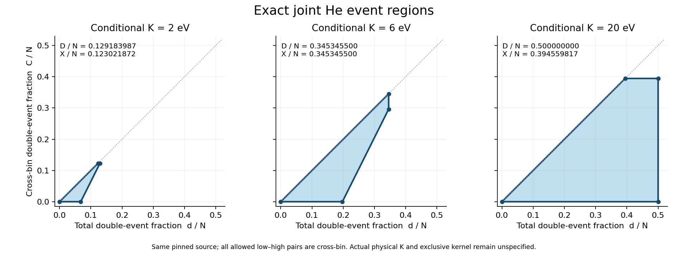

# CR–He 사건 수와 cross-bin 사건 수의 정확한 공동 가능 영역

**단위:** `CR_PHYS02_HE_JOINT_REGION_V1` · **날짜:** 2026-10-28 · **게시 위치:** [bass_cr PR116](https://github.com/cosmosapjw-quantum/bass_cr/pull/116)

이 보고서는 R1–R10의 이론 연구와 C1–C9의 구현·검증 결과를 종합한다. 과학 판정과 최종 전달의 실제 상태는 각각 `ADMISSION.json`, `WORKFLOW.json`, `publication/FINAL_DELIVERY.json`을 기준으로 읽는다. 이 C9 문서가 만들어지는 시점에 C10의 실제 게시·백업은 아직 수행 전이며, 이후 영수증은 별도 실제 커밋에 연결된다.

## 1. 이번에 해결한 문제

앞선 PR114는 에너지 제한 아래 전체 double-event 질량의 최댓값을, PR115는 서로 다른 birth-bin 사이 double-event 질량의 최댓값을 제공했다. 두 최댓값을 따로 안다는 사실만으로 두 양을 동시에 어느 범위에서 선택할 수 있는지는 정해지지 않는다. 같은 원자 주변질량을 보존하는 하나의 사건 측도에서 두 값이 함께 달성되는지와, 그 사이 모든 가능한 조합을 구성하는 일이 남아 있었다.

이번 연구는 **모든 허용된 양의 질량 low–high 쌍이 서로 다른 bin에 속한다**는 명시적 조건 아래 그 문제를 닫았다. 전체 double-event 질량을 `d`, 그중 cross-bin 질량을 `C`라 하면 정확한 공동 영역은 다음과 같다.

\[
\boxed{\mathcal P=\{(d,C):0\le d\le D,\quad0\le C\le X,\quad C\le d,\quad2d-C\le L\}.}
\]

여기서 `L`은 low 원자의 총 질량, `M`은 허용 high–low capacity matching의 최대 질량, `D=(L+M)/2`, `X`는 cross-bin double 최대 질량이다. **(D,X)를 같은 사건 측도로 달성할 수 있으며, 영역의 모든 유리수 점에 대해 원래 원자별 주변질량을 보존하는 유리수 사건 측도를 구성했다.** 실수 사건 계수 전체의 투영은 닫힌 다각형 P이고, 사건 계수를 유리수로 제한한 투영은 `P ∩ Q²`다.

완전한 증명은 [`theory/THEOREM.md`](theory/THEOREM.md), 구현은 [`implementation/joint_region.py`](implementation/joint_region.py), 실제 native 검증은 [`coding/C07_NATIVE_SCIENCE.md`](coding/C07_NATIVE_SCIENCE.md)에 있다. 이는 조건부 유한 사건 모델의 결과이며 실제 exclusive He kernel 또는 실제 물리적 K를 새로 결정한 결과가 아니다.

## 2. 최신 근거 조사와 통합

접근 가능한 저장소 목록 51개(public35/private16)를 terminal까지 확인했고, 관련 공개 저장소 10개의 **branch heads 1,757개**를 각 저장소의 빈 terminal page까지 열거했다. 시작 시점 bass_cr의 기존 PR은 **115개 전체**를 확인했다. 선택한 7개 저장소의 PR 메타데이터는 385행/384 distinct records, 최근 선택 commit history는 100행이다. 이는 모든 저장소의 전체 commit graph를 읽었다는 뜻이 아니다. 관련 private 연구 저장소 1개의 branch 이름 57개와 README를 읽었고, 나머지 무관한 private 본문은 조사 대상에 넣지 않았다.

Dropbox에서는 CR285개, 부모의 직접 파일3472개와 하위 폴더59개, 지정 WU 경로666개를 각 terminal까지 열거했다. Drive에서는 CR267/WU698/REI133개를 반환받았으나 continuation이 노출되지 않았고 부모 경로1000개는 상한에 도달했으므로 **부분 조사**로 기록했다. 부모의 모든 하위 폴더를 재귀적으로 전수 열람한 것은 아니다. PR115의 22개 checkpoint/source/closeout 이름·크기는 두 provider 사이에서 대응했다. 기존 SOURCE/CLOSEOUT R3는 같은 identity에 대한 재사용이며 새 다운로드로 표기하지 않았다.

과거 대화 검색의 실제 호출은 `Personal context is unavailable for this conversation.`으로 실패했다. 따라서 이번 작업은 현재 대화, 접근 가능한 handoff, 저장소·백업 근거를 사용했고 과거 모든 대화의 본문을 열람했다고 주장하지 않는다. 사용자 첨부20개는 SHA manifest로 묶었고, 선택한 원본/ZIP member 동일성을 확인했다. 기존 CMB/Rust 연구의 재실행이나 toolchain 설치는 하지 않았다. 상세 범위와 한계는 [`intake/SURVEY_KO.md`](intake/SURVEY_KO.md), [`intake/ACCESS_LIMITATIONS.json`](intake/ACCESS_LIMITATIONS.json), [`intake/BACKUP_COVERAGE.json`](intake/BACKUP_COVERAGE.json)에 남겼다.

| 최신 근거 | 이번 연구에 반영한 내용 | 유지한 경계 |
|---|---|---|
| CR PR114 / PR115 | 기존 d 최대값, C 최대값, exact certificates와 선택한 complete event witnesses를 identity로 재사용 | 종결된 예산·실패를 새 단위로 이전하지 않음 |
| CR PR113 | full Cartesian support/허용 diagonal의 fixed-d 결과를 대조 | 현재 에너지 제한 문제와 같다고 취급하지 않음 |
| HE ENDPOINT14 | 330 MeV He4(gamma,d)d endpoint-zero sextic reference, local14/18 | PHYS02의 실제 exclusive electron kernel을 공급하지 않음 |
| REC PR146 | neutral He H_STEADY132 source points의 Fe=FH, physical0/313 | 전체 결합계의 물리 완료가 아님 |
| REI PR246 | 저장 epoch의 QSS source-history, coupled IVP0 | 새 coupled IVP나 runtime 예산으로 전용하지 않음 |
| WU PR150 | local29/44와 actual HD/named-consumer 입력 대기 | 입력 대기 상태·owner·예산을 유지 |

R1에서 중앙 DAG는 `03202f9230fdf0d631b1d8673221ae86c54edc04`의 **28/88**, 88 nodes/17 edges였다. C9 독립 검토가 C05–C08 preflight에 이미 기록된 중앙 HEAD 변경을 발견했다. 이전 스냅샷을 최신이라고 읽을 수 없도록 실제 최신 `08364a6ef6f4880c9c4fff87335d167fbff9b440`의 DAG와 AGENTS를 원문 GET으로 재확인했다. 새 DAG SHA256은 `cf0488d50b087884004c2b2395df32243b788c84e456ed8db132fe1d5142c8c8`이다. 모든 88 node의 ID/current_status, 17 edges, authorities가 같고 43개 leaf 변경은 HE 관측 메타데이터에 한정되어 **28/88이 유지됨**을 확인했다. 이전 receipt와 R1 계약은 수정하지 않았다. [`publication/CENTRAL_REQUALIFICATION_C09.json`](publication/CENTRAL_REQUALIFICATION_C09.json)이 실제 정정 근거다.

## 3. 모델과 정리의 의미

각 유한 원자는 고유 key, 비음수 유리수 질량 `a_i`, 비음수 에너지 `E_i`, birth-bin `b_i`를 갖는다. 사건은 single 또는 unordered pair다. 모든 `E_i+E_j<=K` 쌍을 허용하며 `i=j`도 포함한다. 같은 원자의 diagonal 계수 `p_ii`는 해당 원자 주변질량을 **2p_ii** 소비한다. Single은 항상 허용된다. 별도의 forbidden edge mask, 정수 개체 불가분성 또는 Pauli 제약을 이 모델에 추가하지 않았다.

Low는 `2E_i<=K`, high는 `2E_i>K`다. 따라서 high–high 쌍은 없고 모든 low–low 쌍과 low diagonal은 허용된다. 정리의 추가 조건은 모든 **양의 질량** 허용 low–high 쌍에 대해 `b_l != b_h`라는 것이다. Zero-mass 원자는 이 조건의 실제 점유에 영향을 주지 않는다. 구현은 K의 이름이나 예상 bin 경계에 의존하지 않고 실제 원자의 support를 검사한다.

Native 입력은 기존 source의 3200 active atoms와 별도 cutoff ghost 1개이며 bin0..3을 그대로 보존했다. Direct Python API는 재사용 validator의 규약에 따라 built-in nonnegative integer bin을 받는다. 수학적으로 임의의 정수 label을 사용하는 일반 fixture는 caller가 distinct labels를 `0,...,B-1`에 일대일 대응시키면 동일한 문제를 표현할 수 있다. **이 변환은 API가 자동 수행하지 않으며 pinned native labels/digest를 바꾸는 근거도 아니다.** C9에서 이 표현 차이를 명시했다.

## 4. 증명의 핵심과 완전한 구성

어떤 사건 측도의 high–low 질량을 `m`, low–low 질량을 `r`라 하면 `d=m+r`이다. Low 질량의 소비량은 `m+2r=2d-m`이므로 `2d-m<=L`이다. `m<=M`에서 `d<=(L+M)/2=D`를 얻는다. 반대로 최대 high–low matching을 취하고 남은 low 질량을 각자의 diagonal로 채우면 D를 정확히 달성한다.

현재 domain에서는 모든 high–low 사건이 cross이므로 `m<=C`다. 따라서 **새 결합 부등식 `2d-C<=L`**이 나온다. 또 cross 사건은 double의 일부이므로 `C<=d`, 각각의 최대값 정의로 `C<=X`, `d<=D`다.

필요조건만으로는 다각형 전체의 달성이 보장되지 않는다. 공동 최댓값은 다음 교환 논증으로 구성했다. Cross 최댓값 X를 달성하는 cross-only 측도 중 high–low 질량 m이 최대인 것을 선택한다. 만약 m<M이면 residual high–low network에 증가 경로가 있다. 경로 끝 low에 single이 남으면 cross가 증가하여 X의 최대성에 모순이다. 끝 low가 low–low cross에 묶여 있으면 그 LL 사건을 조금 줄이고 HL 경로를 같은 양만큼 늘린다. 다른 LL 끝점에는 single을 돌려준다. Cross 총량 X와 모든 주변질량은 그대로이고 m만 증가하므로 secondary 최대성에 모순이다. 이 논증은 다른 LL 끝점이 경로 내부 low인 경우도 포함한다.

따라서 m=M인 cross 최적 측도가 존재한다. 남은 low 주변질량을 diagonal로 채우면 `d=D,C=X`가 함께 달성된다. 유리수 입력에서는 공통 분모를 제거한 정수 단위로 매번 m이 증가하므로 유한 종료한다. 이 종료 논증을 strong polynomial runtime 주장으로 확대하지 않았다.

다음 다섯 complete event measures를 만든다.

| 이름 | 좌표 (d,C) | 구성 |
|---|---|---|
| O | (0,0) | 모두 single |
| A | (L/2,0) | low를 전부 diagonal, high는 single |
| B | (D,M) | 최대 HL matching + 남은 low diagonal |
| F | (D,X) | 위 공동 최댓값 구성 |
| G | (X,X) | F의 추가 diagonal을 single로 돌린 cross-only 측도 |

이 vertex들은 퇴화 조건에서 겹칠 수 있다. Single까지 포함한 전체 측도를 convex combination하여 모든 가능한 유리수 `(d,C)`를 구성했다. `X=0`, `M=0`, `X=M`, `X=D`와 위·아래 경계가 같은 경우의 영분모를 모두 별도 처리했다. 좌표만 보간하고 원자 주변질량을 버리는 방식은 사용하지 않았다.

결과적으로 고정 d에서

\[
\max(0,2d-L)\le C\le\min(d,X),
\]

고정 C에서는

\[
C\le d\le\min\{D,(L+C)/2\}.
\]

모든 끝점은 같은 입력 주변질량을 가진 실제 사건 측도로 달성된다. 상세 유도와 퇴화 분기는 THEOREM의 Lemmas1–5에 있다.

## 5. 기존 문헌과 구별한 범위

SciSpace와 Exa로 관련 문헌을 탐색하고 두 1차 자료의 실제 본문을 대조했다. [Behrend, Fractional Perfect b-Matching Polytopes I (2013)](https://arxiv.org/abs/1301.7356)의 일반 fractional matching polytope 이론과 [Koperberg, Couplings and Matchings (2022)](https://arxiv.org/abs/2202.02092)의 finite Hall/Strassen 대응은 기존 결과다. 이번 연구는 그 일반 정리의 우선권을 주장하지 않는다.

특히 문헌의 loop incidence1과 우리의 두-leg diagonal을 같게 두지 않았다. 대응은 `x_ii=2p_ii`이며 d 목적함수의 diagonal 계수는 1/2이다. 서로 다른 low/high 총 capacity를 따로 확률 정규화하여 원래 matching 문제를 바꾸지도 않았다. 이번 기여는 명시된 에너지 support와 cross-bin HL domain에서 `(d,C)`의 정확한 투영, 공동 최댓값, 모든 점의 complete witness를 구성하고 기존 source consumer에 연결한 것이다. 전 세계 문헌에 대한 exhaustive novelty 판정은 하지 않았다. 상세 문헌 사실과 적용 한계는 [`theory/R2_LITERATURE_REVIEW.md`](theory/R2_LITERATURE_REVIEW.md)에 있다.

Wolfram은 별도의 세 원자 rational fixture에서 여섯 선형 목적함수의 exact optimum을 확인했다. N=5,L=4,M=1,D=5/2,X=2인 비퇴화 오각형의 다섯 vertex 및 목적함수 값 `{5/2,2,4,0,0,0}`이 저장되어 있다. 이 작은 검산이 일반 증명을 대체하지는 않는다. 원격 CPU 시간은 제공되지 않아 null로 기록했다.

## 6. 실제 native 결과

3201개의 원래 원자를 사용해 6개 cap을 수용하고, 각 distinct vertex와 비퇴화 영역의 interior/edge witness를 포함하는 **20개 complete measures**를 만들었다. 각 witness마다 기존 consumer를 같은 source와 proper window에 대해 한 번 호출했다. 서로 다른 witness는 대안이며 한 시간 구간에 차례로 누적한 호출이 아니다.

| K | L/N | M/N | D/N | X/N | complete witnesses |
|---|---:|---:|---:|---:|---:|
| 0 | 0 | 0 | 0 | 0 | 1 |
| exact1/5 | 0 | 0 | 0 | 0 | 1 |
| 2×저장 binary ghost | 0.000244557201 | 0 | 0.000122278600 | 0 | 3 |
| 2 | 0.135346102595 | 0.123021871572 | 0.129183987084 | 0.123021871572 | 5 |
| 6 | 0.394559816720 | 0.296131182877 | 0.345345499799 | 0.345345499799 | 5 |
| 20 | 1 | 0 | 0.5 | 0.394559816720 | 5 |

표의 소수는 표시용이며 수용은 저장된 exact fraction으로 했다. `K=1/5`와 `K=2×stored binary64 ghost=3602879701896397/18014398509481984`는 서로 다르다. 이 차이를 허용 오차로 합치지 않아 cutoff diagonal의 정확한 진입 경계가 드러난다.

K2에서는 `X=M`이므로 저장된 B가 공동 최댓값이다. K6에서는 `X=D`이며 **6404 nodes/14931 forward arcs의 새 C++ flow로 explicit cross primal을 구성**했다. 이는 기존 PR115 scalar bound를 다시 최적화한 실행과 구별된다. K20에서는 high 집합이 비어 `M=0`이므로 기존 G에 남은 low diagonal을 채웠다. Native scalar-optimizer replay0, source-fit/RR/transport replay0을 유지했다.

특히 `d=D`일 때 C의 정확한 구간은 `[M,X]`이다. K2에서는 `C/N=0.123021871572`로 강제된다. K6에서는 `0.296131182877<=C/N<=0.345345499799`, K20에서는 `0<=C/N<=0.394559816720`이다. 별도 scalar 최댓값만으로 보이지 않았던, 최대 double-event 수준에서 허용되는 cross 중복의 폭이다.

K1,3,10은 실제 원자에서 같은 bin의 허용 HL 쌍이 발견되어 이 정리의 domain에서 제외했다. 구체적인 쌍은 각각 `(active_0001,active_0130)`, `(active_0291,active_0453)`, `(active_0938,active_1584)`다. 이는 해당 데이터가 물리적으로 불가능하다는 뜻도, 같은 다각형이 그 모든 데이터에서 틀렸다는 뜻도 아니다. 정리의 현재 충분조건이 성립하지 않는다는 명시적 판정이다.

그림은 accepted `SUMMARY.json`만 읽어 그렸고 solver 호출은 0이다. 공통 축에서 K2/6/20의 영역을 보여 준다. 실제 1920×720 PNG의 제목·축·vertex·조건부 문구를 눈으로 확인했다. PNG와 SVG는 함께 보존했다.

## 7. 원래 source-parent·chemical 반환과의 연결

사용한 source는 기존의 조건부 100 K H1/He4, gas-rest, fixed proper-volume, zero-recoil 상태다. `q_i(t)=t A_i`, proper time `[0,10^10] s`와 `n_b=8750/47 m^-3`를 그대로 썼다. `N,d,C`는 source coefficient 수준의 양이고, `W=∫t dt=10^20/2 s²`를 한 번 곱하여 밀도를 얻는다. 아래 식은 **full-selected single-window, p=0** 범위다.

\[
\Delta(n_{He^0},n_{He^+},n_{He^{++}})=W(-N+d,\;N-2d,\;d),
\]
\[
n_{parent}=W(N-d),\qquad Q_{ionic}/e=WN,
\]
\[
U_{union}=W[I_1N+(I_2-I_1)d],\quad I_1=24.59\ eV,\ I_2=54.42\ eV.
\]

서로 다른 partition이 동일 cross 사건을 중복 계상한 반환을 union으로 고치는 보정은

\[
\Delta\boldsymbol n_{partition}=W(C,0,-C),\quad
\Delta Q/e=-2WC,\quad
\Delta U_{partition}=-79.01WC.
\]

이는 중복 장부의 보정이며 새 전자 손실을 추가하는 항이 아니다. 원자별 kinetic source `W Σ E_i a_i`는 pairing에 무관하다. 각 abundance는 해당 density를 `n_b`로 한 번만 나눈다. RR와 retained-photon 반환은 기존의 별도 once-only port로 남겼다.

공동 영역을 통해 고정 d에서 얻는 **달성 가능한 정확한 chemical correction 구간**은

\[
-79.01W\min(d,X)\le\Delta U_{partition}
\le-79.01W\max(0,2d-L).
\]

고정 C에서 `d_up=min(D,(L+C)/2)`라 하면 parent density는 `W(N-d_up)`부터 `W(N-C)`까지, union chemical energy는 `W[I_1N+(I_2-I_1)C]`부터 `W[I_1N+(I_2-I_1)d_up]`까지다. 초기 He inventory가 허용하는 별도 lower bound를 적용할 때에는 같은 d 구간을 먼저 잘라야 한다.

이 식을 partial selection에 그대로 적용하지 않는다. Selected-outside partner가 있는 일반 경우에는 p와 selected-internal C의 별도 항이 필요하다. 이번 native 검증은 그 일반화를 새로 시험한 결과가 아니다. W=0은 이론상의 한계이며 실제 사용한 consumer window는 양의 길이를 갖는다. Inventory 확인도 각 대안 witness 한 호출의 조건이다.

## 8. 구현과 독립 검증

`joint_region.py`는 domain 검사, exact metrics, vertex 구성, HL residual repair, complete-measure interpolation을 구현한다. `assemble`은 caller가 upper bound의 certificate binding을 확인한 D/X를 받으며 primal만으로 전역 최적성을 새로 주장하지 않는다. Native worker는 PR114/115의 hash와 exact cap key로 그 전제를 연결했다. 일반 fixture용 `solve` 경로는 별도 fresh exact optimizer다.

C++ backend는 부동소수점 capacity를 쓰지 않는 비재귀 `__int128` Dinic이다. Capacity와 bound를 2^126 미만으로 제한하고 decimal overflow를 검사한다. Python wrapper는 반환된 모든 edge capacity, 모든 node의 flow conservation, residual source–sink 분리와 cut=value를 exact integer로 검사한 뒤에만 원래 residual network를 갱신한다. 오류 시 임시 class-method 변경은 finally에서 복원된다. 단일 thread·동기 호출과 외부 bounded runner라는 실행 전제는 문서에 명시했다.

| 근거 | 실제 결과와 범위 |
|---|---|
| 구현 control | **117/117 assertions** 통과 |
| 독립 full-incidence oracle | **12 fixtures, 479 candidate bases** 검사; candidate에는 singular/infeasible 후보 포함 |
| 경계·오류 control | equality/below-boundary, zero mass, 퇴화영역, 1회 HL 교환, 64-bit 초과 capacity, 2^126 거절, corrupt zero-flow 출력 거절, 실패 후 patch 복원 |
| Native | 6 accepted caps, 3 concrete domain rejections, 20 complete witnesses/consumer calls |
| 원시 NPZ 독립 checker | **64,020 exact atom marginals**, 78,155 event records, 29,039 pair-support checks |
| Source mapping | 1,020 scalar checks, 2,020 vector-component checks, 300 physical-gate checks |
| C9 독립 검토 | Core 비작성자 검토와 별도 provenance 검토, 과학 blocker0 |

Independent checker는 production constructor를 import하지 않고 원본 NPZ의 binary64 값을 직접 exact Fraction으로 재구성했다. Solver 호출0이다. 전역 D/X upper bound의 증명은 명시적으로 이전 certificate에서 재사용하고, 새 checker는 complete primal과 원 consumer 반환을 확인한다. 일반 정리, 작은 incidence oracle, native 개별 증인의 검증을 같은 종류의 증거로 합치지 않았다.

긴 reverse HL 경로나 제거 LL 사건의 다른 끝점 q가 내부 경로 vertex인 경우는 수학·정적 코드 검토에 포함했지만 이번 control에서 직접 실행하지 않았다. 강제 repair 실행은 1회, 길이1 경로다. 이 한계를 보존해도 현재 native는 검증된 특수 분기를 사용하며 독립 검토에서 추가 실행을 요구하는 결함은 발견되지 않았다.

## 9. 실패, 복구, 자원 결산

새 단위의 local CPU cap은 40 s이며 이전 PR115와 다른 owner의 잔여 예산은 이전하지 않았다. 실제 local science·compiler·coordinator·실패·plot·보수적 tail과 controller 진단을 포함한 최종 charge는 **23.448655 CPU-s**다.

| 실행 | 상태 | 측정 CPU-s | charge CPU-s |
|---|---|---:|---:|
| build_v1 | watchdog 종료, 실패 보존 | 0.079626 | 0.179626 |
| controller metadata diagnostics | 3회, 첫 missing-path 실패 포함 | aggregate 미측정 | 0.300000 보수적 |
| build_v2 | PASS | 0.956505 | 1.056505 |
| controls_v1 | PASS | 0.202852 | 0.302852 |
| native_v1 | PASS | 17.819608 | 17.919608 |
| independent_v1 | PASS | 1.395590 | 1.495591 |
| plot_v1 | PASS | 2.094473 | 2.194473 |

첫 build 실패는 process namespace의 PID를 host procfs PID로 직접 사용하여 다른 process의 CPU를 읽은 watchdog 오류였다. Native 모델의 실패가 아니지만 실행 실패와 비용을 지우지 않았다. NSpid와 실제 parent/child mapping으로 수정한 build_v2가 통과했다. 모든 시도의 source snapshot, argv, stdout/stderr, exit status, input/dependency hash와 resource receipt를 유지했다.

Controls/native 실행에는 source/input/dependency pin과 build 결과의 binary hash가 있으나 별도 prelaunch executable-hash 필드는 없었다. C8에서 이후 non-build invocation에 그 검사를 추가했고 실제 plot invocation에서 관측했다. 이를 과거 실행에서 수행한 검사로 소급하지 않았다. Event certificate의 독립 primal 검증은 generator binary의 신뢰와 분리되어 있다.

예방적 aggregate hard cap을 원자적으로 증명했다고 주장하지 않는다. 실행은 serial reservation, 단일 CPU affinity, per-process CPU/address-space 제한 및 sampled process-tree watchdog을 썼다. 원격 Wolfram CPU, provider/게시/메타데이터 CPU는 미측정이다. 알려지지 않은 시간을 0으로 합쳐 전체 모든 시스템의 총량 증명으로 표현하지 않는다.

별도 저장공간 부족 때에는 이미 백업 영수증이 확보된 과거 단계의 재생성 가능한 로컬 복사본과 중단된 중복 전송 사본만 정리했다. 원본 입력·과학 증거·원격 백업은 보존했다. 정리·복원 근거는 `publication/LOCAL_WORKING_COPY_RETENTION.json`에 있다. C4의 실제 게시/양쪽 백업 완료와 이후 로컬 상태파일 쓰기 실패를 구분했다.

## 10. 채택 범위와 다음 인계

이번 scoped 연구 노드는 1/1로 채택할 수 있다. 중앙 DAG의 효과는 0이며 최신 재확인한 중앙 진행률은 **28/88**다. N4/N5는 PARTIAL_OPEN, N6/N7은 PREDECESSOR_GATED, L4_ready=false와 global physical completion=null을 유지한다. Actual K, actual exclusive He kernel, 실제 d/C, outside-partner response, projectile donor work, EOS/T, absolute volume, full-source physical native25는 여전히 null이다.

Local science budget은 C9에서 닫고 남은 **16.551345 CPU-s는 NONTRANSFERABLE**, 추가 과학 allowance0, automatic next node=false로 둔다. 다음 연구 후보는 같은 bin의 허용 HL 쌍이 있는 일반 영역, 특히 현재 domain 밖인 native K1/3/10의 정확한 공동 투영이다. 새로운 실제 exclusive source가 들어오면 그 kernel과 같은 상태·history를 binding하는 연구도 가능하다. 두 후보 모두 이번 결과를 자동으로 넓혀 채택하지 않으며, 다음 명시적 요청에서 별도 범위·근거·예산을 고정한다.

매 단계 실제 Git와 양쪽 R2 checkpoint를 먼저 완료한 뒤 다음 단계로 진행했다. SOURCE/CLOSEOUT은 create-only로 한 번만 만들고 양쪽 원본 전체 GET, 전체 SHA256, 모든 payload SHA256와 ZIP CRC의 R3를 수행하는 전달 계약이다. 실제 완료 여부, object IDs, S/D/F commit과 최종 20단계 게시표는 `publication/FINAL_DELIVERY.json`, `publication/PUBLICATION_INDEX.md`, `HANDOFF_KO.md`에서 확인한다. 이 문서 작성 시점의 미래 게시를 이미 완료한 것으로 해석하지 않는다.
