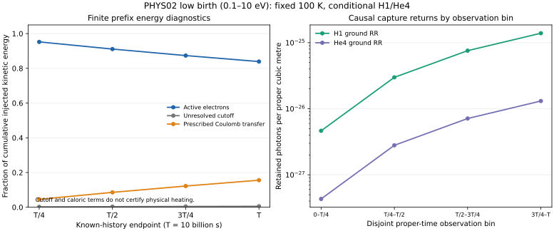

# 실제 PHYS02 low-birth source의 유한 proper-time RR 응답

실제 보존 source revision과 direct_0p1_10 birth tag를 고정하여, 새100K conditional H1/He4 inventory에서 유한 이력의 전자수·에너지·RR·native25 event·retained-photon port를 계산한 단위다. 기존 PR109의 nb=null 및 PR107의10000K 범위는 그대로다. 현재 상세 판정은 [ADMISSION.json](ADMISSION.json), 독립 검토는 [C9_FINAL.json](review/C9_FINAL.json), 실제 최종 게시·백업 해석은 [PR110](https://github.com/cosmosapjw-quantum/bass_cr/pull/110)을 따른다.

## 읽는 순서

1. [보고서](REPORT_KO.md): 이론, 조건, 실제4prefix/4bin 결과와 한계.
2. [고정 계약](CONTRACT.md), [이론](THEORY_KO.md), [이론→구현](THEORY_TO_CODE_KO.md).
3. [실제 source pins](inputs/INPUT_MANIFEST.json), [계수 준비](runs/prepare_v1/PREPARATION.json), [primary](runs/primary_v1/RESULT.json), [독립 참조](runs/independent_v1/RESULT.json).
4. [한정 controls의 수용](evidence/C06_ACCEPTANCE.json), [실패 포함 CPU 정산](evidence/BUDGET_CLOSEOUT.json).
5. [다음 단위 계약](NEXT_UNIT_CONTRACT.json).

그림은 실제 saved RESULT를 읽었다. 왼쪽은 비가산 cumulative prefix의 kinetic energy 분할이며 caloric/cutoff 항은 physical heating 완료가 아니다. 오른쪽은 이전 birth의 생존자를 포함하는 서로 겹치지 않는 observation bin의 retained-photon 수다. Photon transport, escape/absorption, 전체 source-parent chemistry는 완결하지 않았다.

## 재사용과 실행 경계

원본source와 계수 준비, production/reference 배열은 source ZIP에서 exact bytes로 복원하여 재사용한다. 이전 H1/HeI/HeIII/C23E/source 과학suite를 재실행하지 않는다. 현재 단위의40CPU allowance는 실패·coordinator·conservative tail을 포함해 종료했으며 추가 허용 run은0이다. 산술 잔여는 다음 단위로 이월하지 않는다. 새 scope·입력·허용치·예산·host/AGENTS/HEAD/source/backup 확인 후 별도 단위를 시작한다.

Git에는 텍스트 source·결과·SVG·영수증을 게시한다. NPZ,PNG 및 원 actual source JSON을 포함하는 canonical source ZIP의 정확한 원본 identity와 양provider fullGET R3는 후속 delivery receipt와 PR110의 최종 본문에 결속된다. Scientific S, documents D, central M은 서로 다른 역할이며 sourceZIP을 후속영수증으로 재포장하지 않는다.
