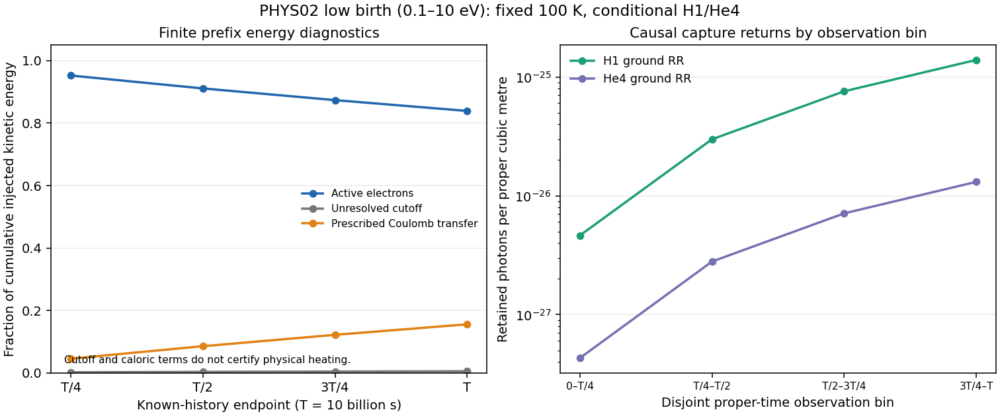

# 실제 PHYS02 low-birth source의 유한 시간 Coulomb–RR 응답

## 문서 상태와 중심 질문

이 문서는 `CR_PHYS02_LOW_BIRTH_CAUSAL_RR_V1`의 **실제 C8 결과와 C9 독립 saved-output 검토를 반영한 과학 보고서**다. 실제 coefficient preparation과 C6의 서로 다른 46개 controls가 수용됐고, C7의 네 cumulative prefix와 네 observation bin은 내부 검사를 통과했다. C8의 별도 augmented-exponential 참조도 실제517/517 검사를 통과했다. C9 판정은 `PASS_SCOPED_FINITE_CAUSAL_RR`이며, 지정된 finite low-birth 모형의 수용 범위와 남은 물리·실행 한계를 아래에 명시한다. 실제 게시·이중 R2 완료는 현재 C8까지18/20이고 C9 게시와 최종 closeout은 남아 있으므로 전체 단위 완료를 선언하지 않는다. 아래 수치 표는 저장된 C7 원 JSON에서 옮겼으며 새로운 solver 실행으로 만든 값이 아니다. 최종 source/document/central identity와 실제 R3는 해당 closeout 기록에 결속한다. 권위 있는 범위는 [frozen R1 계약](CONTRACT.md), [최종 이론](THEORY_KO.md), [실제 C9 독립 검토](review/C9_FINAL.json)이다.

중심 질문은 다음과 같다. **실제로 저장된 100 K PHYS02 electron source가 유한한 proper-time 동안 주입될 때, 같은 상태에서 Coulomb slowing과 H/He ground radiative recombination이 경쟁하여 만드는 잔존 전자, cutoff 유출, 포획 사건, retained photons를 어떻게 인과적으로 계산하고 같은-state baryon 정규화에 연결할 것인가?** 이 질문은 저장 source의 시간 이력과 새 recipient의 물리적 상태를 함께 요구한다. 순간 주입량에 eventual capture probability를 곱하거나, conditional mean lifetime을 exposure로 대입해서는 유한 관측창의 결과를 얻을 수 없다.

이번 단위는 그 질문을 실제 `direct_0p1_10` birth cohort에 한정한다. 새 모형은 저장된 3200개 active energy node, cutoff atom, 유한 ramp history를 사용한다. HII/HeII ground RR를 같은 100 K 수밀도 상태의 Coulomb downward drift에 결합한다. 기존 10000 K PR107/108의 numerical response를 가져오지 않으며, 회수되지 않은 full9600 raw generator가 복원됐다고 주장하지 않는다. [입력 identity](inputs/INPUT_MANIFEST.json), [RR source 결속](intake/RR_SOURCE_BINDINGS.json), [구현 가능성 조사](intake/IMPLEMENTATION_FEASIBILITY_KO.md)가 이 선택의 근거다.

## 1. 실제 source와 새 조건부 inventory

### 1.1 주입원을 만드는 대신 저장된 원자를 소비한다

실제 입력은 앞 단위가 저장한 `research/cr_proper_injection_20261027/runs/actual_v1/ACTUAL_SOURCE_RECORDS.json`이다. payload는 4,394,309 bytes, SHA256 `8fca44c378844029a72253179e557dfa97f6cca8e0f9d6e677d67919ca3797cf`로 고정된다. root JSON에서 유일한 `direct_0p1_10` 태그를 선택한다. 이 record에는 3200개 active atom과 `E=0.1 eV`의 direct-cutoff atom이 있으며, 각 원자의 실제 계수와 energy를 그대로 사용한다. [입력 명세](inputs/INPUT_MANIFEST.json), [이론→코드 계약](THEORY_TO_CODE_KO.md)

`selected_total`에 `E<=10` 필터를 적용하면 같은 source가 되지 않는다. High-born partition의 projection에도 `E=10 eV` 경계 atom이 있으므로 현재 energy만으로 고르면 birth ownership이 섞인다. 이번 native birth support는 `[0.1,10] eV`이고, drift 뒤의 현재 energy와 capture photon energy가 그 birth partition을 대신하지 않는다. 원 source quadrature·projection·과거 transport solver는 재실행 대상이 아니다.

저장 source의 실제 history는

\[
q_j(t)=tA_j,\qquad 0\le t\le T,\qquad T=10^{10}\ {\rm s},
\]

이며 proper time과 proper volume에 대한 number source다. 따라서 `q_j`의 단위는 `m^-3 s^-1`, `A_j`의 단위는 `m^-3 s^-2`이다. 저장 record에서 이미 적용된 angle integral, source target density, proper-volume factor 및 source clock을 다시 곱하지 않는다. 이전 energy-coordinate 원자료에서 count coefficient로 바꾸는 과정도 앞 단위에서 수행됐으므로 이번 `A_j`를 energy로 다시 나누지 않는다. [최종 이론 §3](THEORY_KO.md)

기록된 구간 밖 source는 **unknown**이다. `t=T`에서 반환하는 endpoint rate는 알려진 이력의 좌극한이며, 그 뒤 source가 꺼졌다는 뜻이 아니다. 물리적 proper volume의 크기도 주어지지 않았으므로 worldtube 전체 입자수·전체 에너지는 null이다. 이번 결과는 proper volume당 수·에너지·점유시간으로 정의된다.

### 1.2 같은 상태의 H1/He4 inventory를 새로 명시한다

보존된 PHYS02 density recipe는 `nH=140 m^-3`, `YHe=0.248`, `xHII=xHeII=0.01`, `xHeIII=0`, `T_bath=100 K`이다. 이번 recipient에서는 H를 H1, He를 He4로 사상하는 **새 조건부 H1/He4-only inventory**를 명시한다. 다른 bath의 T나 `n_b`를 가져오지 않는다. [계약](CONTRACT.md), [source 결속](intake/RR_SOURCE_BINDINGS.json), [최종 이론 §2](THEORY_KO.md)

그 inventory의 exact nominal semantics는 다음과 같다.

| 양 | 정의 | exact nominal 값 |
|---|---|---|
| `nH` | 모든 hydrogen nuclei의 수밀도 | `140 m^-3` |
| `nHe` | `nH*YHe/[4*(1-YHe)]` | `(1085/94) m^-3` |
| `nHII` | `0.01*nH` | `(7/5) m^-3` |
| `nHeII` | `0.01*nHe` | `(217/1880) m^-3` |
| `nHeIII` | 고정된 inventory | `0` |
| `ne` | `0.01*(nH+nHe)` | `(2849/1880) m^-3` |
| `nb` | `nH+4*nHe` | `(8750/47) m^-3` |
| `ne/nb` | 같은 inventory의 free-electron abundance | `407/50000` |

수치 구현은 고정된 binary64 식 `nHe=nH*.248/(4*(1-.248))`, `ne=.01*(nH+nHe)`, `nb=nH+4*nHe`를 사용하고, 위 유리수 의미와 실제 표현값을 구분해 기록한다. 반올림 표현을 맞추기 위해 저장된 `A_j`를 재정규화하지 않는다. `n_b`는 baryon 정규화의 분모이며 RR target은 각각 `nHII`, `nHeII`이다. Target density를 `n_b`로 바꾸지 않는다.

이 구성은 원 source가 `n_b`를 명시해 제공했다거나 실제 우주의 다른 baryon 성분이 관측으로 배제됐다는 주장이 아니다. **앞 PR109의 actual `nb=null`, RR/native25 null은 그 당시의 계약과 함께 그대로 보존한다.** 이번 단위가 새 inventory와 donor/recipient 상태 결속을 추가하여 조건부 projection을 정의한다. PR236/PW19의 T·density 및 PR107/108의 10000 K bath는 채택하지 않는다.

## 2. 유한 proper-time 응답과 실제 점유시간

### 2.1 Ramp source에 대한 인과적 해

`L_act`를 active count state의 고정 generator라고 하자. 초기 cohort는 0이고, 실제 source를 그대로 쓰면

\[
\dot n(t)=L_{\rm act}n(t)+tA,\qquad n(0)=0.
\]

Variation of constants는

\[
n(t)=\int_0^t e^{L_{\rm act}(t-s)}sA\,ds
=t^2\varphi_2(tL_{\rm act})A,
\qquad
\varphi_k(Z)=\sum_{m=0}^{\infty}\frac{Z^m}{(m+k)!}
\]

를 준다. 실제 active occupancy는

\[
O(t)=\int_0^t n(s)\,ds=t^3\varphi_3(tL_{\rm act})A,
\qquad [O_j]={\rm m}^{-3}{\rm s}.
\]

이 식들은 entire function으로 정의되므로 zero eigenvalue나 zero-rate limit에서도 유효하다. 행렬 역수로 singular ledger를 강제로 다루지 않는다. Polynomial forcing을 augmented exponential로 계산하는 일반 방법은 Al-Mohy–Higham의 원전 §2, Theorem2.1에 대조했다. 이번 ramp/occupancy 식은 그 방법에 맞는 직접 유도이며, 실제 finite history의 의미는 [최종 이론 §4](THEORY_KO.md)에 고정했다. [원전 대조표](literature/PRIMARY_READMAP.json), [문헌 적용 범위](literature/LITERATURE_SUPPORT_KO.md)

Channel `c`의 유한 포획과 endpoint rate는 각각

\[
C_c(t)=\sum_j\lambda_{c,j}O_j(t),\qquad
\dot C_c(t)=\sum_j\lambda_{c,j}n_j(t)
\]

이다. `O`는 실제 주입 population이 각 state에서 보낸 유한 density-time이다. Conditional mean lifetime이나 누적 capture를 경과시간으로 나눈 값으로 바꾸지 않는다. Per-state `C_cj=lambda_cj*O_j`와 양의 `lambda_cj`가 주어질 때만 그 state의 occupancy를 나눗셈으로 복구할 수 있으며, 집계된 capture 전체를 특정 bin의 hazard로 나눌 수는 없다.

### 2.2 네 prefix와 네 observation bin의 사건 소유권

계산할 cumulative endpoint는 `T/4,T/2,3T/4,T`이다. Prefix들은 중첩된 diagnostics이며 합산할 사건 집합이 아니다. 실제 additive returns는 `[0,T/4]`, `(T/4,T/2]`, `(T/2,3T/4]`, `(3T/4,T]`의 네 disjoint observation bin으로 구성한다.

관측창 `[a,a+h]`에서는

\[
O_{[a,a+h]}=O(a+h)-O(a)
=h\varphi_1(hL)n(a)+ah^2\varphi_2(hL)A+h^3\varphi_3(hL)A.
\]

첫 항은 앞서 태어난 생존 population의 기여이고, 둘째 항은 source의 absolute clock을 유지한다. 각 창에서 상태를 0으로 다시 시작하거나 source를 `A(t-a)`로 바꾸면 다른 문제를 푼다. [최종 이론 식(4c)](THEORY_KO.md)

입력 birth claim은 실제 source family와 low native partition에 대해 한 번만 소유한다. 출력 RR return claim은 family·channel·native birth partition·observation interval에 결속한다. 서로 다른 observation bin은 동일한 이전 birth history를 참조할 수 있지만, 같은 사건의 겹치는 return을 두 번 채택할 수 없다. Mixed frame/state, isotope mismatch, native support 확장, 중복 clock/volume/target factor는 거절 대상이다. 누적 prefix의 차이를 낼 때도 birth support를 current-energy support로 바꾸지 않는다. [계약의 finite-return ownership](CONTRACT.md), [이론→코드 §4](THEORY_TO_CODE_KO.md)

## 3. 채택한 Coulomb + ground RR 모형

저장 active energies를 `E_1<...<E_3200=10 eV`, cutoff를 `E_0=0.1 eV`라고 한다. 고정된 PHYS02 Coulomb stopping law에서 `b_j=b(E_j)`를 평가하고,

\[
d_j=\frac{b_j}{E_j-E_{j-1}},\qquad
\lambda_{{\rm H},j}=n_{\rm HII}v_j\sigma_{{\rm RR,H},j},\qquad
\lambda_{{\rm He},j}=n_{\rm HeII}v_j\sigma_{{\rm RR,He},j}
\]

로 둔다. Active count equation은

\[
\dot n_j=-(d_j+\lambda_{{\rm H},j}+\lambda_{{\rm He},j})n_j
+d_{j+1}n_{j+1}+tA_j,
\]

이며 마지막 node에서는 위에서 내려오는 항이 없다. 저장 source의 direct-cutoff atom은 cutoff port에 직접 들어가며 active RR hazard를 부여하지 않는다. 이는 선택한 absorbing boundary의 정의이고, cutoff 아래 RR가 전체 물리에서 사라졌다는 결론은 아니다.

Coulomb law의 classical/quantum logarithm minimum은 보존하고, 새 coefficient evaluation은 CODATA2022/SciPy1.17.0에 결속한 한 constants set을 사용한다. H ground channel은 `HII→HI(1s)`, He channel은 `HeII(1s)→HeI(1s² singlet)`이다. Verner fit의 native thresholds `I_H=13.60 eV`, `I_He=24.59 eV`, photon support `<=50000 eV`, Milne denominators `d_H=1`, `d_He=4`를 유지한다. 이 Milne degeneracy factor와 isotope mass number는 다른 양이다. [정확한 source/constant revision](intake/RR_SOURCE_BINDINGS.json)

이 모형의 조건은 stationary heavy target, zero recoil, nonrelativistic scalar/isotropic ensemble, spontaneous ground recombination이다. HeI smooth fitted ground channel의 residual-ion state qualification도 조건부로 유지한다. Source의 neutral-target factor는 `A` 안에 이미 있고, 새 RR ion-target factor는 `lambda=n_ion*v*sigma`에 한 번만 들어간다.

이 downward block은 `10 eV` 이하에서 시작하므로 보존된 HI electronic excitation threshold `10.2 eV`나 HeI inelastic thresholds를 넘지 않는다. 그러나 이 사실만으로 full transport의 물리 오차가 통제됐다고 말할 수 없다. 이번 계산에는 neutral elastic scattering, energy diffusion, thermal/stimulated recombination, excited-state cascade, bath feedback, photon absorption/escape를 추가하지 않았다. Coulomb stopping law도 prescribed approximation이며 thermal collision physics의 exact solution이 아니다. 연속 energy discretization 및 이 생략 과정들의 전체 오차는 이번 단위에서 인증하지 않는다. [고정 모형의 적용 범위](CONTRACT.md)

## 4. 입자수와 에너지의 연결

모든 식의 수·에너지는 같은 proper volume당 값이다. Prefix에서 total injected source moments는 실제 source atoms로부터

\[
N_{\rm inj}(t)=\frac{t^2}{2}\left(\sum_jA_j+A_{\rm cut}\right),\qquad
U_{\rm inj}(t)=\frac{t^2}{2}\left(\sum_jE_jA_j+E_0A_{\rm cut}\right)
\]

로 정해진다. Cutoff와 caloric ledgers는

\[
N_{\rm cut}=\frac{A_{\rm cut}t^2}{2}+d_1O_1,\qquad
U_{\rm cut}=E_0N_{\rm cut},\qquad Q_C=\sum_jb_jO_j
\]

이며, channel별 captured kinetic energy와 retained photon energy는

\[
K_c=\sum_j E_j\lambda_{c,j}O_j,\qquad
U_{\gamma,c}=\sum_j(E_j+I_c)\lambda_{c,j}O_j
=K_c+I_cC_c.
\]

Retained photon number는 같은 RR 사건의 `C_c`이다. 이 discrete photon measure는 실제 source와 admitted operator의 각 capture weight에서 생성된다. Photon moments만 보고 임의 spectrum이나 continuous time history를 역으로 만들어내는 과정이 아니다.

다음 세 identity를 함께 검사한다.

\[
N_{\rm inj}=N_{\rm active}+N_{\rm cut}+C_{\rm H}+C_{\rm He},
\]

\[
U_{\rm inj}=U_{\rm active}+Q_C+U_{\rm cut}+K_{\rm H}+K_{\rm He},
\]

\[
U_{\rm inj}=U_{\rm active}+Q_C+U_{\rm cut}
+U_{\gamma,\rm H}+U_{\gamma,\rm He}+\Delta U_{\rm ion},
\qquad
\Delta U_{\rm ion}=-I_{\rm H}C_{\rm H}-I_{\rm He}C_{\rm He}.
\]

`K_c`와 `U_gamma,c`는 같은 RR event를 두 방식으로 기록한 것이므로 두 sink를 독립적으로 더하지 않는다. Observation bin에서는 active quantity의 **변화량**과 그 창의 누적 returns를 사용하여 같은 보존식을 검사한다. Active inventory의 차이가 곧 event count는 아니다. [최종 이론 식(8)–(10)](THEORY_KO.md)

`Q_C`, cutoff energy, retained radiation은 각각의 port에 남는다. RR photon energy를 `w_ext`나 heating에 옮기지 않는다. 특히 caloric partition의 계산은 물리적 온도 진화가 닫혔다는 뜻이 아니다.

## 5. RR-only native25와 미정인 source chemistry

같은 recipient inventory의 `n_b`를 분모로 사용하면 RR 사건만의 native25 delta를 정의할 수 있다. 아래 indices는 고정된 native order를 따른다.

| Native25 성분 | RR event delta |
|---|---|
| H1I, index1 | `+C_H/nb` |
| H1II, index2 | `-C_H/nb` |
| He4I, index10 | `+C_He/nb` |
| He4II, index11 | `-C_He/nb` |
| `zeta`, index21 | `-(C_H+C_He)/nb` |
| `w_nt`, index22 | `-(K_H+K_He)*eV_J/nb` |
| `w_ext`, index23 | `0` |
| `logT`, index24 | `0`, frozen diagnostic convention |

Legacy definition에서 `x_e=q·Y`는 species charge에서 정해지는 전체 free-electron abundance이고, `zeta`는 그 안의 nonthermal subset이다. 따라서 `x_e,th=q·Y-zeta`이다. 이번 fast-electron capture는

\[
q\cdot\Delta Y=\Delta\zeta=-\frac{C_{\rm H}+C_{\rm He}}{n_b},\qquad
\Delta x_{e,\rm th}=0
\]

을 만족한다. 즉 이 RR event ledger는 thermal-electron population을 제거하지 않는다. 이것은 source injection이나 cutoff transfer의 전체 native25 update가 아니다. [최종 이론 §6](THEORY_KO.md)

실제 source record는 electron birth spectrum을 제공하지만 source를 만든 parent-ion chemistry의 species별 daughter ledger를 제공하지 않는다. 그러므로 임의로 `DeltaY=0`, `Delta zeta=+Ninj/nb`를 넣어 source 전체를 charge-neutral native25 state로 표시할 수 없다. 그렇게 하면 정의상 thermal-electron 변화가 강제로 생겨 실제 외부 source의 charge balance와 다른 계약이 된다. **`full_source_native25=null`을 유지한다.** `Nactive/nb`와 `Uactive*eV_J/nb`는 net nonthermal diagnostics로 제공할 수 있지만, 그 자체가 닫힌 chemical source vector는 아니다.

Cutoff electron을 thermal bath에 편입하는 추가 closure를 명시한 경우에는 `DeltaY=0`, `Delta zeta=-Ncut/nb`, `Delta x_e,th=+Ncut/nb`라는 event bookkeeping을 쓸 수 있다. 공통 T의 monatomic bath에 대한 local energy relation도, energy를 J로 맞춘 뒤,

\[
\Delta T_{\rm join}
=\frac{Q_C+U_{\rm cut}-\tfrac32k_BT_0N_{\rm cut}}
{C_{V0}+\tfrac32k_BN_{\rm cut}}
\]

로 표현할 수 있다. 추가 thermal particle이 열용량을 바꾸므로 단순 `Q/Cv`와 다르다. 이 식은 명시된 closure 아래의 bookkeeping이며 이번 frozen-source response가 전체 coupled temperature history를 계산했다는 결과가 아니다. Source parent chemistry와 실제 recipient evolution이 미정인 상태를 보존한다.

## 6. 수치 방법과 작은 RR 신호의 오차 기준

생산 방법은 count-conservative extension `L_count`의 uniformization에 기반한다. `nu>=max_j(d_j+lambda_Hj+lambda_Hej)`, `P=I+L_count/nu`로 두면 conceptual `P`는 stochastic이고 실제 sweep에 쓰는 active block은 substochastic이다. Absorber occupancy나 mixed-unit energy rows를 active particle state로 해석하지 않는다.

`x=nu*t`, `p_l=exp(-x)*x^l/l!`를 실제 **정규화하지 않은** Poisson mass로 놓으면 ramp와 occupancy의 양의 coefficients는

\[
w_k(x)=x^{-2}\sum_{l\ge k+2}(l-k-1)p_l,\qquad
v_k(x)=x^{-3}\sum_{l\ge k+3}\binom{l-k-1}{2}p_l
\]

이고, `n=t² sum_k w_k P_act^k A`, `O=t³ sum_k v_k P_act^k A`로 계산할 수 있다. `l<=M`에서 자른 실제 Poisson mass를 다시 합1로 정규화하지 않는다. 동일한 M을 사용하면 truncated capture와 occupancy가 `C_cj=lambda_cj*O_j`로 연결되고, truncated source-mass identity도 유지된다. 이 ramp/occupancy specialization과 tail 식은 이번 직접 유도이며, Fox–Glynn의 normalized retained-weight 결과와 구분한다. [최종 이론 §9의 positive uniformization·occupancy·tail 유도](THEORY_KO.md), [문헌 적용 범위](literature/LITERATURE_SUPPORT_KO.md)

작은 RR channel의 missing count에는 전체 injected count만을 이용한 bound 외에

\[
\epsilon_c(t)\le\min\left\{
N_{\rm inj,act}(t)\Pr[Z\ge M-1],\;
\frac{S_A\lambda_{c,\max}t^3}{6}\Pr[Z\ge M-2]
\right\},\qquad Z\sim{\rm Pois}(\nu t),\quad S_A=\sum_jA_j
\]

를 쓴다. Captured kinetic energy tail에는 `Emax*epsilon_c`, retained photon energy tail에는 `(Emax+I_c)*epsilon_c`를 전달한다. Bin 차이에는 양 endpoint의 tail bounds를 전달한다. Prefix의 양의 truncated result를 차분했다고 해서 그 bin 차이가 자동으로 lower bound가 되는 것은 아니다.

독립 참조는 생산 함수나 coefficient arrays를 입력으로 가져오지 않는다. 원 source atoms와 고정한 literals를 독립적으로 읽고, 별도 SI/log-form Coulomb·Milne 계수를 구성한다. Dimensionless time과 source normalization으로 scaling을 분리한 6402-state sparse augmented exponential에서 `n`과 `O`를 동시에 얻는다. 이 방법의 배열과 채널 totals를 생산 결과와 비교한다. [독립 참조 소스](review/independent_reference.py), [출력 schema](implementation/OUTPUT_SCHEMA.md)

측정 전에 고정한 acceptance는 다음과 같다.

| 검사 | 고정 기준과 의미 |
|---|---|
| Count·kinetic·photon+binding closure | 해당 nonzero injection 수·에너지로 정규화한 잔차 `<=1e-11` |
| Positive H/He capture 수·kinetic·photon의 독립 비교 | 각 quantity 자체를 분모로 한 상대 불일치 `<=1e-9` |
| Source·photon·native25 stoichiometry | `<=1e-11` |
| Analytic Poisson truncation | Injection N/E의 `1e-13` 이하 및 각 positive capture의 `1e-12` 이하 |
| Binary64 coefficient·summation·exponential 비교 | Analytic tail과 별도로 기록하며 outward interval 인증으로 표시하지 않음 |

Total-source scale로 작은 RR disagreement를 나누면 capture 계산이 크게 틀려도 숫자가 작아질 수 있다. 이번 rare-channel 비교는 그런 상쇄를 허용하지 않는다. 반면 finite-operator numerical agreement가 연속 energy 모형이나 생략된 충돌 과정의 물리 오차를 자동으로 제한하는 것도 아니다. 이 두 종류의 오차를 구분한다.

## 7. 실제 독립 이론 검토와 Wolfram 확인

독립 R6는 frozen contract와 최종 theory SHA256 `d42d88d8adefa0a08f847f7a38440b038b5383ee68f3bfadb9cc5d5ddb18d026`에 대해 `PASS_SCOPED_THEORY`를 발행했다. 16개 항목은 해석적 검토이며 새 numerical test 수가 아니다. `n_b` 분모의 양수 domain, intensive `logT`, active/count generator 및 source vector/scalar 구분을 명확히 했고 열린 지적은 0건이다. [R6 원기록](review/R6_THEORY_REVIEW.json)

R7에서는 제한된 Wolfram evaluator 요청 **3회**가 실제 실행됐다. 각 요청의 `timeConstraint`는 최대8초였고 provider CPU 측정값은 **null**이다. 반환된 것은 **19개 zero residual과 3개 exact inventory 유리수**다. 이는 실제 source/operator의 수치 실행이나 원자 cross section의 검증을 뜻하지 않는다. [실제 symbolic 요약](literature/WOLFRAM_SUMMARY.json), [요청 원문](SYMBOLIC_REQUESTS.json)

| 실제 요청 | 확인 범위 | 실제 반환과 한계 |
|---|---|---|
| W01 | 새 inventory, RR/cutoff thermal-electron bookkeeping, local thermal-join identity | `8750/47`, `2849/1880`, `407/50000` 및 zero residual3개 |
| W02 | Absolute source clock을 보존한 scalar finite window, survival/capture/occupancy 관계와 zero-rate limit | zero residual8개; `Power::infy`, `Infinity::indet`, `General::messages` 경고가 함께 반환됨 |
| W03 | Poisson factorial/finite-sum identities, k=0,1,2의 bounded scalar weight 확인, tiny-channel tail의 shifted factorial 관계 | zero residual8개; bounded examples를 일반 증명의 대용으로 쓰지 않음 |

W02의 rational 표현에는 removable pole이 있어 `1/0`, `0^(-2)`, `0*Infinity` 등의 진단이 나왔다. 원문 경고와 마지막 `Out[1]={0,0,0,0,0,0,0,0}`를 함께 보존한다. 경고 없는 CAS 성공으로 표시하지 않고, 경고를 지우기 위한 네 번째 요청도 하지 않았다. 정의와 극한의 권위는 entire `phi` 표현과 독립 검토한 해석적 유도에 있다. 실제 원기록은 [W01](literature/WOLFRAM_01_RAW.json), [W02](literature/WOLFRAM_02_RAW.json), [W03](literature/WOLFRAM_03_RAW.json)에 있다.

`SYMBOLIC_REQUESTS.json`의 미실행 표기는 요청을 준비했던 당시의 상태로 남긴다. 실제 실행 여부와 출력은 `WOLFRAM_SUMMARY.json` 및 각 raw 기록이 알려준다. 과거 Wolfram 계산이나 source science를 반복한 것은 아니다.

## 8. 실제 실행과 검증 상태

C7의 생산 결과 상태는 `PRIMARY_INTERNAL_PASS_REFERENCE_PENDING`이다. 원출력은 [primary RESULT](runs/primary_v1/RESULT.json), 저장 배열은 [ARRAYS.npz](runs/primary_v1/ARRAYS.npz), 실행 identity는 [executed-source manifest](runs/primary_v1/EXECUTED_SOURCE_MANIFEST.json)에 있다. RESULT는 81,358 bytes, SHA256 `ae8452f25958c47349d313926ef14e7ab7d78691ba6bb3b8395dc399aa49b0ce`다. 표에는 읽기 편한 유효숫자를 사용했으며 정확한 binary64 직렬화 값은 원 JSON을 따른다. 이는 C7 실행 당시의 immutable 상태이며 해당 RESULT의 reference PENDING 필드를 소급 변경하지 않는다. 이후 실제 C8 독립 검증은 §8.6, C9 독립 판정은 §8.8에 별도 기록한다.

### 8.1 실제 준비, 자원 판단과 controls의 실패·복구

새 coefficient preparation은 실제 source의 3200 active atoms와 direct-cutoff atom을 읽고 같은 100 K 상태의 Coulomb/RR 계수를 평가했다. 저장된 uniformization rate는 `3.0652506630352777e-7 s^-1`, 최대 `nu*T=3065.2506630352777`, Poisson cutoff는 `M=4083`이다. 생산 sweep는 4081번의 `P_act` application으로 네 prefix의 `n`과 `O`를 함께 만들었다. 이 preparation과 저장 coefficient payload를 재사용했으며 과거 source 생성·full9600 transport·10000 K RR 계산을 재실행하지 않았다. [PREPARATION](runs/prepare_v1/PREPARATION.json), [PREPARED](runs/prepare_v1/PREPARED.npz), [primary 알고리즘 기록](runs/primary_v1/RESULT.json)

최초 C4 memory admission은 당시의 clean-inactive-only 추정치가 필요한 `256 MiB worker + 1 GiB reserve`보다 작아 실패했다. Scientific worker는 이 admission 전에 시작되지 않았다. 실제 cache hint와 `memory.reclaim` 시도도 별도로 기록했고, 마지막 요청의 `EROFS` 실패를 유지했다. Resource limit이나 다른 process를 변경하지 않았다. [최초 admission](evidence/C04_HOST_ADMISSION.json), [자원 준비 비용](evidence/PREWORKER_RESOURCE_COSTS.json)

Linux 원전과 현재 host의 counter 의미를 대조한 뒤 새 단위의 자원 **추정 방식**을 version2로 명시했다. Active file LRU도 clean·unmapped라면 reclaim 후보일 수 있으므로, `min(file-shmem,active_file+inactive_file)`에서 mapped/dirty/writeback/unevictable을 뺀 후보의 절반만 credit으로 사용한다. 그 credit과 signed cgroup headroom을 합한 뒤 host `MemAvailable`로 제한한다. 50%는 이 단위가 선택한 보수적 policy haircut이며 Linux의 보장이나 확률적 신뢰구간이 아니다. Non-atomic counter와 concurrent load 때문에 추정치는 엄밀한 lower bound가 아니다. 고정한 1 GiB reserve, worker 상한512 MiB 및 이번 named256 MiB limit, CPU40 cap은 바꾸지 않았다. [원전·정적 검토](review/RESOURCE_ESTIMATOR_V2_REVIEW_KO.md), [정확한 version2 판단](review/RESOURCE_ESTIMATOR_V2_REVIEW.json)

실제 C4v2는 추정 available `3,320,475,648 bytes`와 required `1,342,177,280 bytes`를 기록하여 admission을 통과했다. 동일 counter에서의 old inactive-only estimate `878,891,008 bytes`도 남겨 두었다. 원 실패와 비용은 새 같은-unit preparation manifest에 포함했고, metadata·SHA·cost 대조는 15/15를 통과했다. [실제 C4v2](evidence/C04_HOST_ADMISSION_V2.json), [동일 단위 준비 ledger](evidence/C04_PREPARATION_LEDGER_V2.json), [독립 actual-metadata 검토](review/C4_ACTUAL_ADMISSION_REVIEW.json)

C6 최초 실행은 46개 controls 중45개를 통과했고 `direct_cutoff_has_no_active_RR` 하나가 실패했다. 실패는 direct-cutoff source가 active RR를 발생시킨 것이 아니었다. `n==0`과 `O==0`의 exact-zero 검사는 먼저 통과했고, 이어진 energy oracle이 수학적으로 같은 곱을 서로 다른 binary64 연산 순서로 비교하면서 tolerance0을 요구했다. `acut=2`, `t=3`일 때 `.1*(acut*t*t/2)`와 `.1*acut*t*t/2`는 한 ulp 차이가 날 수 있다. 이는 저장된 실패 위치와 source를 읽어 진단했으며, 실패 worker를 다시 실행해 진단하지 않았다. [최초 RESULT](runs/controls_v1/RESULT.json), [최초 RECEIPT](runs/controls_v1/RECEIPT.json), [독립 oracle 진단](review/C6_CONTROL_ORACLE_DIAGNOSIS.json)

교정한 oracle은 실제 입력 binary64를 `Fraction.from_float`로 정확히 읽어 count와 energy의 유리수 식을 계산한 뒤 마지막에 한 번 float로 반올림한다. Exact-zero active `n/O`와 tolerance0은 그대로다. 다른45개 action 본문과 과학 허용치는 바꾸지 않았다. Unique `controls_v2`는 해당 action 하나만 실행해1/1을 통과했으며, 45개를 새로 실행한 것처럼 세지 않는다. 따라서 **채택된 서로 다른 controls는46/46**, 실제 action 평가 수는 **47회 중46 PASS·1 FAILED**다. Original failed result·receipt·비용과 `all_raw_control_attempts_pass=false`를 유지한다. 46개의 범위는 physical/analytic controls40개와 resource-counter controls6개다. [targeted v2 결과](runs/controls_v2/RESULT.json), [C6 수용 기록](evidence/C06_ACCEPTANCE.json)

CPU는 unit-local preparation, worker, coordinator, receipt tail과 실패를 모두 합산한다. 다음 표는 C7 실행 직후까지의 실제 debit이며 C8·최종 집계가 추가되기 전 상태다.

| 실제 작업 | 관찰된 상태 | Charge `[CPU-s]` |
|---|---|---:|
| 최초 C4 admission | Memory admission FAIL; scientific worker0 | 0.251963 |
| Owned cache hint | 실제 hint 결과 보존 | 0.198262 |
| Runtime cache hint | 실제 hint 결과 보존 | 1.119878 |
| Container reclaim 요청 | `EROFS` 실패 보존 | 0.144332 |
| C4v2 admission | Version2 estimator로 PASS | 0.222070 |
| `prepare_v1` | 새 coefficient preparation PASS | 1.606539 |
| `controls_v1` | 45 PASS·1 failed oracle | 0.640928 |
| `controls_v2` | 교정한 control 하나1/1 PASS | 0.343292 |
| `primary_v1` | Internal PASS; reference 대기 | 0.950902 |
| **C7까지 합계 / 별도 cap** | 실패·coordinator·tail 포함 | **5.478166 / 40** |

C4v2까지의 preparation baseline은 `1.936505 CPU-s`이고, C6까지는 `4.527264 CPU-s`였다. C7 worker의 실측 CPU는 `0.641746`, coordinator는 `0.259156`, receipt tail charge는 `0.05`다. 원 attempt별 immutable debit는 attempt ID당 최대 cumulative charge 한 번으로 reconcile한다. 다른 단계의 예산이나 이전 unit의 남은 allowance를 이월하지 않는다. Provider CPU·외부 metadata 작업 시간은 측정되지 않은 값을0으로 채우지 않는다. [현재 실행 ledger](evidence/EXECUTION_LEDGER.json), [C7 receipt](runs/primary_v1/RECEIPT.json)

이번 host에서 `/proc` polling monitor가 실제 worker를 관측했다는 증거는 제한적이다. `controls_v1`은 polling23회에도 observed owned processes0과 aggregate estimate0을 남겼고, `controls_v2` 및 `primary_v1`도 observed0이었다. 최종 child resource usage로 실제 worker CPU를 charge했지만, 이 관찰을 hard aggregate preventive cap의 검증으로 해석할 수 없다. Per-process limits, 실행 뒤 inclusive accounting, admission reservation, monitoring 추정치를 서로 구분한다. C7 종료 시점까지의 worker·coordinator reservation 초과는 기록되지 않았으나 모든 resource/control 시도가 성공했다는 주장은 하지 않는다. [실패 receipt](runs/controls_v1/RECEIPT.json), [primary receipt](runs/primary_v1/RECEIPT.json)

### 8.2 Prefix의 수 보존과 실제 점유시간

| Endpoint | Injected N `[m^-3]` | Active N `[m^-3]` | Direct / drift cutoff N `[m^-3]` | H capture `[m^-3]` | He capture `[m^-3]` | Active occupancy `[m^-3 s]` |
|---|---:|---:|---|---:|---:|---:|
| `T/4` | 5.364814492e-17 | 4.921743584e-17 | 1.608991775e-20 / 4.414619164e-18 | 4.636359107e-27 | 4.311855552e-28 | 4.174725273e-08 |
| `T/2` | 2.145925797e-16 | 1.857079713e-16 | 6.435967101e-20 / 2.882024871e-17 | 3.454712776e-26 | 3.228942703e-27 | 3.186181074e-07 |
| `3T/4` | 4.828333043e-16 | 3.975909684e-16 | 1.448092598e-19 / 8.509752650e-17 | 1.103165621e-25 | 1.034420560e-26 | 1.033041384e-06 |
| `T` | 8.583703188e-16 | 6.759336715e-16 | 2.574386840e-19 / 1.821792083e-16 | 2.494944964e-25 | 2.344961602e-26 | 2.361913523e-06 |

### 8.3 Prefix의 에너지와 별도 photon port

| Endpoint | Injected / active U `[eV m^-3]` | Coulomb / cutoff U `[eV m^-3]` | H / He captured K `[eV m^-3]` | H / He retained photon U `[eV m^-3]` | H / He endpoint capture rate `[m^-3 s^-1]` |
|---|---|---|---|---|---|
| `T/4` | 2.133945203e-16 / 2.032060540e-16 | 9.745395426e-18 / 4.430709082e-19 | 1.207074439e-26 / 1.267332177e-27 | 7.512522825e-26 / 1.187018498e-26 | 5.406975775e-36 / 5.039743575e-37 |
| `T/2` | 8.535780813e-16 / 7.776018934e-16 | 7.308772697e-17 / 2.888460838e-18 | 9.291762917e-26 / 9.769441908e-27 | 5.627585667e-25 / 8.916914297e-26 | 1.988123470e-35 / 1.863217954e-36 |
| `3T/4` | 1.920550683e-15 / 1.677668344e-15 | 2.343581051e-16 / 8.524233576e-18 | 3.029172021e-25 / 3.187274191e-26 | 1.803222446e-24 / 2.862367575e-25 | 4.189913085e-35 / 3.940051987e-36 |
| `T` | 3.414312325e-15 / 2.864448445e-15 | 5.316202148e-16 / 1.824366470e-17 | 6.952656101e-25 / 7.318132113e-26 | 4.088390762e-24 / 6.498073791e-25 | 7.046662328e-35 / 6.642044801e-36 |

### 8.4 Disjoint observation returns

각 행은 그 관측창에 실제 발생한 RR 사건이다. 두 번째 행부터는 앞 관측창에서 태어나 남아 있던 전자도 포함한다. Cumulative prefix는 return을 claim하지 않고, 아래 네 창×두 channel의8개 return만 registry에 결속된다. Retained photon 수는 각 channel의 capture 수와 같다.

| Observation bin | H / He capture = retained photon N `[m^-3]` | RR-only `Delta zeta` | RR-only `Delta w_nt` `[J/baryon]` | Count / kinetic / photon+binding relative residual |
|---|---|---:|---:|---|
| `[0,T/4]` | 4.636359107e-27 / 4.311855552e-28 | -2.721995419e-29 | -1.147871848e-47 | 2.954480113e-17 / 4.970689818e-17 / 4.970689820e-17 |
| `(T/4,T/2]` | 2.991076865e-26 / 2.797757148e-27 | -1.756915100e-28 | -7.689354229e-47 | 4.758804883e-17 / 3.836043233e-17 / 3.836043224e-17 |
| `(T/2,3T/4]` | 7.576943432e-26 / 7.115262893e-27 | -4.452092307e-28 | -1.997472067e-46 | 2.074573557e-16 / 9.782499117e-17 / 9.782499114e-17 |
| `(3T/4,T]` | 1.391779344e-25 / 1.310541043e-26 | -8.179791091e-28 | -3.732042209e-46 | 3.183475045e-16 / 2.965872659e-16 / 2.965872659e-16 |

### 8.5 현재 수치 검토와 대기 항목

| 검증 항목 | 실제 현재 상태 |
|---|---|
| 서로 다른 C6 controls | 46/46 채택;45개 pass 재사용+1개 targeted pass; 원 failed action1개 보존 |
| C7 count relative residual 최대 | `3.1834750449466674e-16` |
| C7 kinetic energy relative residual 최대 | `2.9658726585559450e-16` |
| C7 photon+binding total relative residual 최대 | `2.9658726587480676e-16` |
| RR-only thermal-electron identity relative residual 최대 | `1.7816474609301197e-16`; analytic delta0과 binary64 residual 구분 |
| Positive channel별 최대 독립 상대 불일치 | 실제 C8 PASS; H/He의 수·kinetic·photon별 own-scale 값은 §8.6 |
| 독립 state/occupancy array 비교 | 실제 C8 PASS; response-array relative L1 최대 `2.0717594826386223e-14` |
| 최종 C9 | **PASS_SCOPED_FINITE_CAUSAL_RR**; open blocking finding0, 범위·한계는 §8.8 |
| 최종 S/D/M, source ZIP와 실제 R3 | **해당 실제 closeout 기록 대기** |

`T=10^10 s`에서 injected number는 `8.583703187582433e-16 m^-3`, H와 He capture는 각각 `2.4949449643820725e-25`와 `2.3449616022857227e-26 m^-3`다. 이 값은 지정된 희박한 source와 고정 recipient 모형의 finite-window 결과이며, 전체 CR 환경의 보편적 recombination 효율이 아니다. C8에서는 이 작은 RR 신호를 각 quantity 자체의 크기로 정규화해 별도 방법과 비교했다. 따라서 현재 agreement는 큰 source scale로 희석한 오차가 아니며, C9는 이 제한된 수치 응답을 수용한다.

저장된 최종 prefix tail 평가값은 source count `1.1765811405693121e-83 m^-3`, H capture `3.0887724101880565e-92 m^-3`, He capture `2.455671666658895e-93 m^-3`다. 앞 두 prefix의 `0.0` tail 표시는 **양수 Decimal80 tail을 binary64로 바꾸는 단계의 underflow**이며 수학적 tail이 정확히0이라는 뜻이 아니다. 실제 count-fraction Decimal 기록은 `T/4`에서 `2.704995007547652638…E-1528`, `T/2`에서 `3.510059403034372785…E-632`이고, occupancy-fraction 기록은 각각 `1.440980295617963025…E-1527`, `9.350080894189496481…E-632`다. 전체 문자열과 omitted-tail-summation remainder를 preparation에 보존했다. Chernoff 계산 자체가 이0을 만들었다고 해석하지 않는다.

Preparation에는 동일 M을 선택할 때의 최대 horizon Chernoff bound `7.304399978973035e-67`와 사전에 정한 더 느슨한 design bound `1e-30`가 별도로 남아 있다. Poisson tail의 horizon 단조성과 그 design bound를 사용하면 작은 horizon에도 양수의 보수적 analytic reserve를 줄 수 있다. Actual injected number는 모든 prefix에서 `1e-15 m^-3` 미만이고 최소 positive channel capture는 `4e-28 m^-3`보다 크다. Bin에는 두 endpoint bounds를 더하고, kinetic energy에는 `Emax=10 eV`, photon energy에는35 eV 미만의 최대값을 전달한다. 이 reserve는 underflow0을 정확한 수로 간주하지 않고도 고정한 channel/injection tail 기준에 충분한 여유를 준다. Decimal80 및 binary64 평가가 outward interval 인증이 되는 것은 아니며 `outward_interval_enclosure=false`를 유지한다. Binary64 누적·계수·독립 exponential의 오차는 C8 비교와 별도로 평가한다. [실제 tail 기록](runs/primary_v1/RESULT.json), [M 선택 기록](runs/prepare_v1/PREPARATION.json)

### 8.6 실제 독립 sparse exponential 비교

독립 참조의 실제 RESULT는 **517/517 PASS**, 172,924 bytes, SHA256 `583f1dcfccdcdc6280cc62b6913ecdd6ff7e15db884e020c69e3bd1117044ce8`다. Executed reference source SHA256은 `b02b30515d24a21722475ca522ad79b94609fd2fdc9575ef4978cad076f41db4`이며, source payload와 고정 constants에서 별도 SI/log-form coefficient를 구성했다. Solver는 6402-dimensional·12,800-nonzero sparse augmented matrix의 `expm_multiply`를 한 history에 적용해 네 prefix의 `n/O`를 함께 얻었다. Production imports는 빈 목록이고 과거 source/transport replay는0이다. [독립 RESULT](runs/independent_v1/RESULT.json), [독립 executed source](runs/independent_v1/EXECUTED_SOURCE_MANIFEST.json), [독립 RECEIPT](runs/independent_v1/RECEIPT.json)

Scalar 비교는 `abs(primary-reference)/abs(reference)`를 쓰고 reference0에는 actual0을 요구한다. Array 비교는 각 row에서 `sum(abs(primary-reference))/sum(abs(reference))`라는 relative L1를 쓰며 reference의 zero component와 producer의 zero를 별도로 확인한다. Coefficient tolerance와 response tolerance는 다음처럼 다르며, 둘을 하나의 허용치로 합치지 않는다.

| 실제 check category | 검사 수 | 고정 수용 기준 | 관측 최대 상대 불일치 | 판정 |
|---|---:|---|---:|---|
| Input/time/photon energy exact identity | 5 | Exact float-value identity | 0; 다섯 배열 일치 | PASS |
| 독립 coefficient arrays | 4 | Relative L1 `1e-11` | `3.1640318755646693e-15` | PASS |
| State·occupancy·capture·rate response arrays | 36 | Relative L1 `1e-09` | `2.0717594826386223e-14` | PASS |
| Primary/reference scalar와 native25 성분 | 376 | Quantity 자체의 relative `1e-09` | `2.2101503955804203e-14` | PASS |
| 독립 참조 자체의 conservation·photon·charge identities | 48 | Quantity 자체의 relative `1e-11` | `2.1520221818962809e-14` | PASS |
| Primary 값을 독립식으로 읽은 conservation·photon·charge identities | 48 | Quantity 자체의 relative `1e-11` | `2.6405180145966635e-16` | PASS |

다섯 exact identity는 active energy, actual source coefficient, 네 endpoint time 및 H/He photon-energy atom 위치다. Coefficient4개는 Coulomb stopping `b`, drift rate, H hazard, He hazard이며, 최대 relative L1는 H hazard에서 `3.1640318755646693e-15`다. Response arrays36개와 scalar376개는 이미 계산한 동일 physical slice를 다른 수치 방법으로 대조한 것이고, 그 검사 수를 서로 다른 physical scenario 수로 부르지 않는다.

작은 RR channel의 핵심 quantities를 각자 크기로 비교한 최대값은 다음과 같다. Capture 수·kinetic·photon은 네 prefix와 네 관측창 전체에서, endpoint rate는 네 prefix에서 최대를 취했다. 모든 항목의 고정 기준은 `1e-9`이다.

| Quantity | H 최대 own-scale 상대 불일치 | He 최대 own-scale 상대 불일치 |
|---|---:|---:|
| Capture number = retained photon number | `2.0620073635499035e-14` | `2.0584381653694703e-14` |
| Captured kinetic energy | `2.1065956904879639e-14` | `2.1120000490964289e-14` |
| Retained photon energy | `2.0736816496522206e-14` | `2.0712649034049238e-14` |
| Endpoint capture rate | `1.6385549655942863e-14` | `1.6297235865584034e-14` |
| Endpoint captured-kinetic rate | `1.6473424766616202e-14` | `1.6382788000252522e-14` |

Relative L1 response maximum은 He observation-bin capture array의 `2.0717594826386223e-14`다. 별도 positive-component maximum도 diagnostic으로 저장했지만 이를 frozen acceptance gate로 소급 바꾸지 않았다. Coefficient 계산, binary64 uniformization, sparse exponential이 모두 ordinary floating point이므로 이 agreement는 outward interval certificate나 생략된 물리의 오차 상한이 아니다.

독립 시도의 실측 worker CPU는 `1.204410`, coordinator는 `0.096395`, tail charge는 `0.05`, total charge는 `1.350805 CPU-s`다. 이 실행까지 plot을 제외한 같은-unit 누적 charge는 `6.828971/40 CPU-s`였다. 이후 plot의 실패·cleanup·amendment와 unique v2 성공까지 포함한 최종 전체 비용은 아래와 같다. Plot은 이미 저장된 결과의 표현이며 과학 acceptance나 새 solver 결과를 만들어내는 작업은 아니다.

### 8.7 Plot의 별도 실패와 비용 보존

`plot_v1`은 저장된 primary JSON만 읽는 표현 작업이었다. 실제 coordinator reservation guard가 `COORDINATOR_CPU_RESERVATION_APPROACHING`으로 중단하여 worker exit `-9`/runner exit137을 기록했고, 완성된 이미지나 plot RESULT를 만들지 못했다. Worker CPU 자체의 reservation 초과는 false였지만 coordinator 초과는 true다. 이를 primary/reference 과학 결과의 실패로 바꾸거나 반대로 plot 성공으로 표시하지 않는다. [원 plot receipt](runs/plot_v1/RECEIPT.json), [복구 context](evidence/C08_PLOT_RECOVERY_CONTEXT.json)

원 receipt의 `3.106334 CPU-s`는 당시까지의 기록이다. 동일 attempt ID `attempt_c9fc5572aaf24e6bb0811ac7d8047da5`의 cleanup·finalization까지 기록한 immutable amendment2가 authoritative cumulative debit다. 최종 worker `1.753803` + coordinator `3.816229` + tail charge `4.575038` = **10.145070 CPU-s**를 한 번 charge한다. 원 receipt와 amendment들을 모두 더하면 같은 시도의 비용이 중복되므로, 최대 cumulative debit를 한 번 채택한다. 원 실패와 모든 intermediate 기록은 그대로 보존한다. [amendment1](evidence/ATTEMPT_DEBITS/attempt_c9fc5572aaf24e6bb0811ac7d8047da5_amendment_1.json), [authoritative amendment2](evidence/ATTEMPT_DEBITS/attempt_c9fc5572aaf24e6bb0811ac7d8047da5_amendment_2.json)

이 실패 직후의 실제 같은-unit 누적 charge는 **16.974041/40 CPU-s**였다. Root는 같은 saved primary와 같은 plot source에 대해 unique `plot_v2`를 별도로 고정했고, prospective reservation을 worker6 + coordinator10 CPU-s로 지정했다. Coordinator10 안에 tail5가 포함되어 총 reservation은16이며 v1 뒤 실제 잔여23.025959 이내였다. 이 변경은 이후 시도의 자원 계획이며 v1 실패를 소급 승인하거나 40 cap을 늘리지 않았다.

실제 `plot_v2`는 worker exit0, runner completed로 끝났고 worker·coordinator reservation 초과가 모두 false다. Worker `2.608287` + coordinator `0.109683` + tail charge `5` = **7.717970 CPU-s**다. 저장된 PNG는118,286 bytes, SHA256 `e367dd44828cefaf5e745836f67c15adf05da2ddfc66d25da89e94c6bedb16c7`; SVG는83,893 bytes, SHA256 `7c1ffbe71a674e3ced007b7484d45d44fde63571715b25ec450d97f53f46333c`다. 두 파일의 실제 크기·SHA를 RESULT와 대조했고 PNG를 육안 확인했다. 새 source·operator·primary·reference 계산은 하지 않았다. [실제 plot RESULT](runs/plot_v2/RESULT.json), [v2 receipt](runs/plot_v2/RECEIPT.json)

왼쪽은 각 prefix의 injected kinetic energy로 나눈 active·Coulomb·cutoff diagnostics이고, 오른쪽은 각 disjoint 관측창에서 생긴 H/He retained-photon number다. 오른쪽 선은 저장된 네 관측창 값을 잇는 표시이며 continuous emission history를 새로 복원한 것이 아니다. 그림 자체의 문구처럼 cutoff·caloric 항은 physical heating 완료를 인증하지 않는다. [벡터 SVG](runs/plot_v2/LOW_BIRTH_CAUSAL_RR.svg)

실제 최종 실행 ledger의 같은-unit 비용은 다음과 같다. 같은 attempt의 immutable amendments는 maximum cumulative debit 한 번만 반영한다.

| 실제 unit-local charge 항목 | 상태 | Charge `[CPU-s]` |
|---|---|---:|
| C4 준비5개 receipt 합계 | 초기 admission·reclaim 실패 포함 | 1.936505 |
| `prepare_v1` | 완료 | 1.606539 |
| `controls_v1` | Original oracle failure 보존 | 0.640928 |
| `controls_v2` | 한 action의 targeted recovery 완료 | 0.343292 |
| `primary_v1` | 생산 결과 완료 | 0.950902 |
| `independent_v1` | 517/517 완료 | 1.350805 |
| `plot_v1` | Failed; amendment2 canonical charge | 10.145070 |
| `plot_v2` | Saved-result rendering 완료 | 7.717970 |
| **전체 / 별도 cap** | 실패·coordinator·tail 포함 | **24.692011 / 40** |

이 중 receipts까지의 실제 measured CPU는 **14.616973**, 별도 conservative tail charges는 **10.075038 CPU-s**다. 실행 ledger의 `measured_worker_plus_coordinator_cpu_s=14.866973` 필드는 charged preparation baseline `1.936505`를 포함하므로 순수 measured 합계로 그대로 인용하지 않는다. 실제 preparation measured `1.686505`와 그 tail `0.25`를 구분한 값이 위의14.616973이다. 모든 charge의 잔여는 **15.307989 CPU-s, NONTRANSFERABLE**이며 다음 unit이나 다른 프로젝트의 예산으로 이월하지 않는다. Global budget remaining과 provider CPU는 여전히 null이다. [최종 실행 ledger](evidence/EXECUTION_LEDGER.json), [원 preparation 비용](evidence/C04_PREPARATION_LEDGER_V2.json)

모든 시도가 성공했다는 판정은 false다. C4 원 실패, `controls_v1`, `plot_v1`을 보존한 채, 교정한 scoped controls·독립 수치 검증·saved-result rendering의 실제 결과를 각각 채택한다. `plot_v2`도 `/proc` observed owned processes0이므로 그 성공을 aggregate CPU cap의 hard preventive guarantee로 쓰지 않는다. [실제 budget closeout](evidence/BUDGET_CLOSEOUT.json)은 추가 승인 과학 실행0과 잔여 이월 금지를 명시한다.

### 8.8 실제 C9 독립 saved-output 판정

`/root/source_qualification`의 실제 판정은 **`PASS_SCOPED_FINITE_CAUSAL_RR`**, open blocking finding0이다. 검토자는 production·runner·주 이론 유도·독립 numerical reference의 작성자가 아니다. Source/literature qualification, R6 및 사전 정적 검토에 참여한 이력은 공개한다. 이번 검토는 exact executed-source snapshots, 원 source/결과/배열 해시, C6 실패와 selective repair, 실제 C8 reference, plot artifacts, 모든 debit와 최종 예산 기록을 읽어 수행했다. 검토자가 source·operator·solver를 실행하거나 과학 수치를 재계산하지 않았다. [기계가 읽을 수 있는 판정과 검토 파일 pins](review/C9_FINAL.json), [한국어 검토](review/C9_FINAL_KO.md)

수용 대상은 `direct_0p1_10`의 저장된 proper-time ramp와 새 조건부100 K H1/He4-only inventory를 결속한 고정 discrete Coulomb+ground RR 응답이다. 네 finite prefix와 네 disjoint observation bin, 실제 integrated occupancy, 알려진 horizon의 endpoint rate, H/He capture와 그 사건에서 생성한 discrete retained-photon atoms, RR-only native25를 포함한다. 같은 source family의 birth claim은 한 번, additive return은 네 bin×두 channel의8개만 채택한다. C6의46개 채택 controls, C7의112개 row별 내부 검사, C8의517개 독립 검사는 각각의 실제 범위로 기록하며 서로 다른 physical scenario 수로 승격하지 않는다.

Primary NPZ의18개 배열은 NPY header/shape/dtype/raw-payload SHA와 CRC를 byte 수준에서 대조했다. 독립 NPZ의 whole-file SHA와 CRC, 실제7개 worker 시도의9개씩 executed snapshots도 대조했다. 이 무결성 검사는 추가 numerical solution이 아니다. 실제 C8는 primary JSON/NPZ identity에 결속되어 있고 별도 coefficient construction과 augmented exponential을 사용했다. 원 primary의 `REFERENCE_PENDING`은 역사값으로 남으며, 이 후속 C8/C9 기록이 수용의 근거다.

이 수용은 `all_runtime_attempts_pass=false`와 양립한다. 원 resource refusal·control failure·plot failure 및 coordinator overrun은 보존한다. `/proc` monitor가 실제 owned worker를 관측했다는 증거와 preventive aggregate hard cap은 확보되지 않았다. 실제 측정분·보수적 tail·총 charge를 구분한24.692011/40의 실패 포함 정산을 채택한다. Underflow로 직렬화된0은 exact tail0이 아니며 outward interval certification은 false다. Source parent chemistry/full source native25, coupled thermal history, photon deposition, 전체 물리 오차, worldtube 총량과 global completion은 계속 null 또는 미완료다. 새 conditional inventory는 이전 PR109의 `nb=null`을 소급 채우지 않는다.

## 9. 결과 해석에서 유지할 경계

이번 수치 계산은 고정 기준을 통과했고 C9는 같은-state 조건부 inventory와 실제 finite proper-time source를 연결한 **지정된 low-birth discrete Coulomb+groundRR 모형의 응답**을 수용했다. 새로 수용한 항목은 actual occupancy, finite-window capture, known-history endpoint rate, 그 capture에서 생성한 discrete retained-photon port, same-state RR-only native25 projection이다. 실제 생산 수치와 내부 잔차, 작은 channel의 독립 수치 agreement와 실패를 포함한 실제24.692011/40 CPU-s 비용을 위에 기입했다. 최종 source ZIP·R3·문서·중앙 반환의 delivery 완료는 이 과학 판정과 별도 실제 영수증에 결속한다.

다음 항목은 그 수용과 별개로 남는다. Source parent-ion chemistry와 full source native25 closure, photon absorption/escape/deposition, cutoff 이후의 실제 thermal evolution, coupled bath feedback, 연속 energy 및 전체 생략 물리의 오차, history 밖 source, extensive worldtube totals가 여기에 해당한다. Caloric partition이나 `Delta logT=0`을 physical heating 완료로 승격하지 않는다. Global physical completion/error/budget remaining/currency도 null로 유지한다.

R1–C5의 실제 게시·백업 당시 원 중앙 DAG 관찰은 **27/88**이었다. C6에서 실제 중앙 HEAD `74aff0740d1812c732466563a9c66108a3a4d8fd`를 읽은 뒤, 다른 owner의 `BASS_B3H_QSS_CHANNEL_COMPLETION_20261027`가 기존 B3h node40을 완료해 **28/88**로 바뀐 것을 확인했다. 전체88 nodes/17 edges는 유지되고 이번 CR의 집계 효과는 여전히0이다. 옛27/88 영수증을 현재 값으로 고치지 않는다. C6 repair 최초 probe의 고정27 metadata 오류도 raw 기록을 남긴 뒤 실제 HEAD+DAG SHA baseline으로 교정했다. [중앙 count baseline](intake/CENTRAL_COUNT_BASELINE_C06.json), [관찰 전환 기록](intake/C06_ACCOUNTING_TRANSITION_KO.md) N4/N5는 `PARTIAL_OPEN`, N6/N7은 `PREDECESSOR_GATED`, L4는 false다. 별도 미병합 PR236의32/88을 합산하지 않는다. 새40CPU cap은 preparation·worker·independent reference·plot·coordinator·cleanup/tail과 실패를 포함한다. 이전20/30CPU의 잔여나 병렬 프로젝트 allowance를 이월하지 않으며 과거 `UNKNOWN_NO_ACK` 및 실패 기록은 유지한다. [R10 기록](stages/R10.json), [이론 수용 범위](THEORY_ADMISSION_KO.md), [runner 정적 검토](review/RUNNER_STATIC_REVIEW.json)

## 10. 저자와 검토 역할

이 초안 작성자 `/root/theory_review`는 이번 이론과 독립 augmented-exponential reference의 작성자이며 production math/runner의 작성자는 아니다. `/root/implementation`이 생산 구현과 runner를 작성했다. `/root/source_qualification`은 문헌·source qualification에 참여했고 독립 R6를 수행했다. Root가 실제 C4 자원 승인, 실행 dispatch, 결과 채택 및 최종 게시·backup·owner return을 담당한다. 이 보고서는 author가 root의 실제 saved outputs를 읽어 서술하며, 독립 reference를 본인이 작성했다는 역할을 함께 공개한다.

이 보고서의 주 이론 설명과 실제 결과 표는 `/root/theory_review`가 작성했고, C9 검토자 `/root/source_qualification`은 두 범위·시점 문구를 교정하고 실제 C9 판정 및 게시 상태 문장을 추가했다. 그 편집 전49949-byte 보고서는 [REPORT_PRE_C9_PRESERVED_KO.md](review/REPORT_PRE_C9_PRESERVED_KO.md)에 바이트 그대로 보존했다. 이 제한된 문서 편집은 production/reference science authoring이나 새로운 과학 실행이 아니며, 검토자의 참여 이력과 함께 공개한다.

## 11. 실제 게시·백업의 현재 위치

현재 이 C9 검토 시점에 대조한 최신 완료 publication receipt는 C8의 expected-parent non-force commit `fbe0dd5acd4664471c9dc9de49117daefe5451e2`다. Checkpoint `BASS_CR_LOW_BIRTH_C08_20261027_fbe0dd5acd46.zip`은 5,148,630 bytes,366 members(365 payloads와 manifest), SHA256 `fdf01b07f406a8e5f159101d6d98bbe09d2e5726d964fe100afce4fd61e3e358`다. Dropbox `id:BSpOijBcT10AAAAAAEDHzw`와 Drive `1UN_Sztj_GFILNm95beU8ZUQah9915VmW`에 양쪽 R2 acknowledgement가 있으며, receipt는 loop18/20과 중앙28/88를 기록한다. `raw_archive_readback=false`이므로 이 checkpoint를 실제 full-GET R3로 부르지 않는다. [C8 publication receipt](publication/C08_RECEIPT.json)

C9 직전 fresh preflight는 `2026-10-27T14:05:41.512387+00:00`에 local/remote CR HEAD `fbe0dd5a…`, 중앙 `74aff074…`, 정책·실제 source pins·직전 backup receipt를 확인했다. REC의 별도 H5 branch 진전이나 WU의 새 관찰은 이번 frozen source/recipient/예산에 자동 채택하지 않는다. C9 판정 완료가 그 stage의 게시·백업 완료를 뜻하지 않으며, C9 실제 receipt 뒤에19/20으로 기록한다. Final source ZIP·이중 R3·문서 D·중앙 M·owner return·handoff는 각각의 실제 receipt가 확정될 때 별도 delivery 기록에 결속한다. [C9 preflight](intake/preflight/C09.json)

개인 대화 전체 검색 unavailable과 Drive partial inventory의 범위 제한, 기존 supplier별 isotope/state/domain gate와 별도 예산, 과거 `UNKNOWN_NO_ACK`를 유지한다. 이번 결과가 공급자의 rate/Q/deposition/consumer 활성화나 global physical completion을 대신하지 않는다.
