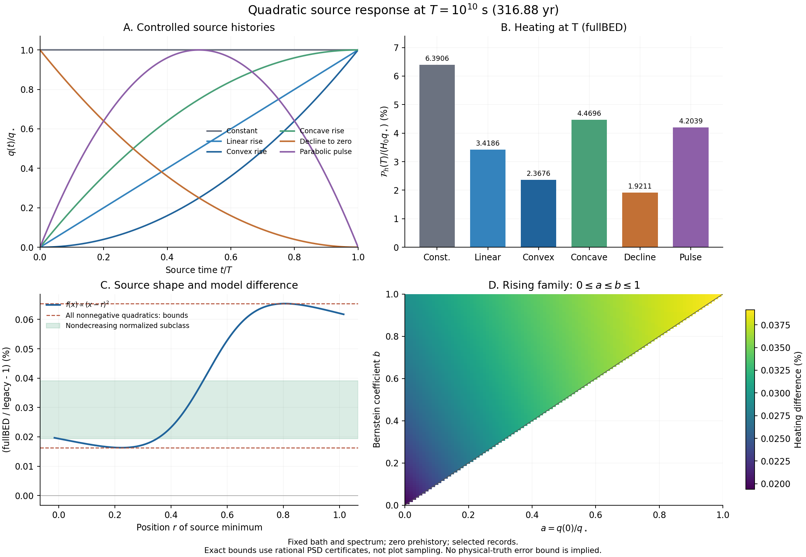

# M0 연구 루프: 비음수 이차 주입 이력의 가열 응답

2026-10-12 · `CR-M0-QUADRATIC-RESPONSE-20261012`

## 결론과 이번 루프의 범위

기존 M0의 상수·선형·이차 증가 사례를 재사용하여, **같은 고정 kernel에 대한 비음수 이차 주입 이력 전체의 가열률 비교**를 닫았다. 현재 기록에서 fullBED/legacy 가열률 차이의 유리수 외향 경계는 **+0.016303% 이상, +0.065394% 이하**다. 현재 주입률로 정규화한 비감소 이차 이력의 범위는 **+0.019389% 이상, +0.039147% 이하**로 더 좁다. 두 범위는 임의 source family나 물리적 진실에 대한 오차 상한이 아니다.

이것은 `research/cr_plan_reset_20261012/`에서 완료한 M0를 되풀이한 실행이 아니라 사용자의 새 M0 요청에 따른 별도 해석 확장이다. 기존 M0 COMPLETE와 실제 성공 기록은 변경하지 않는다. 새 과학적 의미는 같은 T·bath·스펙트럼 안에서 이차 이력의 클래스 전체를 다룬다는 점이다. 기존 F/H/G 판정, 예산, NCP 보류는 유지한다.

근거 상태는 다음과 같다. 응답·cone·비율 정리는 **derived**다. 기록값의 exact 유리수 계산과 PSD 부등식은 **numerically checked**이며 결과 파일에 분자·분모를 보존했다. 그림 출력 경로는 복구 실행에서 **implementation-verified**다. 독립 판정은 `review/DECISION.json`의 범위를 따른다. 실제 우주론 이력, 물리 입력 정확도와 production history는 **unresolved / HOLD**다.

## 1. 입력, 정의, 단위

기준 commit은 `ae2d246d7e9037e000b00cd89991beb6f837f2ee` ([PR42](https://github.com/cosmosapjw-quantum/bass_cr/pull/42))다. 재사용 입력은 `research/cr_plan_reset_20261012/results/CACHED_RESPONSE.json`, 21699B, SHA256 `60747f9da89e3596bfeb93a4ec14a1bb58a33bca3a09629fc092f254839f3b7b`다. 원 물리 기록의 SHA256은 `dfdca59ca0b4131c6143fe3cf0e402a7b18efb113a9af9bcc82a66696f5ec6f5`다. 이전 evaluator를 다시 실행하지 않고 저장된 exact numerator/denominator를 읽었다. `selected_record`와 `birth_defined`는 별도로 평가한다.

모델 (m\in\{f,l\})은 fullBED와 legacy다. 고정 비음수 causal kernel의 총 열 수율을 (H_m>0), 열 가중 지연 확률측도를 (F_m)라 둔다. 원 기록의 H0 정규화를 유지하며 W 또는 eV/s를 임의로 부여하지 않는다. (H_mq_*)가 가열률 단위를 가진다. (p,R,S)와 아래 다항식은 무차원이다.

주입 이전 이력과 이 source 이외의 초기 입자 perturbation을 0으로 둔다. (T=10^{10}\,\mathrm{s}\simeq316.88\,\mathrm{yr}), (q(t)=q_* f(t/T)) on (0\le t\le T), (q_*>0)일 때

\[
\mathcal P_m(T)=H_mq_*\int_{[0,T]}f(1-\tau/T)\,dF_m(\tau).
\]

양 끝점을 포함한다. 지연 원자 \(\tau=T\)는 \(q(0)\), \(\tau=0\)는 \(q(T)\)를 읽는다. zero prehistory가 \(q(0)\)까지 0이라는 뜻은 아니다.

\[
p_m=F_m([0,T]),\quad R_m=\mathbb E[(1-\tau/T)_+],\quad
S_m=\mathbb E[(1-\tau/T)_+^2].
\]

따라서 \(f(x)=\alpha+\beta x+\gamma x^2\)이면 정확히

\[
\boxed{\frac{\mathcal P_m(T)}{H_mq_*}=\alpha p_m+\beta R_m+\gamma S_m.}
\]

이 식은 이차 이력에 대한 정확한 유한 표현이다. 해당 모멘트를 이미 보유한 뒤에는 각 새 이력의 끝점 가열을 3항 합으로 평가하며 G 생성이나 시간전파를 요구하지 않는다. 모멘트 자체를 얻는 비용이나 이차식 밖의 source 계산 비용이 사라진다는 주장은 아니다.

## 2. 주입 종료 시점에도 남는 가열

아래 여섯 이력은 모두 \(\max_{[0,1]} f=1\)로 맞췄다. 표의 가열률 분모는 \(H_mq_*\)이며 현재 source가 0인 행도 포함한다. 마지막 열은 같은 source에 대한 \(100(\mathcal P_f/\mathcal P_l-1)\)이다. 표는 selected 기록의 반올림이며 exact 값과 birth 표현은 JSON/TSV에 있다.

| 이력 \(f(x)\) | \(f(1)\) | fullBED \(\mathcal P(T)/(H_fq_*)\), % | 모델 가열률 차이, % |
|---|---:|---:|---:|
| \(1\), 기존 상수 | 1 | 6.390638 | +0.039147 |
| \(x\), 기존 선형 증가 | 1 | 3.418586 | +0.025857 |
| \(x^2\), 기존 볼록 증가 | 1 | 2.367602 | +0.019390 |
| \(2x-x^2\), 오목 증가 | 1 | 4.469570 | +0.029283 |
| \((1-x)^2\), 감소하여 종료 | 0 | 1.921068 | +0.062104 |
| \(4x(1-x)\), 포물선형 pulse | 0 | 4.203936 | +0.040429 |

종료 이력의 두 정확한 계수는

\[
\frac{\mathcal P_m(T)}{H_mq_*}=p_m-2R_m+S_m
\quad\text{및}\quad4(R_m-S_m).
\]

이들은 과거에 주입된 입자가 현재 가열을 남기는 효과다. 이 두 경우 순간 가열식 \(H_mq(T)\)는 0이지만 기록된 kernel의 응답은 양수다. 이를 순간 예측으로 나눈 상대오차로 표현하면 분모가 0이 된다. 위 표처럼 명시된 이력 amplitude로 정규화한 가열을 사용한다. 여기서 계산한 것은 **종료 시각 T의 가열**이며 T 이후의 시간곡선은 아니다.

\(4x(1-x)\)는 포물선형 pulse다. piecewise-linear 삼각형 pulse의 정확한 응답에는 일반적으로 T/2의 추가 절단 정보가 필요하다.

## 3. 비감소 이차 이력 전체의 정확한 범위

현재 source로 정규화하여 \(f(1)=1\)이라 두면

\[
f(x)=a(1-x)^2+2bx(1-x)+x^2,
\qquad f'(x)=2[(b-a)(1-x)+(1-b)x].
\]

도함수가 일차식이므로 \(f\ge0,f'\ge0\) on \([0,1]\)의 필요충분조건은 \(0\le a\le b\le1\)이다. 또한

\[
f=a\cdot1+(b-a)(2x-x^2)+(1-b)x^2.
\]

따라서 이 클래스는 세 꼭짓점 \(1,2x-x^2,x^2\)의 convex hull이고, 응답 계수는 각각 \(p,2R-S,S\)다. legacy의 각 응답이 양수이면 두 모형의 비율은 꼭짓점 비율들의 legacy 가열 가중평균이다. 그러므로 꼭짓점의 최소·최대 비율이 전체 클래스의 정확한 최소·최대가 된다.

실제 기록에서는 최소가 \(x^2\), 최대가 \(1\)에서 달성된다. selected와 birth를 각각 계산한 외향 6자리 퍼센트 경계가 모두

\[
\boxed{0.019389\%\ \le\ (\mathcal P_f/\mathcal P_l-1)\ \le\ 0.039147\%.}
\]

부등식의 퍼센트는 무차원 비율을 표시한 단위다. machine-readable 파일은 무차원 비율과 퍼센트 표시를 분리한다. 반올림 이전의 정확한 범위는 두 꼭짓점의 유리수 비율이며, 표시 경계는 아래로/위로 향하게 반올림했다. 두 표현이 같은 6자리 구간으로 보인다는 사실은 두 모멘트 정의를 하나로 합쳐도 된다는 뜻이 아니다.

## 4. 모든 비음수 이차 이력의 정확한 범위

이 절은 \(f(1)>0\)나 비감소 조건을 요구하지 않는다. \(f\not\equiv0\), \(f\ge0\) on \([0,1]\), \(\deg f\le2\)가 대상이다.

\[
f=a(1-x)^2+2bx(1-x)+cx^2\ge0
\iff a,c\ge0,\ b\ge-\sqrt{ac}.
\]

끝점에서 \(a,c\ge0\)를 얻고, 내부에서는 \(u=x/(1-x)>0\)를 사용한 \(a/u+2b+cu\ge0\)의 inf로 나머지 조건을 얻는다. 퇴화 끝점도 포함한다. 다음 정확한 분해가 핵심이다.

\[
f=[\sqrt a(1-x)-\sqrt c\,x]^2
  +2(b+\sqrt{ac})x(1-x).
\]

즉 모든 비음 이차식은 선형식의 제곱과 비음 계수의 \(x(1-x)\)로 표현된다. 정의

\[
A_m=H_m\begin{pmatrix}p_m&R_m\\R_m&S_m\end{pmatrix},
\qquad B_m=H_m(R_m-S_m)
\]

에서 선형식 \(u+vx\)의 제곱 응답은 \((u,v)A_m(u,v)^\mathsf T\), \(x(1-x)\) 응답은 \(B_m\)다. 이번 네 기록은 exact arithmetic으로 \(A_m\succ0\), \(B_m>0\)를 만족했다.

\((A_f,A_l)\)의 generalized eigenvalues를 \(\lambda_-\le\lambda_+\)라 두면 squared-linear source의 비율은 이 두 값 사이이며 각 끝은 대응 eigenvector의 제곱 이력으로 달성된다. 일반 source의 비율은 이 비율과 \(B_f/B_l\)의 양의 가중평균이다. 따라서 **달성 가능한 정확한 전체 범위**는

\[
\boxed{\frac{\mathcal P_f}{\mathcal P_l}\in
\left[\min(\lambda_-,B_f/B_l),\ \max(\lambda_+,B_f/B_l)\right].}
\]

두 끝점 이력의 비음 조합으로 사이의 비율도 얻는다. 현재 기록에서는 \(B_f/B_l\)가 eigenvalue 구간 안에 있고 두 끝은 squared-linear 이력이다. selected 기록의 source 최소 위치는 각각 \(x\simeq0.223749676945\), \(x\simeq0.805907610225\)다. 이들은 가열 kernel의 재구성물이 아니라 경계를 실현하는 **주입 이력**이다. 유리수로 근사한 이력과 그 실제 비율도 결과 JSON에 보존했다.

두 표현 각각에서 확인된 외향 퍼센트 경계는

\[
\boxed{0.016303\%\ \le\ (\mathcal P_f/\mathcal P_l-1)\ \le\ 0.065394\%.}
\]

### 표시 정밀도와 인증의 분리

기록값을 exact 유리수로 처리하여 \(\det(A_f-\lambda A_l)=0\)의 두 근을 유리수 구간으로 둘러쌌다. 결정적인 범위 검사는 그 근의 float 출력이나 그림의 격자 표본이 아니다. 외향 유리수 경계 L,U에 대해

\[
A_f-LA_l\succeq0,\quad UA_l-A_f\succeq0,
\quad B_f-LB_l\ge0,\quad UB_l-B_f\ge0
\]

를 정확히 확인했다. 대칭 2×2 행렬의 두 대각 성분과 determinant가 비음이라는 인증값을 저장했다. 이 부등식들이 모든 비음 이차 source에 대한 범위를 직접 보증한다. ‘정확함’의 대상은 저장된 유리수 입력과 이 유한 함수 클래스이며, 원 입력의 물리 정확도가 아니다.

## 5. 유효범위, 극한과 다음 적용

순간 kernel이면 끝점 응답식은 \(\mathcal P_m=H_mq(T)\)로 환원된다. 이때 A는 rank 1, B는 0이므로 위 strict 분모 가정의 일반 비율 정리는 그대로 쓰지 않는다. legacy의 가열이 0인 이력을 fullBED만 가열할 수 있으면 유한한 상한이 사라질 수 있다. 현재 입력은 이런 퇴화가 없는 범위임을 계산으로 확인했다.

끝점 가열은 누적 열량과 다르다. 실제 이차항이 있는 경우

\[
\int_0^T\mathcal P_m(t)\,dt
=H_mq_*T\left(\alpha R_m+\tfrac\beta2S_m+\tfrac\gamma3 U_{3,m}\right),
\quad U_{3,m}=\mathbb E[(1-\tau/T)_+^3].
\]

따라서 pRS만으로 이차 source의 누적 열량을 정확히 계산하지 않았다. 같은 pRS와 다른 U3의 수학적 반례, equality·퇴화·끝점 조건의 상세 증명은 `DERIVATION_KO.md`에 있다. 그 반례는 실제 CR kernel의 대체 모델이 아니다.

실제 주입 이력을 이차식으로 근사할 때 잔차 \(e(t)=q(t)-q_*f(t/T)\)가 있으면 고정 kernel 안에서

\[
|\mathcal P_m[q](T)-\mathcal P_m[q_*f](T)|
\le H_mp_m\|e\|_{\infty,[0,T]}.
\]

잔차의 크기를 실제 자료로 정하지 않으면 이번 이차 클래스의 수치를 일반 이력의 정확도 상한으로 사용할 수 없다. 시간 변화 bath·source spectrum은 별도의 kernel 문제다. 실제 CR 비중과 downstream 관측량의 오차 예산도 아직 결속되지 않았다.

다음 단계는 기존 계획의 M1 소비자 입력 결속과 M2 오차 평가다. 같은 표본을 더 촘촘히 찍거나 새 행렬을 생성하는 작업은 이 M0 결론을 개선하지 않는다. 무거운 원자 계산의 필요성은 실제 부족한 source/domain/observable 또는 독립 CR 과학 질문으로 결정한다.

## 6. 실제 실행과 실패 분류

새 exact 후처리는 1회 실행했다. 유리수 계산과 PSD 검사를 끝내 JSON·TSV를 저장한 뒤 Matplotlib 수식 라벨 `mathcal P`의 문법 문제로 첫 프로세스가 **exit 1, wall 0.561777초**에 끝났다. 이 실패는 **그림 출력 구현 오류**이며 원 과학 source, 수치 양성 조건 또는 자원 부족에 의한 실패가 아니다. 최초 실행 코드·stderr·exit·저장된 산출물 해시는 `evidence/attempt01/`에 보존했다.

그림 함수를 분리하고 라벨을 `mathcal{P}`로 고쳤다. 저장된 결과만 읽는 renderer를 **1회, exit 0, wall 1.497088초** 실행하여 PNG/PDF를 완성했다. exact 계산과 이전 M0 evaluator는 재실행하지 않았다. PNG를 직접 확인했다. 전체 후처리의 최초 exit를 0으로 바꿔 기록하지 않는다. 최종 evaluator의 변경된 그림 경로는 이 복구 실행과 같은 renderer를 사용한다.

새 G, CR linear solve, 시간전파, expm, resolvent, F retry, NCP dispatch, 과거 suite 실행은 각각 0이다. 2×2 generalized pencil의 스칼라 유리수 연산은 수행했으며 이를 ‘아무 계산도 하지 않음’으로 표시하지 않는다. 독립 검토 실행과 판정은 `review/`의 실제 기록을 따른다.

새 NCP handoff는 기존 run의 상태 확인·필요한 수집만 유지한다. 미게시 run은 현지 확인 전까지 UNKNOWN이다. 원래 F/G 및 H의 8build/76800열/900초/retry0, PHYS02_DELAY OPEN, production_history HOLD, atomic_G02 UNRESOLVED, b_grid NO_GO, all_bound OPEN, R17B2B와 CCC exporter 상태를 보존한다.

## 파일

- `CONTRACT.json`: 이번 M0 범위·예산·완료조건.
- `DERIVATION_KO.md`: 직접 유도, equality, 퇴화, 누적량 반례.
- `inputs/CACHED_RESPONSE.json`: 재사용한 exact 입력.
- `evaluate_quadratic_response.py`: 새 수치 후처리. 기존 결과 덮어쓰기 거부.
- `render_quadratic_response.py`: 저장된 결과만 읽는 그림 출력.
- `results/QUADRATIC_RESPONSE.json`, `.tsv`, `.png`, `.pdf`: 정확한 값·인증·그림.
- `evidence/`: 실제 실행과 첫 실패, 그림 회복의 근거.
- `review/DECISION.json`: 실제 독립 판정의 범위.
- `HANDOFF.json`, `NEXT_DAG.json`, `START_NCP_CODEX_KO.md`: 현재 상태와 다음 작업.
