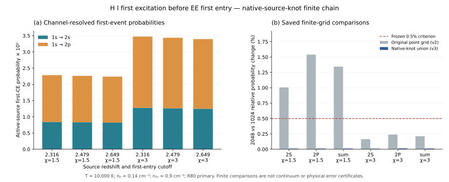

# BASS_CR N5 — EE 확산 중 첫 H I 여기 사건의 채널별 확률

## 판정과 핵심 결과

이번 이론·코딩 루프의 완료 단원은 **CR_N5_CE_KILLED_GENERATOR_FIRST_EVENT**, named consumer는 **N5_C23D_HI_CE_RESOLVENT_V1**이다. 최종 채택은 **NUMERICALLY_CHECKED_SCOPED_CONDITIONAL_FINITE_CHAIN**이다. PHYS83 원자료의 에너지 절점을 포함한 새 유한 chain에서 사전 수치 기준을 모두 통과했고, 독립 C9의 열린 blocking finding은0이다.

T10000K, thermal ne=.14cm⁻³, prescribed lnΛ20, 고정 ground-H1 n1s=.9cm⁻³의 조건에서, C23D의 선택 source 전자 하나가 EE 확산을 거쳐 cutoff 첫 진입 전에 1s→2s 또는1s→2p 여기를 일으킬 확률은 **1.4302747727×10⁻⁵–1.4642413873×10⁻⁵**다. 백분율로는 **0.00143027–0.00146424%**, 선택 전자 백만 개당 약14.30–14.64개에 해당한다. 원 active population만 분모로 삼으면 **2.2387889316×10⁻⁵–3.4726318512×10⁻⁵**다.

이는 두 CE channel을 mark로 둔 frozen-EE 경로의 조건부 관측량이다. CI/RR/DR/CX/neutral elastic/electron-ion 등의 전체 경쟁률은 아직 null이다. 전체 CR_N4_STOPPING_KERNEL과 CR_N5_ATOMIC_ISOTOPE_COVERAGE는 **PARTIAL/OPEN**, N6 conservative coupling 및 N7 new parcel은 선행 gate 미충족이다. global_error_bound와 global_completion_percent는 모두 null이다.

정확한 고정 입력과 수식은 FROZEN_CONTRACT.md, THEORY_KO.md, 변경된 격자 계약은 REFINEMENT_CONTRACT_V3.md에 있다. 원자료는 inputs/, 실제 실행별 결과는 runs/, 독립 검산은 review/에 있으며 이전 실패 기록과 최종 채택된 family를 구별한다. 모든 단계의 EXECUTION | PUBLICATION | BACKUP | DAG는 LOOP_LEDGER_SCIENCE.json 및 최종 delivery ledger에 기록한다.

## 1. 먼저 조사한 권위와 병렬 연구

사용자가 지정한 C23D 고정 인계와 중앙 인계를 읽고 science d04b2a56adb4a5d55b901420aa544332b41f6dbb, documents4a0bbc0ed618ab6eae1b7b2714e366d803186b86, central476587d049cc5b265e599fdec45b1026d3bf6b23의 의미를 보존했다. 실제 HEAD·AGENTS·병렬 변경 조사에서는 이후 완료된 C23E/PR100과 PR101이 존재함을 확인했다. 이번 branch의 실제 base는 PR101 Documents **b65befa5187d3e1e11574a98dcadd2032831de72**이며, 새 Draft PR은102다.

이번에 직접 수행한 첫 전수 metadata snapshot은04:41:26–04:43:17UTC의 **1321branches/856openPR**였다. 이어07:26:02–07:27:03UTC에14collections/29pages를 끝까지 조회한 snapshot은 **1325branches/859openPR**다. 후자는 우리 새 branch/PR102도 포함한다.

| Repo | Branches | Open PR |
|---|---:|---:|
| bass |271|156|
| bass_cr |180|101|
| BASS_HE |101|96|
| WU088_HH |152|143|
| rec_bianchi |151|99|
| rei_bianchi |265|209|
| vigilode |205|55|
| 합계 |1325|859|

전수 pagination은 branch/PR metadata의 범위를 뜻한다. 각 branch의 모든 파일과 전체 대화를 읽었다고 주장하지 않는다. 변경된 관련 과학 source와 gate를 별도로 읽었고 정확한 source pins를 보존했다. 00:43UTC의1306/840은 이전 역사적 snapshot이며 덮어쓰지 않는다. 최신 작은 owner HEAD 조회는 최종 freshness receipt에서 시각과 함께 따로 제공한다.

수신한 주요 변화는 다음과 같다.

- **WU PHYS84는 numerical WAIT 유지.** PHYS83의66T/132rate rows는 완료된 provider다. PHYS85 원 transport의 truncated reference는 미검증 상태를 보존한다. PHYS86은 별도 새 projected exact reference1017 assertions와 moments82 assertions, 총1099/1099을 완료했지만 physical rate/stopping payload를 공급하지 않는다.
- **HE95/96은 실제 보완 자료를 완료.** HE95는 CCC equal-sharing phase/spin/normalization adapter, HE96은 incident54.4eV의 두 located TDCS anchors다. Full angular joint law, full event normalization, recoil provider는 미채택이다. HE-ANG의 SOURCE_INPUT_PENDING을 그대로 둔다.
- **BASS186은 canonical-rest f=0 B3b 범위에서18/18 PASS.** 일반 f>0 finite photon stock과 전체 stopping 완료를 뜻하지 않는다.
- **REC133은 Git 설명과 실제 자료를 구별했다.** 관측 Git HEAD는S0였지만 acknowledged Dropbox S2 archive의 실제 bytes와 선택10payload를 검증해350Fractionpoints/70cells/26controls의 scoped 결과를 수신했다. H5는 INPUT_DEPENDENT_UNCALIBRATED, physical error bound null이다.
- **VigilODE85의 guard 결과와 새 D3 owner를 구별했다.** 기존 manufactured test의 forbidden RHS507→0을 수신했다. D3는 관측 당시 계약 단계였으며 native quota HOLD와 owner 예약을 보존했다.

백업 조사에서는53개 provider read/list 응답, 관련 metadata4981개를 수집했다. Library와 Dropbox의 노출된 목록은 끝까지 조회한 범위를 명시했다. Drive는 cursor가 노출되지 않아 계정 전체 조사 완료로 확대하지 않았다. 기존 C23D와 PR101 ZIP의 정확한 이름+폴더 조회에서 결과0을 받았으나, 이를 absence proof나 성공으로 바꾸지 않았다. 기존 Drive UNKNOWN_NO_ACK는 그대로다. 별도 전체 대화는 UNAVAILABLE, 외부 NCP runtime/lease는 UNOBSERVED다.

## 2. 기존 연구와 이번 새 계산의 관계

PR59 EE coefficient·reversible generator·moving current와 C23D 저장 source atoms를 그대로 재사용했다. C23D의 source count91.3–91.7%, energy64.5–65.9% 선택, 약24.85%의 초기 bath→전자 에너지 교환, 전체 pulse의 양의 순 EE heat와 active first-entry 평균은 기존 결과다. 이번에 재계산하지 않았고 새로운 성과로 세지 않는다. 기존 PR60–64의 finite-bath/nonlinear 후속도 재구현하지 않았다.

PR101은 최대 hazard와 저장 first-entry mean으로 CE upper estimate를 이미 계산했고 backward survival 방정식도 이미 유도했다. 따라서 표준 Feynman–Kac/absorbing-chain 관계 자체는 재사용이다. 이번 새 기여는 다음 세 항목이다.

1. 그 식을 source-pinned EE 유한 generator에 실제로 적용해 **채널별 첫 사건 확률**을 계산했다.
2. 같은 killed-chain에서 **사건 직전 에너지, 조건부 사건시간, 사건 내부에너지**를 연결했다.
3. 실제 원자료 절점을 놓치는 격자의 실패를 기록하고, 원 보간·물리 입력·허용오차를 유지한 별도 native-knot family로 수치 기준을 충족했다.

SciSpace 검색은 저에너지 충돌 문헌과 reaction/diffusion Feynman–Kac 배경을 수집하는 데 사용했다. H2/Ar/screened-H 결과는 종·조건이 맞지 않아 provider로 채택하지 않았다. [Hou–Deng의 원 논문](https://arxiv.org/abs/1706.01512)은 방법 배경으로 확인했으며 새 원자율 source로 쓰지 않았다.

Wolfram은 두 transient state toy model의 exact algebra를1회 검산했다. 확률합, 직접해, small-mark limit, 총 CE 확률의 단조성 및 오목성 등5개 결과가 모두 True였다. 일반 검색의 NoResults 응답과 실제 symbolic 결과를 분리 보존했다. PHYS85/86 owner의 reference 작업을 중복 수행하지 않았다.

## 3. 물리 입력과 확률의 분모

고정 bath는 T=10000K, thermal ne=.14cm⁻³, prescribed lnΛ20, proper seconds, closed box/no escape다. n1s=.9cm⁻³는 총 중성 H를 바닥상태로 두는 명시적 추가 closure다. n2s/n2p는 null이다. 표적은 stationary heavy, unpolarized H1이며 D/T 동위원소 equality나 finite-mass thermal target model을 새로 채택하지 않았다.

초기 source는 저장된 z=2.316,2.479,2.649의 각384atom과 pulse_count_cm3다. 10000proper s exposure는 impulsive population을 정의하며, continuous photoionization chemistry를 적분한 시간이 아니다. 초기 선택은0<W<10eV다. 이는 확산 경로의 상한이 아니다.

θ=.8617333262145178eV, q=χθ이고 χ=1.5,3을 사용한다. 두 q는1.2925999893217768 및2.5851999786435536eV다. 반사 상단 U=Rθ에서 R80, 즉68.93866609716143eV를 primary로 두고 R40을 비교했다. PHYS83 source-native threshold는 Δ=10.20435eV, 상단968.6058eV다. 따라서 선택 초기 전자는 모두 CE threshold 아래지만, EE 확산 경로는 threshold 위에 도달할 수 있다.

원 W>q 전자만 active이며, 양의 두-node 선형 projection이 수와 초기 에너지를 보존한다. q node에 배정된 질량은 유한 chain에서 즉시 first entry로 기록하되 원 active denominator에서 빼지 않는다. 원 W≤q는 t=0에 이미 entry한 것으로 취급한다. q,10eV,Δ를 정확한 node로 포함하여 초기 source가 양의 CE hazard node로 투영되지 않음을 확인했다.

본 보고서의 selected 확률은 원0<W<10eV 선택 전자 전체를 분모로 한다. Active 확률은 원 W>q 부분을 분모로 한다. 선택 밖의 원 pulse 전자에 대해 같은 확률을 적용하지 않는다.

## 4. 유한 chain 수식과 구현

PR59의 Q는 column population에 작용한다. 흡수 q 상태를 제외한 A=Q[1:,1:]에는 q로 빠지는 손실이 남고 backward generator는 G=Aᵀ다. a=−G1=Q[0,1:]는 entry hazard다.

PHYS83는 W_c(E)=Eσ_c(E)의 source-native piecewise-linear arrays를 제공한다. 원 상수 EV_J/ME_KG와 원 보간을 유지해

\[
h_c(E)=n_{1s}\,100\sqrt{\frac{2\,{\rm EV_J}}{{\rm ME\_KG}}}
\,\frac{W_c(E)}{\sqrt E}
\]

를 proper s⁻¹로 계산한다. 100은 m/s→cm/s 변환이다. Constructor 배열만 읽었고 moments/evaluate, source 또는 thermal-rate quadrature는 호출하지 않았다.

h=h_2S+h_2P와 K=diag(h)−G를 정의하면

\[
Ku_c=h_c,\qquad Ku_{\rm entry}=a,\qquad Kt=1,
\]
\[
Kr_c=E h_c,\qquad Kv_c=u_c,\qquad (-G)w=h
\]

를 푼다. u_c는 channel first-event probability, t는 CE 또는 entry 중 먼저 일어날 때까지의 평균시간, r_c와 v_c는 각각 사건 에너지와 시간의 비정규화 reward다. source 평균 후 r_c/u_c와 v_c/u_c를 취하면 조건부 평균을 얻는다. 확률0인 조건부 평균은 null이다.

유한 absorbing birth–death chain에서 K⁻¹은 비음성이며 K1=h+a이므로 u_2S+u_2P+u_entry=1이다. 또한 u_CE≤w다. 희귀 확률은 1−u_entry로 빼서 얻지 않고 양의 channel RHS를 직접 푼다. 이 수학적 관계는 선택 finite chain의 성질이다. 물리 단면적 오차나 continuum/global stopping certificate를 제공하지 않는다.

PHYS83 native knots를 geometric grid와 합집합으로 넣은 v3 family는 GEOMETRIC_PLUS_NATIVE_CE_KNOTS_V1이다. N1024/2048은 기본 geometric 분할의 표기이며, native knots를 추가한 실제 node 수는 그보다 많다. 서로 가까운 다른 knot를 병합하지 않고 정확히 같은 binary64 값만 중복 제거했다. R40은 R80 common grid의 prefix다. 가장 작은 spacing은 약9.4×10⁻⁶eV다. 아래10eV grid 및 source projection은 같은 N의 v2와 동일하다.

## 5. 실제 새 수치 결과

아래 값은 v3, R80, 기본 N2048+native knots의 결과다. 충분한 유효숫자로 표시했으며 세부 binary64 값은 SOURCE_WEIGHTED_RESULTS.json과 FINEST_RESULTS.csv가 권위다.

| z | χ | P(2s), selected | P(2p), selected | P(2s+2p), selected | P(2s+2p), active |
|---:|---:|---:|---:|---:|---:|
|2.316|1.5|5.3835018021e-6|9.2589120706e-6|1.4642413873e-5|2.2842638117e-5|
|2.479|1.5|5.3347644359e-6|9.1750902378e-6|1.4509854674e-5|2.2624896862e-5|
|2.649|1.5|5.2831166423e-6|9.0862628542e-6|1.4369379496e-5|2.2387889316e-5|
|2.316|3|5.3590771332e-6|9.2168995129e-6|1.4575976646e-5|3.4726318512e-5|
|2.479|3|5.3103119404e-6|9.1330298706e-6|1.4443341811e-5|3.4361749804e-5|
|2.649|3|5.2586204099e-6|9.0441273170e-6|1.4302747727e-5|3.3949397027e-5|

| z | χ | CE 조건부 평균 사건시간, proper s | CE 조건부 평균 incident energy, eV | 평균 stop 시간, active s |
|---:|---:|---:|---:|---:|
|2.316|1.5|594855.143|11.25887156|282023.251|
|2.479|1.5|595320.577|11.25887156|281662.000|
|2.649|1.5|595977.940|11.25887156|281463.336|
|2.316|3|590986.259|11.25888224|271471.196|
|2.479|3|591416.949|11.25888224|270577.069|
|2.649|3|592034.620|11.25888224|269738.024|

CE가 실제로 일어난 경로를 조건으로 하면 평균 시간이 약5.91–5.96×10⁵s다. 이는 희귀 threshold excursion이 일어난 경로의 조건부 시간이며, 전체 active first-entry 평균과 같은 관측량이 아니다.

평균 incident energy는 약11.2589eV, 직후 tagged kinetic energy는 약1.05453eV이며, 그 차10.20435eV가 원자 내부 여기다. 선택 전자 하나당 첫 사건 internal reward는1.45950×10⁻⁴–1.49416×10⁻⁴eV다. 이 값은 첫 사건 장부이며 최종 bath heat, photon escape 또는 후속 cascade 총에너지로 이름을 바꾸지 않는다.

같은 χ에서 source z가 달라도 conditional event-energy 값이 일치하는 현상은 이 nearest-neighbor model과 양립한다. 모든 초기 support가 첫 marked state 아래에 있어서, CE가 생기려면 동일한 첫 marked state에 먼저 도달해야 한다. 그 이후 law는 그 state에서 재시작한 law이고 source는 도달확률과 도달시간을 바꾼다. 이는 현재 유한 모델의 설명이며 새로운 일반 정리의 발견으로 세지 않는다.

PR101 selected upper estimates0.33045–0.52558%는 저장된 mean과 전 경로 hmax의 결과로 남긴다. 이번 selected 값0.001430–0.001464%는 실제 에너지 점유에 의존한다. 두 수치는 서로 다른 numerical representation을 사용했으므로 이 비교를 certified continuum error ratio나 엄밀한 동일 discretization inequality로 포장하지 않는다. 이번 동일 chain에서 직접 검사한 u_CE≤w는 별도 PASS다.

그림은 저장된 결과만 읽어 생성했다. 새 provider 호출·행렬·선형 solve는0이며 plotting CPU는 별도 계측했다. 왼쪽은 active denominator, 위 표의 selected denominator와 구별한다.

## 6. 원래 실패를 보존한 검증

| 검증 | 사전 기준 | 최종 관측 최대값 | 판정 |
|---|---:|---:|---|
| Componentwise linear residual |2e-12|9.4650747895e-13|PASS|
| 확률합 absolute defect |2e-8|3.0396907214e-11|PASS|
| Generator column conservation scaled defect |2e-13|1.0226912586e-16|PASS|
| N2048/1024 probability relative change |.005|.0001281093036|PASS|
| Conditional event energy relative change |.01|1.5120036466e-5|PASS|
| Conditional event time relative change |.01|8.5229210366e-5|PASS|
| R40/R80 probability relative change |1e-5|2.4726996662e-11|PASS|
| Independent exact-binary64 Decimal80 P/E/time |5e-10|7.4506402594e-12|PASS|

확률 range, source 수·에너지 projection, 사건 energy 장부, u_CE≤w, native-knot inclusion과 아래10eV identity도 통과했다. 단순히 residual만 작다는 이유로 convergence를 인정하지 않았다.

최초 v1은10controls PASS 뒤 local variable shadow 때문에2Q를 만들고1case/9RHS를 완료한 상태에서 실패했다. 테스트 CPU.239278s와 실패 primary CPU.279477s를 유지한다. 07:21UTC에 이전 scratch 파일들이 사라진 것을 여러 agent가 관측했으며 원인은 UNOBSERVED다. 이 v1의 실제 코드·CASE·raw는 NOT_RECOVERED다. 그 raw가 보존됐다고 주장하지 않으며 admission에서 제외한다.

새 identity의 recovery-v2는 고정 source bytes를 복구하고 실행 전 S1에 게시했다. 11controls PASS,12matrix/108RHS/36source rows를 완료했다. 모든 local arithmetic/projection/energy/boundary 검사는 PASS였지만 χ1.5의18개 probability grid comparisons가1.00615–1.53976%로 frozen0.5% 기준을 실패했다. 독립 Decimal80의8.644925e-14 일치는 유한 행렬 산술만 확인한다. 따라서 v2의 grid 실패는 FAILED_RETAINED다.

v2 최초 positive node가 Δ에서 약.01768eV 떨어진 반면 원 native first-positive knot는 약.0000385eV 떨어져 있다는 진단을 기록했다. source projection도 변하므로 threshold undersampling만이 유일한 원인이라고 단정하지 않았다. h² extrapolation이나 tolerance 완화는 하지 않았다.

R6 delta review 후 별도 v3 input/run에서 native knots를 합집합으로 넣었다. 변경된 targeted control1건과 필요한 N1024/2048의8cases만 실행했고 N512는 반복하지 않았다. 모든 frozen criteria를 통과했으며 독립 finest R80 reference도 PASS다. 원 v2 결과·격자·실패·비용은 바꾸지 않았다. 관측된 두 격자의 합치가 연속 model의 certified error bound는 아니다.

## 7. 실행 수와 누적 비용

| 이번 연속 작업의 실제 항목 | CPU s | 새 과학 계산 수 |
|---|---:|---|
| v1 targeted tests |.239278|10controls|
| v1 실패 primary |.279477|2Q builds,1complete case,9RHS|
| recovery-v2 tests |.358448|11controls|
| recovery-v2 primary |.607510|12Q,12complete,108RHS|
| native-v3 control |.322367|1changed control|
| native-v3 primary |.550025|8Q,8complete,72RHS|
| 독립 v2 reference |.688471|18Decimal direct/adjoint solves|
| 독립 v3 reference |.799264|18Decimal direct/adjoint solves|
| 저장 결과 그림 |1.776108|새 physics/solve0|

이전 known bounded worker19.209296114s에 위5.620948s를 더하면 **24.830244114s**다. 이는 계측된 bounded worker lineage 부분합이며 전체 프로젝트 spend나 금융 비용이 아니다. independent review1.487735s는 위 합계에 한 번만 포함했다. Root saved-output diagnostic.054974463s, reviewer summary mechanical.016845157s, coordinator·packaging·I/O는 별도 ledger로 구별하고 미계측값은 null이다.

실제 primary 작업 합계는 **22Q builds,21completed cases,189RHS**다. v1 실패 뒤 새 identity에서 한 completed case가 다시 계산된 비용도 숨기지 않는다. historical old science replay는0이다. 새 linear/coupled/cosmological ODE0, source/thermal-rate quadrature0, NCP dispatch0이다. C23D의 기존 actual EE ODE4와 원 new_ODE:0의 RESULT_CLARIFICATION은 그대로 보존한다.

관측 host는 CPU0–8, quota8,8GiB cgroup이다. CPU55가 없으므로 coordinatorCPU8, scientific workerCPU0, reviewCPU1을 사용하고 native threads1, create-only output, 명시 lease와 CPU/wall/address-space 제한을 적용했다. 외부 runtime/lease는 추측하지 않았다. 작업별 실제 resource admission/dispatch 영수증이 권위다.

## 8. 보존 법칙, 전체 DAG와 다음 입력

CE event는 e(E)+H1s→e(E−Δ)+H2l이며 전하·핵종·전자 수가 보존된다. Mark 후 계산을 끝내는 것은 관측량 정의이지 irreversible assimilation/Maxwellization이나 물리적인 전자 소멸이 아니다. 후속 cascade·온도·population feedback과 실제 coupled energy owner는 이번 관측량 밖이다.

전체21population/168cell matrix와 최신 owner delta는 COVERAGE_AND_REUSE_KO.md 및 intake/reused_pr101/COVERAGE_MATRIX.json에 결속했다. Missing rate/species는 null이며0으로 채우지 않는다. C23C의 PQ=Q̄P 및 cᵀ=c̄ᵀP isotope quotient 조건과 C23E D43K 장부는 기존 근거를 재사용한다. 이 CE 확률만으로 omitted processes의 지배 순위를 결정하지 않는다.

다음 첫 노드는 계속 **CR_N5_ATOMIC_ISOTOPE_COVERAGE**다. 실제 PHYS84 numerical owner return과 low-energy neutral/EI, CI gap/tail, RR energy spectrum, 부분 이온화 DR, CX partner 자료 중 공급된 것을 먼저 종·전하·T/E·frame·clock·보존 장부와 EE 경쟁률에 결속한다. 이번 v3를 복원 목적으로 다시 실행하지 않는다. Full selected-network gate를 통과한 뒤 N6 conservative coupling, 그 뒤 N7 new parcel로 진행한다.

Non-tilted LRS/full Frobenius와 signed amplitude·norm·cancellation 구분을 유지한다. Isotropic atomic gas closure는 nonbaryonic Vlasov stress와 별개다. 전체 thermal/UV/stars/nuclear network를 완료로 주장하지 않는다. Full high-energy nuclear 및 general triaxial/tilted/polarized CMB는 HOLD, 원 nuclear network PNG는 NOT_RECOVERED_NOT_READ다.

## 9. 게시와 백업을 읽는 방법

실행 전 고정 게시 S0=ad3634c029dcff722602dc139fb726142935f88c, recovery S1=d3d2b2ff478a80d985e5be70052cbda225f1aeba, native pre-execution=21523c93583129763cc8b66f68091bd6e48e81ee이다. 이후 Science S, 중앙M1, canonical backup, Documents D, 중앙M2 및 terminal authority를 분리해 정확한 SHA/ID를 delivery/에 기록한다. 본 science report의 생성 시점 이후 영수증은 최종 인계를 따른다.

중간 S0 recovery ZIP3914869B와 v2 raw ZIP2620376B는 Library/Dropbox R1 ACK 상태로 먼저 보존했다. Final canonical은 실제 bytes의 size/SHA/CRC/all-payload R3를 별도로 수행한다. Git/R1 성공이나 로컬 ZIP 검사만으로 원격 R3를 주장하지 않는다. 과거 Drive unknown을 승격하지 않으며 새 Drive 결과도 실제 ACK와 조회 결과 그대로 기록한다. 삼중 백업 여부는 최종 receipt가 결정한다.

원 v1 unavailable payload와 복구한 자료의 identity를 구별한 missing manifest가 포함된다. Canonical이 현재 manifest의 모든 payload를 포함한다는 사실과 원래 유실된 v1 raw를 복구했다는 주장은 서로 다르다.

## 고정 근거

- [원 C23D 고정 인계](https://github.com/cosmosapjw-quantum/bass_cr/blob/4a0bbc0ed618ab6eae1b7b2714e366d803186b86/research/cr_c23d_finiteT_source_bridge_20261024/delivery/HANDOFF_FINAL_KO.md)
- [원 중앙 고정 인계](https://github.com/cosmosapjw-quantum/rei_bianchi/blob/476587d049cc5b265e599fdec45b1026d3bf6b23/research/orchestration_longterm_20261023/assembly/HANDOFF_bass_cr_KO.md)
- [직전 PR101 report와 source semantics](https://github.com/cosmosapjw-quantum/bass_cr/blob/b65befa5187d3e1e11574a98dcadd2032831de72/research/cr_n5_rate_semantics_20261024/REPORT_KO.md)
- [PHYS83 완료 source](https://github.com/cosmosapjw-quantum/WU088_HH/tree/6a2fc5aacb6182a916b9434c316e99e750e8273c/research/hh_phys83_ce_completion_20261023)
- [새 Draft PR102](https://github.com/cosmosapjw-quantum/bass_cr/pull/102)
