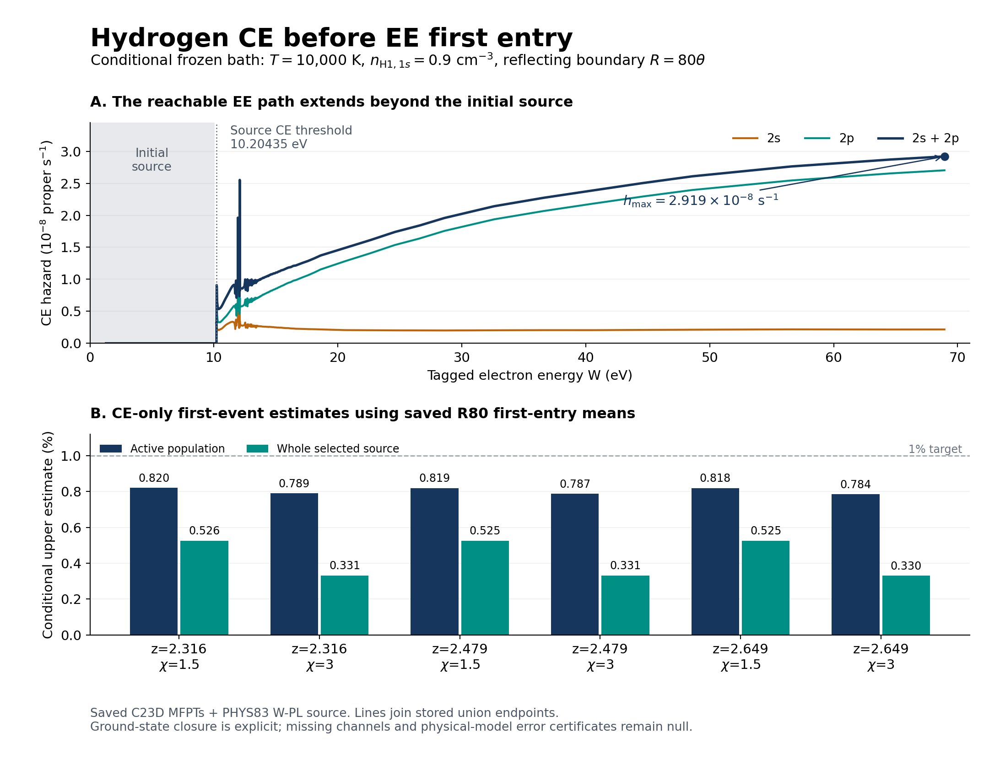

# CR N5: 원자율의 의미와 EE 첫 진입 전 수소 CE 경쟁률

## 결과와 범위

`CR_N5_PROVIDER_RATE_SEMANTICS_AND_CE_ENVELOPE`는 기존 C23D의 저장된 EE first-entry 평균과 PHYS83의 고정된 H I 전자충돌 여기(CE) 원자료를 결속한다. 새 소비자는 `N5_C23D_HI_CE_FIRST_EVENT_FINITE_BAND_V1`이다. 실제 새 계산은 **대수적 진단 1회**이며, 18개 hazard 허용치, 24개 열평균 표적률 비교, 18개 CE first-event 상한 추정치와 6개 경로 전체 hazard maximum을 산출했다. 전체 N5의 상태는 `PARTIAL/OPEN`으로 유지한다.

추가한 물리 입력은 **고정된 바닥상태 H1 밀도** \(n_{1s}=0.9\,\mathrm{cm^{-3}}\)이다. C23D의 총 중성 수소 밀도와 수치는 같지만, 전부 1s라고 두는 것은 이번 진단에 명시적으로 추가한 closure다. \(n_{2s},n_{2p}\)는 `null`이다. 나머지 bath는 C23D와 같이 \(T=10^4\,\mathrm K\), \(n_{e,\mathrm{th}}=0.14\,\mathrm{cm^{-3}}\), prescribed \(\ln\Lambda=20\), closed box, proper seconds다.

선택한 stationary heavy-target, unpolarized H1 W-PL source model에서

\[
h_{\rm CE,max}=2.9189745001395196\times10^{-8}\;\mathrm{s^{-1}}.
\]

같은 EE 과정과 초기 active 분포에 대해 계산한 \(2s+2p\) CE의 first-event 상한 추정치는 active population에서 **0.7843769–0.8199218%**, 선택 source 전체에서 **0.3304549–0.5255800%**다. 이 값은 저장된 수치 평균을 대입한 conditional finite-band 결과다. 물리 source 오차와 mean의 엄밀한 upper enclosure가 제공되지 않았으므로 `physical_probability_certificate=null`을 유지한다. CI/RR/DR/CX/neutral elastic/EI 및 excited-target superelastic의 tagged hazard도 계속 `null`이다.

실제 원출력은 `implementation/runs/n5_ce_envelope_primary_20261024t031906828z_v1/`에 있다. 독립 검토와 교정의 최종 판정은 `review/INDEPENDENT_C9_REVIEW.json`, 실행 원장과 비용은 `BUDGET_CONTINUITY.json`을 참조한다. Git 게시와 백업은 과학 실행과 별도 상태로 `delivery/`에 기록한다.

## 1. 재사용한 근거와 현재 소유자 상태

고정 C23D science `d04b2a56adb4a5d55b901420aa544332b41f6dbb`, documents `4a0bbc0ed618ab6eae1b7b2714e366d803186b86`, 중앙 M2 `476587d049cc5b265e599fdec45b1026d3bf6b23`에서 시작했다. 실제 병렬 변경 조사에서 C23E PR100의 `8e4e06361d714939513a11f64a27f02822bde2fa`를 확인했다. 그 완료된 D43K PI/RR/CX 결과와 비용을 그대로 재사용했다.

| 근거 | 정확한 관측 identity | 현재 의미 |
|---|---|---|
| C23D/PR99 | 위 science/documents SHA | C23B source와 PR59 EE 계수·generator·moving current·MFPT의 완료된 결속 |
| C23E/PR100 | `8e4e06361d714939513a11f64a27f02822bde2fa` | 조건부 D43K PI/RR/CX, 18 states, 3 새 D-target quadratures, 기존 104+29 checks 재사용 |
| PHYS83/WU PR140 | `6a2fc5aacb6182a916b9434c316e99e750e8273c` | 66개 정확한 온도에서 2S/2P 유한 Maxwell rate 132행 완료 |
| PHYS84/WU PR141 | `d5c2c8dbbbd77bc81526dda6e74df534fba3c4e5` | `NUMERICAL_ADMISSION_WAIT` |
| PHYS84 후속/WU PR142 | `1a8f98719fd3ec87d3acbfb27aeda9936b0bc613` | preflight/resource-wait 문서; 실제 numerical source payload 없음 |
| HE94 science | `d8bae9f7e24ad3494e399f7ab46c4167a5623d48` | Childers2004 DDCS의 한 측정 window |
| HE94 delivery | `c8f5818c61d14872837abf7e9bc1a73c670ae25c` | 전달 상태의 후속 identity; full HE-ANG는 `SOURCE_INPUT_PENDING` |

이번 조사 범위는 실제 의존 provider와 최근 CR 변경이다. 사용자가 제시한 00:43 UTC의 7-repo 1306 branches/840 open PR 전체 pagination 기록은 역사적 snapshot으로 보존한다. C23E의 별도 후속 조사 수치는 그 소유자 기록으로 재사용하며, 이번 세션에서 전체 repo metadata 조사를 새로 완료했다고 주장하지 않는다. 별도 전체 대화는 `UNAVAILABLE`, 외부 NCP runtime/lease는 `UNOBSERVED`다.

원본 파일의 repo/commit/path/Git blob/SHA256 대응은 `intake/SOURCE_INDEX_V3.json`, `intake/PHYS83_PINNED_RAW_INTAKE.json`, `inputs/INPUT_MANIFEST.json`에 있다. 실행 전에 30개 고정 입력의 byte identity를 모두 확인했다. PHYS83 constructor의 원본 4개 CCC 표와 vendor도 고정했다. `moments`·`evaluate`는 호출하지 않았고 PHYS84 source consumer도 실행하지 않았다.

## 2. 두 종류의 반응률을 구별하는 이유

열평균 rate coefficient와 tagged-electron hazard는 입력의 확률분포와 밀도 소유자가 다르다.

\[
\lambda_{\rm target}(T)=n_{e,\mathrm{th}}\,k(T),
\qquad
h_e(E)=n_{\rm target}\,\sigma(E)\,v(E).
\]

왼쪽은 정해진 Maxwell electron bath에서 **표적 하나당** 사건률이다. 오른쪽은 에너지가 지정된 **전자 하나당** 사건률이다. \(k(T)\)에는 Maxwell 평균이 포함되므로 이를 그대로 tagged electron의 \(\sigma v\)로 대입할 수 없다. 이 구별은 CHIANTI 공식 user guide §6.10의 전자분포 가정과 ADAS108/302의 상대속도 평균 정의에 대응한다. [CHIANTI](https://www.chiantidatabase.org/cug.html), [ADAS108](https://www.adas.ac.uk/man/chap1-08.pdf), [ADAS302](https://www.adas.ac.uk/man/chap3-02.pdf).

새 adapter는 과정, 핵종, 전하, 내부상태, quantity kind, frame, clock, unit, interpolation, isotope mapping, 온도/입사에너지 및 필요한 전체 domain을 함께 검사한다. 숫자 없이 provider 이름만 있거나 WAIT 상태이면 admission을 내주지 않는다. 공급자의 유효영역을 선언한 경우 요청에서도 그 selector가 필요하다. 누락된 값은 `null`, 물리적으로 적용되지 않는 경우는 별도 상태를 사용한다.

### 정확한 T=10000 K 저장 행의 비교

| 전이 | 저장 \(k(T)\), cm³/s | \(n_e k\), 표적당 s⁻¹ | \((n_e k)m_A\) 범위 |
|---|---:|---:|---:|
| 1s→2s | 8.512547823605277e-14 | 1.191756695304739e-14 | 3.21507e-9–3.36137e-9 |
| 2s→1s | 1.1825666233594462e-8 | 1.655593272703225e-9 | 4.46639e-4–4.66963e-4 |
| 1s→2p | 1.4643481898603336e-13 | 2.0500874658044674e-14 | 5.53064e-9–5.78231e-9 |
| 2p→1s | 6.780928304072407e-9 | 9.493299625701371e-10 | 2.56106e-4–2.67760e-4 |

24개 비교값은 frozen target thermal clock과 EE first-entry mean의 무차원 비율이다. 원자 population evolution, tagged-electron 사건확률, heat rate에는 각각 별도 입력이 필요하며 이번 표에서는 해당 필드를 `null`로 저장했다. 열평균 rate의 새 적분이나 온도 보간은 0회다.

## 3. 초기 support와 도달 가능한 경로

C23D의 \(0<W<10\,\mathrm{eV}\)는 **초기 source 선택**이다. 10000 proper s exposure로 만든 impulsive population이며, 연속 photoionization chemistry를 적분한 이력이 아니다.

이번 진단은 저장된 R80 MFPT를 사용한다. \(\theta=k_BT/\epsilon_{\rm eV}=0.8617333262145178\,\mathrm{eV}\), \(q=\chi\theta\), \(\chi=1.5,3\)이며

\[
q=1.2925999893217768\ \text{또는}\ 2.5851999786435536\,\mathrm{eV},
\qquad W_R=80\theta=68.93866609716143\,\mathrm{eV}.
\]

따라서 first entry 이전 EE 경로는 H CE 문턱 10.20435 eV와 H/He CI 영역까지 도달할 수 있다. source 초기값만 보고 경로 전체에서 해당 과정이 0이라고 둘 수 없다. C23D MFPT는 **연속 finite-band 식의 수치 구적 결과**이며, 256/512-point EE ODE의 평균으로 이름을 바꾸지 않았다. R40 결과도 원래 입력 파일에 보존하지만 새 숫자는 R80 선택에만 대응한다.

처음 core 아래에 있던 선택 전자는 \(\tau=0\)이다. Active 분포의 평균 \(m_A\)와 active fraction \(f_A\)를 분리해야 전체 선택 source의 정규화가 맞는다. 여기서 first entry는 cutoff에 처음 도달한 사건을 뜻한다. 이후 재가열·재이탈·분포 relaxation은 이 stopping-time 진단의 별도 질문이다.

## 4. 표준 survival/Jensen 추정과 소스 전체 maximum

동일한 unperturbed EE 과정 \(W_t\), first-entry 시간 \(\tau\), 그 경로에 조건부 Poisson mark를 부여하는 비음성 hazard \(h\)를 둔다. \([q,W_R]\) 전체에서 \(h\le h_{\max}\), \(\mathbb E_A\tau=m_A<\infty\)이면

\[
\begin{aligned}
P_A(\text{mark before }\tau)
 &=1-\mathbb E_A\exp\!\left[-\int_0^\tau h(W_t,t)\,dt\right]\\
 &\le1-\mathbb E_A e^{-h_{\max}\tau}
 \le1-e^{-h_{\max}m_A}.
\end{aligned}
\]

마지막 전이는 \(e^{-x}\)의 볼록성을 사용한다. 선택 source 전체에 대해서는 \(f_A[1-e^{-h_{\max}m_A}]\)다. 목표 \(\varepsilon\)을 주면 충분조건은

\[
h_{\max}\le h_{\rm crit}(\varepsilon)
=-\frac{\log(1-\varepsilon)}{m_A}.
\]

구현은 작은 값의 소거를 줄이는 `-expm1(-hmax*m)`와 `-log1p(-epsilon)/m`를 사용한다. 이 survival/Jensen 관계를 새 정리로 재발명하지 않는다. 새 기여는 **완료된 두 provider를 정확한 source/context로 결속하여 실제 finite-band 경로의 CE envelope와 여섯 source 조건의 수치 결과를 산출한 것**이다.

PHYS83의 원본 constructor는 \(W_j(E)=E\sigma_j(E)\ge0\)의 piecewise-linear source arrays를 준다. 그 배열만 읽어서

\[
h_j(E)=n_{1s}\,100\sqrt{\frac{2\epsilon_{\rm eV}}{m_e}}\,
\frac{W_j(E)}{\sqrt E}
\]

를 계산한다. 100은 m/s를 cm/s로 바꾸는 인자다. \(m_e=9.1093837139\times10^{-31}\,\mathrm{kg}\)와 원 provider의 \(a_0\) convention을 유지했다. source-native 문턱 아래는 이 stationary target model의 0을 사용한다.

두 channel의 knot union 사이에서 \(W=aE+b\)이면

\[
\frac{dh}{dE}=\frac{C(aE-b)}{2E^{3/2}}.
\]

비음성 W와 양립하는 양의 내부 stationary point는 minimum이다. 그러므로 union knots와 잘린 domain endpoints가 maximum을 포함한다. Production은 내부 후보도 검사하고 독립 oracle은 endpoint 정리만 사용한다. 보간에는 \((1-t)W_L+tW_R\)를 사용하여 threshold 근처 slope/intercept 소거를 피한다. 이 방법은 임의의 coarse energy grid maximum에 의존하지 않는다.

| 선택 channel | 경로 전체 \(h_{\max}\), proper s⁻¹ | 최대값의 에너지 eV |
|---|---:|---:|
| 2s | 7.897387991018573e-9 | 12.082 |
| 2p | 2.701914615623522e-8 | 68.93866609716143 |
| 2s+2p | 2.9189745001395196e-8 | 68.93866609716143 |

두 \(\chi\) 모두 하단이 문턱보다 낮고 R80 상단이 같아서 위 maximum을 공유한다. \(\max(h_{2s}+h_{2p})\)는 두 개별 maximum의 합으로 대체하지 않고 합산 W-PL source에서 직접 찾았다.

## 5. 새 수치 결과

### 2s+2p 첫 CE 사건의 conditional upper estimates

| z | χ | 저장 active mean, proper s | active fraction | active upper estimate | whole-selected upper estimate |
|---:|---:|---:|---:|---:|---:|
| 2.316 | 1.5 | 282051.682609 | 0.6410123821 | 0.8199218% | 0.5255800% |
| 2.316 | 3 | 271510.073684 | 0.4197386095 | 0.7893987% | 0.3313411% |
| 2.479 | 1.5 | 281690.158261 | 0.6413224671 | 0.8188752% | 0.5251631% |
| 2.479 | 3 | 270615.538094 | 0.4203319649 | 0.7868082% | 0.3307206% |
| 2.649 | 1.5 | 281491.197186 | 0.6418371689 | 0.8182992% | 0.5252148% |
| 2.649 | 3 | 269776.031196 | 0.4212960753 | 0.7843769% | 0.3304549% |

| Active probability 목표 ε | 여섯 조건의 충분한 uniform hazard 한계, s⁻¹ |
|---:|---:|
| 1% | 3.563295833067177e-8–3.7254369148127314e-8 |
| 10% | 3.735503886494948e-7–3.905480972147043e-7 |
| 50% | 2.4575183319182607e-6–2.569343086138505e-6 |

선택된 CE envelope는 여섯 경우 모두 1% 충분조건 아래다. 이 판단에 들어간 평균은 저장된 근사 수치이며, 전체 물리 model의 오차 certificate는 공급되지 않았다. 초기 10 eV 선택 밖의 원 pulse, 임의의 bath density 또는 시간에 따라 변하는 원자 조성에는 같은 숫자를 적용하지 않는다.

그림은 저장된 endpoint samples와 저장된 bound rows만 읽어 그렸다. 선은 union endpoints를 연결한다. Plot v1의 겹치는 주석을 고친 v2를 채택했고, 두 plotting 비용을 모두 기록했다.

## 6. 원자·동위원소 coverage와 보존 조건

`intake/COVERAGE_MATRIX.json`은 n, H1, D, T, He3, He4, Li6, Li7의 **21개 전하별 population × 8개 process = 168개 셀**을 명시한다. 이것은 현재 선택 자료의 coverage이며 전체 역사의 부재 선언이 아니다. `MISSING_SELECTED_PROVIDER`, source-covered-but-not-evaluated, physically-inapplicable 상태를 구별하고, 수치가 미공급이면 `null`을 유지한다.

| 과정 | 현재 사용할 수 있는 근거 | 남은 실제 결속 |
|---|---|---|
| CI | PHYS81 H1 [13.6058,968.61], He4 [24.6,60], Li7 [6,15] eV의 유한 source; PHYS82 Li 조건부 gap models; historical HE37 H model | chemical threshold와 source floor 사이 영역, 유한 상단 밖, 다른 charge/isotope와 secondary-energy law |
| RR | HE32의 여섯 elemental case-A ladders, 수치 모델 T=3–1e9 K; C23E 조건부 D43K capture | isotope-specific empirical/Milne pair, tagged capture spectrum, 열·복사 energy owner |
| DR | 선택한 실제 numerical payload 없음 | partially stripped He/Li의 state/charge/T source; bare ion은 core electron이 없어 ordinary DR 적용 밖 |
| CX | C23E/PHYS79 D0+H+ 및 역과정, 공통 D43K potential | He/Li 및 다른 isotope/partner, product state·recoil·radiation owner |
| H bound-bound CE | PHYS83 1s/2s/2p source, exact T rows; 이번 CE-only envelope | excited populations, PHYS84 source execution, finite-mass/temperature closure, isotope spectral mapping |
| Neutral elastic | HE34 neutral viscosity는 별도 observable | electron-neutral momentum-transfer σ, isotope mass, finite-T energy exchange/diffusion |
| Electron-ion | selected EI energy-exchange kernel `null` | charge/isotope-specific coefficients 및 energy/momentum/diffusion 소유자 |
| HE angular | incident20 eV, outgoing3–6 eV, θ15–120°의 DDCS conditional window | full normalization, joint secondary law, complementary angular/energy support, recoil |

PHYS81의 numerical thermal domain 255–50000 K는 유한 source operator의 계산 영역이다. 물리적 full-rate 정확도 영역을 자동으로 뜻하지 않는다. PHYS83도 같은 원칙을 따른다. Li7 chemical threshold는 교정된 `5.39172060034581 eV`이며, 과거 generic Li ASD `5.391714996 eV`를 자동 isotope 값으로 채택하지 않는다.

반응을 실제 network에 추가할 때에는 핵종 incidence \(A\nu_r=0\), 자유전자와 ion charge의 합 \(q^T\nu_r=0\), 그리고

\[
\Delta K_{\rm fast}+\Delta K_{\rm th}+\Delta U_{\rm atomic}
 +\Delta E_\gamma+\Delta K_{\rm recoil}=0
\]

을 같은 사건 extent에서 닫아야 한다. CI는 자유전자 수 +1, RR는 −1, CE와 CX는 0이다. CE에서는 source-native 내부에너지 증가와 tagged kinetic 감소가 맞아야 한다. 본 진단은 그 **첫 사건까지의 mark probability**만 계산하며, 사건 후 energy update/cascade를 결합한 solver는 다음 단계다.

동위원소 합치기는 C23C의 기존 exact quotient 조건을 재사용한다. population에는 \(PQ=\bar QP\), 동일 energy observable에는 \(c^T=\bar c^TP\)가 필요하다. 원래 isotope generator와 binding/recoil energy가 다른데 수만 합쳐 같은 energy network라고 부를 수 없다. C23E의 D43K \(\delta n_{D^+}\) 장부를 보존하고 재구현하지 않았다.

## 7. 검증, 실패 보존, 실행 비용

최초 targeted suite는 25개 중 24 PASS였고, \(\varepsilon=0.999999\)에서 독립 reference의 `Decimal(str(float))`가 다른 실수 입력을 만드는 문제가 1개 있었다. `Decimal.from_float`로 해당 reference 입력을 맞춘 후 그 변경 의존 test만 새 run ID에서 PASS했다. 최초 실패 폴더와 CPU 비용을 유지한다.

독립 C9는 원자료·코드·primary output과 coverage matrix를 직접 읽었다. 누락 selector를 허용하는 semantic 경로와 inherited 상대 source 경로의 불명확함을 찾아, guard의 제한적 변경과 provenance 수정으로 처리했다. 실제 primary는 모든 필요한 selector를 명시했으므로 기존 과학 실행을 재실행하지 않았다. 실행 당시 5개 source와 최종 배송 source의 identity는 repair history에 따로 보존한다. 추가 targeted test와 독립 Decimal.from_float 검산의 세부 수치는 review/implementation 영수증이 권위다.

최종 독립 C9는 **PASS, 열린 blocking0**이며 해결한 항목은 위 두 문제와 Decimal nonzero→float0 변환 underflow를 포함한 3개다. 최종 27개 서로 다른 test method의 근거는 원24 PASS, corrected hcrit1, selector1, Decimal coercion1이다. 독립 80자리 binary64-input 검산의 최대 상대차는 CE maximum6개에서 6.479e-17, hcrit/CE 닫힌식에서 1.853e-16, thermal products에서 1.419e-16이었다. 비차단 문서 항목 두 개는 `POST_REVIEW_CLARIFICATIONS.md`에 해석을 명시했다.

원 scientific run은 child CPU **0.323328 s**, peak RSS **48124 KiB**였다. run 내부 계측 CPU 0.263281527 s와 process 전체 child CPU를 구별한다. 전체 비용 합계에는 테스트 실패·수정, prelaunch lease 차단, 독립 검토, 그림 v1/v2를 포함하며, 이전 C23D 13.331329114 s + C23E 2.161932 s = **15.493261114 s**를 초기 known lineage로 이어받는다. 이것은 전체 프로젝트 CPU나 금액 총합이 아니며 unmeasured/global spend/remaining/currency는 `null`이다.

이 단위의 계측된 bounded worker CPU 합은 **3.716035 s**, coordinator 합은 **0.023516984 s**다. 따라서 inherited worker에 더한 알려진 부분합은 **19.209296114 s**다. 별도 mechanical packaging synthetic check의 combined CPU 0.245824 s는 중복 합산하지 않고 별도 항목으로 기록했다. 이후 게시·백업 I/O의 미계측 비용도 0으로 채우지 않는다.

실제 호스트 affinity CPU0–8, quota8, 8 GiB cgroup을 관측했다. CPU55는 없으므로 coordinator8/worker0, worker당 native thread1을 사용했다. clean inactive-file reclaimability와 headroom을 확인하고 local exclusive lease, 512 MiB address-space/30 CPU s/60 wall s 제한과 create-only output을 사용했다. 원 frozen revision2의 512 MiB가 앞선 256 MiB 초안 resource 문구를 대체한다. 다른 소유자의 lease나 프로세스는 변경하지 않았다. Plot terminal PASS 뒤 남아 있던 root 소유 lease는 정확한 runID/영수증 대응 후 제거했고, 그 전 차단된 두 test attempt는 child execution0으로 보존했다.

새 linear/coupled/cosmological ODE 0, 새 source quadrature 0, 새 provider-rate evaluation 0, PHYS84 source execution 0, old-science replay 0, NCP dispatch 0이다. 원 C23D의 실제 linear EE ODE4와 supplement admission 제외, 원 `new_ODE:0`의 RESULT_CLARIFICATION 의미는 변경하지 않았다.

## 8. 판정과 다음 실제 입력

이 단위의 과학적 결과는 위 고정 가정의 **CE first-event finite-band diagnostic**이다. `CR_N5_ATOMIC_ISOTOPE_COVERAGE`는 현재 coverage 결손을 명시한 `PARTIAL/OPEN`이며, 전체 `CR_N4_STOPPING_KERNEL`도 `PARTIAL/OPEN`이다. N6 conservative coupling과 N7 new parcel은 필요한 selected-network provider 및 energy closure를 승인받은 뒤 진행한다.

다음 첫 연결은 실제 PHYS84 numerical owner return을 수신하여 정확한 T·population·frame·energy/source moment 계약에 맞는지 admission하는 것이다. 동시에 low-energy neutral elastic, Li CI gap/tail, partially stripped DR, RR capture-energy, He/Li CX, EI의 현재 owner payload를 선택한다. Missing payload를 0으로 놓아 coupling을 진행하지 않는다. HE94 window는 full HE-ANG source의 보완 입력이 들어올 때까지 그 window로만 소비한다.

이번 결과는 isotropic atomic gas closure에 속한다. Nonbaryonic Vlasov stress와 구별하며, non-tilted LRS/full tensor Frobenius, signed amplitude/norm/cancellation의 구분을 유지한다. 전체 thermal/UV/stars/nuclear network, full high-energy nuclear 및 general triaxial/tilted/polarized CMB는 완료로 승격하지 않는다. 원 핵반응 network PNG는 `NOT_RECOVERED_NOT_READ`, `global_error_bound=null`, `global_completion_percent=null`이다.

새 strong no-go를 주장하지 않는다. NG1–NG7 검토는 `LOOP_LEDGER.json`에 이 결과가 불가능성 정리의 채택이 아니라 source-pinned constructive calculation이라는 이유와 함께 기록한다. 기존 정리·C23C/C23E/PR59/PR60–64·KC·2048-Landau·NCP51의 완료 계산을 복원 목적으로 재실행하지 않는다.

## 주요 고정 링크

- [C23D 고정 인계](https://github.com/cosmosapjw-quantum/bass_cr/blob/4a0bbc0ed618ab6eae1b7b2714e366d803186b86/research/cr_c23d_finiteT_source_bridge_20261024/delivery/HANDOFF_FINAL_KO.md)
- [C23E source binding](https://github.com/cosmosapjw-quantum/bass_cr/tree/8e4e06361d714939513a11f64a27f02822bde2fa/research/cr_c23e_d43_source_binding_20261024)
- [PHYS83 완료 provider](https://github.com/cosmosapjw-quantum/WU088_HH/tree/6a2fc5aacb6182a916b9434c316e99e750e8273c/research/hh_phys83_ce_completion_20261023)
- [HE94 science](https://github.com/cosmosapjw-quantum/BASS_HE/tree/d8bae9f7e24ad3494e399f7ab46c4167a5623d48)
- [중앙 고정 인계](https://github.com/cosmosapjw-quantum/rei_bianchi/blob/476587d049cc5b265e599fdec45b1026d3bf6b23/research/orchestration_longterm_20261023/assembly/HANDOFF_bass_cr_KO.md)
