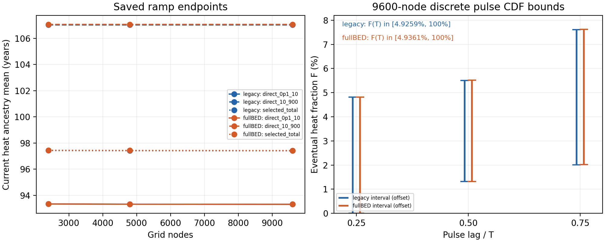

# CR-PHYS02D — 열의 지연을 저장된 ramp 결과에서 분리하기

연구 단위: `CR-PHYS02D-HEAT-DELAY-MOMENTS`  
기준일: 2026-10-11 KST  
결과 상태: **유도 완료 / 저장 결과 분석 실제 수행 / NCP pulse 물리 실행 전**  
독립 판정과 정확한 검토 파일은 `review/INDEPENDENT_DECISION.json`을 따른다.

## 1. 이번에 얻은 물리 결과

fullBED의 기존 9,600점 계산에서, 관측시각에 실제 열을 내는 에너지의 **원천전자 주입 후 평균 나이**는 **97.419429년**이다. 원래 전자의 출생 에너지가 0.1–10 eV인 성분에서는 **93.309875년**, 10–900 eV인 성분에서는 **107.069158년**이다. 이 값은 딸전자가 생성된 뒤의 수명이나 전체 최종 열의 평균 지연과 다른 양이다.

동일한 저장 결과로, 고정 연산자에서 단위 pulse가 최종적으로 내는 열 중 관측시간의 절반까지 방출된 비율에 다음 경계를 얻었다.

\[
1.316618\%\ \le F(T/2)\le\ 5.520554\%,
\qquad T=10^{10}\,{\rm s}=316.880878\,{\rm yr}.
\]

전체 관측시간에는 \(F(T)\ge4.936104\%\)를 얻지만, 이 두 endpoint 모멘트만으로 얻는 일반 상계는 100%다. 따라서 아직 방출되지 않은 열의 정확한 비율이나 전체 평균 지연을 점추정할 수 없다. 이전의 \(P_H/P_{\rm inst}=3.418586\%\)는 ramp의 순간 열률비로 해석해야 한다. Pulse 누적분율 \(F(T)\)는 별도로 계산해야 한다.

이번 새 결과는 저장된 JSON 세 개를 분석하여 얻었다. 실제 물리 연산자 생성, 새로운 물리 수송, 이전 suite 재실행은 모두 **0회**다. 다음 NCP 작업에는 같은 9,600점 격자에서 두 모형의 pulse 응답을 한 번씩 구하는 코드를 준비했다.

## 2. 이어받은 실제 상태

이번 루프는 원래 PHYS02C 준비본 뒤에 실제로 수행된 paired 9,600점 반환을 확인하고 시작했다.

| 항목 | 실제 근거 |
| --- | --- |
| PR #30 science/return commit | `55a97935c5f589e1857e0de595263c94dc52ce53` |
| 실제 두 수송 실행 | 2026-10-10 18:14:45–18:36:47 UTC |
| 실제 wall | 1321.6972244909848 s |
| child/coordinator exit | 0 / 0, timeout false |
| 저장된 당시 독립 판정 | `PASS_SCOPED` |
| 이번 직접 base: PR #31 | `f98ed974c3f3158dabd16cd854ecc5e04b9f5b31` |
| base tree | `ae9c5ea98edd724423bfa8cb79db976908d1c123` |

현재 원격 base의 33개 새 source payload를 정확한 Git blob, byte 수 및 SHA256으로 확인했다. NCP 코드의 전이 의존성은 별도로 **259개 파일**을 base Git tree에 대조하여 `inputs/DEPENDENCY_PAYLOAD_MANIFEST.json`에 고정했다. 필요한 이전 코드·원천표·반환·첫 실패·운영 adapter가 여기 포함된다. 과거 모든 보고서를 다시 받아오는 작업은 수행하지 않았다.

PR #30의 실제 부모는 PHYS02C science `f34a0cc1484247caf252afde3d5fbe834640e9e4`다. 이전 후기 영수증 commit `eecb9bdceb40ff8dbb84feba969d1eec6555970f`는 별도 계보다. 전달 묶음에서 그 영수증은 별도의 provenance로 보존하며, 새 Git 변경은 PHYS02D 경로에만 더한다.

9,600점 반환의 환경은 Python 3.12.3, NumPy 2.4.2, SciPy 1.17.0이다. 기존 4,800점 결과는 Python 3.12.14, NumPy 2.3.5를 사용했다. 따라서 아래 격자 비교에는 실행 환경 변화도 포함된다. 반환의 관측 자원은 약 32 GiB 및 CPU affinity 24개였고, NCP 64-core scaling의 근거로 사용하지 않는다.

## 3. 정의와 유도

활성 전자의 운동에너지 밀도 벡터를 \(x\), 고정 원천 스펙트럼을 \(b\ge0\), 열률 계수 벡터를 \(h\ge0\)라 둔다. \(x\)는 \({\rm J\,m^{-3}}\), \(h\)와 활성 연산자 \(L\)은 \({\rm s^{-1}}\), \(b\)는 무차원이다. 기존과 같은 선형 ramp를 사용하면

\[
\dot x=Lx+\alpha t b,\quad x(0)=0,\quad P_H(t)=h^T x(t),
\quad [\alpha]={\rm J\,m^{-3}\,s^{-2}}.
\]

여기서 \(L\)은 고정된 Metzler/Hurwitz 활성 블록이다. 전체 장부 행렬은 누적 흡수 상태 때문에 0 고유값을 가지므로 역산 대상이 아니다. 직접 원천의 heat 성분은 0이며, cutoff로 직접 들어가는 운동에너지는 별도 장부에 보존된다.

\[
K(\tau)=h^T e^{L\tau}b\ge0,
\qquad H_0=\int_0^\infty K(\tau)d\tau=h^T(-L)^{-1}b>0.
\]

\(K/H_0\)는 **최종 열에 가중한 에너지 방출 지연**의 밀도다. \(H_0\)는 같은 연산자를 무한 시간 유지했을 때의 수학적 기준이며, 실제 우주적 source/bath가 무한히 고정되어 있다는 주장이 아니다.

Duhamel 식과 적분 순서 교환으로

\[
P_H(T)=\alpha\int_0^T(T-\tau)K(\tau)d\tau,
\qquad
Q_H(T)=\frac\alpha2\int_0^T(T-\tau)^2K(\tau)d\tau.
\]

즉시 terminal-yield 비교값 \(P_{\rm inst}(T)=\alpha T H_0\)에 대해

\[
R=\frac{P_H(T)}{P_{\rm inst}(T)},\qquad
S=\frac{2Q_H(T)}{T P_{\rm inst}(T)}.
\]

\(X=(1-\tau/T)_+\)라 두면 \(R=\mathbb E[X]\), \(S=\mathbb E[X^2]\)이다. 따라서

\[
0\le R\le1,\qquad R^2\le S\le R.
\]

저장된 normalized 항목은 endpoint \(u=t/T_0=1\)에서의 selected-total 스칼라다. 이에 맞춰 \(R=P_{\rm norm}/H_{0,\rm norm}\), \(S=2Q_{\rm norm}/H_{0,\rm norm}\)를 구했고, SI 경로와 교차 확인했다. Legacy 2,400점의 SI terminal 열률은 독립 필드가 없어 같은 행의 normalized terminal 값으로 재구성했다. 이 필드 매핑과 재구성 여부는 결과 JSON에 명시되어 있다.

### 서로 다른 두 평균

관측시간을 넘는 지연을 모두 \(T\)로 두는 \(D=\min(\tau,T)\)의 모멘트는

\[
\mathbb E[D]=T(1-R),\qquad
\operatorname{Var}(D)=T^2(S-R^2).
\]

반면 현재 열률에 기여하는 주입의 나이는 \((T-\tau)K(\tau)\)에 가중된다. 그 평균은

\[
\boxed{\bar\tau_{H,\mathrm{now}}=T\left(1-\frac SR\right)
=T-\frac{2Q_H(T)}{P_H(T)}}.
\]

이 두 평균은 같은 분포를 같은 방식으로 평균한 값이 아니다. 특히 \(\mathbb E[D]\approx306\)년을 실제 uncapped 평균 지연이라고 읽으면 안 된다. 미래 꼬리의 지연을 모두 \(T\)에 모았기 때문에, 실제 평균에는 별도의 정보가 필요하다.

## 4. 실제 저장량에서 계산한 수치

연 단위는 \(1\,\mathrm{yr}=31,557,600\,\mathrm{s}\)로 환산했다. 아래 자릿수는 저장된 FP64 값의 재현을 위한 것으로 물리적 정밀도 인증을 뜻하지 않는다.

| 모형 | 격자점 | \(R\) (%) | \(S\) (%) | 현재 열의 평균 나이 (yr) | \(\mathbb E[D]\) (yr) | \(\sigma_D\) (yr) |
| --- | ---: | ---: | ---: | ---: | ---: | ---: |
| legacy | 2,400 | 3.40965030 | 2.36134087 | 97.426183 | 306.076348 | 47.480174 |
| legacy | 4,800 | 3.41089118 | 2.36235112 | 97.412164 | 306.072416 | 47.489961 |
| legacy | 9,600 | 3.41170848 | 2.36299175 | 97.405238 | 306.069826 | 47.496144 |
| fullBED | 2,400 | 3.41652513 | 2.36594907 | 97.440368 | 306.054563 | 47.523920 |
| fullBED | 4,800 | 3.41776691 | 2.36696016 | 97.426353 | 306.050628 | 47.533704 |
| fullBED | 9,600 | 3.41858601 | 2.36760212 | 97.419429 | 306.048033 | 47.539893 |

모든 여섯 행은 \(R^2\le S\le R\)를 만족했다. 9,600점 fullBED에서 원시 slack은 \(S-R^2=0.0225073482052\), \(R-S=0.0105098388195\)이다. 경계에 매우 가까운 값의 차를 강제로 0으로 만든 결과가 아니다. 세 가지 소거 conditioning 지표는 각각 약 1.07079, 5.50550, 1.10385다.

9,600점에서 출생 성분을 분리하면 다음과 같다.

| 원래 전자의 출생 에너지 | legacy 평균 나이 (yr) | fullBED 평균 나이 (yr) |
| --- | ---: | ---: |
| 0.1–10 eV | 93.309875 | 93.309875 |
| 10–900 eV | 107.029977 | 107.069158 |
| 선택한 전체 0.1–900 eV | 97.405238 | 97.419429 |

이 표의 나이는 원천전자 주입을 기준으로 한다. 고에너지 출생 성분에서 생긴 딸전자가 현재 낮은 에너지에 있더라도 출생 표지는 유지된다. 태그 전체 평균은 현재 열률에 따른 혼합이며, 두 행을 단순 평균한 값이 아니다.

4,800→9,600점에서 fullBED 현재 평균 나이는 약 218,512.5 s, 즉 0.006924 yr 감소했다. 같은 전환에서 \(R\)은 \(8.19098\times10^{-6}\), \(S\)는 \(6.41963\times10^{-6}\) 증가했다. 모형 간 9,600점 현재 평균 나이 차이는 약 447,815.7 s, 즉 0.014190 yr이다. 이러한 변화는 경험적 비교로 보고하며 새로운 수렴 문턱, 엄밀 오차구간 또는 원자모형 불확실도 분포로 바꾸지 않았다.

## 5. Pulse 누적 열분율의 경계

\(F(uT)=\Pr(\tau\le uT)\)라 정의한다. 현재 유한 행렬의 열 커널은 연속밀도이므로 \(T\) 경계에서 원자 질량이 없다. Cauchy–Schwarz로

\[
F(T)\ge R^2/S
\]

를 얻는다. 이는 두 모멘트만 아는 일반 비음 측도에서 sharp한 하계다. 더 짧은 시간에는 \(c=1-u\)라 두고

\[
\frac{x(x-c)}{1-c}\le\mathbf1_{x\ge c}
\le\frac{x(1+c-x)}c,\qquad 0\le x\le1
\]

를 평균하여

\[
\max\!\left(0,\frac{S-cR}{1-c}\right)
\le F(uT)\le
\min\!\left(1,\frac{(1+c)R-S}c\right)
\]

를 얻는다. 이 quadratic 경계의 전역 최적성은 주장하지 않는다.

| 지연 시간 | legacy 9,600점 경계 (%) | fullBED 9,600점 경계 (%) |
| --- | ---: | ---: |
| \(T/4\), 79.220220 yr | 0–4.809997 | 0–4.819898 |
| \(T/2\), 158.440439 yr | 1.314275–5.509142 | 1.316618–5.520554 |
| \(3T/4\), 237.660659 yr | 2.013420–7.606575 | 2.017274–7.622522 |
| \(T\), 316.880878 yr | 4.925855–100 | 4.936104–100 |

부등식 자체는 고정된 양의 커널에서 정확하다. 표에는 저장된 수치 모멘트를 대입했으며, 입력·이산화 오차를 엄밀하게 둘러싼 인증구간을 만들지는 않았다. 그림에서는 증명한 이산 시간의 경계만 별도 구간으로 표시한다. 서로 다른 시간의 점을 직선으로 연결해 추가 경계를 암시하지 않는다.

## 6. 전체 평균 지연이 정해지지 않는 이유

\(0<R<1,\ R^2<S<R\)에서 \(p=R^2/S\)라 하자. 지연 측도

\[
p\,\delta_{T(1-S/R)}+(1-p)\,\delta_B,\qquad B\ge T
\]

는 \(B\)를 바꿔도 동일한 \(R,S\)를 갖는다. 하지만 평균은

\[
\mathbb E[\tau]=T(1-R)+(1-p)(B-T)
\]

로 제한 없이 증가한다. 같은 모멘트에 대해 모든 질량이 \(T\) 이전에 있는 측도도 구성할 수 있다. 따라서 endpoint 두 값만으로 실제 꼬리, 높은 분위수 또는 uncapped 평균의 유한 상계를 정할 수 없다.

이론 기여자는 양의 안정적인 두 지수 응답을 혼합한 매끄러운 예도 별도로 검사했다. 같은 목표 \(R=1/8,S=1/10\)를 90자리 Decimal로 유지하면서 평균 지연을 약 82.89\(T\)에서 81,933,212.8\(T\)까지 바꾸었다. 최대 모멘트 잔차는 약 \(3.16\times10^{-74}\)였다. 이 예는 bass_cr 데이터에 맞춘 모델이 아니라 식별 한계를 보이는 반례다.

전체 \(L,b,h\)를 알고 있으면 고정 모델의 커널은 정해진다. 다음 NCP 작업은 바로 그 추가 연산자 정보를 사용한다.

## 7. 준비한 다음 NCP 물리 작업

다음 READY 후보는 `CR-PHYS02D-NCP-PULSE-RESPONSE`다. 독립 검토가 통과하고 최종 DAG 및 payload가 고정되면 실행할 수 있다.

| 항목 | 고정 범위 |
| --- | --- |
| 모형·순서 | fullBED, 다음 legacy |
| 에너지 격자 | 기존과 같은 `(3200,6400)`, 총 9,600점 |
| 초기조건 | 저장된 matching `source_vectors` 전체, 이후 원천 0 |
| 시간 표본 | \(u=i/16,\ i=0,\ldots,16\) |
| 새 연산자 생성 / pulse 전파 | 최대 2회 / 최대 2회 |
| 전체 coordinator wall | 최대 3600 s |
| 수치 방식 | FP64, 동일 quadrature·원자입력·Coulomb·장부, 실제 threadpool 1 thread |
| 실제 환경 pin | Python 3.12.3 / NumPy 2.4.2 / SciPy 1.17.0 |
| 자원 | reserve 후 작업 메모리 12 GiB 이상, disk 8 GiB 이상, effective CPU 1 이상 |

선형 ramp를 또 풀지 않고 pulse 상태의 heat 장부에 두 적분 상태를 붙인다.

\[
J_1'(u)=y_H(u),\quad J_2'(u)=J_1(u),\quad J_1(0)=J_2(0)=0.
\]

그러면 \(J_1(1)\)은 기존 normalized ramp 열률, \(J_2(1)\)은 기존 normalized 누적 열과 같아야 한다. 이 비교는 동일 연산자에 대한 대수적 교차 확인이다. 별도의 독립 물리 모형 검증으로 세지 않는다.

무한구간 모멘트는 활성 블록만 이용한다. \(G_A=T_0L\), \(g_H=T_0h^T\)일 때

\[
H_n=n!T_0^n g_H(-G_A)^{-(n+1)}b_A,
\qquad \mu_\infty=H_1/H_0.
\]

전체 ledger 행렬의 역행렬을 사용하거나, 기존 ramp 상태의 큰 항끼리 빼서 작은 pulse 신호를 복원하지 않는다. 저장 source의 직접 cutoff·내부 counter 성분도 그대로 보존한다.

이 실행은 새 물리 source history의 채택이 아니라 기존 연산자의 응답 진단이다. 새 pulse는 9,600점에서만 구하므로 pulse 자체의 격자 수렴이나 고정 bath를 넘는 우주론적 예측을 주장할 수 없다. 실제 NCP 결과는 이번 전달본에 아직 존재하지 않는다.

## 8. 검증, 실패 및 재현성

새 scalar 분석은 한 번 수행했다. 결과와 그림을 만든 뒤 heterogeneous comparison CSV의 열 매핑에서 process exit 1이 발생했다. 첫 traceback과 실제 종료 기록을 보존하고, 저장된 `RESULT.json`에서 CSV만 다시 내보내는 수정을 수행했다. 수치 분석을 재실행하지 않았다. 이후 그림의 이산 경계 표시도 같은 저장 결과에서 수정했다. 초기 그림과 수정 영수증을 모두 보존했다.

NCP 코드의 작은 예제에서는 one-pole, 서로 다른 두 감쇠율의 직렬 cascade, 같은 감쇠율의 Erlang-2, 시간 단위, 직접 cutoff 및 잘못된 입력을 검사했다. 첫 sparse augmentation의 zero-block shape 오류와 전파 후 ledger에 대한 과도한 bitwise 테스트 실패를 보존했다. 후자의 차이는 약 \(1.11\times10^{-16}\)이었으며, 원래 고정한 FP64 oracle 허용값을 적용했다. 허용값을 느슨하게 바꾼 것이 아니다. 실제 NPZ의 두 원소 시간 배열과 transitive dependency coverage도 실행 전에 확인했다.

독립 코드 검토에서는 저장된 모멘트와 새 CDF 경계의 명시적 비교, 최종 READY 상태와 무관하게 유효한 테스트, coordinator 자체 실패의 실제 종료 영수증 및 전체 deadline, 반환 묶음의 검토 자료 완결성을 보완했다. Collector가 과거 workspace manifest까지 선택한 실패도 보존하고, admission과 같은 현재 manifest 선택 규칙으로 제한했다. 이 수정들은 기존 계약에 있던 출력을 연결하고 운영 증거를 완결하는 변경이며, 새로운 물리 입력이나 완화한 수용 기준을 도입하지 않았다.

증거는 다음 위치에 있다.

- `evidence/endpoint/RESULT.json`: 여섯 selected 행, 18개 출생 성분 행, 원본 필드 경로와 해시, SI 및 Decimal 비교.
- `evidence/endpoint/ANALYSIS_PROCESS_EXIT.json`, `ACTUAL_EXIT.json`, `AMENDMENT_EXPORT_EXIT.json`: 첫 실패와 export-only 수정의 실제 종료 기록.
- `research/theory_contribution/`: 독립적인 Fraction/Decimal 유도 oracle과 실제 실행 영수증.
- `evidence/toy/`, `evidence/ncp_validation/`: 작은 pulse·운영·입력 검사의 원시 결과 및 실패.
- `review/`: 후보 설계·구현과 독립된 최종 심사 및 정확한 검토 파일 목록.

구현은 owner 정책에 따라 낮은 tier 경로를 요청했다. 도구에 요청한 route와 실제 host가 표시하는 모델 metadata가 일치한다고 확인할 수 없어 이를 구분해 기록했다. 실제 낮은 모델 전환, 비용 절감 또는 성능 개선은 주장하지 않으며 `NOT_EVALUATED`다.

## 9. 유지하는 미해결 항목과 이번 승격 범위

| Gate | 상태 |
| --- | --- |
| PHYS02_DELAY 전체 | OPEN |
| production_history | HOLD |
| atomic_G02 | UNRESOLVED |
| b_grid | NO_GO |
| all_bound | OPEN |
| R17B2B | NO_CERTIFIED_SOURCE_SHARPENING |
| 2026 CCC exporter/source identity | SOURCE_IDENTITY_UNRESOLVED |

CCC 원천 에너지의 Hamiltonian·상태 label·에너지 영점·exporter 의미를 exact 2026 ZIP에 결속할 근거는 이번에 추가되지 않았다. Native marker나 incident axis, state energy cost를 이동시키지 않는다. 이 HOLD와 독립인 유한창 열 지연의 의미와 경계를 이번에 얻었으며, 다음 계산은 두 pulse의 CDF와 고정 연산자 모멘트를 직접 측정하는 데 한정한다.

## 근거 파일

모든 새 숫자는 `inputs/INPUT_IDENTITIES.json`이 고정한 기존 raw 결과와 `evidence/endpoint/RESULT.json`에 연결된다. 새 정리는 `research/theory_contribution/DERIVATION_CANDIDATE_KO.md`의 직접 유도에 근거한다. 현재 원격 계보·실제 9,600점 반환·CCC 판정은 `research/context/CURRENT_REMOTE_INTAKE.json`과 두 inherited PR payload에 근거한다. 이번 정리를 위해 새로운 문헌의 외부 수치를 도입하지 않았다.
