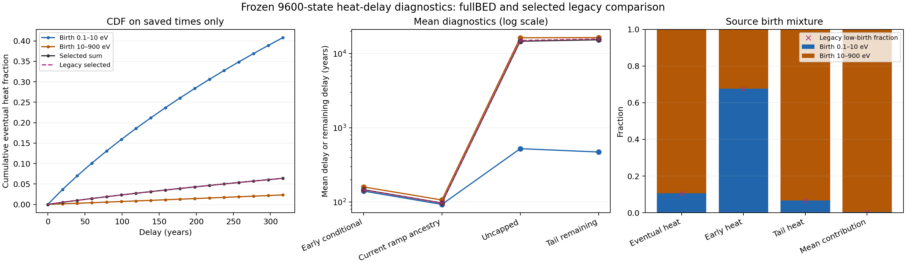

# PHYS02F — 열 지연 꼬리와 출생 성분, 에너지 구간별 체류시간

## 1. 결과와 범위

PHYS02E의 실제 NCP 반환을 받아, 고정된 9,600점 연산자가 예측하는 열 지연의 구간 안팎 모멘트와 출생 성분을 분해했다. fullBED에서 $T=10^{10}\,\mathrm{s}=316.88087814\,\mathrm{yr}$까지 방출된 열은 최종 열의 $6.390638\%$이며, 나머지 $93.609362\%$는 이 시각 이후에 나온다. 구간 안에서 나온 열의 조건부 평균 지연은 $147.369708\,\mathrm{yr}$, 전체 열의 평균 지연은 $14719.993889\,\mathrm{yr}$이다.

현재의 선형 ramp에서 지금 나오는 열의 조상 주입시각, pulse 중 $T$까지 나온 열의 평균 지연, pulse 최종 열 전체의 평균은 서로 다른 열 집합과 가중치를 갖는다. 이번 계산은 이 구분을 실제 반환 데이터에 적용했다.

0.1–10 eV에서 시작한 성분은 최종 열의 $10.590809\%$이지만, $T$까지 나온 열에서는 $67.626670\%$를 차지한다. 전체 지연의 1차 모멘트에 대한 기여는 $0.378309\%$이다. 긴 평균 지연은 주로 10–900 eV에서 시작한 성분과 결합되어 있다. 어느 에너지 구간에서 시간이 누적되는지는 새 adjoint·체류시간 진단이 측정할 질문이다.

이 수치는 고정된 가스·원자 입력·cutoff·유한 격자를 계속 유지한 연산자의 조건부 결과이다. 1만 년 이상 같은 bath가 유지된다는 물리 검증이나 우주론적 주입 이력의 예측은 포함하지 않는다. 격자 수렴과 연속 에너지 꼬리의 안정성은 미판정이다.

독립 판정은 `review/INDEPENDENT_DECISION.json`, 새 NCP 작업의 실행 허용 상태는 `state/NEXT_DAG.json`을 기준으로 한다. 최종 ZIP의 복구·게시 영수증은 ZIP 밖 publication 기록에 결속된다.

## 2. 실제 입력과 기존 실행

입력은 [bass_cr PR35](https://github.com/cosmosapjw-quantum/bass_cr/pull/35)의 고정 반환이다.

| 항목 | 실제 기록 |
| --- | --- |
| 반환 commit | `459018cffc3d57dcf8670997b4029fb6891e8101` |
| 반환 tree | `00eb09b38344b8103bd7eca411469404177d902d` |
| 작업 | `CR-PHYS02E-NCP-SAVED-GRID-PULSE` |
| 실행 구간, UTC | 2026-10-11 04:17:31–05:02:51 |
| launcher wall | 2720.582633553 s |
| 실제 G 완료 / pulse 완료 | 2 / 2 |
| launcher / child / wrapper / collector exit | 모두 0 |
| 실제 독립 판정 | `PASS_SCOPED_ACTUAL_9600_NUMERICAL_NODE` |
| 판정 SHA256 | `ed603d7cc27268527c83a57c195700b5ab875476c4b42f6e152d125165701206` |

원시 numerical ZIP 521개 entry 중 manifest가 열거한 520개 payload의 바이트 수·SHA256을 확인했다. 외부 wrapper 종료기록과 환경·로그를 담은 family envelope는 18개 entry이며, 17개 payload를 검증했다. 현재 복구 경계에서는 실제 원시 바이트를 읽었다. 이전 NCP 게시의 R1/R2 metadata 확인과 구별한다.

`inputs/INPUT_IDENTITIES.json`은 직접 입력 18개, `inputs/DEPENDENCY_PAYLOAD_MANIFEST.json`은 이전 source와 실제 반환을 포함한 의존 파일 538개를 고정한다. 새 분석에서 이전 pulse·G는 재실행하지 않았다. PHYS02D의 실제 격자 불일치 실패와 PHYS02E의 이미 소모된 실행 예산을 보존한다.

## 3. 구간 안팎 모멘트의 유도

최종 열 수율을 $H_0>0$, 열 응답을 $K(\tau)\ge0$라 하고 열에 대한 지연 확률측도를

$$
dF(\tau)=\frac{K(\tau)}{H_0}\,d\tau
$$

로 둔다. 저장된 `kernel_per_s`는 $K$이며, 확률밀도로 쓰려면 $H_0$로 나누어야 한다.

이전 ramp의 무차원 관측량과 pulse CDF는

$$
R=\mathbb E[(1-\tau/T)_+],\qquad
S=\mathbb E[(1-\tau/T)_+^2],\qquad
p=F(T)
$$

이다. 유한 안정 연산자의 pulse는 $T$에 원자 질량이 없는 연속 밀도를 주므로 이번 수치에서는 $\tau<T$와 $\tau\le T$가 같은 결과를 준다.

다항식을 전개하면 구간 안의 비조건부 모멘트는

$$
e_1=\mathbb E[\tau\,1_{\tau\le T}]=T(p-R),\qquad
e_2=\mathbb E[\tau^2\,1_{\tau\le T}]=T^2(p-2R+S)
$$

이다. 전체 모멘트를 $\mu=\mathbb E[\tau]$, $m_2=\mathbb E[\tau^2]$라 하면 후기 raw moments는 $\mu-e_1$, $m_2-e_2$이다. 각 사건의 조건부 모멘트는 $p$ 또는 $1-p$로 나누어 구한다.

특히 $T$ 이후에 나오는 열이 그 시각부터 더 기다리는 시간은

$$
\mathbb E[\tau-T\mid\tau>T]
=\frac{\mu-T(1-R)}{1-p},
$$

$$
\mathbb E[(\tau-T)^2\mid\tau>T]
=\frac{m_2-2T\mu+T^2(1-S)}{1-p}.
$$

전체 평균에서 단순히 $T$만 빼면 이미 방출된 열을 조건부 집합에서 제외하지 못한다. 위 정규화가 필요하다.

$p=0$ 또는 $p=1$인 사건의 조건부 평균은 정의되지 않는다. 구현은 `UNDEFINED_ZERO_EVENT_PROBABILITY`를 반환한다. 음의 분산은 0으로 자르지 않고 원시 값과 상태를 보존한다. Decimal80 검산은 저장된 십진 문자열의 산술을 확인하며, 원래 FP64 입력 오차를 엄밀히 둘러싸는 계산은 아니다.

## 4. 두 모델의 수치 결과

$1\,\mathrm{yr}=31557600\,\mathrm{s}$를 사용한다. 모두 같은 9,600점 조건부 연산자 범위의 결과이다.

| 관측량 | fullBED | legacy |
| --- | ---: | ---: |
| $F(T)$ | 0.06390638043 | 0.06376934057 |
| $1-F(T)$ | 0.93609361957 | 0.93623065943 |
| $\mathbb E[\tau\mid\tau\le T]$, yr | 147.369708 | 147.347185 |
| $\mathbb E[\tau]$, yr | 14719.993889 | 15073.220457 |
| $\mathbb E[\tau\mid\tau>T]$, yr | 15714.855562 | 16089.864257 |
| $\mathbb E[\tau-T\mid\tau>T]$, yr | 15397.974684 | 15772.983379 |
| $\mathbb E[\tau\,1_{\tau\le T}]$, yr | 9.417865 | 9.396233 |
| $\mathbb E[\tau\,1_{\tau>T}]$, yr | 14710.576024 | 15063.824224 |

fullBED의 1차 모멘트 중 약 $99.94\%$가 $\tau>T$에서 온다. $93.61\%$는 열의 양에 대한 꼬리 비중이고, $99.94\%$는 지연을 한 번 더 곱한 1차 모멘트의 비중이다.

fullBED를 legacy와 비교하면 $F(T)$의 상대 차이는 $+0.214899\%$, 전체 평균 지연의 상대 차이는 $-2.343405\%$, 2차 모멘트의 상대 차이는 $-5.330004\%$이다. 상대 차이의 분모는 legacy다. 이는 두 원자 모델의 경험적 차이이며 확률적 불확실성 구간이나 인증된 물리 오차가 아니다. 짧은 구간의 누적 열이 가깝더라도 장시간 모멘트의 모델 민감도는 더 클 수 있다.

전체 수치와 부호 있는 잔차는 `evidence/analysis/NUMERICAL_ARTIFACT.json`, 독립 산술은 `DECIMAL80_ORACLE.json`, 도표 입력은 `PLOTTING_DATA.json`에 있다.

## 5. 출생 성분의 혼합

출생 태그 $j$의 최종 열 수율을 $H_{0j}$라 하면 최종 열 혼합 가중치는

$$
w_j=\frac{H_{0j}}{\sum_kH_{0k}}
$$

이다. 전자 수나 주입 에너지의 비율로 대체하지 않는다. 조기·후기 열을 관측했을 때의 출생 비율은

$$
w_j^{\rm early}=\frac{H_{0j}p_j}{\sum_kH_{0k}p_k},\qquad
w_j^{\rm tail}=\frac{H_{0j}(1-p_j)}{\sum_kH_{0k}(1-p_k)}
$$

이며, 전체 평균과 분산은

$$
\mu=\sum_jw_j\mu_j,\qquad
\operatorname{Var}(\tau)
=\sum_jw_j\{\operatorname{Var}_j(\tau)+(\mu_j-\mu)^2\}
$$

를 따른다. 구간 안팎 분해에도 전체 분산 법칙을 적용했다.

| fullBED의 가중 대상 | 0.1–10 eV 출생 | 10–900 eV 출생 |
| --- | ---: | ---: |
| 최종 열 | 10.590809% | 89.409191% |
| $T$까지 나온 열 | 67.626670% | 32.373330% |
| $T$ 이후의 열 | 6.697016% | 93.302984% |
| 전체 지연 1차 모멘트 | 0.378309% | 99.621691% |

출생 태그는 처음 주입된 전자의 성분이다. 고에너지 출생 성분은 낮은 에너지로 내려온 후에도 열을 낼 수 있다. 이 표만으로 열이 방출되는 순간의 전자 에너지나 지연이 누적된 에너지 구간을 식별할 수는 없다.

왼쪽은 저장된 17개 시각의 CDF, 가운데는 서로 다른 평균의 비교, 오른쪽은 관측 대상에 따른 출생 비중이다. 가운데 세로축은 로그 척도다. 선은 표본과 범주를 연결하며 새 CDF 계산, 분위수 보간 또는 장시간 전파를 뜻하지 않는다.

## 6. 다음 NCP가 측정할 체류시간

새 작업 `CR-PHYS02F-NCP-ADJOINT-RESIDENCE`는 active 블록만 $A=-G_{\rm active}$로 둔다. $u=t/T_0$, $T_0=10^{10}\,\mathrm{s}$이며 이 active 블록은 에너지 좌표 간 작용이므로 무차원이다. 에너지·개수 장부가 섞인 전체 $G$는 일괄 무차원 행렬이 아니며 역행렬 대상도 아니다.

열 장부의 active 행을 $h^\top$라 두고

$$
A^\top q_0=h,\quad A^\top q_1=q_0,\quad A^\top q_2=q_1,\quad
Aw=b,\quad Av=x(T)
$$

를 푼다. $b$와 $x(T)$는 정확히 저장된 두 출생 열의 주입 벡터와 $T$ 시각 pulse active 상태다. 첫 세 식은 한 RHS, 마지막 두 식은 각각 두 출생 열을 가진 RHS이므로 모델당 solver 호출은 5회다.

열 모멘트와 에너지 상태별 평균 지연 기여는

$$
H_0=q_0^\top b,\qquad H_1=T_0q_1^\top b,\qquad
H_2=2T_0^2q_2^\top b,
$$

$$
c_i=\frac{T_0q_{0i}w_i}{H_0},\qquad
\sum_i c_i=\mu
$$

이다. 이는 미래에 열이 될 에너지에 가중된 체류시간 분해다. 국소 열 침적량이나 daughter 전자의 수명으로 읽지 않는다. 남은 열의 평균 잔여시간 기여는 $w$를 $v$로, 분모를 $q_0^\top x(T)$로 바꾸어 구한다. $q_{0i}x_i(T)$는 $T$ 시각 각 에너지 상태에 남아 있는 미래 열의 양이며, 체류시간 기여와 구분하여 저장한다.

구간은 $(0.1,1],(1,10],(10,30],(30,100],(100,300],(300,900]$ eV로 사전 고정했다. 진단용 수치 구간이며 원자 문턱과 같다는 주장은 없다.

| 새 실행 한도 | 값 |
| --- | --- |
| 모델 순서 | fullBED → legacy |
| 격자 | 저장된 $(3200,6400)$, 총 9,600점 |
| G 구성 | 최대 2회 |
| adjoint·forward 계산 블록 | 최대 2회 |
| 희소 삼각계 풀이 호출 | 최대 10회 |
| 새 pulse / expm | 0 / 0 |
| coordinator 전체 wall 한도 | 900 s |
| 수치 runtime | Python 3.12.3 / NumPy 2.4.2 / SciPy 1.17.0 |
| 수치 thread pool | 모두 1 |
| 자원 | 실제 cgroup·affinity·메모리 reserve를 적용한 기존 admission |

PR35는 G를 파일로 저장하지 않았으므로 재구성이 필요하다. 새 CSC의 data·indices·indptr와 에너지 배열의 shape·dtype·SHA256을 PR35의 실제 완료 기록과 정확히 비교한 뒤에만 resolvent를 예약한다. 불일치는 `OPERATOR_IDENTITY_MISMATCH`로 보존하고 풀이를 진행하지 않는다. 이를 통과해도 같은 유한 연산자의 바이트 일치와 진단이라는 범위가 유지된다.

유한 안정 지수 응답의 모멘트가 resolvent 거듭제곱으로 주어지는 구조는 Bladt–Nielsen(2009), 제3절의 matrix-exponential 식과 일치한다. 이번 전치 convention, $T_0$ 단위 복원, 조건부 가중과 구간 분해는 `research/theory/`에서 직접 유도했다. SciPy 공식 문서는 희소 삼각계와 복수 RHS의 API 규약 확인에만 사용했다.

## 7. 검증과 남은 판정

새 scalar 검증은 Fraction 측도·퇴화·잘못된 입력 test 4개, 실제 저장된 두 모델 분석 1회, Decimal80 독립 산술 비교다. 실제 분석은 exit 0, wall 1.65775 s로 끝났고 최초 실패나 repair는 없었다. 별도 정확한 행렬 toy는 active 4상태에서 항등식 63개를 검사했고 실제 1회, exit 0, wall 0.03620 s로 통과했다. 물리 G·pulse·expm과 이전 전체 suite 재실행은 모두 0회다.

NCP 코드 검증에서 수집기 fixture가 SHA 함수를 너무 넓게 대체한 최초 실패는 보존했다. 대체 대상을 동일한 production DEP_HASH 상수로 좁힌 시험은 통과했다. 최종 경계 검사와 별도 합 보존 검사 등 구체적으로 남은 위험은 `state/TARGETED_COMPLETION_AMENDMENT.json`에 따라 닫는다. 실제 최종 검사 결과·명령·exit·원시 로그·source identity는 `evidence/ncp_validation/`가 기준이다. 준비 코드의 toy 성공을 실제 NCP 결과로 승격하지 않는다.

새 NCP 실행은 아직 수행하지 않았다. 실행 후에는 반환 원시 상태, G identity, 풀이 잔차, 모멘트·bin 합, 실제 예산과 exit를 새 독립 reviewer가 검토해야 한다. 성공하더라도 이름 붙인 9,600점 진단만 갱신한다.

| 상위 gate | 유지 상태 |
| --- | --- |
| PHYS02_DELAY | OPEN |
| production_history | HOLD |
| atomic_G02 | UNRESOLVED |
| b_grid | NO_GO |
| all_bound | OPEN |
| R17B2B | NO_CERTIFIED_SOURCE_SHARPENING |
| CCC_2026_exporter_identity | SOURCE_IDENTITY_UNRESOLVED |

## 원문·재현 자료

- 실제 반환: PR35 고정 commit의 `research/cr_phys02e_ncp_return_20261011/`; 복구 증거 `research/context/`.
- 직접 유도·정확 toy: `research/theory/`.
- 실제 scalar 산출물·Decimal 계산·실행 기록: `evidence/analysis/`.
- 코드·허용 기준: `src/`, `state/SCIENTIFIC_CONTRACT.json`, `state/VALIDATION_CONTRACT.json`, `ncp/NCP_EXECUTION_CONTRACT.json`.
- Bladt, M. and Nielsen, B. F. (2009), *Moment Distributions of Phase Type*, IMM-Technical Report-2009-12, 제3절, printed p.3: https://backend.orbit.dtu.dk/ws/files/4616859/tr09_12.pdf . 읽은 범위는 matrix-exponential 밀도·CDF·모멘트 구조이며 CR 모델의 물리 인증 출처가 아니다.
- SciPy 1.17.0, `spsolve_triangular`: https://docs.scipy.org/doc/scipy-1.17.0/reference/generated/scipy.sparse.linalg.spsolve_triangular.html . 삼각 방향·복수 RHS 규약 확인이며 실행 성공의 대체 증거가 아니다.

