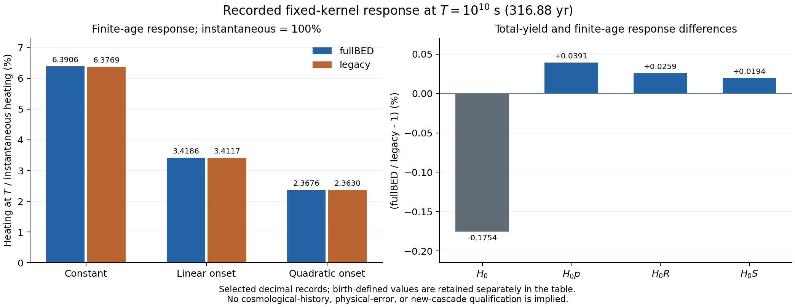

# CR 개발계획 조정과 기존 지연 모멘트의 가열 응답

2026-10-12 · `CR-SCIENTIFIC-FAST-TRACK-RESET-20261012`

## 채택한 계획 변경

`bass_cr`의 다음 작업은 기존에 얻은 CR 열화 결과를 명시된 주입 이력의 가열 응답으로 해석하고, 필요한 정확도를 그 응답의 오차 예산으로 정하는 것이다. **아직 시작하지 않은 PHYS02H 전체9600 직렬·병렬 qualification은 자동 실행 목록에서 보류한다.** 준비 코드와 원래 계약은 보존하고, 구체적인 과학 질문 또는 독립적인 성능 연구 목적이 있을 때 조건부로 활성화한다.

이 문서와 `HANDOFF.json`, `NEXT_DAG.json`, `START_NCP_CODEX_KO.md`가 이 branch에서 향후 작업의 우선순위를 정한다. H의 frozen README에 있는 “sole next execution unit” 및 H handoff의 자동 다음 실행 순서는 이 계획으로 대체된다. H의 수치 소스·실행 계약·NCP_READY·manifest·기존 판정 자체는 바꾸지 않는다. 준비된 실행과 현재 선택된 실행 우선순위는 별도 상태다.

첨부 감사의 직접 대상은 `rei_bianchi`다. 여기서는 연구 목표·의존성·검증 비용에 대한 권고를 CR에 적용한다. 감사에 기재된 REI 실행시간, HI threshold stiffness, shear response 수치는 CR의 측정값으로 가져오지 않았다. 다른 저장소의 실행기·DAG·스케줄을 변경했다고 주장하지 않는다.

원래 `bass_cr`의 charge-exchange와 비열적 입자 열화 연구도 독립적인 과학 목표로 유지한다. 모든 CR 연구가 REI의 감도 요구를 기다려야 한다는 새 의존성은 만들지 않는다. 명시적인 CR 자체의 과학 질문도 정밀 연구를 활성화할 수 있다.

## 1. 실제 근거와 이번 변경의 범위

현재 기준은 [PR41](https://github.com/cosmosapjw-quantum/bass_cr/pull/41)의 head `8d80abde76f6c259cac031353d1928fccb5f191c`, tree `5f1f1d3bc86329ba08a54be9c3bd5cfa6c7226fb`다. PR41과 최신 updated순 PR20개를 읽은 범위에서 새 H NCP 반환은 발견되지 않았다. NCP에 미게시 run이 없는지는 관측하지 못했으므로, 현지 handoff의 첫 조치는 기존 reservation/run 확인이다.

H의 원래 DAG는 `H_NCP_FULL9600 → 독립 결과 판정 → F 결속 및 frontier 판단`을 지정했다. 한편 저장소에 이미 있는 [2026-10-04 연구계획](../../docs/atomic_reionization_handoff_20261004_v1/RESEARCH_PROGRAM_KO.md)은 다음을 명시한다.

- 초기 CR-off 응용은 CR-on 및 정밀 원자물리 확장의 완료를 기다리지 않는다.
- provider의 정의역이 부족하거나 source family 차이가 사전 관측량 예산을 넘으면 필요한 provider만 확장한다.
- 원래 정밀 원자물리 연구는 독립적으로 재개할 수 있는 선택 경로다.

이번 수정은 이 응용 우선 계약을 회복하면서 H 이후의 실행 순서를 바꾼다. root README와 시작문에는 현재 계획 포인터를 추가하고, 예전 foundation 설명은 역사적 안내로 보존한다. AGENTS의 추가 절은 계획 우선순위만 다룬다.

첨부 감사 원문은 `inputs/AUDIT_ORIGINAL_KO.txt`에 그대로 보존했다. 크기27686B, SHA256 `ba4822f20d706d8c1841aaa7f934b8386fdf1e577de63e6578ca266e211807a4`다. 원격 원문18개와 정확한 blob identity는 `inputs/SOURCE_READS.json`에 기록했다. 전체 remote API 응답을 원래 HTTP bytes로 인증했다는 뜻은 아니다.

## 2. 완료한 가장 작은 과학 산출물

질문은 다음과 같다. **같은 eventual heat yield를 순간적으로 방출한다고 근사하면, 유한한 나이의 주입원에서 실제 가열률을 얼마나 다르게 예측하는가?**

새 CR 행렬이나 시간전파를 실행할 필요 없이, 이미 저장된 세 모멘트가 이 질문의 세 통제 사례에 답한다. 입력은 `research/cr_phys02g_20261011/inputs/F_CACHED_NUMERICAL_ARTIFACT.json`의 원본48626B이며 SHA256은 `dfdca59ca0b4131c6143fe3cf0e402a7b18efb113a9af9bcc82a66696f5ec6f5`다.

### 정의와 가정

고정 bath, 고정 주입 스펙트럼, 선형 응답을 가정한다. 비음이 아닌 causal heating kernel을 \(K(\tau)\), 그 적분을 \(H_0>0\)라 두면

\[
dF(\tau)=K(\tau)d\tau/H_0,\qquad \int dF=1.
\]

\(F\)는 열 가중 지연법칙이다. 입자의 도착시간 분포 또는 총 주입에너지 중 열의 분율과 혼동하지 않는다. \(H_0\)의 수치 정규화는 원 기록을 유지한다. 원 단위주입에 대한 시간당 amplitude를 \(q(t)\)라 하면 \(H_0q(t)\)와 가열률 \(\mathcal P_h(t)\)는 같은 단위를 가진다. 이 문서의 표는 \(\mathcal P_h/(H_0q_0)\) 또는 \(\mathcal P_h/q_0\) 계수이며 임의의 W 또는 eV/s 단위를 부여하지 않는다.

주입 전 이력이0이고 최초 particle perturbation이 이 source 이외에는 없을 때,

\[
\mathcal P_h(t)=H_0\int_{[0,t]}q(t-\tau)\,dF(\tau).
\]

시간은 초, \(T=10^{10}\,\mathrm{s}=316.880878140\ldots\,\mathrm{yr}\), 정확한 연 변환은31557600s다. 기록된

\[
p=F(T),\quad R=\mathbb E[(1-\tau/T)_+],\quad S=\mathbb E[(1-\tau/T)_+^2]
\]

를 사용한다. \(0\le t\le T\)에서 각각 \(q_0\), \(q_0t/T\), \(q_0(t/T)^2\)인 source를 위 식에 대입하면

\[
\frac{\mathcal P_h(T)}{H_0q_0}=p,\quad R,\quad S
\]

가 된다. 세 경우 모두 현재 source amplitude는 \(q(T)=q_0\)이므로 같은 순간 가열 근사의 값은1이다. 따라서 아래 결손은 **순간 가열 예측으로 정규화한 차이**이며 실제 가열값으로 나눈 상대오차가 아니다.

### 실제 계산값

아래는 `selected_record`의 표시용 반올림이다. 원 exact numerator/denominator와 별도의 `birth_defined` 결과는 `results/CACHED_RESPONSE.json` 및 TSV에 있다.

| 모델 | \(H_0\) | 상수 onset: \(p\) | 선형 onset: \(R\) | 이차 onset: \(S\) |
|---|---:|---:|---:|---:|
| fullBED | 0.5590872090008833 | 0.06390638042977166 | 0.0341858600521931 | 0.023676021232690768 |
| legacy | 0.5600694339688331 | 0.06376934057435844 | 0.034117084796884606 | 0.023629917531414642 |

fullBED의 순간 가열값으로 정규화한 결손은 각각93.6094%,96.5814%,97.6324%다. 이는 **317년 전에 시작된 해당 source 형태**에 대한 결과다. 우주론 전체에서 CR 열화가 이 비율만큼 누락된다고 해석하지 않는다.

총 열 수율을 포함한 비교도 함께 필요하다.

| 계수 | fullBED | legacy | fullBED/legacy−1, % |
|---|---:|---:|---:|
| \(H_0\) | 0.5590872090 | 0.5600694340 | −0.175376 |
| \(H_0p\) | 0.03572923987 | 0.03571525848 | +0.039147 |
| \(H_0R\) | 0.01911287708 | 0.01910793637 | +0.025857 |
| \(H_0S\) | 0.01323696063 | 0.01323439454 | +0.019390 |

정규화된 시간 분포만 비교하면 \(p,R,S\)의 차이는 약0.195–0.215%지만, \(H_0\)까지 포함한 이 세 응답의 차이는 약0.019–0.039%다. 이 사실은 여기서의 차이를 source history와 eventual yield 양쪽으로 해석해야 함을 보여준다. 모든 주입 이력·에너지·bath에서 두 원자 모형의 차이가 작다는 보편적 상한은 아니다. 실제 CR 성분이 전체 가열에서 차지하는 비중도 이 계산에는 주어지지 않았다.

`birth_defined`는 birth별 정확한 \(H_{0j}\)를 가중치로 사용하여 따로 정의했다. selected와 birth를 한 분포로 교집합하지 않았다. 그림은 selected만 표시하며, 작은 표현 차이는 표와 exact JSON에 보존한다. 원자적 feasibility witness를 실제 kernel로 채택하거나 새로운 시간분포를 적합하지 않았다.

### 누적 열량과 오차식

상수 source의 누적 가열은 Fubini 정리에 의해

\[
\int_0^T\mathcal P_h(t)\,dt
=H_0q_0\int_{[0,T]}(T-\tau)\,dF
=H_0q_0TR.
\]

선형 source의 누적 가열은 \(H_0q_0TS/2\)다. 따라서 \(R\)와 \(S\)는 특정 source의 누적 가열 효율로도 해석된다.

일반적인 \(q\in C^2([0,T])\), \(\|q''\|_\infty\le M\)에 대해서는

\[
M_{1,<T}=T(p-R),\qquad M_{2,<T}=T^2(p-2R+S)
\]

이며 Taylor 식을 \([0,T]\)의 열 가중 측도에 적분하면

\[
\frac{\mathcal P_h(T)}{H_0}
=p q(T)-T(p-R)q'(T)+\epsilon,
\qquad
|\epsilon|\le\frac M2T^2(p-2R+S).
\]

이 부등식에서 \([M]=[q]/\mathrm{s}^2\)이므로 \(MT^2\)는 주입률 \(q\)와 같은 단위다. \(H_0\)를 곱하면 가열률 단위가 된다. \(M\) 또는 실제 source가 없는 상태에서 근사의 정확도를 승인하지 않는다. \(q(T)=0\) 부근에서는 이를 상대오차로 나누지 않는다.

한 번 미분 가능한 source에서 \(|q'|\le L\)이면 더 간단히

\[
\left|\frac{\mathcal P_h(T)}{H_0}-q(T)\right|
\le |q(T)|(1-p)+LT(p-R)
\]

를 얻는다. \(q\)가 음의 시간의0 이력까지 포함하여 전역 Lipschitz이면 \(L\mu\) 상한도 성립하지만, 순간적으로 켜지는 상수 source에는 그 전역 전제가 적용되지 않는다. bath가 변하는 실제 우주론에서 stationarity가 성립하는지는 별도 문제다.

확인 가능한 극한은 다음과 같다. \(K=H_0\delta_0\)이면 \(p=R=S=1\)로 순간 가열을 되찾고, 열 방출이 모두 \(T\) 이후이면 세 응답은0이다. 선형 source에서는 Taylor 나머지가0, 이차 source에서는 둘째 모멘트 항이 정확하다. \(q_0=0\)이면 가열도0이다. 이 결과들은 고정 causal linear kernel의 직접 유도이며 원자율 또는 수치 격자의 오차 인증이 아니다.

## 3. 수정된 개발 순서

| 단계 | 다음에 답할 질문과 산출물 | 실행 위치 | 종료 조건 |
|---|---|---|---|
| M0 — 완료 | 세 onset 응답, 총 수율을 포함한 두 모델 비교, source 곡률 오차식 | 여기 | exact 기록값 표·그림·해석과 실행 증거 확보 |
| M1 — 다음 | 실제 소비자가 요구하는 CR 기여, 주입 history/spectrum·bath/domain·관측량·허용오차를 기존 자료에서 연결; 부족한 항목은 명시 | 여기 | `CONSUMER_REQUEST.json`의 입력이 실제 자료로 결속되거나, 자료가 없는 범위를 명시한 controlled diagnostic으로 구분 |
| M2 | 그 범위에서 instantaneous/지연 보정/기록 kernel 중 무엇이 충분한가; source 시간척도와 곡률에 대한 응답·오차 map | 여기 | 가열 관측량의 예산과 closure 오차의 비교. 이미 있는 μ·p/R/S를 재사용하고 필요 없는 G 생성0 |
| M3 | CR-off 또는 선택 CR-on의 최소 numeric interface·회계·단위·domain; receiver owner에게 결과 공급 | 여기의 adapter 작업, 실제 receiver는 그 repo | CR-off calls0와 source0를 소비자 실행에서 관측해야 구현 완료. CR-on의 미지원 domain은 typed unavailable |
| M4 — 조건부 | 현재 값으로 답할 수 없는 CR 물리 질문 또는 domain을 한정해 확장 | 경량은 여기, 무거운 독립 사례는 NCP | 명시된 observable·오차·입력·source·자원·종료 예산을 가진 개별 실행 계약 |
| H 병렬 qualification — 조건부 | 필요한 큰 작업에서 전체9600 생성기의 동일 입력 parity와 성능 | NCP | 재활성화 기록 + 원 H 계약의 모든 admission. 원8build/900초 예산을 그대로 보존 |

M1은 사용자에게 이미 존재하는 파일을 다시 작성해 달라고 요구하는 단계가 아니다. 먼저 실제 관련 저장소의 주입/source/domain 자료를 선택적으로 읽는다. 자료가 없으면 그 사실과 최소 필요량을 명시한다. 명시적인 controlled source 계산은 실제 cosmological history와 구분하여 진행할 수 있다. 같은 “입력 없음” 확인을 주기적으로 반복하지 않는다.

CR-off baseline과 prescribed-history Bianchi 수송은 CR의 정밀 원자 gate를 의존성으로 갖지 않는다. 다만 이번 commit은 CR 저장소의 계약만 변경하며 `rei_bianchi`의 native 실행 중단이나 receiver 수정은 수행하지 않는다. Bianchi의 평균 팽창률 효과·방향 수송·편광 관측량의 구분은 downstream owner에게 전달할 해석 조건이다.

## 4. NCP 사용을 결정하는 기준

현재 **새 NCP 과학 dispatch는0**이다. 이전 H의 준비 PASS나 이미 작성된 실행기를 비용 사용의 이유로 삼지 않는다. 기존 H run이 현지에 있으면 그 실제 상태·소모량·결과부터 수집한다. 미완료 수집을 새 실행으로 대체하지 않는다.

향후 NCP를 활성화할 때는 다음을 한 실행 계약에 기록한다.

1. 계산이 답할 구체적인 CR 물리 질문 또는 명시적인 구현 성능 연구 목적.
2. 기존 값·해석식·캐시·경량 근사로 답하지 못하는 양과 필요한 출력.
3. same-workload의 측정 또는 보수적인 사전 비용 판단, 실제 자원 admission과 병렬 독립성. 이 단계에서 미측정 speedup을 사실로 쓰지 않는다.
4. 한 coordinator의 누적 예산과 기존 reservation, 최초 실패·partial values 보존, 종료 및 결과 수집 조건.
5. 결과에 따른 결정: 현재 closure 유지, 특정 오차 원인만 개선, 또는 목적에 비해 비용이 크면 보류.

독립적인 source/parameter 사례가 충분히 있고 개별 사례가 무거우면 그 사례들을 병렬 처리하는 구성을 우선 검토한다. 적은 사례에서 필요한 경우에는 H의 열별 병렬 생성기를 선택할 수 있다. 새로운 dispatch가 자동으로29×2 또는64 workers를 상속하지 않는다. H qualification을 그대로 실행하는 경우에만 H의 고정6슬롯·모델당29상한·런타임·900초/8build 계약이 그대로 적용된다.

64 CPU를 계속 채우거나128GB를 많이 사용하는 것이 성공조건은 아니다. 필요한 과학 산출물을 같은 정확도로 얻는 전체 wall time과 메모리·I/O 비용이 판단 기준이다. 작은 H 파일럿은 직렬보다 느렸고 전체9600 가속률은 여전히 미측정이다.

## 5. 검증과 보존 규칙

| 종류 | 계속 지킬 것 | 이번부터의 배치 |
|---|---|---|
| 정의·물리 회계 | 단위·부호·positivity·핵수/전하/에너지 bookkeeping와 모델의 열고 닫힌 경계 | source/closure를 바꿀 때 해당 항목을 확인 |
| 입력 동일성 | source/commit/raw 값 identity, 원래 실패 보존 | 새 입력·복구에 한정한 실제 내용 검증 |
| 수치 정확성 | 원래 고정 계약의 tolerance와 누적 순서 | 새 관측량에는 별도 오차 예산을 명시. 옛 실패의 기준을 낮추지 않음 |
| 물리 정확성 | source family·domain·고정 bath·mesh 한계 | 목표량에 민감한 부분만 정밀 확장 |
| 독립 검토 | 주요 새 claim·알고리즘 교체·과학적 승격 | 이번에는 새 응답 해석과 계획 결속만 한 번 검토 |
| 증거·백업 | 실제 실행·첫 실패·중요 결정의 durable 기록, R1/R3 의미 구분 | 관련 경량 변경을 하나의 milestone로 묶어 게시·이중백업. 작은 산술마다 새 전달 루프를 만들지 않음 |

새 reference/candidate의 bitwise parity는 원래 F의 사라진 raw CSC 복구가 아니다. 원본 raw 값이 없는 상태에서 tolerance를 붙여 F 결속을 닫을 수 없다. 의미론적·수치적 동등성 연구는 새 source와 명시된 norm/observable/error 계약이 필요하며 자동 승격 경로가 아니다.

## 6. 실제 실행·근거 상태·남은 한계

이번 postprocessing은1회, 실제 exit0, 외부 wall1.091836초였다. 순수 exact 산술은0.001637초, 그림을 포함한 프로세스 내부 wall은0.967803초였다. 새 G·pulse·expm·resolvent·linear solve·F retry·NCP 실행과 옛 suite 재실행은 모두0이다. 표4행과 onset functional12개를 산출했다. stdout/stderr와 실제 명령·Python·파일 해시는 `evidence/`에 있다.

- convolution과 source response 항등식: **derived**, 고정 선형 kernel 가정.
- 기록값의 유리수 평가와 표·그림: **numerically checked**, exact numerator/denominator 보존, 표시만 반올림.
- 이전 H의 local parity 및 exact 인증: 기존 **implementation-verified / PASS_SCOPED** 기록 재사용, 이번 재실행 아님.
- 새 보고서의 독립 검토: `review/DECISION.json`의 실제 범위를 따른다. 계획 변경은 사용자 요청에 따른 일정 결정이며 과학적 production PROMOTE가 아니다.
- 진화하는 우주론의 CR heating, 외부 source family 오차, bath/domain coverage, Bianchi-specific observable: **unresolved**.
- F=`HOLD_OPERATOR_BINDING_UNRESOLVED`, G frontier=`BLOCKED_BY_F_OPERATOR_BINDING_HOLD`: 해당 의존 경로에서 **blocked**.

PHYS02_DELAY OPEN, production_history HOLD, atomic_G02 UNRESOLVED, b_grid NO_GO, all_bound OPEN, R17B2B NO_CERTIFIED_SOURCE_SHARPENING, CCC_2026 exporter SOURCE_IDENTITY_UNRESOLVED를 보존한다. 이 상태들은 기존 기록값의 응답 해석이나 CR-off 기준 응용을 차단하는 공통 gate로 확대하지 않는다.

## 근거

- 사용자가 제공한 감사 원문: `inputs/AUDIT_ORIGINAL_KO.txt` — 계획 변경의 명시적 입력.
- 원10월4일 계약: `inputs/pinned/docs/atomic_reionization_handoff_20261004_v1/` — 응용 우선 및 선택 확장 원칙.
- 원H state/DAG: `inputs/pinned/research/cr_phys02h_20261011/state/` — 변경 전 의존성, 원예산·gate.
- G cache: `inputs/F_CACHED_NUMERICAL_ARTIFACT.json` — 이번 숫자의 유일한 물리 기록 입력.
- `evaluate_cached_response.py`, `results/`, `evidence/` — 이번 직접 평가와 실제 실행 증거.
- `CONTRACT.json`, `HANDOFF.json`, `NEXT_DAG.json` — 현재 범위·일정·다음 산출물.
