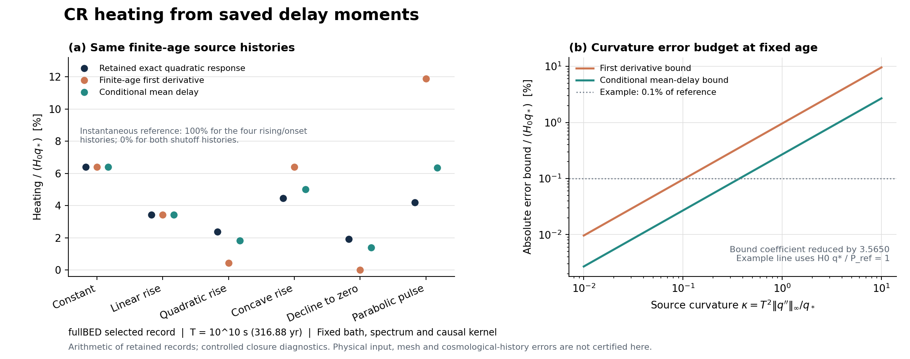

# BASS_CR 다음 연구 루프: 소비자 연결과 유한 나이 가열 오차

연구 단위: **CR-RUX-M1-M3-REUSE-20261012** · 2026-10-12 · GPT-6 Astra / 연구·코딩 하네스 4.0.0

## 1. 이번 루프의 결론

첨부된 원자자료 재사용 DAG를 현재 BASS_CR 결과에 맞추어 재편하고, 완료된 M0의 다음 경량 과학 계산을 실행했다. 결과는 **기존 지연 모멘트만으로 계산하는 양수성 보존 가열 근사와 그 오차 상계**다. 동시에 실제 CR 소비자 코드를 조사하여 M1과 M3의 출발점을 바로잡았다. 기존 native CR packet과 OFF 분기가 존재하므로, 다음 작업은 이를 새로 만드는 일이 아니라 **전자 주입원–지연 커널–소비자 정규화의 연결과 실제 허용오차의 지정**이다.

이번에 닫은 것은 제한된 소비자 조사, 고정 kernel의 새 수학·산술 진단, 국소 OFF 근거의 재사용이다. 실제 우주론 이력과 그 CR 오차 예산은 아직 연결되지 않았다. 기존 M0와 이차 응답을 재실행하지 않았고, 새로운 G 구성·시간전파·NCP 실행도 없다. 전체 REI DAG의 실행 상태를 이 국소 결과로 바꾸지 않았다.

| 항목 | 이번 결과 | 남은 범위 |
|---|---|---|
| M0 및 이차 주입 응답 | 원 결과와 입력을 그대로 재사용 | 원래 수치·물리 정확도의 한계 유지 |
| M1 소비자 조사 | 실제 snapshot, source 계보, 단위와 domain 식별 | 실제 선택 이력, electron kernel 정규화, 관측량 예산 |
| M2 가열 오차 지도 | 양수성 보존 근사 유도, 기록 4행·이력 24개·예산 180개 비교 | 실제 소비자에 적용 가능한지 판정 |
| M3 CR OFF | 보존된 함수와 과거 실행 근거 확인, 새 수정 필요 없음 | 선택된 최신 전체 이력에서 source 0 / provider 호출 0 영수증 |
| 첨부 DAG 반영 | CR 선행 relevance/binding 및 조건부 release 의존성 추가 | downstream 소유자의 실제 채택·실행 |

독립 검산의 수학·코드·기록 산술 비교는 종료 코드 0이었다. 최종 범위 판정은 [review/DECISION.json](review/DECISION.json), 실제 독립 실행은 [review/INDEPENDENT_REFERENCE_ACTUAL_EXECUTION.json](review/INDEPENDENT_REFERENCE_ACTUAL_EXECUTION.json)에 분리한다. 이 검토는 원자 입력 자체의 물리 정확도 또는 production 승격을 뜻하지 않는다.

## 2. 실제 소비자에서 확인한 것

### 2.1 이미 있는 두 인터페이스의 역할

기존 `cr_off_igm_bridge.rs`는 primary 광흡수·광가열의 국소 인터페이스다. 입력은 gas-rest proper 밀도 `[cm^-3]`, 광자 에너지 `[eV]`, 이미 에너지 bin과 각도 가중을 합친 `photons/H`다. 따라서 이 입력을 사용하면서 다시 `4π`, `dE`, `a^-3`, `dt`를 곱하지 않는다. source 주입·redshift·시간적분 단계는 caller가, 화학과 열 방정식은 `igm_point_rhs`가 맡는다. 이 규칙은 특정 입력 정의의 결과이며 모든 spectral-density 형식에 대한 전역 규칙이 아니다.

별도로 PHYS01/03의 native hard-particle terminal deposition packet과 `cr_deposition_derivative`가 이미 있다. 현재 REI PR110 소스 `17f8d0daa72e0f76a49cde01b110f650a6688c42`에서 확인한 두 composition knot는 다음과 같다.

| 양 | 기록된 범위 |
|---|---|
| 시간 | `10^10 s`의 prescribed snapshot |
| 가스 | `nH=140 m^-3`, `nHe=11.542553191489361 m^-3`, `Tg=100 K` |
| 조성 | `xi=0.01` 또는 `0.1`; `xHII=xHeII=xi`, `xHeIII=0` |
| 배경 | `H=3.3e-17 s^-1`, shear `3.3e-18 s^-1`; 지정된 snapshot 기하 |
| source | source manifest의 `z=8`, active proton `1–4 MeV` |
| 침적 모형 | FS10 local terminal deposition, excitation 및 continuum escape |
| 허용하지 않은 확대 | xi 보간, 임의 bath, 진화하는 전체 우주론 이력 |

전체 proton source의 정규화 구간은 `10 keV–1 PeV`다. 이를 active collision 구간인 `1–4 MeV`에 다시 정규화하면 source 정의가 바뀐다. source 코드의 efficiency 등 기본값은 확인했지만, 선택될 실제 실행의 constructor 인수 영수증으로 대체하지 않았다. 자세한 source 핀과 단위는 [CONSUMER_REQUEST.json](CONSUMER_REQUEST.json), [ATOM_OWNER_MATRIX.json](ATOM_OWNER_MATRIX.json), [RATE_DOMAIN_MAP.json](RATE_DOMAIN_MAP.json)에 있다.

### 2.2 공통 source 계보와 응답량의 동일성은 다른 조건이다

PHYS01과 PHYS02의 manifest에 기록된 `injection.py`와 `rudd.py` digest가 일치한다. 그러나 PHYS01은 선택된 proton snapshot의 terminal energy 분할이고, M0는 PHYS02의 고정 bath에서 electron source를 입력으로 받는 causal heating 응답이다. PHYS02A의 leading local source 근사는 `Np=t qp`, 따라서 `Qe(W,t)=t A(W)`이며, PHYS02B의 electron energy 구간은 `0.1–900 eV`다. 두 birth 구간과 selected/birth 표현의 정규화를 구분해야 한다.

그러므로 **PHYS01의 terminal heating에 M0의 p를 곱해 시간 지연을 붙이는 변환은 승인되지 않는다.** 후속 M1은 electron spectrum, 시간 기저, 초기 stock, bath, 연산자 및 단위주입 정규화를 한 실제 소비자 요청에 대조하여 호환 또는 비호환을 명시해야 한다. 공통 파일 digest만으로 이 연결을 완료 처리하지 않는다.

### 2.3 M3는 국소 구현을 재사용한다

현재 OFF 함수 전체와 negative control 함수는 과거 실제 실행에 묶인 소스의 해당 함수와 바이트가 같다. 과거 native 실행에는 `exit=0`, `off_no_call=true`, `solver_intervals=0`와 7개 test 통과가 기록되어 있고, 후속 PHYS03의 8개 scoped validation도 보존되어 있다. 이번에는 그 suite를 재실행하지 않았다.

`enabled=false`이면 CR source 항은 정확히 0이고 provider closure를 호출하지 않는다. 팽창·희석·열적 일에 의한 기하 항은 남으므로 전체 미분값이 0이라는 뜻은 아니다. CR ON의 누락·미지원 입력은 typed error이며 0으로 대체하지 않는다. 함수의 동일성과 과거 component 실행은 최신 전체 binary 또는 선택된 전체 history의 실행 증거가 아니다. 그 영수증은 receiver 소유자가 해당 실제 history를 실행할 때 남긴다. 근거는 [OFF_BRANCH_COMPARISON.json](inputs/consumer_intake/OFF_BRANCH_COMPARISON.json)과 [CONSUMER_INTAKE.json](inputs/consumer_intake/CONSUMER_INTAKE.json)이다.

## 3. 이번에 얻은 가열 근사와 오차 상계

### 3.1 고정된 문제

원 M0와 같은 비음 causal kernel을 사용한다. 총 열 응답을 `H0>0`, 정규화한 열 가중 지연측도를 `F`, source 이력을 `q`라 쓰면

\[
\mathcal P(T)=H_0\int_{[0,T]}q(T-\tau)\,dF(\tau),\qquad T=10^{10}\,\mathrm{s}.
\]

`q(t<0)=0`이며 별도 초기 비열적 stock은 없다. `q(0)`는 실제 끝점 값으로 보존한다. `H0`의 기존 정규화를 유지하여 `H0 q`가 가열률 단위를 갖는다. 고정 bath와 spectrum을 유지하고 새로운 시간이나 밀도로 모멘트를 외삽하지 않는다.

\[
p=F([0,T]),\quad
R=\int_{[0,T]}(1-\tau/T)dF,\quad
S=\int_{[0,T]}(1-\tau/T)^2dF.
\]

이차 이력 `q(t)/q*=a+b(t/T)+c(t/T)^2`에는 기존의 정확한 세 모멘트 식

\[
\boxed{\mathcal P(T)=H_0q_*\,(a p+b R+c S)}
\]

을 우선 사용한다. 여기서 정확하다는 것은 **고정된 기록 모형의 산술**에 대한 말이다. 기존 기록의 원자율·격자·전방 수치오차까지 없어졌다는 뜻은 아니다.

### 3.2 일반 C2 이력의 한 번 평가 근사

`p>0`이면 early delay의 조건부 평균을 사용하여

\[
t_*=T\frac Rp,\qquad
\boxed{\mathcal P_+(T)=H_0p\,q(t_*)}
\]

로 둔다. 이 근사는 비음 source의 양수성을 보존하고, 상수·선형 source에는 정확하다. `M≥sup|q″|`가 실제로 주어지면

\[
|\mathcal P-\mathcal P_+|
\le H_0 M T^2 C_+,\qquad
C_+=\frac12\left(S-\frac{R^2}{p}\right).
\]

끝점에서 얻는 finite-age 첫 보정

\[
\mathcal P_1=H_0[pq(T)-T(p-R)q'(T)]
\]

의 계수 `C1=(p−2R+S)/2`와 비교하면

\[
\boxed{C_1-C_+=\frac{(p-R)^2}{2p}\ge0.}
\]

따라서 같은 곡률 정보를 쓰는 절대오차 상계가 작거나 같다. 모든 개별 이력에서 실제 오차가 더 작다는 주장은 하지 않는다. 이차 이력에는 `M=|q″|`일 때 상계가 날카롭다. `p=0`에서는 source 함수를 평가하지 않고 0을 반환하며, 조건부 분산이 0이면 한 지연 근사가 임의 source에 정확하다. 불연속 shutoff에는 C2 상계를 그대로 적용할 수 없다. 완전한 유도와 차원·끝점 검토는 [DERIVATION_KO.md](DERIVATION_KO.md)에 있다.

### 3.3 기록된 fullBED selected 결과

| 양 | 값 |
|---|---:|
| p | 0.06390638042977166 |
| R | 0.03418586005219310 |
| S | 0.023676021232690768 |
| source 평가 시각 `t*/T` | 0.5349365716270038 |
| 조건부 평균 지연 `/T` | 0.4650634283729962 |
| `C1` | 0.009605340779038114 |
| `C+` | 0.002694377229125023 |
| 상계 계수 비 `C1/C+` | 3.564957673783997 |

`T`는 약 316.88년이다. 전체 지연 평균은 `μ/T≈46.45`이므로 전체 평균을 onset Taylor 항에 무심코 넣으면 zero-prehistory 경계를 넘는다. 현재 기록에서 `q/q*=x^3`의 첫 보정은 `3R−2p≈−0.0252552`로 음수다. 실제 cubic 응답은 비음 source와 양의 early mass로 양수이지만 그 정확한 값을 추가 모멘트 없이 새로 계산하지 않았다.

아래 값은 모두 `P/(H0 q*)`이며, 정확값은 기존 M0 이차 결과 파일에서 읽었다.

| 이력, `x=t/T` | 보존된 정확값 | 순간 침적 | finite-age 첫 보정 | 조건부 평균 지연 |
|---|---:|---:|---:|---:|
| 1 | 0.06390638 | 1 | 0.06390638 | 0.06390638 |
| x | 0.03418586 | 1 | 0.03418586 | 0.03418586 |
| x² | 0.02367602 | 1 | 0.00446534 | 0.01828727 |
| 2x−x² | 0.04469570 | 1 | 0.06390638 | 0.05008445 |
| (1−x)² | 0.01921068 | 0 | 0 | 0.01382193 |
| 4x(1−x) | 0.04203936 | 0 | 0.11888208 | 0.06359437 |

**3.565는 오차 상계 계수의 개선 비율이며 속도 향상이나 물리 정확도 인증이 아니다.** `x²` 이력에서 한 지연 근사의 실제 CR 가열 대비 오차는 아직 약 **22.76%**다. 종료 이력 `(1−x)²`에서는 약 28.05%, 포물선 pulse에서는 약 51.27%다. 이미 정확한 이차 식이 있는 경우에는 그 식을 사용한다. 한 지연 근사는 일반 이력에서 그 오차가 소비자 예산 안에 드는지 판단하는 선택지다.

기계 판독 값과 유리수 분자·분모는 [RESPONSE_ERROR_MAP.json](results/RESPONSE_ERROR_MAP.json), 간결한 비교 표는 [RESPONSE_ERROR_MAP.tsv](results/RESPONSE_ERROR_MAP.tsv)에 있다. fullBED/legacy와 selected/birth 네 행을 구분했다.

## 4. 실제 소비자의 허용오차로 연결하는 법

명시적인 source 진폭 `q*>0`와 `κ=T²M/q*`를 사용하면 `|P−P+|/(H0q*)≤C+κ`다. 실제 소비자가 양의 reference `P_ref`와 상대 허용오차 `η`를 지정하면

\[
f_*\,C_+\kappa\le\eta,\qquad f_*\equiv H_0q_*/P_{\rm ref}
\]

가 충분조건이다. `f*`는 reference에 대한 정규화 비율이다. gas ionization `xi`, source CR efficiency, 실제 CR 가열분율을 이 값으로 대체하지 않는다. 현재 source가 0인 종료 시각에도 `q*`는 이력의 최대값이나 초기값으로 정의할 수 있다.

이번 180개 budget 경우는 이 조건의 통제된 산술 지도다. 실제 우주론에서 선택된 `f*`, source 곡률 또는 관측량 예산을 측정한 결과가 아니다. 가열률의 오차가 주어져도 `ΔTg`, `Δxe`, `Δτ`에는 coupled 방정식을 통한 별도의 전파가 필요하다. 따라서 다음 M1은 실제 observable, 분모, 절대 또는 상대 허용오차를 먼저 묶고, M2의 물리 적용 판정은 그 뒤에 한다.

## 5. 첨부 DAG에 반영한 변경

[PLAN_KO.md](PLAN_KO.md)와 [NEXT_DAG.json](NEXT_DAG.json)은 BASS_CR의 실행 계획이고, [REI_ATOMIC_REUSE_DAG_CR_OVERLAY_20261012.json](REI_ATOMIC_REUSE_DAG_CR_OVERLAY_20261012.json)은 첨부 전역 DAG에 대한 제안이다. 첨부 원문과 SHA256은 `inputs/`에 보존했다.

| 원 DAG의 문제 또는 빈칸 | 반영한 변경 |
|---|---|
| CR 확장의 RUX13이 baseline 그림 이후에만 있어, 처음부터 필요한 물리를 늦게 발견할 수 있음 | `RUX03_CR_SCREEN`을 RUX04 시나리오 확정 전에 추가 |
| 기존 native CR packet과 최신 M0의 source 근거가 빠짐 | source registry에 `CRX01–CRX05` 추가 |
| CR ON의 source/domain 연결 선행조건이 불명확함 | `RUX13_BIND` 추가; CR ON인 RUX04/05/07의 조건부 필수 의존성 |
| RUX16 release가 선택한 확장 근거를 건너뛸 수 있음 | CR/HE/HH/spatial 주장을 켠 경우 해당 노드를 필수로 연결 |
| synthetic 진단과 실제 EoR 그림의 입력 혼동 가능 | RUX11이 RUX08/09/10의 실제 산출물을 소비하도록 명시 |
| `main_critical_path` 목록이 전체 직렬 순서로 읽힐 수 있음 | `main_nodes`로 바꾸고 실제 dependency readiness로 진행 |

원래 17개 global node의 `PROPOSED_NOT_EXECUTED`와 실행 소유자는 유지했다. 추가한 두 노드까지 전역 19개, BASS_CR의 실제 상태를 나타내는 국소 DAG는 17개다. 새 국소 성과로 전역 physical admission을 완료 처리하지 않는다. baseline의 CR OFF 선택은 전체 원자 연구 완료를 기다리지 않으며, 독립적인 CR 원자·산란 질문을 위한 별도 연구 경로도 유지한다.

## 6. 실행, 검토, 남은 gate

| 실제 수행 | 기록 |
|---|---|
| 새 closure의 targeted 검사 7개 | 1회, exit 0, wall 약 0.0507초 |
| 새 M2 exact postprocess | 1회, exit 0, wall 약 0.0408초 |
| 독립 Fraction reference | 1회, exit 0, wall 약 0.0453초 |
| DAG 구조 검사 | cycle·source ref·조건부 의존성 PASS; 물리 검증 아님 |
| 그림 | 저장 결과만 렌더링; 주석 겹침을 수정한 최종 그림을 시각 확인 |
| 기존 M0·과거 receiver suite·G·solve·pulse·expm·NCP | 이번 루프의 새 실행 0 |

독립 기준 계산은 별도 이산 지연측도의 직접합과 경계·분모·비유일성 예를 사용했다. 기록 산술에서 유리수를 사용한 것은 입력 소수의 산술을 정확히 비교하기 위해서다. 원 기록의 오차를 줄였다는 주장과 구분한다. 실행 코드·command·exit·wall·로그 SHA는 `evidence/`와 `review/`에 있다. 유일한 검토 문장 수정은 이차식의 등호 조건에 `M=|q″|`를 명시한 것이며 계산을 다시 실행할 필요가 없었다.

F의 `HOLD_OPERATOR_BINDING_UNRESOLVED`, 그에 종속된 G frontier, PHYS02_DELAY OPEN, production_history HOLD, atomic_G02 UNRESOLVED, b_grid NO_GO, all_bound OPEN을 유지한다. 아직 시작하지 않은 H 전체9600 NCP 작업은 `DEFERRED_OPTIONAL`이고 원래 8 build / 76,800 column / 누적 900초 / 자동 retry 0의 계약을 바꾸지 않았다. 실제 미수집 H run의 존재는 이번에 새로 조사하지 않았으며, 없는 run을 가정하거나 반복 부재 조회를 예약하지 않는다.

다음 경량 연구의 완료 기준은 **한 실제 소비자 요청에 대해 electron source와 kernel의 호환성 및 정규화를 명시하고, 관측량 오차 예산을 묶어 사용할 응답식을 선택하는 것**이다. 새 고비용 계산은 그 과정에서 남은 구체적인 물리 질문과 필요한 출력이 확인될 때에만 별도 계약으로 활성화한다.

## 자료와 근거

이 보고서의 새 수학은 [DERIVATION_KO.md](DERIVATION_KO.md), 수치는 [results/RESPONSE_ERROR_MAP.json](results/RESPONSE_ERROR_MAP.json), 소비자 사실은 [inputs/consumer_intake/SOURCE_IDENTITY.json](inputs/consumer_intake/SOURCE_IDENTITY.json), 기존 원자·photon interface는 [inputs/atomic_intake/SOURCE_INVENTORY.json](inputs/atomic_intake/SOURCE_INVENTORY.json)에 연결되어 있다.

문헌상 사건 구분에는 [Verner et al. (1996) 원 자료](https://www.pa.uky.edu/~verner/photo.html)의 ground-state 광이온화 단면적과 [Furlanetto & Stoever (2010)](https://arxiv.org/abs/0910.4410)의 fast-electron 에너지 분할을 참고했다. 후자는 heating·H/He ionization·excitation의 분할이 입사 전자 에너지와 가스 이온화 상태에 의존함을 다룬다. 이 문헌이 이번 cache의 causal kernel 또는 수치 정확도를 독립적으로 인증하는 것은 아니다.
