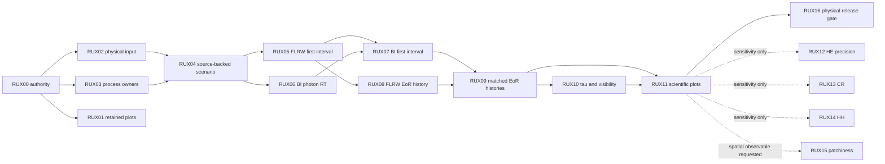

# rei_bianchi: atomic research reuse + physical EoR successor DAG

Date: 2026-10-12 KST. Status: PROPOSED_NOT_EXECUTED. This file is a plan, not proof of a new physics result.

## Design decision

The critical path is existing physical-input and owner admission, first coupled interval, source-backed FLRW/BI histories, then BASS tau/visibility. Existing scoped F08/SYNC02/SYNC03 and atomic HE/CR/HH results are retained, not re-run. HH/CR/high-precision HE are sensitivity-triggered and not baseline prerequisites.

Important distinction: the 2026-10-04 GLOBAL_DAG.json with initial pending state is a historical plan. The successor uses later receipts and does not mark those source records retroactively complete.

## Repository registry (checked as accessible GitHub repositories)

- `rei_bianchi`: https://github.com/cosmosapjw-quantum/rei_bianchi | primary coupled runtime; physical EoR owner
- `rec_bianchi`: https://github.com/cosmosapjw-quantum/rec_bianchi | initial/recombination-history provider
- `BASS_HE`: https://github.com/cosmosapjw-quantum/BASS_HE | helium and atomic source/rate authority
- `bass_cr`: https://github.com/cosmosapjw-quantum/bass_cr | absorption/heating; opt-in CR physical corrections
- `bass`: https://github.com/cosmosapjw-quantum/bass | polarized photon transport, Thomson tau/visibility
- `WU088_HH`: https://github.com/cosmosapjw-quantum/WU088_HH | HH event and response conditional research
- `htt_base`: https://github.com/cosmosapjw-quantum/htt_base | historical/regression reference only

## Dropbox / Drive primary paths

- `S01` `/bianchi/rei_bianchi/rust/rei_microphysics/src/` | Existing Rust modules including atomic_provider, homogeneous_rates, coupled_primary, axisym_radiation, paired_runtime, axisym_coupling
- `S02` `/bianchi/rei_bianchi/runs/rei_fastest_v1/paired/` | F08 synthetic 15 histories, 248000 accepted trials, short 1e13 s prescribed interval
- `S03` `/bianchi/rei_bianchi/docs/atomic_reionization_handoff_20261004_v1/` | 2026-10-04 historical GLOBAL_DAG; execution state is historical and not current runtime truth
- `S04` `/bianchi/rei_bianchi/docs/research_sync/REI-REC-BASS-SYNC02-20261005/` | scoped actual REC-REI-BASS connection with audit
- `S05` `/BASS_DERIVATION_DOSSIERS_20260912/ATOMIC_REIONIZATION_HANDOFF_20261004_v1/` | archives for source/closure and physical-input handoff
- `S06` `/BASS_DERIVATION_DOSSIERS_20260912/ATOMIC_REIONIZATION_HANDOFF_20261004_v1/REI_BIANCHI_PHYSICAL_INPUT_HANDOFF_20261010_v2.tar` | Exists, internal physical admission NOT VERIFIED
- `S07` `/BASS_DERIVATION_DOSSIERS_20260912/REI_PHYSINPUT_P01_PRODUCTION_20261010_c168e578.tar.gz` | Exists, internal contents/admission NOT VERIFIED
- `S08` `/BASS_DERIVATION_DOSSIERS_20260912/REI_PHYSINPUT_P02A_20261010_8a80fa9.tar.gz` | Exists, internal contents/admission NOT VERIFIED
- `S09` `/BASS_DERIVATION_DOSSIERS_20260912/REI_PHYSINPUT_P03A_20261010_d6ad8b7.tar.gz` | Exists, internal contents/admission NOT VERIFIED
- `S10` `/BASS_DERIVATION_DOSSIERS_20260912/REI_P03A_SOURCE_DELTA_20261010_05c45c3.tar.gz` | Exists, internal contents/admission NOT VERIFIED
- `S11` `/BASS_DERIVATION_DOSSIERS_20260912/REI_N2_LOCAL_INPUT_RESEARCH_20261010_v1/RECEIPT.md` | N2 HOLD: Bianchi-I background, IC, spectrum, source histories, energy/source closures and executable provider binding missing in assessed input
- `S12` `/BASS_DERIVATION_DOSSIERS_20260912/REI_AXI05_COUPLED_COMPOSITION_20261010_v1/RECEIPT.md` | scoped local derivative composition PASS; full cosmology HOLD
- `S13` `/BASS_DERIVATION_DOSSIERS_20260912/BASS_HE_E13C10_REPORT_KO_20261012.md` | selected finite-interval bound improvement; physical/continuum/production HOLD
- `S14` `/BASS_DERIVATION_DOSSIERS_20260912/WU088_HH_R31S_NCP_REDESIGN_20260928/WU088_HH_OBSERVABLE_FIRST_PLAN_NCP_HANDOFF_20261012_v1.md` | HH PHYS11 preserved, observable-first plan, no heavy job ready
- `S15` `https://drive.google.com/file/d/16y6OFZJF9fkcU31Qr-rTsAJGjEojwgJB/view` | BASS_CR point photon-stock PASS, wide propagated error PARTIAL
- `S16` `https://drive.google.com/drive/folders/1JIh1a-WtEZG-ahzN6rk-9PECVSVxljo5` | SYNC03 conditional finite-cell tau and visibility
- `S17` `https://docs.google.com/document/d/13AYaC3mEKz_EFMR5p4htnD039vUGwgA_weSOa6SuOMk/edit` | EoR MICRO-0 H/He rate families and conservation-tested reference/auditor recovered

## DAG

## Work unit contract

### RUX00: Authority inventory and non-duplication lock
- Depends on: none; owner: rei_bianchi; route: LOCAL; optional: False
- Input refs: S01, S02, S03, S04, S16
- Output: `SOURCE_AUTHORITY_LOCK.json and RETAINED_RESULTS.json`
- Acceptance: Inspect exact branch heads, commit/tree/blob SHA and per-source claims; identify previously PASS nodes and stale 2026-10-04 pending records
- Fail/stop: No re-run of F08/SYNC02/SYNC03 or completed atomic precision work; report unknown refs rather than infer

### RUX01: Publish retained scientific diagnostics without recomputation
- Depends on: RUX00; owner: rei_bianchi; route: LOCAL; optional: False
- Input refs: S02, S04, S16
- Output: `plots/retained_F08_SY3_diagnostics and ERROR_LEDGER.json`
- Acceptance: Reproduce figures from saved curves and finite-cell tau, label synthetic/conditional and source/observer tail limitations; numerical checks refer to retained receipts
- Fail/stop: No claim of physical EoR, continuum sign or sky anisotropy; no fresh full science rerun

### RUX02: Physical-input archives: exact intake and admission
- Depends on: RUX00; owner: rei_bianchi; route: LOCAL; optional: False
- Input refs: S06, S07, S08, S09, S10, S11
- Output: `PHYSICAL_INPUT_ADMISSION.json`
- Acceptance: Cross-check each file SHA/internal manifests against N2 missing fields: Bianchi background/epoch, hydrogen/helium initial abundances and temperature, spectrum/source history, closures and executable callback
- Fail/stop: If any mandatory field is null or only synthetic, mark PHYSICAL_HOLD with exact missing fields; do not fabricate values

### RUX03: Atomic process and opacity ownership registry
- Depends on: RUX00; owner: rei_bianchi; route: LOCAL; optional: False
- Input refs: S01, S05, S13, S15, S17
- Output: `ATOM_OWNER_MATRIX.json + RATE_DOMAIN_MAP.json`
- Acceptance: Distinct HI/HeI/HeII cross sections and binding cutoffs; case A explicit recombination photons XOR case B OTS; local HI absorption XOR effective MFP overlap; proper/comoving, photon/energy, frame and units verified
- Fail/stop: Fail on double-counting, unknown/unsupported rates, missing heating, incompatible source domains, HE excited-state differential spectrum misuse

### RUX04: Physical EoR scenario freeze (FLRW and Bianchi pair)
- Depends on: RUX02, RUX03; owner: rei_bianchi; route: LOCAL; optional: False
- Input refs: S06, S07, S08, S09, S10, S17
- Output: `PHYSICAL_SCENARIO_LOCK.json`
- Acceptance: One identified, source-backed cosmological initial epoch and background (aV, directional shear), consistent H/He IC, T, source spectrum including explicit He-ionization claim support or narrowed claim, emissivity/escape/clumping assumptions with provenance
- Fail/stop: No post-hoc tuning of source, normalization, shear, IC or closure after inspecting pair; no claims from S0 13.7 eV fixture

### RUX05: Reuse primary microstep on first FLRW physical interval
- Depends on: RUX04; owner: rei_bianchi; route: LOCAL; optional: False
- Input refs: S01, S04, S12
- Output: `FIRST_FLRW_PHYSICAL_INTERVAL.json + conservation ledger`
- Acceptance: Use existing coupled_primary/microstep; same-event photons and ions, nuclei/charge/energy, positivity, owner checks, independent check at fixed physical inputs
- Fail/stop: Fail-closed on missing data, case/opacity mismatch, precision/unit errors; do not reimplement solver

### RUX06: Reuse Bianchi-I geodesic/energy remap and angular cells
- Depends on: RUX04; owner: rei_bianchi; route: LOCAL; optional: False
- Input refs: S01, S02
- Output: `BI_TRANSPORT_REGRESSION.json`
- Acceptance: Exact directional characteristic energy relation, photon number and frequency-face flux telescoping, FLRW sigma->0 limit, frame conventions and KMS not assumed
- Fail/stop: Do not claim microphysical coupling, new history or physical result from collisionless transport tests

### RUX07: First physical Bianchi-I coupled interval
- Depends on: RUX05, RUX06; owner: rei_bianchi; route: LOCAL; optional: False
- Input refs: S01, S12
- Output: `FIRST_BI_PHYSICAL_COUPLED_INTERVAL.json`
- Acceptance: Same source/history/IC and frozen rates as FLRW, couple actual angular RT to same-event absorption/HHe chemistry/thermal power; energy and group-boundary ledgers closed
- Fail/stop: Fail on nonconvergence, conservation breach, missing time carry or source/opacity owner conflict; no prediction from a manufactured fixture

### RUX08: Source-backed multi-epoch FLRW EoR history
- Depends on: RUX05; owner: rei_bianchi; route: LOCAL; optional: False
- Input refs: S01, S07, S08, S09
- Output: `FLRW_EOR_HISTORY.csv + convergence and model ledger`
- Acceptance: Evolve selected source-backed history over declared reionization epoch, species fractions/temperature/photons, causal photon inventory, post-overlap sink handling, independent FLRW reference/limit
- Fail/stop: No QV=xHII relabeling, no cosmological extrapolation beyond provider/source domain

### RUX09: Matched Bianchi-I/FLRW EoR history
- Depends on: RUX07, RUX08; owner: rei_bianchi; route: NCP_IF_MEASURED_HEAVY; optional: False
- Input refs: S01, S02, S16
- Output: `PAIRED_EOR_HISTORY.csv + DIFFERENCE_ERROR_LEDGER.json`
- Acceptance: Same cosmological source and closure, directional photon remap, time/angle/energy refinements, explicit shears; separation of background/history vs shear transport effect
- Fail/stop: Do not interpret numerical contrast as observationally novel if source/closure systematic larger or unconstrained

### RUX10: CMB receiver optical depth and visibility
- Depends on: RUX09; owner: bass; route: LOCAL; optional: False
- Input refs: S04, S16
- Output: `TAU_VISIBILITY_SOURCE_BACKED.json + plots`
- Acceptance: Bind proper ne(t) from genuine physical paired history into existing BASS time/visibility API; observer-tail explicit; FLRW and non-tilted limits checked
- Fail/stop: No arbitrary tail=0 as physical total tau; do not imply full polarized CMB sky result

### RUX11: Scientific plot and observational-claim screening
- Depends on: RUX08, RUX09, RUX10; owner: rei_bianchi; route: LOCAL; optional: False
- Input refs: S02, S16
- Output: `FIGURE_SET + CLAIM_LEDGER.json`
- Acceptance: Source-backed xHII,xHeII,xHeIII,Tg,Gamma,photons, delta observables, tau/visibility; uncertainties split numeric, atomic, source, geometry, spatial closure
- Fail/stop: Publication gate fails for unconstrained cosmological input, unmatched source, missing uncertainty or false QV claim

### RUX12: HE precision sensitivity import, when material
- Depends on: RUX11; owner: BASS_HE; route: NCP_IF_MEASURED_HEAVY; optional: True
- Input refs: S13, S17
- Output: `HE_EFFECT_ON_EOR.json`
- Acceptance: Only if process and temperature/source domain relevant; consume rates, event moments or bounded perturbations with provider authority; run matched ON/OFF sensitivity in rei once
- Fail/stop: Do not promote E13C10 finite interval width to physical model error; no 2440-path replay without need

### RUX13: CR hard-particle process extension, when material
- Depends on: RUX11; owner: bass_cr; route: NCP_IF_MEASURED_HEAVY; optional: True
- Input refs: S15
- Output: `CR_EFFECT_ON_EOR.json`
- Acceptance: Only if deposition/hard particle/temperature observables require, with native rate owner and supported point outputs
- Fail/stop: CR OFF remains legitimate baseline; full wide propagated numerical certificate OPEN

### RUX14: HH chemistry/spectral response, when material
- Depends on: RUX11; owner: WU088_HH; route: NCP_IF_MEASURED_HEAVY; optional: True
- Input refs: S14
- Output: `HH_EFFECT_ON_EOR.json`
- Acceptance: Bind named HH processes to stoichiometric network, threshold heating, domain; local sensitivity first, actual matched histories only if needed
- Fail/stop: Singlet ion-pair not replaced by free-electron LCS; native root/continuum unfinished; no ungrounded HH promotion

### RUX15: Patchiness/spatial topology extension
- Depends on: RUX11; owner: rei_bianchi; route: NCP_IF_MEASURED_HEAVY; optional: True
- Input refs: S03
- Output: `QM_QV_RT_EXTENSION_PLAN.json`
- Acceptance: Declare density–ionization correlation, topology and spatial RT/IGM opacity source if QV, 21cm power or spatial sky inference claimed
- Fail/stop: Homogeneous xHII alone cannot be relabeled QV nor predict patchy 21cm spectrum

### RUX16: Physical promotion and reproducible release
- Depends on: RUX11; owner: rei_bianchi; route: LOCAL; optional: False
- Input refs: S03, S11, S16
- Output: `PHYSICAL_CLAIM_DECISION.json + final charts + reproducibility manifest`
- Acceptance: Numerical convergence; source/model errors and physical assumptions; independent trusted checks, source/license/provenance, passed observable gate; actual repo commit and checksum receipts if published
- Fail/stop: Keep physical/continuum/production HOLD until own acceptance; optional precision/spatial results may remain open

## First action

Read existing repo AGENTS.md; read the actual current branch/commit and observed historical receipts. Run RUX00, RUX02 and RUX03 as bounded read-only/intake tasks before writing a new solver. RUX01 can proceed independently from retained curves and certified receipt scope. If RUX02 does not provide a complete physical dataset, create one explicit P0 physical-input selection task rather than a new atomic precision campaign.

## Claim boundaries

All nodes in this successor DAG are PROPOSED_NOT_EXECUTED; existing references are separate evidence. The F08 13.7 eV synthetic spectrum does not photoionize HeI/HeII. SYNC03 is finite endpoint-linear conditional tau, not a cosmic EoR prediction. Existing BASS_CR wide error is PARTIAL, HE E13 full physical accuracy HOLD, HH native/continuum admission OPEN. No QV prediction from homogeneous xHII alone.
