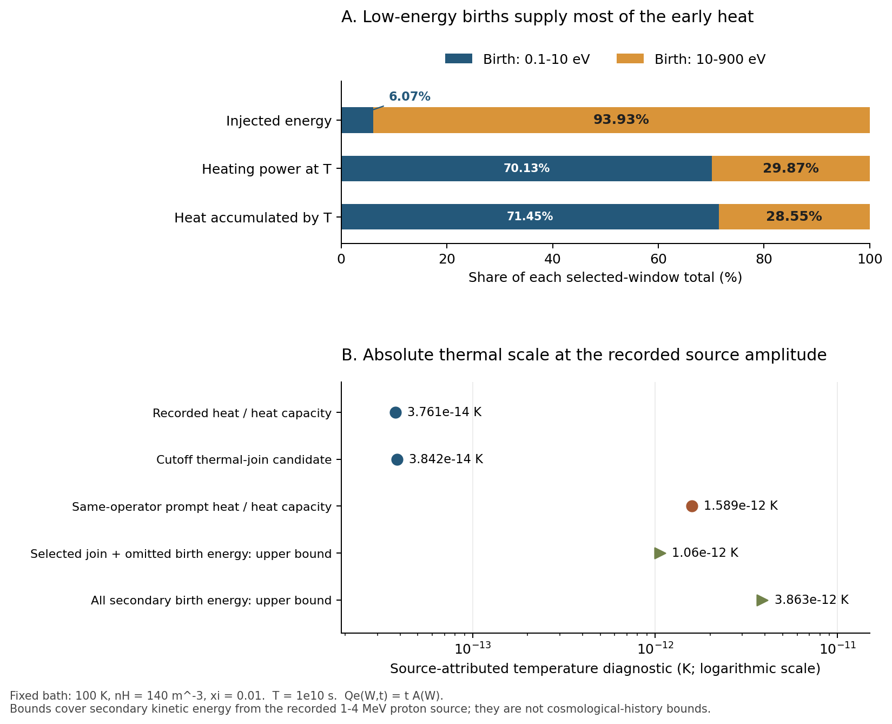

# BASS_CR 다음 연구 루프 — 실제 전자 주입원과 열적 편입

**CR-RUX-M1B-SOURCE-BINDING-20261012 · 2026-10-12**

## 1. 이번에 얻은 결과

**실제 실행된 전자 birth source를 기존 M0 지연 응답에 연결하고, 열량과 열적 전자 수를 함께 넘기는 cutoff 편입식을 구성했다.** 같은 source의 에너지 창 밖 기여도 누적 에너지 예산으로 묶었다.

가열률과 누적 열 자체는 과거 PHYS02C/E에 이미 저장되어 있던 값이다. 이번에는 그 값이 어떤 양성자 source, 전자 spectrum, energy normalization, clock 및 bath에 대응하는지 실제 실행 코드까지 추적하고, 물리 단위의 오차와 열적 효과로 연결했다. [원문 계보](inputs/source_lineage/SOURCE_FINDINGS_KO.md), [전체 유도](DERIVATION_KO.md), [실제 산술 결과](results/SOURCE_BOUND_RESPONSE.json)가 근거다.

| 결과 | fullBED, 실제 선택 source |
|---|---:|
| 끝점 전자 에너지 주입률 \(q_*\) | \(1.8012625784\times10^{-42}\ \mathrm{J\,m^{-3}s^{-1}}\) |
| 끝점 가열률 \(P_h(T_0)\) | \(3.4427310257\times10^{-44}\ \mathrm{J\,m^{-3}s^{-1}}\) |
| 누적 열 \(E_h(T_0)\) | \(1.1921620919\times10^{-34}\ \mathrm{J\,m^{-3}}\) |
| \(E_h/C_{V,0}\) 열량계적 환산 | \(3.7610126366\times10^{-14}\ \mathrm K\) |
| cutoff 에너지·입자수 편입 후보의 \(\Delta T_{\rm lin}\) | \(3.8418834732\times10^{-14}\ \mathrm K\) |
| 해당 source의 모든 secondary kinetic energy를 열로 허용한 상계 | \(3.8629273054\times10^{-12}\ \mathrm K\) |

이 수치는 **\(T_0=10^{10}\) s, 약 316.88년의 고정 배경 실험**에 해당한다. 마지막 상계의 source 범위도 아래에서 명시한다.

최종 독립 판정은 **PROMOTE_SCOPED**다. 자체 점검 **37개**와 후보 구현을 호출하지 않은 독립 기준 계산 **30개**가 모두 통과했다. 과학 판정과 독립 reference는 [DECISION.json](review/DECISION.json), [REVIEW_KO.md](review/REVIEW_KO.md)에 있다. 수식·표·근거를 포함한 LaTeX 보고서는 [report.pdf](latex/report.pdf)다.

## 2. 실제로 연결한 source와 SI normalization

배경은 \(n_H=140\ \mathrm{m^{-3}}, Y_{\rm He}=0.248, T_g=100\ \mathrm K\), \(x_{\rm HII}=x_{\rm HeII}=0.01,\ x_{\rm HeIII}=0\)이다. 초기 비열적 전자는 0이다. 선택 birth 창은 \(0.1\!-\!900\) eV이며 \(10\) eV에서 low/high 태생 tag를 나눈다.

양성자 주입 \(q_p(K)\)는 이미 각도를 적분한 proper-volume rate다. 전체 \(10\) keV–\(1\) PeV 에너지 구간으로 정규화한다. 실제 충돌 창 \(1\!-\!4\) MeV를 다시 전체 source power로 정규화하지 않는다. \(z=8,\alpha=2.2\), CR 효율 0.1, escape fraction 1 등의 실제 사용은 **실행 영수증이 고정한 launcher와 transitive default constructor**로 확인했다. 별도 constructor 인수 JSON이 출력된 것은 아니다.

PHYS02의 leading local source는

\[
A(W)=\sum_{s=\mathrm{H,He}}n_{s,0}\int_{1\,\mathrm{MeV}}^{4\,\mathrm{MeV}}
q_p(K)v_p(K)\frac{d\sigma_{p,s}}{dW}(K,W)\,dK,\qquad
Q_e(W,t)=tA(W).
\]

\(A(W)\)의 단위는 \(\mathrm{m^{-3}s^{-2}eV^{-1}}\)이다. \(Q_e\)는 birth rate이고 stock 자체가 아니다. PHYS01의 정확 Bianchi 수송과 FS10 terminal packet은 별도의 물리 출력이다.

두 actual9600 fullBED/legacy source 배열의 shape는 (9611, 2)이고 raw C-order SHA256은 모두 07dd0fa81154f5aecaf262b00c2adfada21ebc9b2a2dba59703e03e3f5dab609다. 같은 source와 물리 진폭을 사용한다. [40개 원문 inventory](inputs/math_intake/SOURCE_INVENTORY.json)는 commit, 경로, digest와 실제 읽은 범위를 보존한다.

\[
A_{E,B}=\int_{0.1}^{900}WA(W)\,dW,\qquad
\phi(W)=A(W)/A_{E,B},\qquad \int W\phi(W)\,dW=1.
\]

\(\phi\)는 에너지로 정규화한 birth shape다. 두 birth 열 모두 **같은 전체 선택 에너지 분모**를 쓴다. 실제 저장 scale은

\[
U_*=T_0^2A_{E,B}=1.1242596728743301\times10^{-13}\ \mathrm{eV\,m^{-3}}.
\]

따라서 \(\epsilon_{\rm eV}=1.602176634\times10^{-19}\ \mathrm{J/eV}\)를 사용하면

\[
q_*=\epsilon_{\rm eV}U_*/T_0,\qquad q(t)=q_*t/T_0.
\]

동일한 고정 kernel의 열 가중 모멘트 \(R,S\)에 의해

\[
\boxed{P_h(T_0)=q_*H_0R},\qquad
\boxed{E_h(T_0)=\frac{q_*T_0}{2}H_0S}.
\]

선형 source의 끝점에는 \(R\), 누적 열에는 \(S\)가 들어간다. impulse의 early fraction \(p\)를 선형 source에 그대로 곱하지 않는다. fullBED selected 값은 \(H_0=0.5590872090008833,\ R=0.0341858600521931,\ S=0.023676021232690768\)이다.

selected_record와 birth_defined, fullBED와 legacy의 네 행을 각각 계산했다. 기존 9600 SI 값과의 최대 비교 차이는 약 \(4.50\times10^{-14}\)다. 입력 소수의 정확 분수 산술은 원자 입력이나 격자의 물리 오차를 제거하지 않는다.

## 3. 저에너지 birth가 짧은 시간의 열을 공급한다

| Birth energy | 주입 에너지 비중 | 끝점 가열률 비중 | 누적 열 비중 |
|---|---:|---:|---:|
| 0.1–10 eV | 6.0739% | 70.1325% | 71.4458% |
| 10–900 eV | 93.9261% | 29.8675% | 28.5542% |

대부분의 주입 에너지는 high birth에 있지만 짧은 시간의 열은 low birth가 주도한다. 이는 각 birth 집단의 열화 지연이 다르기 때문이다. 이미 낮은 에너지로 내려온 high-born descendant를 low-born 외부 source로 다시 세지 않는다.

같은 kernel의 eventual yield를 순간적으로 적용하면 끝점 가열률은 **29.2519배**, 누적 열은 **42.2368배** 커진다. 각각의 절대 차이는 \(9.7263555739\times10^{-43}\ \mathrm{J\,m^{-3}s^{-1}}\), \(4.9160981291\times10^{-33}\ \mathrm{J\,m^{-3}}\)다. 이 비교도 같은 source 및 같은 operator의 prompt 기준이며 FS10 packet과 혼합하지 않는다.

## 4. 열적 전자 수를 구분한 cutoff 편입

원 cascade는 cutoff energy와 cutoff number를 각각 보존한다. 수 보존식은

\[
N_{\rm birth}+N_{\rm sec}=N_{\rm active}+N_c.
\]

\(N_{\rm sec}\)는 전자 열화가 만드는 추가 H/He ionization event다. 새 후보는 cutoff에 도달한 전자가 thermal bath에 합류한다고 정한다. 그때

\[
P_{\rm th}=P_h+P_c,\qquad \dot n_{\rm th}=S_c.
\]

전체 자유전자 수와 thermal 전자 수의 차이가 \(N_{\rm active}\)다. 현재의 한 전자수·한 온도 receiver에 자동 대입하기보다 이 두 집단의 입자수 계약을 먼저 연결해야 한다. 실제 cutoff ledger에는 subcutoff daughter도 포함되므로 \(E_c=0.1\,\mathrm{eV}\,N_c\)로 바꾸지 않고 저장된 에너지와 수를 각각 읽었다.

\[
C_{V,0}=\frac32k_B(n_H+n_{\rm He}+n_{e,0})
=3.1697901790\times10^{-21}\ \mathrm{J\,m^{-3}K^{-1}}.
\]

명시한 closure의 국소 온도 항과 frozen-coefficient 누적 진단은

\[
\boxed{C_{V,0}\dot T_g=P_h+P_c-\frac32k_BT_gS_c},
\]

\[
\Delta T_{\rm lin}=
\frac{E_h+E_c-\frac32k_BT_{g,0}N_c}{C_{V,0}}.
\]

주어진 deposition 총량의 정확 고정체적 열역학 대수는 마지막 분모를 \(C_{V,0}+\frac32k_BN_c\)로 바꾼다. transport 계수를 온도에 따라 재계산한 coupled history의 정확성을 주장하는 식이 아니다.

결과는 \(\dot T_{\rm local}=1.1074696108\times10^{-23}\ \mathrm{K/s}\), \(\Delta T_{\rm lin}=3.8418834732\times10^{-14}\ \mathrm K\)다. 열용량 변화 비율은 약 \(1.20\times10^{-18}\)이다.

이 후보는 cutoff에서 열적 합류를 정한 에너지·입자수 계약이다. subcutoff 물리, cutoff 독립성 및 REI 실제 이력 채택은 이후 범위다. 초기 검토의 event-only 사영식은 thermal 에너지 기준 및 primary birth와의 완결된 연결이 없어 이번 승격 대상으로 사용하지 않았다.

## 5. 생략된 birth energy까지 포함한 물리적 크기

같은 원 source의 전체 secondary kinetic-energy 계수는 \(A_{E,\rm all}=1.5285042578786697\times10^{-33}\ \mathrm{eV\,m^{-3}s^{-2}}\)다. 선택 창은 그 에너지의 73.55293039%를 포함한다. 이 분모는 **1–4 MeV 양성자가 직접 낳은 모든 전자의 kinetic energy**이며, 전체 CR power나 primary binding energy를 포함하지 않는다.

실제 평가기는 PHYS02B R002의 coverage를 읽었고, 상세 유도는 PHYS02C R001을 인용했다. 두 전체 기록의 파일 identity는 다르지만 coverage 하위 객체는 저장 소수까지 동일하다. 이 구분과 대조 근거는 [COVERAGE_IDENTITY_NOTE.json](review/COVERAGE_IDENTITY_NOTE.json)에 기록했다.

| 누적 에너지 예산 | 값 [J m⁻³] |
|---|---:|
| 전체 해당 secondary birth energy | \(1.2244669035\times10^{-32}\) |
| 선택 구간 밖 birth energy | \(3.2383561426\times10^{-33}\) |

초기 active stock이 없고 외부 bath에서 에너지를 빌리지 않는 수동적 deposition이면, 생략 구간의 source-attributed 누적 열은 birth energy 이하이다. 따라서

\[
\Delta T_{\rm join+outside}
\le\frac{E_h+E_c+E_{\rm outside}}{C_{V,0}}
=1.0601700122\times10^{-12}\ \mathrm K.
\]

선택 구간의 아직 열화하지 않은 에너지까지 모두 열로 허용한 더 넓은 상계는

\[
\boxed{\Delta T_{\rm all\ secondary}\le
E_{\rm all,in}/C_{V,0}=3.8629273054\times10^{-12}\ \mathrm K.}
\]

이 source 범위와 짧은 고정 배경 실험에서 절대 가열 효과가 작다는 결론을 얻는다. 같은 계산의 CR 상대 지연 효과는 크다. 서로 다른 분모의 결론이다. 더 긴 이력·다른 양성자 에너지 창·초기 reservoir·진화하는 bath·전체 재이온화 효과는 해당 입력으로 다시 묶어야 한다. 누적 에너지 상계를 임의의 순간 power 상계로 바꾸지 않는다.

## 6. 실행·검토와 후속 계획

표준 라이브러리 scalar postprocess의 최종 확인은 **37개 PASS**다. 첫 실행에서 zero-source 검사에 무차원 fraction을 잘못 합산한 부분만 수정했으며 첫 코드·결과·로그를 evidence/attempt01에 보존했다. 이후 A2에서 active/thermal 구분과 cutoff 편입을 추가했다. event-only 투영 단계도 evidence/a1_event_projection에 남겼다.

새 generator·source quadrature·transport·pulse·NCP·과거 suite 재실행은 모두 0이다. 최종 독립 검토는 후보 생성과 분리하여 수행했다. 독립 실행은 정확한 delay-measure 예제, source 시간 인자와 birth 중복 가중의 반례, 열량·입자수 대수, 원 pulse의 J1/J2 경로를 포함해 **30개 PASS, 실패 0, 종료 코드 0**을 기록했다. 판정은 명시한 source·bath·closure·에너지 범위의 **PROMOTE_SCOPED**다.

새 [DAG](NEXT_DAG.json)는 BASS_CR source binding 완료와 실제 REI 채택 대기를 별도 노드로 구분한다. 전역 RUX 노드 19개의 상태와 의존관계는 유지한다. 다음 작업은 다음처럼 구체화했다.

1. **선택한 실제 scenario/source 이력 결속:** energy window, 진폭, 시간 원점, 초기 stock, bath를 확인한다.
2. **입자수 계약:** total/active/thermal electron을 구분하고 cutoff energy·number의 이관 소유자를 정한다.
3. **실제 관측량 예산:** observable, reference denominator, 절대·상대 tolerance를 지정하여 이번 SI 항과 비교한다.
4. **필요한 부분의 확장:** 실제 누락이 확인된 에너지·bath·시간·채널만 다음 계산 계약으로 만든다.

최신 REI intake에서 CR-on observable과 tolerance는 공급되지 않아 null로 유지했다. 현재 native FS10 snapshot이나 xi=.1 knot를 새 causal kernel의 채택 영수증으로 사용하지 않는다. 기존 국소 OFF 구현은 재사용한다. H 추가 실행은 선택적이며 F의 operator-binding 보류는 해당 경로에 남는다.

## 7. 재현

이 단위에서 다음을 실행하면 된다.

    python evaluate_source_binding.py
    python render_results.py
    python build_report_values.py
    cd latex
    xelatex -interaction=nonstopmode -halt-on-error report.tex
    xelatex -interaction=nonstopmode -halt-on-error report.tex

주 계산은 Python 표준 라이브러리만 사용하며 그림은 matplotlib·numpy를 사용한다. PDF는 XeLaTeX와 Noto Sans CJK KR font로 컴파일했다. 전달 source bundle에는 두 원 font와 라이선스도 포함한다. 이번 scalar 응용의 코드·원문·결과·검토를 전달하며 과거의 대형 H/generator archive 전체를 중복 포장하지 않는다.
